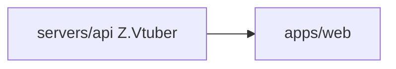

# Z.Vtuber Web

## 技术栈说明

- 语言：TypeScript
- 框架：React 19
- 构建工具：Vite

## 项目模块示意图

## 开发流程

- TDD 开发
- 契约式开发（基于 OpenAPI 契约生成客户端）
- 参考：`docs/engineering/common-rules.md`

## 相关规范引用

- `docs/engineering/common-rules.md`
- `docs/engineering/frontend-rules.md`
