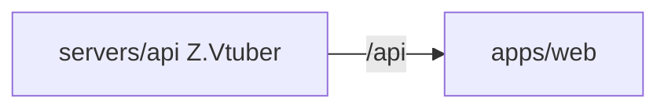

# Z.Vtuber Web

## 技术栈说明

- 语言：TypeScript
- 框架：React 19
- UI 组件库：Ant Design v6（`antd@^6.6` + `@ant-design/icons@^6`，不升级到 v7）
- 构建工具：Vite
- 测试框架：Vitest + React Testing Library

## 项目模块示意图



## 目录结构

```
src/
├── api/
│   ├── client.ts          # API 客户端封装
│   ├── client.test.ts     # API 客户端单元测试
│   ├── schema.d.ts        # OpenAPI 生成的类型定义（B 站，自动生成勿手改）
│   ├── schema-weibo.d.ts  # OpenAPI 生成的类型定义（微博，自动生成勿手改）
│   ├── schema-notify.d.ts # OpenAPI 生成的类型定义（通知，自动生成勿手改）
│   ├── schema-cookie.d.ts # OpenAPI 生成的类型定义（Cookie 服务，自动生成勿手改）
│   ├── schema-recording.d.ts # OpenAPI 生成的类型定义（录播服务，自动生成勿手改）
│   ├── schema-recording-transcript.d.ts # OpenAPI 生成的类型定义（录播转写服务，自动生成勿手改）
│   └── schema-training.d.ts # OpenAPI 生成的类型定义（训练服务，自动生成勿手改）
├── pages/
│   ├── subscription/
│   │   ├── SubscriptionPage.tsx      # 订阅管理页
│   │   └── SubscriptionPage.test.tsx # 订阅管理页测试
│   ├── cookie/
│   │   ├── CookiePage.tsx            # Cookie 管理页（扫码登录化：帐号列表 + 新增帐号弹窗 + QR 码轮询）
│   │   └── CookiePage.test.tsx       # Cookie 管理页测试
│   ├── notification/
│   │   ├── NotificationPage.tsx      # 通知管理页（群维度：group_id/group_name）
│   │   └── NotificationPage.test.tsx # 通知管理页测试
│   ├── recording/
│       ├── RecordingStatusPage.tsx      # 录制状态页（三态 + 实例/场次/文件名 + 轮询刷新 + 历史录播列表/下载/实时音频入口；历史录播列表展示文件名、格式化大小与所属场次标题）
│       └── RecordingStatusPage.test.tsx # 录制状态页测试
│   ├── transcripts/
│       ├── TranscriptsPage.tsx          # 语音转写页（「任务列表」/「设置」两 Tab 切换）
│       ├── TaskListTab.tsx              # 任务列表 Tab（任务状态/场次/模型/进度 + 选中任务 segments，EventSource 实时追加、断开自动重连、限高容器滚动与底部自动跟随、「收起」按钮；识别结果标题行提供「下载 SRT」「下载 ASS」（`<a download>` 指向 `/api/transcripts/task/{taskId}/subtitle`，无片段 `aria-disabled` 置灰）；手动发起识别：场次选项按 `[{主播名}][{大小}] {场次名} - 起 - 止（结束为空显示「进行中」）` 展示 + 模型 enqueue 后刷新任务；场次任务：按主播（显示 `主播名（roomId）`）查看场次/任务 + 失败重试；识别结果标题行另有「播放偏移」设置（秒输入、0.1 精度、可正可负，保存 `Math.round(seconds*1000)` 调 PUT，成功后清空已合并片段并重拉详情、重建 SSE；非法输入或服务端 400 提示「偏移无效」，400 保持原值））
│       ├── TaskListTab.test.tsx         # 任务列表 Tab 测试（含播放/切源/停止、错误态、下载链接与置灰）
│       ├── SegmentAudioPlayer.tsx       # 片段试听控件（共享单例 `<audio>`：片段行播放/停止按钮、当前句高亮、统一控件展示起止时间+摘要+进度+停止；同句再点停止、他句切源、`ended`/`pause` 清高亮；`error`/`play()` 失败提示「音频暂不可用」非阻断；`task.file` 为空按钮置灰；负偏移片段试听区间钳 0（`startMs`/`endMs` 不小于 0，展示时间不变），`segment.end <= 0` 该句按钮置灰提示「音频暂不可用」；切任务/收起/卸载 `pause()` 清空 src）
│       ├── SegmentAudioPlayer.test.tsx  # 试听控件测试
│       ├── SettingsTab.tsx              # 设置 Tab（识别设置：主播开关 + 添加自动识别（从候选主播下拉选择、识别模型必选、未绑定展示「待完善」并引导补选、可删除（二次确认））；模型设置：增删改/启停/识别模型(model)/并发，无默认模型标记）
│       ├── SettingsTab.test.tsx         # 设置 Tab 测试
│       └── TranscriptsPage.test.tsx     # 语音转写页测试
│   └── training/
│       ├── DatasetsPage.tsx             # 数据集页（「音频数据集」/「模型设置」双 Tab；音频 Tab = 数据集选择器 + 导入入口 + 条目列表 + 情绪任务队列；未选中数据集时不显示「从 Transcript 导入」，空态引导导入；模型设置 Tab 仅渲染 ModelSettingsTab）
│       ├── DatasetSelector.tsx          # 数据集下拉 + 新建/重命名/删除（confirm 二次确认）；重名提示「数据集名字已存在」且不生效；首次加载自动选中首个数据集
│       ├── TranscriptImportDialog.tsx   # 从识别结果导入模态弹窗（fixed 半透明遮罩 + flex 居中面板、aria-modal；仅列 status=DONE 任务，确认后调 import 并反馈 imported/skipped，遮罩点击/取消关闭且不请求，**导入进行中忽略遮罩/禁用关闭以保住结果反馈**，400/502 错误提示）
│       ├── DatasetItemList.tsx          # 七字段条目列表 + 「展示类型」列显隐（音频信息六列默认隐藏 / 情绪信息十列默认展示，文本与操作恒展示，展开行 colSpan 动态）+ 情绪列（空态「-」/限宽截断 title）+ 编辑态「重新识别」+ 工具栏「情绪识别」（未多选 `aria-disabled` 置灰）；audioKey 不可编辑；audioUri/text/startMs/endMs 内联编辑保存（保存/批量删除进行中禁用防重复）；勾选多选 + 批量删除 confirm；分组切换 + 分组头全选联动；列宽策略 `table-layout:fixed`+`colgroup`；点击条目行在其正下方展开行插波形
│       ├── DatasetItemWaveform.tsx      # wavesurfer.js 波形试听（url 由 `trainingAudioClipUrl` 拼区间，endMs 空取 startMs+300000 并标注试听预览上限 5 分钟；**加载就绪即自动播放**（区间仍为片段相对时间轴），播放/停止用于重播/中止，切换/卸载经 destroy 不串播；**播放失败**（真实 loader `play()` 返回 Promise，reject 交调用方、不经 onError）非阻断提示「音频暂不可用」并**保留播放/停止控件可重试**；加载失败/uri 不可解析提示「音频不可用」且不阻断列表）
│       ├── waveformLoader.ts            # 波形加载器抽象（可注入/可 mock，单测不依赖真实 wavesurfer）
│       ├── DatasetsPage.test.tsx        # 数据集页测试
│       ├── TranscriptImportDialog.test.tsx # 导入对话框测试
│       ├── DatasetItemList.test.tsx     # 列表编辑/多选/分组/展示类型测试
│       ├── DatasetItemWaveform.test.tsx # 波形 url 拼接与降级测试
│       ├── waveformLoader.test.ts       # 真实 wavesurfer 加载器单测（锁定片段相对时间轴播放区间）
│       ├── ModelSettingsTab.tsx         # 「模型设置」Tab：Providers + Models 双表（新增）
│       ├── ModelSettingsTab.test.tsx    # 模型设置测试
│       ├── ProviderDialog.tsx           # Provider 新增/编辑弹窗（新增）
│       ├── ReRecognizeDialog.tsx        # 单条「重新识别」对话框（新增）
│       ├── ReRecognizeDialog.test.tsx   # 重新识别对话框测试
│       ├── EmotionSubmitDialog.tsx      # 批量「情绪识别」确认框（新增）
│       ├── EmotionSubmitDialog.test.tsx # 情绪识别确认框测试
│       ├── EmotionTaskQueue.tsx         # 情绪识别任务队列区块（新增）
│       └── EmotionTaskQueue.test.tsx    # 任务队列测试
├── utils/
│   └── format.ts          # 共用格式化（formatBytes 人类可读大小 / formatDateTime yyyy-mm-dd-HH-mm / formatPosition ms → m:ss 片段时间定位 / parsePosition `m:ss`、`m:ss.S` → 毫秒，非法返回 null）
├── test/
│   ├── setup.ts           # 测试配置文件（jsdom 补齐 matchMedia/ResizeObserver/scrollTo）
│   └── render.tsx         # 页面测试统一渲染入口 renderWithProviders（zhCN + 主题 + antd App 上下文）
├── components/
│   ├── AppShell.tsx       # 应用外壳（antd Layout + Menu）与菜单图标
│   ├── menuIcons.tsx      # 菜单图标常量
│   └── PageHeader.tsx     # 页面标题区（标题 + 描述 + 右侧 extra）
├── theme.ts               # 暗色 Design Token 唯一入口（ConfigProvider 注入）
├── App.tsx                # 主应用组件（ConfigProvider(zhCN, appTheme) + antd App + AppShell + 路由）
├── App.test.tsx           # 主应用组件测试
├── App.css                # 全局样式
└── main.tsx               # 应用入口
```

## 开发流程

- TDD 开发（先写测试再实现）
- 契约式开发（基于 OpenAPI 契约生成客户端；`codegen` 同时从 `contracts/bilibili-crawler.openapi.yaml`、`contracts/weibo-crawler.openapi.yaml`、`contracts/notifier.openapi.yaml`、`contracts/cookie.openapi.yaml`、`contracts/recording.openapi.yaml`、`contracts/recording-transcript.openapi.yaml` 与 `contracts/training.openapi.yaml` 生成 `schema.d.ts`、`schema-weibo.d.ts`、`schema-notify.d.ts`、`schema-cookie.d.ts`、`schema-recording.d.ts`、`schema-recording-transcript.d.ts` 与 `schema-training.d.ts`）
- Cookie 管理页（`CookiePage.tsx`）：扫码登录化、多平台 — 顶部「新增微博帐号」「新增Bilibili帐号」双按钮分别发起对应平台扫码登录（QR 码轮询 + 自动关闭 + 按平台区分的扫码文案），列表展示平台列/昵称/ID/Session 状态/Cookie 状态/最近刷新时间/最近登录时间，支持按平台删除帐号
- 通知管理页（`NotificationPage.tsx`）：新增绑定弹窗的通知类型为下拉（「bilibili帐号失效通知」→ `bilibili_cookie_invalid`、「微博帐号失效通知」→ `weibo_cookie_invalid`），绑定列表展示类型中文名（存量 `cookie_invalid` 按 bilibili 处理）
- 后台聚合：订阅管理页使用 `listBackstageSubscriptions` 聚合接口展示主播昵称列
- 订阅管理页（`SubscriptionPage.tsx`）：新增订阅表单含平台选择（B站/微博）；选微博时仅填 uid；B 站订阅类型含 `录播`；列表含平台标识列，存量条目默认 B站；取消/创建按平台调用对应接口
- 录制状态页（`RecordingStatusPage.tsx`）：按录播订阅展示三态（未开播/录制中/录制出错）、录制实例 hostname、场次名与文件名；周期轮询刷新；录制中提供实时音频入口，文件提供下载链接；历史录播列表经 `listRecordings` 展示文件名、格式化大小与所属场次标题（不含录制中文件）
- 语音转写页（`TranscriptsPage.tsx`）：「任务列表」Tab 经 `listTranscriptTasks`/`getTranscriptTask` 展示任务与 segments，选中任务用 `openTranscriptStream`（原生 `EventSource`，本仓库首个前端 SSE 用法，断开自动重连）实时追加到限高滚动容器（`maxHeight`+`overflowY:auto`，停留底部时自动跟随），并可「收起」；识别结果由 `SegmentAudioPlayer` 承载——每句可试听该句语音（片段 URL 带 `startMs`/`endMs`，区间与展示起止时间一致、同一时刻只播一句），标题行提供「下载 SRT」「下载 ASS」；标题行另提供「播放偏移」设置（`updateTranscriptTaskOffset` 保存成功后以响应更新任务、清空已合并片段并重拉详情、重建 SSE，识别结果/试听/字幕下载同步生效，保存前本地校验 ±24h 与非数字，失败提示「偏移无效」）；经 `listTranscriptRecordings`+`enqueueTranscript` 手动发起（场次选项 `[{主播名}][{大小}] {场次名} - 开始 - 结束`，进行中显示「进行中」、主播名缺失兜底 roomId）、`getRoomTranscripts`/`retryTranscriptTask` 查看场次任务与失败重试（主播选择器显示 `主播名（roomId）`）；「设置」Tab 经 `getTranscriptSettings`/`setRoomAutoEnqueue(roomId, enable, modelId?)` 管理自动识别开关，添加时从 `getTranscriptCandidateRooms()` 候选主播下拉选择（候选为空禁用并提示），每条设置可 `deleteTranscriptSettings(roomId)` 删除（`window.confirm` 二次确认；未绑定设置的房间展示「待完善」并引导补选），模型经 `listTranscriptModels`/`createTranscriptModel`/`updateTranscriptModel` 管理（`model` 识别模型必填，无默认模型概念，apiKey 不回显）
- 主菜单分组（`App.tsx`）：`menuGroups` 结构（缺省组不渲染分组标题，既有 5 个菜单项渲染不变），新增分组「训练」→「数据集」（`PageKey` `training-datasets`）
- 音频数据集页（`pages/training/DatasetsPage.tsx`）：本期唯一 Tab「音频数据集」；`DatasetSelector` 承载数据集下拉 + 新建/重命名/删除（`window.confirm` 二次确认，重名提示「数据集名字已存在」且不生效，首次加载自动选中首个），**未选中数据集时不显示「从 Transcript 导入」按钮**、空态引导导入；`TranscriptImportDialog` 为**模态弹窗**（全屏 `fixed` 半透明遮罩 + `flex` 居中面板 + 高层级 `z-index`，`aria-modal`；点击遮罩/取消关闭且不请求），仅列 `status=DONE` 任务，确认后导入并反馈 `{imported, skipped}`，400/502 错误提示；`DatasetItemList` 七字段表格（`audioKey` 不可编辑；`table-layout:fixed` + `colgroup` 列宽策略：音频来源/音频地址/音频标识三列限宽 + 省略号截断并以 `title` 悬浮展示完整值，「文本」列不设宽度占满剩余宽度并正常换行，音频类型/开始时间/结束时间/操作短列固定窄宽，整表 `width:100%` + `borderCollapse:collapse`）支持 audioUri/text/startMs/endMs 内联编辑（`m:ss`/`m:ss.S` ↔ 毫秒、`endMs` 可置空、非法时间提示且不保存；「文本」编辑态为多行 `textarea`、`width:100%` 占满单元格，`aria-label="文本"` 不变；音频地址等输入同样 `width:100%` + `box-sizing:border-box`）、勾选多选 + 批量删除（confirm）、分组切换（不分组/按来源/按类型）与分组头全选联动；点击条目行在**该行正下方插入展开行（`colSpan=9`，仍位于表格内）**承载波形、同一时刻仅展开一行（分组模式下同样插在对应条目行之下）；`DatasetItemWaveform` 以 wavesurfer.js 绘制波形（**wavesurfer.js 为本仓库唯一新增 npm 依赖**，经 `waveformLoader.ts` 抽象便于注入/mock），**加载就绪即自动播放**（播放区间仍为片段相对时间轴 `0 → (endMs-startMs)/1000`，「播放/停止」用于重播/中止，切换条目/卸载经 destroy 不串播，`play()` 失败非阻断提示「音频暂不可用」），`endMs` 空取 `startMs+300000` 并标注试听预览上限 5 分钟，加载失败或 `audioUri` 不可解析提示「音频不可用」且不阻断列表操作
- `api/client.ts` training 封装新增 14 个：`listTrainingProviders`/`createTrainingProvider`/`updateTrainingProvider`/`deleteTrainingProvider`、`discoverTrainingModels`、`importTrainingModels`、`listTrainingModels(enabled?)`、`createTrainingModel`/`updateTrainingModel`/`deleteTrainingModel`、`recognizeTrainingDatasetItem(datasetId,itemId,modelId)`、`createEmotionTasks(datasetId,itemIds,modelId)`、`listEmotionTasks({datasetId?,status?,limit?})`（`URLSearchParams` 拼 query）、`retryEmotionTask`；`apiErrorMessage` 增补上述端点的服务端错误码中文化
- 「模型设置」Tab（`ModelSettingsTab.tsx` + `ProviderDialog.tsx`）：Providers 表格（名称/模型类型/Endpoint/API key 状态/操作）新增/编辑弹窗（类型下拉仅 OpenAI/Claude；**编辑时 apiKey 留空即不改且永不回显明文**，仅 `apiKeySet` 展示「已配置/未配置」）；「获取模型」调 `discoverTrainingModels` 勾选后 `importTrainingModels` 并反馈 `{imported, skipped}`（失败经 `apiErrorMessage` 区分「模型服务不可用」/「模型服务响应非法」/「Provider 不存在」；**导入进行中忽略遮罩/禁用关闭以保住结果反馈**）；Models 表格以接口返回 `slug` 展示、手动添加 **Provider 为下拉选择已有 Providers**（**提交中「添加中...」禁用且忽略遮罩防重复提交**）、启停/删除；删除 Provider `confirm` 提示「其下 N 个模型将一并删除」；`providers.length === 0` 时 Providers 区显示引导、`models.length === 0` 时 Models 区显示「暂无模型，请通过「获取模型」导入或手动添加」引导
- 单条「重新识别」（`ReRecognizeDialog.tsx`）：条目编辑态出现「重新识别」按钮 → 模态对话框（model 下拉列 `enabled` 模型并以 slug 展示，无模型提示「请先在模型设置中配置」）；「识别」loading 文案「识别中...」禁用防重复、成功回填「文本」框可继续微调、失败提示且**原文本不被破坏**；「保存」与内联编辑保存**同一 payload**（接收该行内联草稿 `draft`，一并提交 `audioUri/startMs/endMs`，文本以草稿为起点，非法时间本地拦截「时间输入无效」），成功后退出该行内联编辑并同步草稿，杜绝未保存修改被静默丢弃；「取消」不产生任何请求
- 批量「情绪识别」（`EmotionSubmitDialog.tsx` + `EmotionTaskQueue.tsx`）：工具栏「情绪识别」未多选 `aria-disabled` 置灰、多选可用；确认框 model **必选**下拉，确认才提交并反馈 `{created, skipped}`，取消不请求；任务队列区块状态统计 chips + 任务表格（条目/模型 slug/状态/次数/错误/时间）+ FAILED「重试」按钮（**按任务进行中禁用防重复提交**）+ `setInterval` 10s 轮询（**load 请求序号比对，慢响应后到不覆盖新数据**）+ 卸载清理；错误列错误码经 `apiErrorCodeText` 中文化
- 条目列表「展示类型」（`DatasetItemList.tsx`）：位于**分组切换之前**的勾选组——「音频信息」（默认不勾选）控制音频类型/来源/地址/标识/开始/结束六列、「情绪信息」（默认勾选）控制情绪控制权重/描述/开心/愤怒/悲伤/恐惧/厌恶/忧郁/惊讶/平静十列；文本列与操作列恒展示；条件渲染 `<col>/<th>/<td>` 保持列数一致、展开行 `colSpan` 随可见列数动态计算；情绪数值列限窄、描述列截断 + `title`、无数据展示「-」

- `api/client.ts` 另提供 `updateTranscriptTaskOffset(taskId, offsetMs)`（PUT `/transcripts/task/{taskId}/offset`，body `{offsetMs}`，400 抛 `ApiError{status, serverMessage}`）与 URL 构造器 `recordingAudioClipUrl(roomId, fileName, startMs, endMs)`（试听片段 `/api/b/live/{roomId}/recordings/{file}/audio`）与 `transcriptSubtitleUrl(taskId, format)`（字幕下载 `/api/transcripts/task/{taskId}/subtitle?format=srt|ass`），均 `encodeURIComponent` + `URLSearchParams`；训练端点封装 `listTrainingDatasets(type)`、`createTrainingDataset`、`renameTrainingDataset`、`deleteTrainingDataset`、`listTrainingDatasetItems(datasetId, {audioType?, source?})`、`importTrainingDatasetItems(datasetId, {taskId})`、`updateTrainingDatasetItem(datasetId, itemId, patch)`（`endMs: null` 必须序列化为显式 JSON `null` 以置空，缺失字段不改）、`batchDeleteTrainingDatasetItems(datasetId, itemIds)`，以及 URL 构造器 `trainingAudioClipUrl(audioUri, startMs, endMs)`（解析 `b/live/{roomId}/recordings/{file}` 复用 `recordingAudioClipUrl`；`endMs` 空取 `startMs + 300000` 预览上限；uri 空或不可解析返回 `null`），以及错误文案函数 `apiErrorMessage(error, fallback)`——解析 `serverMessage` 中的 `{"error":"..."}` 取出错误码并映射为可读中文（未收录的错误码原样展示，无消息回退 fallback）与 `apiErrorCodeText(code)`（仅有错误码字符串时如任务 `error` 字段复用同一映射）；数据集选择器/列表/导入对话框/任务队列的错误提示统一走它（`serverMessage` 本身保持原始报文，既有调用方按原文解析不受影响）
- 参考：`docs/engineering/common-rules.md`

## UI 规范

- 全站统一使用 Ant Design v6：`Table`/`Form`/`Modal`/`Tabs`/`Select`/`Tag`/`Progress`/`Typography`/`Empty`/`Spin`/`Alert` 等，不新增手工 UI 原语。
- 主题唯一入口 `src/theme.ts`，经 `App.tsx` 的 `ConfigProvider` 注入；页面内不写死颜色/间距。
- 应用外壳 `src/components/AppShell.tsx`（`Layout` + `Menu`）与 `PageHeader.tsx`。
- 反馈走 `App.useApp()` 的 `message`；危险操作走 `App.useApp()` 的 `modal.confirm`（禁止 `window.confirm` 与静态 `message.xxx`）。
- 三态：`Spin`/`Table loading`、`Empty`（带引导）、`Alert`（带重试）；提交中 `Button loading` 防重复。
- 禁止新增「野生」内联 `style` 大对象；仅保留 antd 布局必要 style（margin/固定宽度等）。
- 页面测试统一用 `src/test/render.tsx` 的 `renderWithProviders`（中文 locale + 主题 + antd `App`）。
- 详见 `docs/engineering/frontend-rules.md` 的「UI / 样式规范」。

## 常用命令

```bash
npm run dev        # 启动开发服务器
npm run build      # 构建生产版本
npm run test       # 运行测试
npm run lint       # 代码检查
npm run codegen    # 重新生成 API 类型
```

## API 代理配置

开发环境下，Vite 会将 `/api` 请求代理到后端服务器：
- 本地开发：默认代理到 `http://localhost:5000`
- Aspire 编排：通过 `VITE_API_URL` 环境变量配置

Cookie 服务接口（`/api/cookie/*`）由 cookie 服务独立提供，前端通过代理访问。

## 相关规范引用

- `docs/engineering/common-rules.md`
- `docs/engineering/frontend-rules.md`
