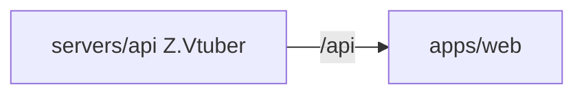

# Z.Vtuber Web

## 技术栈说明

- 语言：TypeScript
- 框架：React 19
- 构建工具：Vite
- 测试框架：Vitest + React Testing Library

## 项目模块示意图



## 目录结构

```
src/
├── api/
│   ├── client.ts          # API 客户端封装
│   ├── client.test.ts     # API 客户端单元测试
│   ├── schema.d.ts        # OpenAPI 生成的类型定义（B 站，自动生成勿手改）
│   ├── schema-weibo.d.ts  # OpenAPI 生成的类型定义（微博，自动生成勿手改）
│   ├── schema-notify.d.ts # OpenAPI 生成的类型定义（通知，自动生成勿手改）
│   └── schema-cookie.d.ts # OpenAPI 生成的类型定义（Cookie 服务，自动生成勿手改）
├── pages/
│   ├── subscription/
│   │   ├── SubscriptionPage.tsx      # 订阅管理页
│   │   └── SubscriptionPage.test.tsx # 订阅管理页测试
│   ├── cookie/
│   │   ├── CookiePage.tsx            # Cookie 管理页（扫码登录化：帐号列表 + 新增帐号弹窗 + QR 码轮询）
│   │   └── CookiePage.test.tsx       # Cookie 管理页测试
│   └── notification/
│       ├── NotificationPage.tsx      # 通知管理页（群维度：group_id/group_name）
│       └── NotificationPage.test.tsx # 通知管理页测试
├── test/
│   └── setup.ts           # 测试配置文件
├── App.tsx                # 主应用组件（布局+路由）
├── App.test.tsx           # 主应用组件测试
├── App.css                # 全局样式
└── main.tsx               # 应用入口
```

## 开发流程

- TDD 开发（先写测试再实现）
- 契约式开发（基于 OpenAPI 契约生成客户端；`codegen` 同时从 `contracts/bilibili-crawler.openapi.yaml`、`contracts/weibo-crawler.openapi.yaml`、`contracts/notifier.openapi.yaml` 与 `contracts/cookie.openapi.yaml` 生成 `schema.d.ts`、`schema-weibo.d.ts`、`schema-notify.d.ts` 与 `schema-cookie.d.ts`）
- Cookie 管理页（`CookiePage.tsx`）：扫码登录化 — 帐号列表展示昵称/MID/Session 状态/Cookie 状态/最近刷新时间/最近登录时间，点击「新增帐号」打开弹窗发起扫码登录（QR 码轮询 + 自动关闭），支持删除帐号
- 后台聚合：订阅管理页使用 `listBackstageSubscriptions` 聚合接口展示主播昵称列
- 订阅管理页（`SubscriptionPage.tsx`）：新增订阅表单含平台选择（B站/微博）；选微博时仅填 uid；列表含平台标识列，存量条目默认 B站；取消/创建按平台调用对应接口
- 参考：`docs/engineering/common-rules.md`

## 常用命令

```bash
npm run dev        # 启动开发服务器
npm run build      # 构建生产版本
npm run test       # 运行测试
npm run lint       # 代码检查
npm run codegen    # 重新生成 API 类型
```

## API 代理配置

开发环境下，Vite 会将 `/api` 请求代理到后端服务器：
- 本地开发：默认代理到 `http://localhost:5000`
- Aspire 编排：通过 `VITE_API_URL` 环境变量配置

Cookie 服务接口（`/api/cookie/*`）由 cookie 服务独立提供，前端通过代理访问。

## 相关规范引用

- `docs/engineering/common-rules.md`
- `docs/engineering/frontend-rules.md`
