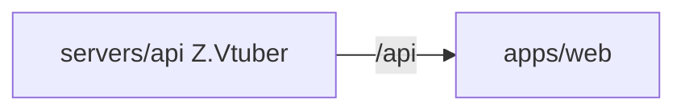

# Z.Vtuber Web

## 技术栈说明

- 语言：TypeScript
- 框架：React 19
- 构建工具：Vite
- 测试框架：Vitest + React Testing Library

## 项目模块示意图



## 目录结构

```
src/
├── api/
│   ├── client.ts          # API 客户端封装
│   ├── client.test.ts     # API 客户端单元测试
│   └── schema.d.ts        # OpenAPI 生成的类型定义（自动生成勿手改）
├── pages/
│   ├── subscription/
│   │   ├── SubscriptionPage.tsx      # 订阅管理页
│   │   └── SubscriptionPage.test.tsx # 订阅管理页测试
│   └── cookie/
│       ├── CookiePage.tsx            # Cookie 管理页
│       └── CookiePage.test.tsx       # Cookie 管理页测试
├── test/
│   └── setup.ts           # 测试配置文件
├── App.tsx                # 主应用组件（布局+路由）
├── App.test.tsx           # 主应用组件测试
├── App.css                # 全局样式
└── main.tsx               # 应用入口
```

## 开发流程

- TDD 开发（先写测试再实现）
- 契约式开发（基于 OpenAPI 契约生成客户端）
- 后台聚合：订阅/Cookie 管理页使用 `listBackstageSubscriptions`/`listBackstageCookies` 聚合接口，分别展示主播/帐号昵称列（昵称缺失显示「暂无资料」），现有增删/录入操作不变
- 参考：`docs/engineering/common-rules.md`

## 常用命令

```bash
npm run dev        # 启动开发服务器
npm run build      # 构建生产版本
npm run test       # 运行测试
npm run lint       # 代码检查
npm run codegen    # 重新生成 API 类型
```

## API 代理配置

开发环境下，Vite 会将 `/api` 请求代理到后端服务器：
- 本地开发：默认代理到 `http://localhost:5000`
- Aspire 编排：通过 `VITE_API_URL` 环境变量配置

## 相关规范引用

- `docs/engineering/common-rules.md`
- `docs/engineering/frontend-rules.md`
