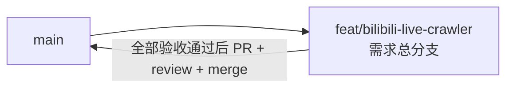

# B站主播数据抓取与订阅服务 - 实现 Plan

**功能名称**: B站主播数据抓取与订阅服务
**关联 PRD**: `docs/product/draft/20260813-bilibili-live-crawler-prd.md`
**关联技术提案**: `docs/engineering/proposals/20260813-proposal-bilibili-live-crawler.md`
**Plan 版本**: v1.0
**创建日期**: 2026-08-14
**作者**: Deliay
**feat-branch**: `feat/bilibili-live-crawler`（需求总分支）

## 1. 概述

本 Plan 基于已通过审核的 PRD v1.0 与技术提案 v1.0 产出，用于指导 B 站主播数据抓取与订阅服务的编码实施。实施全程遵循 `docs/engineering/common-rules.md`：TDD、契约式开发、核心逻辑单元测试覆盖率 ≥ 80%、合并前 review。

### 1.1 实施范围

- **做**：`contracts/` 契约、`infra/apphost` MongoDB 编排、`servers/api` 全部后端模块（Cookie 池、订阅管理、四类抓取任务、持久化、9 个对外 API）、`tests/` 测试项目。
- **不做**：`apps/web` 前端页面（本期无界面）、对外鉴权、多实例分布式调度、历史数据迁移。

### 1.2 现状基线

- `servers/api` 为模板 Web API（仅 `HealthController`），无业务代码、无 MongoDB / Mikibot.Crawler 依赖。
- `infra/apphost` 已编排 api + web，尚未编排 MongoDB。
- `contracts/` 与 `tests/` 目录尚不存在，需新建。

## 2. 分支与提交流程

遵循 `z-git` 规范（仅 merge、禁止 rebase/squash）与 Conventional Commits：

- 本需求开发全程只使用需求总分支 `feat/bilibili-live-crawler` 一个分支：契约、实现、测试全部直接在该分支上提交，不再切开发子分支。
- 全部验收通过后，以 `feat/bilibili-live-crawler` 向 `main` 提 PR，review 通过后 merge（仅 merge，禁止 rebase/squash）；合并 PR 后删除该分支的远端与本地副本，**不删除** `main`。
- 提交信息使用 Conventional Commits（`feat:` / `test:` / `docs:` / `chore:` 等）。

## 3. 实施阶段

按 z-coding 开发流程「契约 → 实现 → 编排 → API 测试 → E2E 测试」推进，每阶段任务均 TDD（先写测试再实现）。各阶段对应提案第 7 章项目结构。

### Phase 0: 契约先行

| # | 任务 | 产出 |
|---|------|------|
| 0.1 | 依据提案 §3.1 编写 OpenAPI 契约，覆盖全部 9 个端点（统一前缀 `/api/b`） | `contracts/bilibili-crawler.openapi.yaml` |
| 0.2 | 契约评审通过后直接提交至需求总分支，作为后续实现与 API 测试的唯一依据 | 契约合入 |

### Phase 1: 基础设施与编排

| # | 任务 | 关键文件 |
|---|------|---------|
| 1.1 | AppHost 引入 `Aspire.Hosting.MongoDB`，增加 MongoDB 资源并向 api 注入连接字符串 | `infra/apphost/AppHost.cs`、`Z.Vtuber.AppHost.csproj` |
| 1.2 | API 引入 `Aspire.MongoDB.Driver`、`Mikibot.Crawler`（锁定 1.0.8），注册 MongoClient 与 `AddBilibiliCrawlers()` | `servers/api/Z.Vtuber.csproj`、`Program.cs` |
| 1.3 | 增加 `BilibiliCrawler__*` 配置节（4 个周期配置，默认值同提案 §9.2） | `servers/api/appsettings.json` |

### Phase 2: 持久化层与基础模块（TDD）

| # | 任务 | 测试重点 |
|---|------|---------|
| 2.1 | Mongo 数据访问层：6 个集合的读写与索引初始化（`dynamic_id`、`mid` 唯一索引等，提案 §4.1） | Testcontainers 集成测试：唯一索引去重、分页查询 |
| 2.2 | `ICookiePoolService`：录入、`Next()` 按 `last_used_at` round-robin、`MarkOffline()` | 单元测试：轮询顺序、无有效 Cookie 抛可观测异常 |
| 2.3 | `ISubscriptionService`：订阅增删查，唯一索引保证幂等 | 单元 + 集成测试：重复订阅不产生重复记录 |

### Phase 3: 抓取调度与定时任务（TDD）

| # | 任务 | 测试重点 |
|---|------|---------|
| 3.1 | 调度基础设施：`BackgroundService + PeriodicTimer` 主循环、per-key `SemaphoreSlim` 抓取锁（同对象串行等待、异对象并行、单次 HTTP 10s 超时释放锁） | 单元测试：锁串行化语义 |
| 3.2 | `CookieProbeJob`（5 分钟）：`GetNavInfoV2` 探活、失败置 `offline`、全失效告警日志（不含 Cookie 明文） | 单元测试：探活下线逻辑 |
| 3.3 | `AccountInfoJob`（24 小时）：抓 `space/acc/info` 入 `bilibili_account_basic_info`，提取冗余 `room_id` | 样例报文 mock 单测 |
| 3.4 | `LiveStatusJob`（15 秒）：末条记录比对去重 + 场次 UUID 状态机（提案实现点 3 状态图），room_id 取自最新账号信息 | 单元测试：状态机全部分支（首抓在播/未播、标题变化、开播/下播切换、跳过） |
| 3.5 | `SpaceTimelineJob`（30 秒）：`GetAsync` 封装 dynamic/space 接口，整页命中停止翻页、断档续抓、唯一索引 + upsert 去重 | 单元测试：翻页终止条件、断档续抓；集成测试：去重 |

### Phase 4: 直播事件长连接与 SSE（TDD）

| # | 任务 | 测试重点 |
|---|------|---------|
| 4.1 | `DanmakuClient` 长连接管理：按订阅直播间建连、`CommandSubscriber` 事件归一化、watchdog 自动重连 | 单元测试：事件归一化（danmaku/gift/super_chat 等） |
| 4.2 | 事件直写 Mongo（含 `occurred_at`、当前 `live_session_id`），持久化不依赖 EventBus | 集成测试：事件入库 |
| 4.3 | `ILiveEventBus` 订阅门控：仅 roomId 有活跃 SSE 订阅才创建/写入 Channel，末订阅断开即移除；`RequestAborted` + `finally` 双保险注销 | 单元测试：无订阅不写入、末订阅断开移除 Channel、计数无泄漏 |
| 4.4 | SSE 端点流式响应，仅推送连接建立之后的事件 | API 测试覆盖 |

### Phase 5: 对外 API（TDD）

| # | 任务 | 测试重点 |
|---|------|---------|
| 5.1 | `BilibiliSubscriptionController`（接口 1-3） | API 测试：幂等订阅、404 |
| 5.2 | `BilibiliUserController`（接口 4、9） | API 测试：404、分页 |
| 5.3 | `BilibiliLiveController`（接口 5-8，含 SSE 与时间段查询） | API 测试：分页、400 时间范围非法、SSE 仅推新事件 |

### Phase 6: 编排验证与测试收口

| # | 任务 | 验收 |
|---|------|------|
| 6.1 | z-aspire-orchestrator 编排验证：AppHost 一键拉起 MongoDB + api + web | 本地 `dotnet run` 通过 |
| 6.2 | z-test 覆盖契约 9 端点的 API 测试 | 全部通过 |
| 6.3 | E2E 测试：订阅主播 → 抓取入库 → 查询/SSE 消费全链路 | 通过 |
| 6.4 | 覆盖率核验：核心逻辑 ≥ 80%（状态机、断点续抓、round-robin、EventBus 门控、per-key 锁） | 达标 |
| 6.5 | 更新 `servers/api/AGENTS.md`、`infra/apphost` 相关说明，反映新增模块与依赖 | 文档同步 |

## 4. 并行策略

- 本需求仅 `servers` 一个实现子项目，按 `write-implementation.md` 以 subagent 委托开发；阶段内可并行的部分：Phase 2 各模块相互独立可并行，Phase 3 的 3.3/3.4/3.5 在 3.1 调度基础设施完成后可并行。
- Phase 0 契约必须先于 Phase 5 完成；Phase 1 是所有后续阶段的前置。
- 每阶段完成后更新 todo 并提交（实现与测试分开提交）。

## 5. 验收对照

| PRD 功能点 | 实现任务 | 验证方式 |
|-----------|---------|---------|
| 1. Cookie 池管理与自动探活 | 2.2、3.2 | 单测 + API 测试 |
| 2. 订阅主播列表管理 | 2.3、5.1 | 单测 + API 测试 |
| 3. 账号基本信息抓取 | 3.3 | 单测 + 集成测试 |
| 4. 直播状态抓取与场次划分 | 3.4 | 状态机单测全覆盖 |
| 5. 直播间事件抓取 | 4.1、4.2 | 单测 + 集成测试 |
| 6. 空间动态抓取与断点续抓 | 3.5 | 单测 + 集成测试 |
| 7. 对外数据服务（6 项能力 / 9 端点） | Phase 5 | API 测试 + E2E |
| 非功能：同对象抓取串行化 | 3.1 | per-key 锁单测 |
| 非功能：Cookie 不明文泄露 | 3.2 日志约束 | 代码评审检查 |

## 6. 风险与依赖

| 项 | 说明 | 应对 |
|---|------|------|
| Mikibot.Crawler API 变动 | 上游包升级风险 | csproj 锁定 1.0.8，升级显式回归 |
| B 站 dynamic/space 接口分页游标 | 库内未封装，需手动实现 | 以样例报文 mock + 集成测试验证 |
| B 站接口不可直连 CI | 外部依赖 | 全部以录制样例报文 mock，不做 CI 直连 |
| 进程重启状态丢失 | 内存状态不可靠 | 直播状态比对一律取 Mongo 末条记录 |

## 7. 相关文档

- PRD：`docs/product/draft/20260813-bilibili-live-crawler-prd.md`
- 技术提案：`docs/engineering/proposals/20260813-proposal-bilibili-live-crawler.md`
- 开发规范：`docs/engineering/common-rules.md`、`docs/engineering/backend-rules.md`
