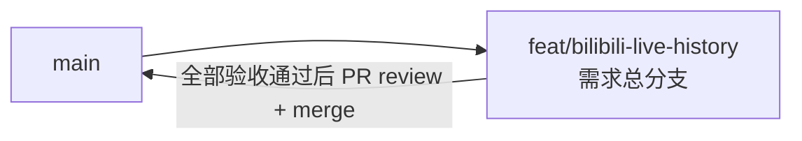

# 直播场次历史查询与分页排序统一 - 实现 Plan

**功能名称**: 直播场次历史查询与分页排序统一
**关联 PRD**: `docs/product/draft/20260815-bilibili-live-history-prd.md`
**关联技术提案**: `docs/engineering/proposals/20260815-proposal-bilibili-live-history.md`（v1.1，已按评审意见修订：空间动态排序使用已有 `DynamicId` 倒序，不新增 `PublishedAt`）
**Plan 版本**: v1.0
**创建日期**: 2026-08-15
**作者**: Deliay
**feat-branch**: `feat/bilibili-live-history`（需求总分支）

## 1. 概述

本 Plan 基于已通过审核的 PRD v1.0 与技术提案 v1.1 产出，用于指导直播场次历史查询与分页排序统一的编码实施。实施全程遵循 `docs/engineering/common-rules.md`：TDD、契约式开发、核心逻辑单元测试覆盖率 ≥ 80%、合并前 review。

### 1.1 实施范围

- **做**：
  - `contracts/bilibili-crawler.openapi.yaml` 新增 `GET /api/b/live/{roomId}/history` 契约，并补充空间动态分页排序语义说明。
  - `LiveSessionRepository` 分页查询统一为 `(Total, Items)` 的 `GetPageAsync` 签名。
  - `SpaceTimelineRepository.GetPageAsync` 排序从 `FetchedAt` 倒序改为 `DynamicId` 倒序（数值语义），`MongoDbInitializer` 补充 `Mid asc + DynamicId desc` 复合索引。
  - `BilibiliLiveController` 新增 `GET {roomId}/history` 端点。
  - 三个仓储（`LiveSession` / `LiveStatus` / `SpaceTimeline`）分页排序的真实断言测试补齐。
- **不做**：抓取链路与数据写入逻辑、实体 schema 变更、`apps/web` 前端、鉴权、非分页端点（`event/range` 等）。

### 1.2 现状基线

- `LiveSessionRepository` 已有 `GetByRoomIdAsync`（仅返回 items，仅被测试使用），`Program.cs` 已注册单例；`bilibili_live_session` 已有 `RoomId asc + StartDate desc` 复合索引（`MongoDbInitializer.cs`），新接口零新增索引。
- `SpaceTimelineRepository.GetPageAsync` 当前按 `FetchedAt` 倒序（`SpaceTimelineRepository.cs:51-62`）；`SpaceTimelineRecord.DynamicId` 已随抓取入库。
- `LiveStatusRepository.GetPageAsync` 已按 `CreatedAt` 倒序，无需改动，仅补排序断言测试。
- `tests/Z.Vtuber.Tests` 已有 `MongoDbFixture`（Testcontainers）与各仓储测试骨架。

## 2. 分支与提交流程

遵循 `z-git` 规范（仅 merge、禁止 rebase/squash）与 Conventional Commits：

- 本需求开发全程只使用需求总分支 `feat/bilibili-live-history`：契约、实现、测试全部直接在该分支上提交，不再切开发子分支。
- 需求总 PR 已存在（`https://github.com/Deliay/z-vtuber/pull/6`），后续提交直接推送到该分支更新 PR；全部验收通过后 review 通过即 merge（仅 merge，禁止 rebase/squash）。
- 提交信息使用 Conventional Commits（`feat:` / `test:` / `docs:` / `chore:` 等），实现与测试分开提交。

## 3. 实施阶段

按 z-coding 开发流程「契约 → 实现 → 编排 → API 测试」推进，全程 TDD（先写测试再实现）。

### Phase 0: 契约先行

| # | 任务 | 产出 |
|---|------|------|
| 0.1 | 在 `contracts/bilibili-crawler.openapi.yaml` 新增 `GET /api/b/live/{roomId}/history`：`page`（默认 1，≥1）、`pageSize`（默认 20，1–100），响应 `LiveSessionHistoryPage`（`total` / `page` / `pageSize` / `items[]`），item schema 含 `liveId`、`roomId`、`title`、`coverUrl`、`parentArea`、`area`、`isFinish`、`startDate`、`stopDate`（可空）、六项场次指标；注明按 `startDate` 倒序 | 契约更新 |
| 0.2 | 在既有 `GET /api/b/user/{mid}/space` 契约中补充排序语义说明：按 `dynamicId` 倒序（B 站动态 ID 单调递增，倒序即创建时间倒序），响应结构与分页参数不变 | 契约更新 |

### Phase 1: 持久化层（TDD）

| # | 任务 | 关键文件 | 测试重点 |
|---|------|---------|---------|
| 1.1 | `LiveSessionRepository` 增加 `GetPageAsync(long roomId, int page, int pageSize, CancellationToken)` 返回 `(long Total, IReadOnlyList<LiveSessionRecord> Items)`：过滤 `RoomId`、`StartDate` 倒序、Skip/Limit 分页；移除/替换仅测试使用的 `GetByRoomIdAsync` | `servers/api/Persistence/LiveSessionRepository.cs` | 集成测试：乱序插入断言严格倒序、翻页不重不漏、total 正确 |
| 1.2 | `SpaceTimelineRepository.GetPageAsync` 排序从 `FetchedAt` 倒序改为 `DynamicId` 倒序（数值语义，如聚合 `$toLong` 转换后排序，以测试断言为准） | `servers/api/Persistence/SpaceTimelineRepository.cs` | 集成测试：不同长度 `DynamicId`（如 `"99"` 与 `"100"`）按数值序而非字典序排列 |
| 1.3 | `MongoDbInitializer` 为 `bilibili_user_space_timeline` 补充 `Mid asc + DynamicId desc` 复合索引 | `servers/api/Persistence/MongoDbInitializer.cs` | 索引创建不报错、与既有唯一索引共存 |
| 1.4 | `LiveStatusRepository.GetPageAsync` 补充排序断言（行为不变，仅补验证） | `tests/Z.Vtuber.Tests/` | 乱序插入断言 `CreatedAt` 严格倒序 |

### Phase 2: 对外 API（TDD）

| # | 任务 | 关键文件 | 测试重点 |
|---|------|---------|---------|
| 2.1 | `BilibiliLiveController` 注入 `LiveSessionRepository`，新增 `GetHistory(long roomId, [FromQuery] int page = 1, [FromQuery] int pageSize = 20)`：`page = Math.Max(1, page)`、`pageSize = Math.Clamp(pageSize, 1, 100)`，返回 `Ok(new { total, page, pageSize, items })`，item 投影沿用既有匿名对象/`ToDto` 风格 | `servers/api/Controllers/BilibiliLiveController.cs` | API 测试：默认参数、参数 clamp（负数/0/超大 pageSize）、空列表、进行中场次（`isFinish=false`、`stopDate=null`） |
| 2.2 | 既有 `LiveSessionRepositoryTests` 适配新签名（`GetByRoomIdAsync` → `GetPageAsync`） | `tests/Z.Vtuber.Tests/LiveSessionRepositoryTests.cs` | 回归通过 |

### Phase 3: 编排验证与测试收口

| # | 任务 | 验收 |
|---|------|------|
| 3.1 | z-aspire-orchestrator 编排验证：AppHost 拉起 MongoDB + api，新端点可访问 | 本地 `dotnet run` 通过 |
| 3.2 | z-test 覆盖 `GET /api/b/live/{roomId}/history` 与 `GET /api/b/user/{mid}/space` 的 API 测试 | 全部通过 |
| 3.3 | 覆盖率核验：核心逻辑 ≥ 80%（本需求核心为仓储分页与排序、Controller 参数 clamp） | 达标 |
| 3.4 | 全量回归 `dotnet test` | 全部通过 |
| 3.5 | 如模块结构有变化，同步更新 `servers/api/AGENTS.md` | 文档同步 |

## 4. 并行策略

- 本需求仅 `servers/api` 一个实现子项目，按 `write-implementation.md` 以 subagent 委托开发。
- Phase 0 契约必须先于 Phase 2 完成；Phase 1 的 1.1/1.2/1.3 相互独立可在同一委托内顺序完成（均属 `Persistence/`，改动小，无需再拆并行）。
- 每阶段完成后更新 todo 并提交（实现与测试分开提交）。

## 5. 验收对照

| PRD 功能点 | 实现任务 | 验证方式 |
|-----------|---------|---------|
| 1. 直播间历史场次分页查询（开播时间倒序、进行中标识、空列表、参数边界） | 0.1、1.1、2.1 | 集成测试 + API 测试 |
| 2. 分页列表排序统一为创建时间倒序 | 0.2、1.2、1.4 | 集成测试（含不同长度 `DynamicId` 数值序）+ API 回归 |
| 非功能：翻页代价不随总量线性增长 | 1.1（复用 `RoomId+StartDate desc` 索引）、1.3（补充 `Mid+DynamicId desc` 索引） | 索引覆盖查询，代码评审检查 |
| 非功能：兼容既有分页参数与响应结构 | 0.2、1.2 | 契约评审 + 回归测试 |

## 6. 风险与依赖

| 项 | 说明 | 应对 |
|---|------|------|
| `DynamicId` 字符串数值排序 | 字典序与数值序在不同长度数字串上不一致（`"99"` > `"100"`） | 查询时按数值语义排序（如 `$toLong`），并以不同长度用例测试断言兜底 |
| 既有测试依赖旧签名 | `GetByRoomIdAsync` 仅被测试使用 | Phase 2.2 同步适配，回归验证 |
| 历史数据排序键完整性 | `DynamicId` 已随抓取入库，无需迁移 | 若存在异常非数值 `DynamicId`，以测试暴露后再评估 |
| 契约先行约束 | 实现必须严格对齐契约 | Phase 0 先行评审，API 测试以契约为唯一依据 |

## 7. 相关文档

- PRD：`docs/product/draft/20260815-bilibili-live-history-prd.md`
- 技术提案：`docs/engineering/proposals/20260815-proposal-bilibili-live-history.md`
- 契约：`contracts/bilibili-crawler.openapi.yaml`
- 开发规范：`docs/engineering/common-rules.md`、`docs/engineering/backend-rules.md`
- 上一期 Plan：`docs/engineering/plans/20260814-plan-bilibili-live-crawler.md`
