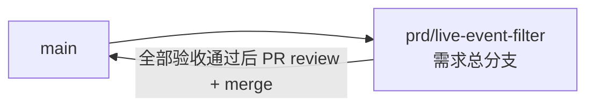

# 直播事件查询与订阅筛选 - 实现 Plan

**功能名称**: 直播事件查询与订阅筛选
**关联 PRD**: `docs/product/draft/20260815-live-event-filter-prd.md`
**关联技术提案**: `docs/engineering/proposals/20260815-proposal-live-event-filter.md`（v1.0，已审核通过）
**Plan 版本**: v1.0
**创建日期**: 2026-08-15
**作者**: Deliay
**feat-branch**: `prd/live-event-filter`（需求总分支）

## 1. 概述

本 Plan 基于已通过审核的 PRD v1.0 与技术提案 v1.0 产出，指导直播事件查询与订阅筛选的编码实施。实施全程遵循 `docs/engineering/common-rules.md`：TDD、契约式开发、核心逻辑单元测试覆盖率 ≥ 80%、合并前 review。

### 1.1 实施范围

- **做**：
  - `contracts/bilibili-crawler.openapi.yaml`：`event/range` 新增 `Page`/`PageSize`/`type` 参数，`startedAt`/`endedAt` 由必填改为可选（复用共享参数），响应由 `LiveEventList` 调整为分页 schema `LiveEventPage`；`event/subscribe` 新增 `type` 参数。
  - `LiveEventRepository` 新增 `GetPageAsync`（`RoomId` + 类型 `$in` + 可选 `OccurredAt` 范围 + Count/Find 分页），取代 `GetRangeAsync`。
  - `BilibiliLiveController`：`event/range` 端点透传与校验新参数（分页钳制、type 去重去空、`startedAt > endedAt` 返回 400）；`event/subscribe` 端点在 SSE 循环内按 `HashSet<string>` 过滤。
  - 仓储层集成测试、Controller 测试与订阅过滤测试补齐。
- **不做**：事件归一化规则变更（`DanmakuEventNormalizer` 不动）、SSE 推送格式变更、新增索引、前端改动、鉴权。

### 1.2 现状基线

- `BilibiliLiveController.GetEventsRange`（`servers/api/Controllers/BilibiliLiveController.cs:67-81`）：`startedAt`/`endedAt` 为必填 `DateTime`，`endedAt < startedAt` 时返回 400（文案 `endedAt must not be earlier than startedAt.`），响应为 `{ items }`。
- `BilibiliLiveController.Subscribe`（`servers/api/Controllers/BilibiliLiveController.cs:83-106`）：订阅 `ILiveEventBus` 后全量写 SSE，`finally` 中取消订阅，无可过滤参数。
- `LiveEventRepository.GetRangeAsync`（`servers/api/Persistence/LiveEventRepository.cs:14-23`）：`RoomId + OccurredAt` 范围一次性 `ToListAsync`，仅此一个调用点。
- 同 Controller 的 `state/all`、`history` 端点已落地目标模式：`[FromQuery] DateTime?` + `BilibiliUserController.BadTimeRange` 校验（文案 `startedAt must not be later than endedAt.`）+ `Math.Max(1, page)` / `Math.Clamp(pageSize, 1, 100)` 钳制 + `{ total, page, pageSize, items }` 分页响应，直接对齐即可。
- 契约 `contracts/bilibili-crawler.openapi.yaml`：共享参数 `Page`/`PageSize`/`StartedAt`/`EndedAt` 已存在（:217-249），`StartedAt`/`EndedAt` 描述尚未涵盖 `event/range` 语义；`event/range`（:174-200）当前内联必填时间参数、`event/subscribe`（:161-173）无 `type` 参数；`LiveEventList` schema（:433-439）仅被 `event/range` 引用，可直接改造为分页结构。
- 集合 `bilibili_live_event` 既有 `RoomId asc + OccurredAt asc` 索引，无 schema 变更、无新增索引。
- `tests/Z.Vtuber.Tests` 已有 `MongoDbFixture`（Testcontainers）、`BilibiliLiveControllerTests`（Controller 直调 + JsonElement 断言模式）、`LiveEventBusTests`，无 `LiveEventRepositoryTests`。

## 2. 分支与提交流程

遵循 `z-git` 规范（仅 merge、禁止 rebase/squash）与 Conventional Commits：

- 本需求开发全程只使用需求总分支 `prd/live-event-filter`：契约、实现、测试全部直接在该分支上提交，不再切开发子分支。
- 需求总 PR 已存在（`https://github.com/Deliay/z-vtuber/pull/12`），后续提交直接推送到该分支更新 PR；全部验收通过后 review 通过即 merge（仅 merge，禁止 rebase/squash）。
- 提交信息使用 Conventional Commits（`feat:` / `test:` / `docs:` / `chore:` 等），实现与测试分开提交。

## 3. 实施阶段

按 z-coding 开发流程「契约 → 实现 → 编排 → API 测试」推进，全程 TDD（先写测试再实现）。

### Phase 0: 契约先行

| # | 任务 | 产出 |
|---|------|------|
| 0.1 | `contracts/bilibili-crawler.openapi.yaml` 新增共享 query 参数 `EventType`（`name: type`，array[string]，可选，`style: form, explode: true`，描述：事件类型筛选，可重复传入如 `type=danmaku&type=gift`，多值为合集，不传返回全部类型） | 契约更新 |
| 0.2 | `event/range` 端点：删除内联必填 `startedAt`/`endedAt`，改为引用共享参数 `Page`/`PageSize`/`EventType`/`StartedAt`/`EndedAt`；summary/description 注明按发生时间（occurredAt）升序分页、时间含起止边界、`startedAt > endedAt` 返回 400 | 契约更新 |
| 0.3 | 响应 schema：`LiveEventList` 改造为 `LiveEventPage`（`total`/`page`/`pageSize`/`items`，items 引用 `LiveEvent` 不变），与 `LiveStatePage` 同构；400 描述补充「时间范围非法」语义不变 | 契约更新 |
| 0.4 | `event/subscribe` 端点：参数追加 `EventType` 引用，description 注明传入时仅推送匹配类型事件、不传推送全部 | 契约更新 |
| 0.5 | 共享参数 `StartedAt`/`EndedAt` 描述补充 `event/range` 按事件发生时间（occurredAt）过滤的语义 | 契约更新 |

### Phase 1: 持久化层（TDD）

| # | 任务 | 关键文件 | 测试重点 |
|---|------|---------|---------|
| 1.1 | `LiveEventRepository` 新增 `GetPageAsync(long roomId, int page, int pageSize, IReadOnlyCollection<string>? types = null, DateTime? startedAt = null, DateTime? endedAt = null, CancellationToken ct = default)` 返回 `(long Total, IReadOnlyList<LiveEventRecord> Items)`：`Eq(RoomId)` 恒有，`types` 非空叠加 `In(Type, types)`，`startedAt`/`endedAt` 非空叠加 `Gte/Lte(OccurredAt)`；`CountDocuments` 与 `Find` 共用同一过滤条件，`SortBy(OccurredAt)` 升序 + `Skip/Limit`；删除被取代的 `GetRangeAsync` | `servers/api/Persistence/LiveEventRepository.cs` | 新建 `tests/Z.Vtuber.Tests/LiveEventRepositoryTests.cs`（Testcontainers）：单类型/多类型合集过滤、不含类型返回全部、时间含起止边界、单侧边界、无时间限制、范围内翻页不重不漏、total 与 items 一致、空结果 total=0 |

### Phase 2: 对外 API（TDD）

| # | 任务 | 关键文件 | 测试重点 |
|---|------|---------|---------|
| 2.1 | `GetEventsRange` 签名改为 `(long roomId, [FromQuery] int page = 1, [FromQuery] int pageSize = 20, [FromQuery] string[]? type = null, [FromQuery] DateTime? startedAt = null, [FromQuery] DateTime? endedAt = null, CancellationToken ct = default)`：复用 `BilibiliUserController.BadTimeRange` 校验（400 文案统一为 `startedAt must not be later than endedAt.`，原文案废弃）；`page`/`pageSize` 钳制与其他端点一致；`type` 去重（`StringComparer.Ordinal`）并剔除 null/空白，空集合按未传入处理；调 `GetPageAsync` 返回 `{ total, page, pageSize, items }` | `servers/api/Controllers/BilibiliLiveController.cs` | `BilibiliLiveControllerTests` 增补：分页结构返回、pageSize 钳制 1-100、超页返回空列表 total 保真、单/多 type 筛选、重复 type 去重、空串 type 忽略、单侧时间边界、`startedAt > endedAt` → 400 |
| 2.2 | `Subscribe` 新增 `[FromQuery] string[]? type = null`：同样去重去空后构建 `HashSet<string>`（`StringComparer.Ordinal`）；SSE 循环内集合非空且 `!set.Contains(liveEvent.Type)` 时 `continue`；其余逻辑（`event:`/`data:` 写出、`finally` 取消订阅）不变 | `servers/api/Controllers/BilibiliLiveController.cs` | Controller 测试（`DefaultHttpContext` + `MemoryStream` 响应体 + `CancellationTokenSource`）：订阅后发布多类型事件，传 type 时响应流仅含匹配类型的 `event:` 行、不传 type 时全量推送、SSE 格式不变 |

### Phase 3: 编排验证与测试收口

| # | 任务 | 验收 |
|---|------|------|
| 3.1 | z-aspire-orchestrator 编排验证：AppHost 拉起 MongoDB + api，两端点可访问 | 本地 `dotnet run` 通过 |
| 3.2 | z-test 覆盖 `event/range`（多 type 筛选、可选日期组合、分页翻页、`startedAt > endedAt` → 400、不传新参数兼容性回归）与 `event/subscribe`（type 过滤推送、不传 type 回归） | 全部通过 |
| 3.3 | 覆盖率核验：核心逻辑 ≥ 80%（组合过滤、参数去重去空、时间校验、SSE 过滤） | 达标 |
| 3.4 | 全量回归 `dotnet test` | 全部通过 |
| 3.5 | 同步更新 `servers/api/AGENTS.md` 模块结构描述（`event/range` 分页 + 类型筛选、`event/subscribe` 类型过滤） | 文档同步 |

## 4. 并行策略

- 本需求仅 `servers/api` 一个实现子项目，按 `write-implementation.md` 以 subagent 委托开发。
- Phase 0 契约必须先于 Phase 2 完成；Phase 1（仓储）与 Phase 2 的 2.2（SSE 过滤，仅涉及 Controller）相互独立，可拆分两个委托并行；2.1 依赖 Phase 1 完成。
- 每阶段完成后更新 todo 并提交（实现与测试分开提交）。

## 5. 验收对照

| PRD 功能点 | 实现任务 | 验证方式 |
|-----------|---------|---------|
| 功能点 1：event/range 支持分页 | 0.2、0.3、1.1、2.1 | 仓储集成测试（翻页不重不漏、total 真实）+ Controller 测试（钳制、超页空列表）+ API 测试 |
| 功能点 2：event/range 类型筛选与可选日期范围 | 0.1、0.2、0.5、1.1、2.1 | 仓储集成测试（合集过滤、含边界、单侧边界）+ Controller 测试（去重去空、400）+ API 测试 |
| 功能点 3：event/subscribe 多类型过滤 | 0.4、2.2 | Controller SSE 测试（匹配/全量/格式不变）+ API 测试 |
| 非功能：分页与筛选不退化为全量扫描 | 1.1（仓储层 `$in` + 索引范围过滤） | 索引覆盖查询，代码评审检查 |
| 非功能：兼容性（subscribe 不传 type 行为不变、range 既有传参兼容） | 0.2、0.4、2.1、2.2 | 契约评审 + 兼容性回归测试 |

## 6. 风险与依赖

| 项 | 说明 | 应对 |
|---|------|------|
| `event/range` 响应结构破坏性变更 | `{ items }` → 分页结构，调用方需适配 | PRD 已明确为分页改造，契约评审把关，items 内字段不变 |
| `type` 非法值 | 类型为开放集合（未映射命令回退小写名），无法穷举校验 | 按合集匹配不到即空结果/无推送，不报错（提案 6.1 决策），测试锁定行为 |
| SSE 过滤测试复杂度 | `Subscribe` 直接写 `HttpResponse` | 测试用 `DefaultHttpContext` + `MemoryStream` + 取消令牌驱动，参考既有 Controller 直调测试模式 |
| 契约先行约束 | 实现必须严格对齐契约（`explode: true` 防逗号拼接误解析） | Phase 0 先行，API 测试以契约为唯一依据 |

## 7. 相关文档

- PRD：`docs/product/draft/20260815-live-event-filter-prd.md`
- 技术提案：`docs/engineering/proposals/20260815-proposal-live-event-filter.md`
- 契约：`contracts/bilibili-crawler.openapi.yaml`
- 开发规范：`docs/engineering/common-rules.md`、`docs/engineering/backend-rules.md`
- 上一期 Plan：`docs/engineering/plans/20260815-plan-pagination-time-range.md`
