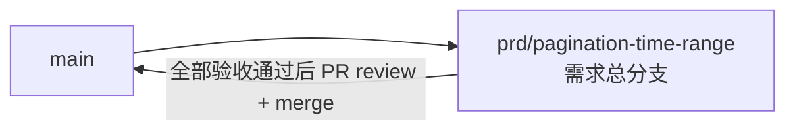

# 分页列表时间范围筛选 - 实现 Plan

**功能名称**: 分页列表时间范围筛选
**关联 PRD**: `docs/product/draft/20260815-pagination-time-range-prd.md`
**关联技术提案**: `docs/engineering/proposals/20260815-proposal-pagination-time-range.md`（v1.0，已审核通过）
**Plan 版本**: v1.0
**创建日期**: 2026-08-15
**作者**: Deliay
**feat-branch**: `prd/pagination-time-range`（需求总分支）

## 1. 概述

本 Plan 基于已通过审核的 PRD v1.0 与技术提案 v1.0 产出，指导分页列表时间范围筛选的编码实施。实施全程遵循 `docs/engineering/common-rules.md`：TDD、契约式开发、核心逻辑单元测试覆盖率 ≥ 80%、合并前 review。

审核节点补充了一项遗漏需求（本 Plan 一并覆盖，见 1.3）：**直播状态发生变化（开播/下播）时，`bilibili_live_session` 需同步写入/更新场次记录**，目前状态机只写 `bilibili_live_status` 并生成场次 UUID，场次集合完全依赖 `AccountInfoCrawler` 从 B 站频道接口同步，开播中的场次无法及时出现在 `GET /api/b/live/{roomId}/history` 中。

### 1.1 实施范围

- **做**：
  - `contracts/bilibili-crawler.openapi.yaml`：3 个分页端点统一新增可选 `startedAt` / `endedAt` 共享参数及语义说明。
  - `SpaceTimelineRecord` 新增 `PubTs` 字段；`SpaceTimelineJob` 入库时从原始 JSON 提取 `pub_ts`；`MongoDbInitializer` 新增 `Mid + PubTs desc` 索引并幂等回填存量数据。
  - `SpaceTimelineRepository` / `LiveStatusRepository` / `LiveSessionRepository` 分页方法增加时间范围过滤。
  - `BilibiliUserController` / `BilibiliLiveController` 透传并校验时间参数（`startedAt > endedAt` 返回 400）。
  - **场次写入补充**：直播状态变化时由 `LiveStatusJob` 直接维护 `bilibili_live_session`（开播新建、下播关闭），`AccountInfoCrawler` 同步时按时间邻近合并去重。
  - 仓储层、状态机、Job 与 API 层测试补齐。
- **不做**：前端筛选 UI、非分页端点（`event/range` 保持原样）、排序语义变更、鉴权。

### 1.2 现状基线

- `SpaceTimelineRepository.GetPageAsync` 已按 `DynamicId` 数值倒序分页（`servers/api/Persistence/SpaceTimelineRepository.cs:51-70`），`SpaceTimelineRecord` 尚无 `PubTs` 字段。
- `LiveStatusRepository.GetPageAsync` 已按 `CreatedAt` 倒序，`LiveSessionRepository.GetPageAsync` 已按 `StartDate` 倒序，均无时间过滤参数。
- `LiveStatusStateMachine.Decide`（`servers/api/Services/LiveStatusStateMachine.cs`）在首次抓取开播或 `false→true` 时生成新场次 UUID，但仅写入 `LiveStatusRecord.LiveSessionId`；`LiveSessionTracker` 仅作内存态供弹幕事件归属。
- `LiveSessionRecord` 仅由 `AccountInfoCrawler.PersistLiveSessionsAsync`（`servers/api/Services/AccountInfoCrawler.cs:70-108`）从 B 站频道接口 `lives` 数组 upsert（按 B 站 `liveId` 去重）。
- `bilibili_live_session` 已有 `LiveId` 唯一索引与 `RoomId + StartDate desc` 复合索引；`bilibili_user_space_timeline` 已有 `DynamicId` 唯一、`Mid+FetchedAt desc`、`Mid+DynamicId desc` 索引（`MongoDbInitializer.cs`）。
- `tests/Z.Vtuber.Tests` 已有 `MongoDbFixture`（Testcontainers）、`LiveStatusStateMachineTests` 与各仓储测试骨架。

### 1.3 补充需求：直播状态变化时写入场次

| 状态迁移 | 现状 | 补充后行为 |
|---------|------|-----------|
| 无记录/下播 → 开播（生成新场次 UUID） | 仅写 `LiveStatusRecord` | 同时向 `bilibili_live_session` 插入新 `LiveSessionRecord`（`LiveId`=场次 UUID，`IsFinish=false`，`StartDate`=当前时间，`Title` 取自房间信息，指标归零） |
| 开播 → 下播 | 仅写 `LiveStatusRecord`（场次 UUID 不变） | 同时将当前场次记录置为 `IsFinish=true`、`StopDate`=当前时间 |
| B 站频道接口后续同步到同一场次 | 按 B 站 `liveId` 新插一条 → 重复 | 按 `RoomId` + `StartDate` 时间邻近匹配本地 UUID 场次并合并（保留本地 `LiveId`，回填指标/封面/分区/起止时间），不重复插入 |

保留本地 UUID 作为 `LiveId` 的原因：`bilibili_live_status` 与 `bilibili_live_event` 均以该 UUID 关联场次，不可中途换键。

## 2. 分支与提交流程

遵循 `z-git` 规范（仅 merge、禁止 rebase/squash）与 Conventional Commits：

- 本需求开发全程只使用需求总分支 `prd/pagination-time-range`：契约、实现、测试全部直接在该分支上提交，不再切开发子分支。
- 需求总 PR 已存在（`https://github.com/Deliay/z-vtuber/pull/9`），后续提交直接推送到该分支更新 PR；全部验收通过后 review 通过即 merge（仅 merge，禁止 rebase/squash）。
- 提交信息使用 Conventional Commits（`feat:` / `test:` / `docs:` / `chore:` 等），实现与测试分开提交。

## 3. 实施阶段

按 z-coding 开发流程「契约 → 实现 → 编排 → API 测试」推进，全程 TDD（先写测试再实现）。

### Phase 0: 契约先行

| # | 任务 | 产出 |
|---|------|------|
| 0.1 | 在 `contracts/bilibili-crawler.openapi.yaml` 定义共享 query 参数 `StartedAt` / `EndedAt`（string, date-time, 可选，含边界，UTC），并在 `GET /api/b/user/{mid}/space`、`GET /api/b/live/{roomId}/state/all`、`GET /api/b/live/{roomId}/history` 三端点引用；分别注明过滤字段语义：space 按动态发布时间 `pub_ts`（缺失记录被排除）、state/all 按 `createdAt`、history 按 `startDate`；注明 `startedAt > endedAt` 返回 400 | 契约更新 |

### Phase 1: 持久化层（TDD）

| # | 任务 | 关键文件 | 测试重点 |
|---|------|---------|---------|
| 1.1 | `SpaceTimelineRecord` 新增 `long? PubTs` 字段 | `servers/api/Persistence/Entities/SpaceTimelineRecord.cs` | 序列化/反序列化兼容（存量无该字段的文档读出为 null） |
| 1.2 | `SpaceTimelineRepository.GetPageAsync` 增加 `DateTime? startedAt = null, DateTime? endedAt = null`：内部转 unix 秒后叠加 `PubTs >= / <=` 过滤，`CountDocuments` 与聚合查询共用同一条件；null PubTs 在带时间条件时天然排除 | `servers/api/Persistence/SpaceTimelineRepository.cs` | 集成测试：含起止边界、单侧边界、null PubTs 排除、范围内翻页不重不漏、total 正确 |
| 1.3 | `LiveStatusRepository.GetPageAsync` / `LiveSessionRepository.GetPageAsync` 同构增加可选时间参数，分别叠加 `CreatedAt` / `StartDate` 范围条件 | `servers/api/Persistence/LiveStatusRepository.cs`、`LiveSessionRepository.cs` | 集成测试：边界含入、单侧边界、total 与 items 一致 |
| 1.4 | `LiveSessionRepository` 新增场次写入方法：`UpsertAsync(LiveSessionRecord)`（按 `LiveId` upsert 单条）与 `CloseAsync(string liveId, DateTime stopDate, ...)`（置 `IsFinish=true`、`StopDate`，幂等——已关闭不重写） | `servers/api/Persistence/LiveSessionRepository.cs` | 集成测试：插入/重复 upsert 不报错、Close 幂等、Close 后 `GetPageAsync` 可见 `stopDate` |
| 1.5 | `MongoDbInitializer` 为 `bilibili_user_space_timeline` 新增 `Mid asc + PubTs desc` 复合索引；新增存量回填：`PubTs == null` 的记录分批（每批 500）解析 `Data` 提取 `modules.module_author.pub_ts` 并 `$set`，幂等（重复执行为空操作） | `servers/api/Persistence/MongoDbInitializer.cs` | 集成测试：回填正确性、幂等性、`pub_ts` 缺失/非法保持 null |

### Phase 2: 抓取与状态链路（TDD）

| # | 任务 | 关键文件 | 测试重点 |
|---|------|---------|---------|
| 2.1 | `SpaceTimelineJob` 入库时从动态 item 提取 `modules.module_author.pub_ts`（`System.Text.Json`，`long.TryParse`）赋给 `PubTs`，缺失/非法为 null，不阻断入库 | `servers/api/Jobs/SpaceTimelineJob.cs` | 单元测试：正常/缺失/非法格式/不同动态类型 |
| 2.2 | `LiveStatusStateMachine.Decide` 返回值扩展为可区分迁移类型（如 `(bool ShouldPersist, string? LiveSessionId, SessionTransition Transition)`，`Transition ∈ None/Started/Ended`）：`Started` = 无记录且开播 或 `false→true`；`Ended` = `true→false`；其余为 `None` | `servers/api/Services/LiveStatusStateMachine.cs` | 单元测试：五种迁移路径的 Transition 判定（适配既有 `LiveStatusStateMachineTests`） |
| 2.3 | `LiveStatusJob` 注入 `LiveSessionRepository`：`Transition=Started` 时插入新 `LiveSessionRecord`（`LiveId`=新 UUID、`RoomId`、`Title`、`IsFinish=false`、`StartDate=DateTime.UtcNow`、指标归零、`FetchedAt`）；`Transition=Ended` 时调用 `CloseAsync(latest.LiveSessionId, now)`（`LiveSessionId` 为 null 时跳过） | `servers/api/Jobs/LiveStatusJob.cs` | 单元测试（fake 仓储）：开播写新场次、下播关闭场次、标题变化不触发场次操作、写场次失败不阻断状态入库（catch + log） |
| 2.4 | `AccountInfoCrawler.PersistLiveSessionsAsync` 合并去重：对每条 B 站场次，先查本地同 `RoomId` 且 `IsFinish=false` 或 `StartDate` 邻近（容差 ±10 分钟）的 UUID 场次；命中则原地更新该记录（保留本地 `LiveId`，回填 `Title`/`CoverUrl`/`ParentArea`/`Area`/`IsFinish`/`StartDate`/`StopDate`/六项指标），未命中走既有按 B 站 `liveId` upsert | `servers/api/Services/AccountInfoCrawler.cs`、`LiveSessionRepository.cs`（新增按 RoomId 查未关闭/邻近场次方法） | 集成测试：开播本地场次被 B 站同步合并不产生重复、历史场次仍按 B 站 liveId 正常 upsert |

### Phase 3: 对外 API（TDD）

| # | 任务 | 关键文件 | 测试重点 |
|---|------|---------|---------|
| 3.1 | `BilibiliUserController` space 端点与 `BilibiliLiveController` state/all、history 端点新增 `[FromQuery] DateTime? startedAt, endedAt`：校验 `startedAt > endedAt` 返回 `BadRequest`（ProblemDetails），格式非法由模型绑定自动 400；透传至仓储 | `servers/api/Controllers/BilibiliUserController.cs`、`BilibiliLiveController.cs` | API 测试：带/不带时间参数、单侧边界、`startedAt > endedAt` → 400、非法格式 → 400、兼容性回归（不传参数结果不变） |

### Phase 4: 编排验证与测试收口

| # | 任务 | 验收 |
|---|------|------|
| 4.1 | z-aspire-orchestrator 编排验证：AppHost 拉起 MongoDB + api，索引初始化与存量回填随启动执行，3 端点可访问 | 本地 `dotnet run` 通过 |
| 4.2 | z-test 覆盖 3 端点时间范围检索 + 参数错误 + 兼容性回归；补充验证开播后 history 立即含进行中场次 | 全部通过 |
| 4.3 | 覆盖率核验：核心逻辑 ≥ 80%（`pub_ts` 提取、时间过滤、状态机迁移、场次写入/合并、参数校验） | 达标 |
| 4.4 | 全量回归 `dotnet test` | 全部通过 |
| 4.5 | 如模块结构有变化（新增仓储方法/状态机签名），同步更新 `servers/api/AGENTS.md` | 文档同步 |

## 4. 并行策略

- 本需求仅 `servers/api` 一个实现子项目，按 `write-implementation.md` 以 subagent 委托开发。
- Phase 0 契约必须先于 Phase 3 完成；Phase 1 内部 1.1–1.3（时间过滤）与 1.4（场次写入）相互独立，Phase 2 的 2.1（space 提取）与 2.2–2.4（场次链路）相互独立，可拆分两个委托并行；Phase 3 依赖 Phase 1 完成。
- 每阶段完成后更新 todo 并提交（实现与测试分开提交）。

## 5. 验收对照

| PRD 功能点 / 补充需求 | 实现任务 | 验证方式 |
|-----------|---------|---------|
| 功能点 1：动态列表按发布时间范围检索 | 0.1、1.1、1.2、1.5、2.1、3.1 | 集成测试 + 回填测试 + API 测试 |
| 功能点 2：其余分页列表统一支持时间范围检索 | 0.1、1.3、3.1 | 集成测试 + API 测试 |
| 功能点 3：参数统一规范与边界处理 | 0.1、3.1 | API 测试（400 用例）+ 契约评审 |
| 补充：直播状态变化时写入新场次 | 1.4、2.2、2.3、2.4 | 状态机/Job 单元测试 + 仓储集成测试 + API 测试（history 含进行中场次） |
| 非功能：翻页代价不随总量线性增长 | 1.2、1.5（`Mid+PubTs desc` 索引）、1.3（复用既有索引） | 索引覆盖查询，代码评审检查 |
| 非功能：向后兼容（参数可选、响应结构不变） | 0.1、3.1 | 契约评审 + 兼容性回归测试 |

## 6. 风险与依赖

| 项 | 说明 | 应对 |
|---|------|------|
| 动态类型多样导致 `pub_ts` 缺失 | 个别动态类型无 `modules.module_author.pub_ts` | 按 null 处理（时间筛选中排除），测试覆盖各类型 |
| 存量回填启动耗时 | 存量大时逐条解析 `Data` | 分批 500 条 + 仅处理 `PubTs == null`，幂等可重入 |
| 本地 UUID 场次与 B 站 `liveId` 口径不一致 | 场次合并依赖时间邻近匹配，存在误配/漏配窗口 | 容差 ±10 分钟 + 优先匹配未关闭场次；漏配时退化为重复一条（B 站同步仍完整），以集成测试锁定行为 |
| 下播时 `LiveSessionId` 为 null | 服务重启后内存 tracker 丢失，但状态机以仓储 latest 为准不受影响；历史异常数据可能无场次 ID | `CloseAsync` 前判空跳过，仅记录日志 |
| 契约先行约束 | 实现必须严格对齐契约 | Phase 0 先行，API 测试以契约为唯一依据 |

## 7. 相关文档

- PRD：`docs/product/draft/20260815-pagination-time-range-prd.md`
- 技术提案：`docs/engineering/proposals/20260815-proposal-pagination-time-range.md`
- 契约：`contracts/bilibili-crawler.openapi.yaml`
- 开发规范：`docs/engineering/common-rules.md`、`docs/engineering/backend-rules.md`
- 上一期 Plan：`docs/engineering/plans/20260815-plan-bilibili-live-history.md`
