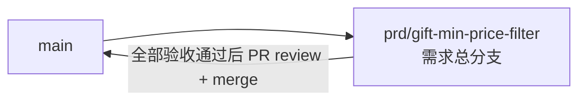

# 礼物事件金额筛选 - 实现 Plan

**功能名称**: 礼物事件金额筛选
**关联 PRD**: `docs/product/draft/20260817-gift-min-price-filter-prd.md`（v1.0，已审核通过）
**关联技术提案**: `docs/engineering/proposals/20260817-proposal-gift-min-price-filter.md`（v1.0，已审核通过）
**Plan 版本**: v1.0
**创建日期**: 2026-08-17
**作者**: Deliay
**feat-branch**: `prd/gift-min-price-filter`（需求总分支）

## 1. 概述

本 Plan 基于已通过审核的 PRD v1.0 与技术提案 v1.0 产出，指导礼物事件金额筛选的编码实施。实施全程遵循 `docs/engineering/common-rules.md`：TDD、契约式开发、核心逻辑单元测试覆盖率 ≥ 80%、合并前 review。

### 1.1 实施范围

- **做**：
  - `contracts/bilibili-crawler.openapi.yaml`：`event/range` 新增可选 query 参数 `minPrice`（number，最小 0.01，仅作用于 `gift` 类型事件，不传不限制）。
  - `LiveEventRecord` 新增 `Price` 字段（long，金瓜子）；新增 `Live/GiftPriceExtractor` 从礼物 payload 提取金额；`LiveEventSource` 落库时填充 `Price`。
  - `LiveEventRepository.GetPageAsync` 新增可选参数 `minPriceGoldSeeds`，叠加金额下限过滤（`Ne(Type, "gift") | Gte(Price, threshold)`），Count 与 Find 共用同一过滤条件。
  - `BilibiliLiveController.GetEventsRange` 接收 `[FromQuery] decimal? minPrice`，校验 `< 0.01` 返回 400，按 `Ceiling(minPrice × 1000)` 换算为金瓜子透传仓储。
  - 提取逻辑单元测试、仓储层集成测试、Controller 测试补齐。
- **不做**：`event/subscribe` 金额过滤、历史数据回填（缺省 `Price` 按 0 处理）、事件归一化规则与响应结构变更、新增索引、前端改动。

### 1.2 现状基线

- `BilibiliLiveController.GetEventsRange`（`servers/api/Controllers/BilibiliLiveController.cs:67-88`）：已支持 `page`/`pageSize` 钳制（`Math.Max(1, page)` / `Math.Clamp(pageSize, 1, 100)`）、可重复 `type` 去重去空（`NormalizeTypes`，`StringComparer.Ordinal`）、可选时间范围校验（`BadTimeRange` → 400），调 `GetPageAsync` 返回 `{ total, page, pageSize, items }`；`minPrice` 参数的接收/校验/换算在此追加，风格与既有参数一致。
- `LiveEventRepository.GetPageAsync`（`servers/api/Persistence/LiveEventRepository.cs:14-41`）：`Eq(RoomId)` + 可选 `In(Type)` + 可选 `Gte/Lte(OccurredAt)`，`CountDocuments` 与 `Find` 共用过滤条件，`SortByDescending(OccurredAt)` + `Skip/Limit`；金额过滤条件在此叠加，仅此一个调用点。
- `LiveEventRecord`（`servers/api/Persistence/Entities/LiveEventRecord.cs`）：无金额字段；新增 `Price`（long）后，历史缺省记录反序列化为 0，天然满足「历史数据按金额 0 处理」语义，无需迁移。
- `LiveEventSource.RunRoomAsync`（`servers/api/Live/LiveEventSource.cs:126-133`）：归一化后构造 `LiveEventRecord` 并 `InsertAsync`，随后 `bus.TryPublish`；金额提取填充在构造实体处单点接入，总线发布与 SSE 推送链路不变。
- 事件类型归一化（`servers/api/Live/DanmakuEventNormalizer.cs:11-12`）：`SEND_GIFT`/`COMBO_SEND` 均归一为 `gift`，提取器以归一化后的 `Type == "gift"` 判定即可。
- 契约 `contracts/bilibili-crawler.openapi.yaml`：`event/range`（:176-187）已引用共享参数 `Page`/`PageSize`/`EventType`/`StartedAt`/`EndedAt`；`minPrice` 仅该端点使用，按共享参数模式新增 `MinPrice` 组件参数并引用。
- `tests/Z.Vtuber.Tests` 已有 `MongoDbFixture`（Testcontainers）、`LiveEventRepositoryTests`（组合过滤/分页模式可直接扩展）、`BilibiliLiveControllerTests`（Controller 直调断言模式）；提取器为纯函数，新建独立单元测试文件。

## 2. 分支与提交流程

遵循 `z-git` 规范（仅 merge、禁止 rebase/squash）与 Conventional Commits：

- 本需求开发全程只使用需求总分支 `prd/gift-min-price-filter`：契约、实现、测试全部直接在该分支上提交，不再切开发子分支。
- 需求总 PR 已存在（`https://github.com/Deliay/z-vtuber/pull/17`），后续提交直接推送到该分支更新 PR；全部验收通过后 review 通过即 merge（仅 merge，禁止 rebase/squash）。
- 提交信息使用 Conventional Commits（`feat:` / `test:` / `docs:` 等），实现与测试分开提交。

## 3. 实施阶段

按 z-coding 开发流程「契约 → 实现 → 编排 → API 测试」推进，全程 TDD（先写测试再实现）。

### Phase 0: 契约先行

| # | 任务 | 产出 |
|---|------|------|
| 0.1 | `contracts/bilibili-crawler.openapi.yaml` 新增共享 query 参数 `MinPrice`：`name: minPrice`，`in: query`，`required: false`，`schema: { type: number, minimum: 0.01 }`，描述：礼物金额下限（元），最小 0.01，含边界；仅作用于 `gift` 类型事件，其他类型不受影响；不传不限制；小于 0.01 或非数值返回 400 | 契约更新 |
| 0.2 | `event/range` 端点 parameters 追加 `MinPrice` 引用；description 补充金额筛选语义；400 响应描述补充 `minPrice` 非法场景 | 契约更新 |

### Phase 1: 金额提取与持久化层（TDD）

| # | 任务 | 关键文件 | 测试重点 |
|---|------|---------|---------|
| 1.1 | 新增 `GiftPriceExtractor`（静态类）：`ExtractGoldSeeds(string type, string payload)` —— `type != "gift"` → 0；`JsonDocument` 解析 payload 读取 `data.price`（long，金瓜子）；仅 `data.coin_type == "gold"`（付费）返回该值，免费礼物（silver）、解析失败、字段缺失均 → 0 | `servers/api/Live/GiftPriceExtractor.cs`（新增） | 新建 `tests/Z.Vtuber.Tests/GiftPriceExtractorTests.cs`：付费礼物（SEND_GIFT/COMBO_SEND 样本 payload）提取正确、silver 免费礼物 → 0、非 gift 类型 → 0、非法 JSON/缺字段 → 0 |
| 1.2 | `LiveEventRecord` 新增 `Price` 属性（long，`[BsonRepresentation(BsonType.Int64)]`，默认 0） | `servers/api/Persistence/Entities/LiveEventRecord.cs` | 随 1.3 集成测试覆盖（缺省 Price 记录按 0 处理） |
| 1.3 | `LiveEventRepository.GetPageAsync` 签名追加 `long? minPriceGoldSeeds = null`：非空时叠加 `Ne(Type, "gift") \| Gte(Price, threshold)`；Count 与 Find 共用同一过滤条件；排序与分页逻辑不变 | `servers/api/Persistence/LiveEventRepository.cs` | `LiveEventRepositoryTests` 增补（Testcontainers）：金额含边界过滤、低于阈值不返回、非 gift 类型不受 minPrice 影响照常返回、缺省 Price（历史记录）按 0 被过滤、minPrice 与 type/时间范围叠加、total 为筛选后真实条数、筛选条件下翻页不重不漏、不传 minPrice 行为与现状一致 |
| 1.4 | `LiveEventSource` 落库时填充 `Price = GiftPriceExtractor.ExtractGoldSeeds(liveEvent.Type, liveEvent.Payload)`，其余链路（归一化、总线发布、SSE）不变 | `servers/api/Live/LiveEventSource.cs` | 编译与既有测试回归；提取正确性由 1.1 单测锁定 |

### Phase 2: 对外 API（TDD）

| # | 任务 | 关键文件 | 测试重点 |
|---|------|---------|---------|
| 2.1 | `GetEventsRange` 签名追加 `[FromQuery] decimal? minPrice = null`：`minPrice < 0.01m` → 400（文案 `minPrice must be at least 0.01.`，与既有 `{ error = ... }` 风格一致）；合法时 `threshold = (long)Math.Ceiling(minPrice.Value * 1000m)`（decimal 运算避免浮点误差）传入 `GetPageAsync`；不传时不传阈值；非数值入参由 `[ApiController]` 模型绑定自动返回 400 | `servers/api/Controllers/BilibiliLiveController.cs` | `BilibiliLiveControllerTests` 增补：`minPrice=0.01` 合法生效、元→金瓜子换算（含 Ceiling，如 0.011 → 11）、`minPrice=0`/负数/0.001 → 400 及文案、不传 `minPrice` 仓储调用不带阈值（回归） |

### Phase 3: 编排验证与测试收口

| # | 任务 | 验收 |
|---|------|------|
| 3.1 | z-aspire-orchestrator 编排验证：AppHost 拉起 MongoDB + api，`event/range` 带/不带 `minPrice` 可访问 | 本地运行通过 |
| 3.2 | z-test 覆盖 `event/range`：`type=gift&minPrice` 筛选、含边界、不传 `minPrice` 兼容性回归、`minPrice < 0.01` → 400、`type=danmaku&minPrice` 弹幕不受影响 | 全部通过 |
| 3.3 | 覆盖率核验：核心逻辑 ≥ 80%（金额提取、参数校验换算、仓储组合过滤） | 达标 |
| 3.4 | 全量回归 `dotnet test` | 全部通过 |
| 3.5 | 同步更新 `servers/api/AGENTS.md` 模块结构描述（`Live/` 新增 `GiftPriceExtractor`、`event/range` 支持 `minPrice` 金额筛选、`LiveEventRecord` 含 `Price`） | 文档同步 |

## 4. 并行策略

- 本需求仅 `servers/api` 一个实现子项目，按 `write-implementation.md` 以 subagent 委托开发。
- Phase 0 契约必须先于 Phase 2 完成；Phase 1 的 1.1（提取器，纯函数无依赖）与 1.3（仓储过滤）可拆分两个委托并行，1.2/1.4 随各自侧提交；2.1 依赖 Phase 1 完成。
- 每阶段完成后更新 todo 并提交（实现与测试分开提交）。

## 5. 验收对照

| PRD 功能点 | 实现任务 | 验证方式 |
|-----------|---------|---------|
| 功能点 1：礼物事件按最低金额筛选（含边界、条件叠加、翻页不重不漏） | 0.1、0.2、1.1-1.4、2.1 | 提取器单测 + 仓储集成测试（含边界/叠加/翻页/total 真实）+ Controller 测试 + API 测试 |
| 功能点 2：不传 minPrice 时不限制金额 | 1.3、2.1 | 仓储集成测试与 Controller 测试的不传参回归 + API 兼容性回归 |
| 功能点 3：minPrice 参数校验（0.01 合法、<0.01/非数值 → 400） | 0.1、2.1 | Controller 测试（边界 0.01、0/负数/0.001、模型绑定 400）+ API 测试 |
| 边界：历史礼物事件缺金额按 0 处理 | 1.2、1.3 | 仓储集成测试（无 Price 字段记录被 minPrice 过滤） |
| 边界：minPrice 与非 gift 类型组合不影响其他类型 | 1.3、2.1 | 仓储集成测试（danmaku 照常返回）+ API 测试 |
| 非功能：不退化为内存过滤、total 真实 | 1.3（仓储层过滤条件，Count/Find 共用） | 集成测试断言 total + 代码评审检查 |

## 6. 风险与依赖

| 项 | 说明 | 应对 |
|---|------|------|
| `data.price` 字段语义（单价/总价） | B 站原始 payload 中 `price` 可能为单价，需结合 `data.num` | 提案已明确：集成测试用真实样本核对，若为单价在提取器内单点修正（乘 `num`），不影响其他模块 |
| 浮点精度 | 元（decimal）→ 金瓜子（long）换算 | Controller 单点 `decimal` 运算 + `Ceiling`，测试锁定换算边界（0.011 → 11） |
| 历史数据无 Price 字段 | 存量记录缺省字段反序列化为 0 | 语义与 PRD 一致（视为金额 0），集成测试用缺省字段文档锁定行为，不做回填 |
| 契约先行约束 | 实现必须严格对齐契约（参数名 `minPrice`、minimum 0.01） | Phase 0 先行，API 测试以契约为唯一依据 |
| 免费礼物判定 | `coin_type` 为 `silver` 的礼物金额视为 0 | 提取器仅 `coin_type == "gold"` 计金额，单测覆盖 silver 样本 |

## 7. 相关文档

- PRD：`docs/product/draft/20260817-gift-min-price-filter-prd.md`
- 技术提案：`docs/engineering/proposals/20260817-proposal-gift-min-price-filter.md`
- 契约：`contracts/bilibili-crawler.openapi.yaml`
- 开发规范：`docs/engineering/common-rules.md`、`docs/engineering/backend-rules.md`
- 上一期 Plan：`docs/engineering/plans/20260815-plan-live-event-filter.md`
