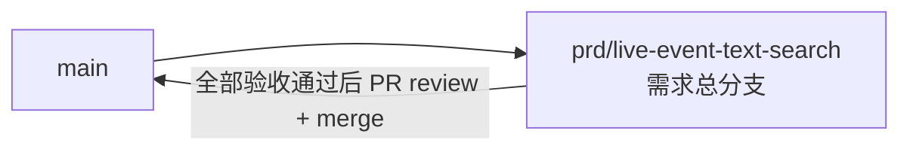

# 直播文字事件搜索 - 实现 Plan

**功能名称**: 直播文字事件搜索
**关联 PRD**: `docs/product/draft/20260819-live-event-text-search-prd.md`（v1.0，已审核通过）
**关联技术提案**: `docs/engineering/proposals/20260819-proposal-live-event-text-search.md`（v1.1，已审核通过）
**Plan 版本**: v1.0
**创建日期**: 2026-08-19
**作者**: Deliay
**feat-branch**: `prd/live-event-text-search`（需求总分支）

## 1. 概述

本 Plan 基于已通过审核的 PRD v1.0 与技术提案 v1.1 产出，指导直播文字事件搜索的编码实施。实施全程遵循 `docs/engineering/common-rules.md`：TDD、契约式开发、核心逻辑单元测试覆盖率 ≥ 80%、合并前 review。

### 1.1 实施范围

- **做**：
  - `contracts/bilibili-crawler.openapi.yaml`：新增 `GET /api/b/live/{roomId}/event/search` 端点契约（`roomId + stringCriteria`，分页结构复用 `LiveEventPage`）。
  - `MongoDbInitializer`：`bilibili_live_event` 新增 `RoomId asc + OccurredAt desc + Type asc` 复合索引；新建 `bilibili_live_event_text_index` 集合及 `{ RoomId: 1, Text: "text" }` 复合全文索引与 `EventId` 唯一索引；新增历史弹幕/SC 文本索引幂等回填。
  - 新增 `Live/LiveEventTextExtractor`（纯函数）：弹幕取 `payload.info[1]`、SC 取 `payload.data.message`。
  - `LiveEventSource`：落库弹幕/SC 事件成功后同步写文本索引记录（EventId 唯一索引兜底去重）。
  - 新增 `Persistence/LiveEventTextIndexRepository`：`$text` + RoomId 等值过滤的全文搜索、Count/Find 分页、按 OccurredAt 降序稳定翻页。
  - `LiveEventRepository`：多 type 筛选时强制按 OccurredAt 降序并附加新索引 hint；新增 `GetByIdsAsync`（join 用）。
  - `BilibiliLiveController`：新增 `event/search` 端点，`stringCriteria` 校验（非空、非纯空白、≤200 字符 → 400），索引命中后 `_id $in` join 事件并按时间倒序输出。
  - 提取逻辑、参数校验、仓储层、Controller 与回填的测试补齐（样本取自内网环境真实 payload）。
- **不做**：`event/subscribe` 文本过滤、弹幕/SC 以外类型的文本搜索、相关性排序（不暴露 text score）、前端改动、新增配置项与鉴权。

### 1.2 现状基线

- `MongoDbInitializer.EnsureLiveEventIndexesAsync`（`servers/api/Persistence/MongoDbInitializer.cs:69-90`）：现有 3 个索引（`RoomId+OccurredAt asc`、`RoomId+Type+OccurredAt desc`、`RoomId+Type+Price+OccurredAt desc`）；新索引 `RoomId asc + OccurredAt desc + Type asc` 在此方法追加。集合名常量在 `MongoCollectionNames`（:6-16）追加 `LiveEventTextIndex`。
- 回填模式：`BackfillGiftPriceAsync`（`servers/api/Persistence/MongoDbInitializer.cs:193-249`）——`Meta` 集合标记（`MetaRecord`，:252-256）+ 分批 500 扫描 + BulkWrite + 完成写标记；文本回填沿用该模式，标记 key `live_event_text_index_backfill_v1`。`Program.cs:53-55` 启动时依次调用 `EnsureIndexesAsync` / `BackfillGiftPriceAsync`，文本回填调用在 `BackfillGiftPriceAsync` 之后追加。
- `LiveEventRepository.GetPageAsync`（`servers/api/Persistence/LiveEventRepository.cs:14-48`）：`Eq(RoomId)` + 可选 `In(Type)` + 可选时间/金额过滤，Count/Find 共用过滤条件，`SortByDescending(OccurredAt)` + `Skip/Limit`；多 type 强制排序与 hint 在此单点实现，无其他调用点。
- `LiveEventSource.RunRoomAsync`（`servers/api/Live/LiveEventSource.cs:126-136`）：归一化后构造 `LiveEventRecord` 并 `InsertAsync`（驱动在插入时生成 `Id`），随后 `bus.TryPublish`；文本索引写入在 `InsertAsync` 成功后接入（取插入后实体的 `Id` 作为 `EventId`），总线发布与 SSE 链路不变。仓储通过构造函数注入，模式同现有 `LiveEventRepository` 注入。
- 事件类型归一化（`servers/api/Live/DanmakuEventNormalizer.cs`）：弹幕归一类型为 `danmaku`、醒目留言为 `super_chat`，提取器以归一化后的 `Type` 判定。
- `BilibiliLiveController`（`servers/api/Controllers/BilibiliLiveController.cs`）：`event/range`（:67-105）已有分页钳制（`Math.Max(1, page)` / `Math.Clamp(pageSize, 1, 100)`）与 `{ error = ... }` 400 风格；`event/search` 端点新增于此，DTO 复用 `ToEventDto(LiveEventRecord)`（:186-193）。
- 契约 `contracts/bilibili-crawler.openapi.yaml`：`event/range`（:176-197）引用共享参数 `RoomId`/`Page`/`PageSize` 等，分页响应 schema 为 `LiveEventPage`（:195）；`event/search` 复用 `RoomId`/`Page`/`PageSize`/`LiveEventPage`，仅新增 `StringCriteria` 组件参数。
- `tests/Z.Vtuber.Tests`：已有 `MongoDbFixture`（Testcontainers）、`LiveEventRepositoryTests`、`BilibiliLiveControllerTests`（Controller 直调断言模式）、`GiftPriceExtractorTests`（纯函数提取器单测模式）；新测试沿用既有模式。

## 2. 分支与提交流程

遵循 `z-git` 规范（仅 merge、禁止 rebase/squash）与 Conventional Commits：

- 本需求开发全程只使用需求总分支 `prd/live-event-text-search`：契约、实现、测试全部直接在该分支上提交，不再切开发子分支。
- 需求总 PR 已存在（`https://github.com/Deliay/z-vtuber/pull/23`），后续提交直接推送到该分支更新 PR；全部验收通过后 review 通过即 merge（仅 merge，禁止 rebase/squash）。
- 提交信息使用 Conventional Commits（`feat:` / `test:` / `docs:` 等），实现与测试分开提交。

## 3. 实施阶段

按 z-coding 开发流程「契约 → 实现 → 编排 → API 测试」推进，全程 TDD（先写测试再实现）。

### Phase 0: 契约先行

| # | 任务 | 产出 |
|---|------|------|
| 0.1 | `contracts/bilibili-crawler.openapi.yaml` 新增共享 query 参数 `StringCriteria`：`name: stringCriteria`，`in: query`，`required: true`，`schema: { type: string, maxLength: 200 }`，描述：搜索关键词，在弹幕/SC 纯文本中全文检索；非空且非纯空白，最长 200 字符；缺失、为空、仅空白或超长返回 400 | 契约更新 |
| 0.2 | 新增 path `/api/b/live/{roomId}/event/search`：GET，`operationId: searchLiveEvents`，parameters 引用 `RoomId`/`Page`/`PageSize`/`StringCriteria`；200 响应复用 `LiveEventPage` schema（`items` 按 `occurredAt` 降序，仅含弹幕/SC 事件）；400 响应描述 `stringCriteria` 非法场景；summary/description 说明搜索范围限定弹幕与 SC | 契约更新 |

### Phase 1: 索引、新集合与历史回填（TDD）

| # | 任务 | 关键文件 | 测试重点 |
|---|------|---------|---------|
| 1.1 | 新增实体 `LiveEventTextIndexRecord`：`Id`（ObjectId，`[BsonId]`）、`EventId`（ObjectId）、`RoomId`（long，`[BsonRepresentation(BsonType.Int64)]`）、`Type`（string）、`Text`（string）、`OccurredAt`（DateTime，`[BsonDateTimeOptions(Kind = Utc)]`）；`MongoCollectionNames` 追加 `LiveEventTextIndex = "bilibili_live_event_text_index"` | `servers/api/Persistence/Entities/LiveEventTextIndexRecord.cs`（新增）、`MongoDbInitializer.cs` | 随 1.3/1.4 集成测试覆盖 |
| 1.2 | `EnsureLiveEventIndexesAsync` 追加 `RoomId asc + OccurredAt desc + Type asc` 复合索引；新增 `EnsureLiveEventTextIndexAsync`：创建 `{ RoomId: 1, Text: "text" }` 复合全文索引（`Builders<T>.IndexKeys.Ascending(r => r.RoomId).Text(r => r.Text)`）与 `EventId asc` 唯一索引；在 `EnsureIndexesAsync` 中注册调用 | `servers/api/Persistence/MongoDbInitializer.cs` | `MongoDbInitializerTests` 增补（Testcontainers）：索引创建成功、重复执行幂等、全文索引含 RoomId 前缀与 text 键、EventId 唯一索引生效（重复 EventId 写入抛 DuplicateKey） |
| 1.3 | 新增 `BackfillLiveEventTextIndexAsync`：沿用 `BackfillGiftPriceAsync` 模式——`Meta` 标记 `live_event_text_index_backfill_v1` 存在即跳过；分批（500）扫描 `type $in [danmaku, super_chat]` 的事件（投影 Id/Type/Payload/RoomId/OccurredAt），`LiveEventTextExtractor` 提取文本后批量写入索引集合（按 EventId upsert，唯一索引兜底幂等）；完成写标记；`Program.cs` 在 `BackfillGiftPriceAsync` 之后追加调用 | `servers/api/Persistence/MongoDbInitializer.cs`、`servers/api/Program.cs` | 新增 `LiveEventTextIndexBackfillTests`（Testcontainers）：历史弹幕/SC 事件全部回填、非文字类型不回填、提取为 null 的事件跳过、重复执行幂等（Meta 标记 + 不产生重复记录） |

### Phase 2: 纯文本提取与落库写索引（TDD）

| # | 任务 | 关键文件 | 测试重点 |
|---|------|---------|---------|
| 2.1 | 新增 `LiveEventTextExtractor`（静态类）：`ExtractText(string type, string payload)` —— `type == "danmaku"` → `JsonDocument` 取 `info[1]`（string）；`type == "super_chat"` → 取 `data.message`（string）；其他类型、解析失败、字段缺失、文本为空白 → `null`。测试样本取自内网环境 `http://vtuber.internal.fffdan.com` 直播间 `1727076670` 真实 payload | `servers/api/Live/LiveEventTextExtractor.cs`（新增） | 新建 `tests/Z.Vtuber.Tests/LiveEventTextExtractorTests.cs`：真实弹幕/SC 样本提取正确、非文字类型 → null、非法 JSON/缺字段/字段类型异常 → null、纯空白文本 → null |
| 2.2 | `LiveEventSource` 构造函数注入 `LiveEventTextIndexRepository`；事件 `InsertAsync` 成功后调用 `ExtractText`，非空时写入 `{ EventId = record.Id, RoomId, Type, Text, OccurredAt }`；捕获唯一键冲突（DuplicateKey）仅记日志不阻断；提取/写索引异常不阻断总线发布与 SSE | `servers/api/Live/LiveEventSource.cs` | 编译与既有测试回归；提取正确性由 2.1 单测锁定，索引记录正确性由 1.4/3.1 集成测试覆盖 |

### Phase 3: 搜索仓储与对外 API（TDD）

| # | 任务 | 关键文件 | 测试重点 |
|---|------|---------|---------|
| 3.1 | 新增 `LiveEventTextIndexRepository`：`InsertAsync(LiveEventTextIndexRecord)`；`SearchAsync(roomId, criteria, page, pageSize)` —— 过滤 `Eq(RoomId) & $text: { $search: criteria }`（`Builders<T>.Filter.Text(criteria)`），`CountDocuments` 得 total，Find 按 `OccurredAt desc, Id desc` 排序 + `Skip/Limit` 得当前页索引记录；在 `Program.cs` 注册 DI（模式同 `LiveEventRepository`） | `servers/api/Persistence/LiveEventTextIndexRepository.cs`（新增）、`servers/api/Program.cs` | 新建 `LiveEventTextIndexRepositoryTests`（Testcontainers）：关键词命中/无命中、RoomId 隔离、中文关键词子串语义命中、分页不重不漏、total 为命中真实条数、同 OccurredAt 记录按 Id 降序稳定翻页 |
| 3.2 | `LiveEventRepository`：`GetPageAsync` 中 `types is { Count: > 1 }` 时显式保持 `SortByDescending(OccurredAt)` 并对 Find 附加 `RoomId+OccurredAt+Type` 索引 hint（索引键常量复用）；单类型与无类型查询路径不变。新增 `GetByIdsAsync(IReadOnlyCollection<ObjectId> ids)`：`_id $in` 批量取事件（返回顺序不做保证，由调用方按索引记录顺序还原） | `servers/api/Persistence/LiveEventRepository.cs` | `LiveEventRepositoryTests` 增补：多 type 查询 `explain()` 无 SORT 阶段且走新索引、查询语义（筛选/排序/分页/total）与现状一致（回归）、`GetByIdsAsync` 批量取回全部命中事件 |
| 3.3 | `BilibiliLiveController` 注入 `LiveEventTextIndexRepository`，新增 `[HttpGet("{roomId}/event/search")]`：`stringCriteria` 缺失/空串/纯空白/超 200 字符 → 400（文案 `stringCriteria must be non-empty and at most 200 characters.`，与既有 `{ error = ... }` 风格一致）；`page`/`pageSize` 钳制复用既有写法；调 `SearchAsync` 得 (total, 索引记录)，`GetByIdsAsync` 取事件后按索引记录的 OccurredAt/Id 顺序还原排序，用 `ToEventDto(LiveEventRecord)` 输出 `{ total, page, pageSize, items }` | `servers/api/Controllers/BilibiliLiveController.cs` | `BilibiliLiveControllerTests` 增补：合法关键词正常返回、空/纯空白/201 字符 → 400 及文案、200 字符合法（边界）、无命中返回空列表 total=0、页码超范围返回空列表 total 真实、join 结果按时间倒序 |

### Phase 4: 编排验证与测试收口

| # | 任务 | 验收 |
|---|------|------|
| 4.1 | z-aspire-orchestrator 编排验证：AppHost 拉起 MongoDB + api，启动日志确认新索引创建与历史回填完成，`event/search` 可访问 | 本地运行通过 |
| 4.2 | z-test 覆盖 `event/search`：命中搜索、翻页、空关键词 400、超长 400、无命中 total=0；`event/range` 多 type 行为回归 | 全部通过 |
| 4.3 | 覆盖率核验：核心逻辑 ≥ 80%（文本提取、参数校验、搜索仓储、回填） | 达标 |
| 4.4 | 全量回归 `dotnet test` | 全部通过 |
| 4.5 | 同步更新 `servers/api/AGENTS.md` 模块结构描述（`Live/` 新增 `LiveEventTextExtractor`、`Persistence/` 新增文本索引集合与仓储、`event/search` 端点、多 type 查询走新索引） | 文档同步 |

## 4. 并行策略

- 本需求仅 `servers/api` 一个实现子项目，按 z-coding 工作流以 subagent 委托开发。
- Phase 0 契约必须先于 Phase 3 完成；Phase 1 的 1.2/1.3（初始化器与回填）与 Phase 2 的 2.1（提取器，纯函数无依赖）可拆分两个委托并行，2.2 依赖 2.1 与 1.1 完成；Phase 3 的 3.1/3.2 可在 Phase 1 后并行，3.3 依赖 3.1/3.2 完成。
- 每阶段完成后更新 todo 并提交（实现与测试分开提交）。

## 5. 验收对照

| PRD 功能点 | 实现任务 | 验证方式 |
|-----------|---------|---------|
| 功能点 1：按关键词搜索文字事件（弹幕/SC 均覆盖、时间倒序、翻页不重不漏、total 真实） | 0.1、0.2、3.1、3.2、3.3 | 搜索仓储集成测试（命中/隔离/翻页/total/稳定排序）+ Controller 测试 + API 测试 |
| 功能点 2：搜索关键词校验（缺失/空/纯空白/超 200 → 400，边界 200 合法） | 0.1、3.3 | Controller 测试（各非法形态 + 边界 200/201）+ API 测试 |
| 功能点 3：历史事件可搜索 | 1.2、1.3 | 回填集成测试（回填完整 + 幂等）+ API 测试（历史弹幕/SC 命中） |
| 功能点 4：多类型事件查询性能保障（语义不变、走新索引免内存排序） | 1.2、3.2 | 集成测试 `explain()` 无 SORT 阶段 + 多 type 查询语义回归 + API 回归 |
| 边界：非文字类型事件不参与搜索 | 2.1、1.3 | 提取器单测（其他类型 → null）+ 回填测试（非文字类型不回填） |
| 边界：关键词含特殊符号/表情不报错 | 3.1 | 搜索仓储集成测试（特殊字符样本） |
| 非功能：搜索不退化为内存匹配、total 真实 | 3.1（索引集合 Count/Find 分页） | 集成测试断言 total + 代码评审检查 |

## 6. 风险与依赖

| 项 | 说明 | 应对 |
|---|------|------|
| 纯文本提取路径 | 弹幕 `payload.info[1]`、SC `payload.data.message` | 提案 v1.1 已经内网环境真实数据验证成立；实现期单测继续覆盖字段缺失/类型异常退化样本 |
| MongoDB text 索引中文分词 | `$text` 对 CJK 按二元组切分，满足关键词子串检索；`$search` 短语语法（`"..."`）不对外暴露 | 集成测试用中文样本锁定命中语义；如发现用户输入引号导致语义变化，实现期在仓储层对 criteria 做转义（单点处理） |
| 每集合仅允许一个 text 索引 | 全文索引字段固定为 `Text` | 索引创建收敛在 `EnsureLiveEventTextIndexAsync` 单点，后续扩展需重建索引（本期不涉及） |
| 尾部 `$in` 索引扫描量 | 「时间范围窄、类型稀疏」场景多 type 查询扫描量可能偏大 | 按需求约定实现并用 `explain()` 验证；实测不达标再评估 `RoomId+Type+OccurredAt` 多计划 union（超出本期范围） |
| 首次启动回填耗时 | 数据量大的环境回填期间启动变慢 | 回填分批执行并记录进度日志；回填期间新事件索引写入不受影响（EventId 唯一索引兜底重复） |
| 契约先行约束 | 实现严格对齐契约（参数名 `stringCriteria`、maxLength 200、required） | Phase 0 先行，API 测试以契约为唯一依据 |

## 7. 相关文档

- PRD：`docs/product/draft/20260819-live-event-text-search-prd.md`
- 技术提案：`docs/engineering/proposals/20260819-proposal-live-event-text-search.md`
- 契约：`contracts/bilibili-crawler.openapi.yaml`
- 开发规范：`docs/engineering/common-rules.md`、`docs/engineering/backend-rules.md`
- 上一期 Plan：`docs/engineering/plans/20260817-plan-gift-min-price-filter.md`
