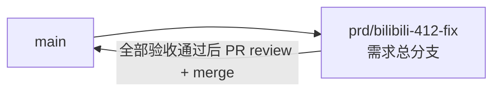

# B 站抓取 412 风控修复 - 实现 Plan

**功能名称**: B 站抓取 412 风控修复
**关联 PRD**: `docs/product/draft/20260820-bilibili-412-fix-prd.md`（v1.0，已审核通过）
**关联技术提案**: `docs/engineering/proposals/20260820-proposal-bilibili-412-fix.md`（v1.0，已审核通过）
**Plan 版本**: v1.1
**创建日期**: 2026-08-20
**作者**: Deliay
**feat-branch**: `prd/bilibili-412-fix`（需求总分支）
**修订记录**: v1.1（2026-08-20）——按下游打回意见「要求 event/range 排序为 OccurredAt Descending」新增 Phase 0.3 分支回归修复：分支上 72cab58 误将 event/range 排序回退为升序，须恢复与 main 一致的降序语义（详见 1.2 与 Phase 0.3）。

## 1. 概述

本 Plan 基于已通过审核的 PRD v1.0 与技术提案 v1.0 产出，指导 B 站抓取 412 风控修复的编码实施。实施全程遵循 `docs/engineering/common-rules.md`：TDD、契约式开发、核心逻辑单元测试覆盖率 ≥ 80%、合并前 review。

### 1.1 实施范围

- **做**：
  - **分支回归修复（v1.1 新增，优先于其他任务）**：分支上 72cab58（提交信息误标为 412 实现，实为 live-event-text-search 验收修复混入）将 `event/range` 排序从降序回退为升序，与 main 及显式需求提交 6e23b69（PR #15，`feat/event-range-desc`）冲突——恢复 `OccurredAt` 降序排序、对应索引与 hint、契约降序表述及测试断言（详见 Phase 0.3）。
  - `RiskControlClassifier`（纯函数）+ `RiskControlException` + `RiskControlHandler`（DelegatingHandler）：识别 HTTP 412 / 业务码 -412 / 风控页面特征，挂入 `BilibiliAccountProvider` 构建的 HttpClient 管线。
  - `CrawlBackoffRegistry`：按目标（`live:{roomId}` / `space:{mid}` / `nav:{cookieHash8}`）维护指数退避 + 随机抖动 + 冷却，进程内存态。
  - `BrowserishBiliApiClient`：拟真通道，自建 HttpClient + Chrome 请求头 + buvid3 会话预热 + 2–5s 随机延迟，复用相同 JSON 接口，输出模型与直连一致。
  - `ResilientBiliApiClient`：`IBiliApiClient` 装饰器，直连优先、风控降级拟真通道、连续成功回升，联动退避注册表与凭证冷却。
  - `CookiePoolService` 扩展：`CookieRecord` 增加 `CooldownUntil`，新增 `MarkCooldownAsync`，`NextAsync`/`GetActiveAsync` 过滤冷却中凭证；`CookieProbeJob` 跳过冷却中凭证、探活遇风控冷却而非离线。
  - `BilibiliCrawlerOptions` 扩展：`FetchMode`/退避/冷却/拟真参数全部配置化，`appsettings.json` 补保守默认值。
  - 三条 B 站链路（直播状态、Nav 探活、空间动态）的风控应对与结构化日志；`GetAccountInfoDataAsync`（第三方接口）不在范围内，装饰器中直接透传直连。
  - 新增类型的单元测试与 Cookie 冷却的 Testcontainers 集成测试，建立 mock `HttpMessageHandler` 的 HTTP 层测试模式。
- **不做**：对外 API 契约变更（`contracts/bilibili-crawler.openapi.yaml` 不变）、HTML 页面解析式抓取、代理 IP 池、前端改动、`AccountInfoJob` 链路调整。

### 1.2 现状基线

- **分支状态警示（v1.1 新增）**：分支 `prd/bilibili-412-fix` 上的 72cab58（提交信息误标为「implement bilibili-412 fix」，内容实为 live-event-text-search 验收修复的混入改动）将 `LiveEventRepository.GetPageAsync` 排序从 `Sort.Descending(OccurredAt)` 回退为 `Sort.Ascending`，索引替换为升序 `RoomId_1_Type_1_OccurredAt_1`，契约 `event/range` 描述改为「升序」，测试断言同步反转。其依据（`docs/engineering/fix/20260819-fix-acceptance-issues.md` P2）不成立：降序是显式需求提交 6e23b69「feat: event/range 按 occurredAt 降序查询」（经 PR #15 合入 main，来源分支 `feat/event-range-desc`），main 代码与契约（`contracts/bilibili-crawler.openapi.yaml:179,191`）均为降序；fix 文档仅对比了停滞的 `release` 分支（仍为升序），得出错误结论。本需求实施前必须先修复该回归（Phase 0.3）；72cab58 中其余混入改动（text 索引 regex 化、回填修复等）不属于本需求范围，维持现状、由所属需求自行处理。
- `IBiliApiClient`（`servers/api/Crawlers/BiliApiClient.cs:21-27`）：4 个方法均显式接收 `cookie` 参数，装饰器可据此计算脱敏凭证标识（哈希前 8 位）并联动冷却；`GetAccountInfoDataAsync`（:33-41）走第三方接口且每次 `new HttpClient`，不在风控范围。
- `BilibiliAccountProvider.BuildProviderAsync`（`servers/api/Crawlers/BilibiliAccountProvider.cs:26-37`）：per-cookie `HttpClient` 在 :29 以 `new HttpClient { Timeout = ... }` 裸构建——`RiskControlHandler` 在此挂入（`new HttpClient(new RiskControlHandler(new HttpClientHandler()))`），直连通道与 Cookie 探活共用同一管线；`BilibiliAccount`（:34-35）持有 wbi 签名能力，拟真通道复用其 `Sign`。
- 直连三链路：`GetLiveRoomInfoAsync`（`BiliApiClient.cs:43-48`，Mikibot `BiliLiveCrawler`）、`GetNavInfoV2Async`（:50-55，Mikibot `BiliBasicInfoCrawler`）、`GetSpaceDynamicsAsync`（:57-100，自构建 wbi 签名 query + `EnsureSuccessStatusCode`，业务码非 0 抛 `InvalidOperationException`）。
- `CookiePoolService`（`servers/api/Services/CookiePoolService.cs`）：`NextAsync`（:52-70）以 `Status == Active` 过滤 + `LastUsedAt` 升序 round-robin；`MarkOfflineAsync`（:72-79）；`CookieRecord`（`servers/api/Persistence/Entities/CookieRecord.cs`）含 `Status`/`LastCheckedAt`/`LastUsedAt`，`CooldownUntil` 在此追加，旧文档缺省 null 向后兼容。
- `CookieProbeJob`（`servers/api/Jobs/CookieProbeJob.cs:15-47`）：遍历 `GetActiveAsync` 逐条 `GetNavInfoV2Async` 探活，任何异常即 `MarkOfflineAsync`——需改为跳过冷却中凭证、风控异常转冷却。
- `PeriodicJobBase`（`servers/api/Jobs/PeriodicJobBase.cs`）：周期照常触发、异常兜底记 Error——退避期「本轮空转」由装饰器抛专用退避异常、Job 捕获后以 Information 级跳过实现，不阻塞调度线程。
- Job 调用点：`LiveStatusJob.CrawlAsync`（`servers/api/Jobs/LiveStatusJob.cs:97-136`，锁 key `live:{roomId}`）、`SpaceTimelineJob.CrawlAsync`（`servers/api/Jobs/SpaceTimelineJob.cs:65-138`，锁 key `space:{mid}`，翻页循环页间无间隔）、`CookieProbeJob`（nav 探活）——退避 key 与锁 key 对齐。
- DI 接线：`Program.cs:37-41` 注册 `IBilibiliAccountProvider`/`IBiliApiClient`；装饰器接线改在 :38 单点（直接实现 + 拟真实现注册为具体类型，`IBiliApiClient` 解析为 `ResilientBiliApiClient`）。
- 配置：`BilibiliCrawlerOptions`（`servers/api/Configuration/BilibiliCrawlerOptions.cs`）现有 5 项；`appsettings.json` 有 `BilibiliCrawler` 节。
- 测试：`tests/Z.Vtuber.Tests` 已有 `MongoDbFixture`（Testcontainers）、`CookiePoolServiceTests`、`Fakes.cs`；项目尚无 HTTP 层 mock `HttpMessageHandler` 模式，本次建立。

## 2. 分支与提交流程

遵循 `z-git` 规范（仅 merge、禁止 rebase/squash）与 Conventional Commits：

- 本需求开发全程只使用需求总分支 `prd/bilibili-412-fix`：实现、测试、文档全部直接在该分支上提交，不再切开发子分支。
- 需求总 PR 已存在（`https://github.com/Deliay/z-vtuber/pull/27`，目标分支 main），后续提交直接推送到该分支更新 PR；全部验收通过后 review 通过即 merge（仅 merge，禁止 rebase/squash）。
- 提交信息使用 Conventional Commits（`feat:` / `test:` / `docs:` 等），实现与测试分开提交。

## 3. 实施阶段

按 z-coding 开发流程推进；本需求无契约变更，Phase 0 为前置验证与配置。全程 TDD（先写测试再实现）。Phase 0.3 为分支回归修复，优先于所有其他阶段执行。

### Phase 0: 前置验证与配置

| # | 任务 | 产出 |
|---|------|------|
| 0.1 | 验证 Mikibot.Crawler 1.0.8 对非 2xx 响应的行为：查阅 `~/.nuget/packages/mikibot.crawler/1.0.8` 程序集（反编译或源码），确认 `BiliLiveCrawler.GetLiveRoomInfo` / `BiliBasicInfoCrawler.GetNavInfoV2` 在 HTTP 412 时抛何异常、是否经 `EnsureSuccessStatusCode`。结论决定风控识别落点：若响应经我方 handler 管线即由 `RiskControlHandler` 识别；若 Mikibot 先行包装异常，则在 `ResilientBiliApiClient` 增加等价异常映射。结论以注释形式固化在 `RiskControlHandler` 或映射代码处 | 验证结论（落点决策） |
| 0.2 | `BilibiliCrawlerOptions` 扩展：`FetchMode`（`BiliFetchMode` 枚举：Direct/Browser/Auto，默认 Auto）、`BackoffBaseSeconds=30`、`BackoffMaxMinutes=15`、`CooldownMinutes=30`、`RiskControlCooldownThreshold=5`、`BrowserMinDelaySeconds=2`、`BrowserMaxDelaySeconds=5`、`BrowserUserAgent`（Chrome UA）、`ChannelRecoverSuccessCount=3`；`appsettings.json` `BilibiliCrawler` 节补默认值 | 配置扩展 |
| 0.3 | **分支回归修复：event/range 恢复 OccurredAt 降序**（下游打回项，依据 6e23b69 显式需求与 main 契约）。① `servers/api/Persistence/LiveEventRepository.cs:44` 恢复 `Sort.Descending(e => e.OccurredAt)`，多 type hint 恢复 `RoomId_1_OccurredAt_-1_Type_1`；② `servers/api/Persistence/MongoDbInitializer.cs` `EnsureLiveEventIndexesAsync` 恢复 `RoomId asc + OccurredAt desc + Type asc` 复合索引（main 形态），并对 72cab58 已创建的升序索引 `RoomId_1_Type_1_OccurredAt_1` 做启动时 `DropOne` 兜底（忽略索引不存在）；③ `contracts/bilibili-crawler.openapi.yaml:179,191` 恢复 main 的「降序」表述（event/range 相关行与 main 零 diff）；④ `tests/Z.Vtuber.Tests/LiveEventRepositoryTests.cs` 恢复降序断言（时间范围用例首元素为较新记录、翻页用例 `OrderByDescending`）；⑤ 更正 `docs/engineering/fix/20260819-fix-acceptance-issues.md` P2 条目：注明其依据不成立（降序为 6e23b69/PR #15 显式需求、main 契约为降序、release 分支已停滞），P2 的「修复」即本次回归来源。验收：`LiveEventRepositoryTests` 降序断言通过；`git diff main -- contracts/bilibili-crawler.openapi.yaml` 不含 event/range 排序相关行 | 回归修复（对齐 main 降序语义） |

### Phase 1: 风控识别（TDD）

| # | 任务 | 关键文件 | 测试重点 |
|---|------|---------|---------|
| 1.1 | 新增 `RiskControlException : HttpRequestException`（`Target`/`CookieTag`/`RetryAfter`）；新增纯函数 `RiskControlClassifier`：输入 (statusCode, contentType, body)，命中三类信号——HTTP 412、JSON `code == -412`、HTML 含「安全风控」/「错误号: 412」特征——返回判定结果；普通超时、5xx、其他业务码不命中（宁可漏不可错） | `servers/api/Crawlers/RiskControlException.cs`（新增）、`RiskControlHandler.cs`（新增，分类器同文件或相邻） | 新建 `tests/Z.Vtuber.Tests/RiskControlClassifierTests.cs`：412 命中、-412 命中、风控页特征命中、200/-404/500/普通业务码不命中、非法 body 不误判 |
| 1.2 | 新增 `RiskControlHandler : DelegatingHandler`：转发响应后调用分类器，命中即抛 `RiskControlException`（带 Target/CookieTag 上下文由调用方补充）；挂入 `BilibiliAccountProvider` 的 HttpClient 构建（:29）；按 0.1 结论决定是否需在装饰器补 Mikibot 异常映射 | `servers/api/Crawlers/RiskControlHandler.cs`、`servers/api/Crawlers/BilibiliAccountProvider.cs` | 新增 mock `HttpMessageHandler` 测试模式：412 响应 → 抛 `RiskControlException`；200/-412 业务码 → 命中或放行符合分类器语义；普通错误原样透出不包装 |

### Phase 2: 退避注册表（TDD）

| # | 任务 | 关键文件 | 测试重点 |
|---|------|---------|---------|
| 2.1 | 新增 `ICrawlBackoffRegistry`/`CrawlBackoffRegistry`：`TryAcquire(key, out wait)`/`ReportSuccess(key)`/`ReportRiskControl(key)`；`ConcurrentDictionary` 内存态；指数退避（base×2^level，上限 `BackoffMaxMinutes`）+ ±25% 抖动；连续风控 ≥ `RiskControlCooldownThreshold` 进入 `CooldownMinutes` 冷却；成功即清零。`TimeProvider` 与随机源可注入，保证测试确定性 | `servers/api/Crawlers/CrawlBackoffRegistry.cs`（新增） | 新建 `CrawlBackoffRegistryTests.cs`：退避间隔逐级指数拉长、抖动在 ±25% 区间内、达阈值进入冷却且冷却期 `TryAcquire` 拒绝、冷却到期放行、`ReportSuccess` 清零等级、多 key 相互隔离 |

### Phase 3: Cookie 池冷却（TDD）

| # | 任务 | 关键文件 | 测试重点 |
|---|------|---------|---------|
| 3.1 | `CookieRecord` 追加 `CooldownUntil`（`DateTime?`，`[BsonDateTimeOptions(Kind = Utc)]`）；`ICookiePoolService` 新增 `MarkCooldownAsync(string cookie, TimeSpan duration, CancellationToken)`；`NextAsync`/`GetActiveAsync` 过滤条件追加 `CooldownUntil <= now 或为空` | `servers/api/Persistence/Entities/CookieRecord.cs`、`servers/api/Services/CookiePoolService.cs` | `CookiePoolServiceTests` 增补（Testcontainers）：冷却凭证不被 `NextAsync` 分配、冷却到期自动恢复可分配、旧文档无 `CooldownUntil` 字段正常参与轮换、`GetActiveAsync` 语义（探活需见冷却凭证以便 3.2 跳过——按实现选择返回全部 active 并附带冷却信息，或新增过滤参数，单测锁定语义） |
| 3.2 | `CookieProbeJob`：冷却中凭证跳过探活（不误标离线）；探活遇 `RiskControlException` 调 `MarkCooldownAsync` 而非 `MarkOfflineAsync`；全部凭证冷却/离线时 Warning 告警日志 | `servers/api/Jobs/CookieProbeJob.cs` | 增补 Job 测试：冷却凭证不发起探活请求、风控异常 → 冷却而非离线、普通异常 → 离线（回归） |

### Phase 4: 拟真通道（TDD）

| # | 任务 | 关键文件 | 测试重点 |
|---|------|---------|---------|
| 4.1 | 新增 `BrowserishBiliApiClient : IBiliApiClient`：自建 HttpClient（经 `RiskControlHandler`），完整 Chrome 请求头（UA 配置化 + `Accept`/`Accept-Language`/`Sec-Ch-Ua` 系列/`Referer: https://www.bilibili.com/`）；首次请求前 GET `https://www.bilibili.com/` 预热取 `buvid3`；请求间 2–5s 随机延迟（可注入以便测试）；直播状态走 `xlive/web-room/v1/index/getInfoByRoom` 并映射为 Mikibot `LiveRoomInfo`，Nav 走 `x/nav/wbi`（复用 `BilibiliAccount.Sign` wbi 签名）映射为 `NavInfo`，空间动态沿用 `x/polymer/web-dynamic/v1/feed/space` 复用现有解析逻辑输出 `SpaceDynamicsPage`；`GetAccountInfoDataAsync` 直接委托直连实现（第三方接口与 B 站风控无关） | `servers/api/Crawlers/BrowserishBiliApiClient.cs`（新增） | 新建 `BrowserishBiliApiClientTests.cs`（mock HttpMessageHandler）：请求头完整且 UA 取自配置、首次请求前发生预热、响应 JSON 正确映射到 `LiveRoomInfo`/`NavInfo`/`SpaceDynamicsPage`（字段与直连一致）、-412 响应抛 `RiskControlException` |

### Phase 5: 自动切换装饰器与接线（TDD）

| # | 任务 | 关键文件 | 测试重点 |
|---|------|---------|---------|
| 5.1 | 新增 `ResilientBiliApiClient : IBiliApiClient`：按 `FetchMode` 选通道；Auto 下默认直连，捕获 `RiskControlException` 后该目标降级拟真通道并重试本轮，目标级连续成功 `ChannelRecoverSuccessCount` 次后回升直连；每轮请求前 `TryAcquire`，退避/冷却中抛 `CrawlBackoffActiveException`（携带 `wait`）；风控时 `ReportRiskControl` + `CookiePoolService.MarkCooldownAsync`（脱敏 CookieTag=哈希前 8 位）；成功 `ReportSuccess`；全部动作结构化日志（目标、通道、CookieTag、退避时长） | `servers/api/Crawlers/ResilientBiliApiClient.cs`（新增）、`CrawlBackoffActiveException`（新增，可同文件） | 新建 `ResilientBiliApiClientTests.cs`（fake 双通道 + 真实 registry + fake cookie pool）：直连风控 → 当轮降级拟真取到数据、凭证被冷却、退避登记；退避中调用抛 `CrawlBackoffActiveException`；拟真连续成功 N 次回升直连；Direct/Browser 模式不切换；`GetAccountInfoDataAsync` 透传直连 |
| 5.2 | `Program.cs` DI 接线：`BiliApiClient`/`BrowserishBiliApiClient` 注册为具体类型，`IBiliApiClient` 解析为 `ResilientBiliApiClient`，`ICrawlBackoffRegistry` 注册单例；`LiveStatusJob`/`SpaceTimelineJob`/`CookieProbeJob` 捕获 `CrawlBackoffActiveException` 以 Information 级日志跳过本轮（不记 Error） | `servers/api/Program.cs`、`servers/api/Jobs/LiveStatusJob.cs`、`SpaceTimelineJob.cs`、`CookieProbeJob.cs` | 既有 Job 测试回归；`LiveStatusJobTests` 增补退避跳过用例 |

### Phase 6: 编排验证与测试收口

| # | 任务 | 验收 |
|---|------|------|
| 6.1 | z-aspire-orchestrator 编排验证：AppHost 拉起 MongoDB + api，`FetchMode=Browser` 实测抓取通路；注入 mock 412 验证「识别 → 退避 → 冷却 → 切通道 → 恢复回升」全链路日志 | 手工验证记录 |
| 6.2 | 全量回归 `dotnet test tests/Z.Vtuber.Tests`（基线 190/190） | 全部通过 |
| 6.3 | 覆盖率核验：核心逻辑（分类器、退避注册表、装饰器切换、凭证冷却）≥ 80% | 达标 |
| 6.4 | 同步更新 `servers/api/AGENTS.md` 模块结构（`Crawlers/` 新增风控识别/退避/双通道/装饰器、`Services/` Cookie 池三态、`CookieProbeJob` 冷却语义、新增配置项） | 文档同步 |

## 4. 并行策略

- 本需求仅 `servers/api` 一个实现子项目，按 z-coding 工作流以 subagent 委托开发。
- Phase 0 必须先完成（0.3 回归修复最先执行；0.1 的结论决定 1.2 与 5.1 的识别落点）。
- Phase 1（风控识别）、Phase 2（退避注册表）、Phase 3（Cookie 冷却）相互独立，可拆分三个委托并行。
- Phase 4 依赖 Phase 1（复用 handler 与异常）；Phase 5 依赖 Phase 1/2/3/4 全部完成；Phase 6 最后收口。
- 每阶段完成后更新 todo 并提交（实现与测试分开提交）。

## 5. 验收对照

| PRD 功能点 | 实现任务 | 验证方式 |
|-----------|---------|---------|
| 打回项（v1.1）：event/range 排序恢复 OccurredAt 降序（对齐 6e23b69/PR #15 显式需求与 main 契约） | 0.3 | `LiveEventRepositoryTests` 降序断言通过 + 契约 event/range 相关行与 main 无 diff + fix 文档 P2 依据更正 |
| 功能点 1：风控识别与分类（412/-412/风控页命中，普通错误不误判，对 Job 透明） | 0.1、1.1、1.2 | 分类器单测（命中/误判用例）+ handler mock 测试 |
| 功能点 2：风控退避与降速（指数退避+抖动、冷却期不请求、成功恢复、频率可配置） | 0.2、2.1、5.1、5.2 | 退避注册表单测（曲线/抖动/冷却/清零）+ 装饰器退避跳过测试 |
| 功能点 3：多抓取通道与自动切换（模式可配、自动降级、字段一致、切换有日志） | 0.2、4.1、5.1 | 拟真通道 mock 测试（头部/预热/模型映射）+ 装饰器切换与回升测试 + 手工验证 |
| 功能点 4：风控与凭证池联动（冷却不分配、探活不误判离线、全冷却告警） | 3.1、3.2、5.1 | Cookie 池集成测试（Testcontainers）+ 探活 Job 测试 + 装饰器冷却联动测试 |
| 功能点 5：风控可观测性（触发/退避/切换/冷却结构化日志，含目标/通道/脱敏凭证/时长） | 5.1、5.2 | 装饰器测试断言日志调用 + 手工验证日志输出 + 代码评审检查 |
| 边界：双通道同时被风控 → 整体冷却退避 + 告警 | 2.1、5.1 | 退避注册表冷却测试 + 装饰器双通道均风控用例 |
| 边界：凭证全冷却/离线 → 暂停 + 告警，新凭证录入自动恢复 | 3.1、3.2 | 集成测试（全冷却告警）+ `NextAsync` 恢复用例 |
| 非功能：契约不变、可回退（`FetchMode=Direct` 等价现状） | 0.2、5.1 | `contracts/bilibili-crawler.openapi.yaml` 无 diff + Direct 模式回归测试 |
| 非功能：既有测试无回归 | 5.2、6.2 | 全量 `dotnet test` |

## 6. 风险与依赖

| 项 | 说明 | 应对 |
|---|------|------|
| Mikibot 非 2xx 行为未验证 | 412 是否经我方 handler 管线、异常类型如何，直接决定识别落点 | Phase 0.1 先行验证并固化结论；若 Mikibot 包装异常则在装饰器做单点等价映射，不扩散到各 Job |
| 拟真通道字段映射 | `getInfoByRoom` 等接口响应结构与 Mikibot 模型（`LiveRoomInfo`/`NavInfo`）的映射需逐字段对齐 | 以直连通道真实响应样本为基准写映射单测；映射不全的字段按可空处理，消费方（Job）仅依赖少数字段（Title/LiveStatus/Mid） |
| wbi 签名复用 | 拟真通道 Nav/空间动态签名依赖 Mikibot `BilibiliAccount.Sign`，其 wbi key 在 `InitializeAsync` 时获取 | 复用 `BilibiliAccountProvider` 的 per-cookie provider 取 `BilibiliAccount`，不自行实现签名；若预热与签名顺序有依赖，在 4.1 实现期以测试锁定 |
| 拟真头失效风险 | B 站风控策略演化可能使固定头部失效 | UA 等头部配置化（0.2），不改代码即可调整；该通道仅作降级手段 |
| 内存退避态重启丢失 | 进程重启后从正常节奏开始，可能再触发风控 | 可接受：风控识别链路会立即重建退避；不引入持久化 |
| 凭证池小时轮换空间有限 | 全部冷却时可用性仍受限 | 告警日志明确提示补充凭证（属运营范畴）；冷却时长配置化 |
| 不新增第三方依赖 | 退避、拟真通道均基于 BCL 自研 | 遵循提案 6.1 决策，不引入 Polly/Playwright |

## 7. 相关文档

- PRD：`docs/product/draft/20260820-bilibili-412-fix-prd.md`
- 技术提案：`docs/engineering/proposals/20260820-proposal-bilibili-412-fix.md`
- 契约：`contracts/bilibili-crawler.openapi.yaml`（本期不变）
- 开发规范：`docs/engineering/common-rules.md`、`docs/engineering/backend-rules.md`
- 上一期 Plan：`docs/engineering/plans/20260819-plan-live-event-text-search.md`
