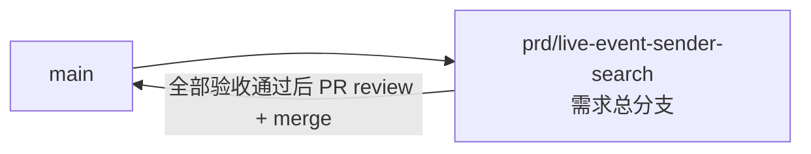

# 直播事件发送者信息搜索 - 实现 Plan

**功能名称**: 直播事件发送者信息搜索
**关联 PRD**: `docs/product/draft/20260820-live-event-sender-search-prd.md`（v1.0）
**关联技术提案**: `docs/engineering/proposals/20260820-proposal-live-event-sender-search.md`（v1.0）
**Plan 版本**: v1.0
**创建日期**: 2026-08-20
**作者**: Deliay
**feat-branch**: `prd/live-event-sender-search`（需求总分支）

## 1. 概述

本 Plan 基于 PRD v1.0 与技术提案 v1.0 产出，指导直播事件发送者信息搜索的编码实施。实施全程遵循 `docs/engineering/common-rules.md`：TDD、契约式开发、核心逻辑单元测试覆盖率 ≥ 80%、合并前 review。

### 1.1 实施范围

- **做**：
  - `contracts/bilibili-crawler.openapi.yaml`：更新 `event/search` 端点与 `StringCriteria` 参数的描述文本（匹配范围扩大为文本/用户名/粉丝牌子串 + 纯数字 UID 精确匹配，契约结构不变）。
  - `Live/LiveEventTextExtractor`：重构为单次解析同时提取纯文本与发送者三元素（`ExtractText` → `Extract` 返回 `LiveEventTextExtraction`）。
  - `Persistence/Entities/LiveEventTextIndexRecord`：新增 `SenderName`/`SenderUid`/`SenderMedal` 三个字段。
  - `Live/LiveEventSource`：落库写索引时填充发送者字段。
  - `Persistence/LiveEventTextIndexRepository.SearchAsync`：`$or` 组合 Text/SenderName/SenderMedal regex 匹配 + 纯数字关键词 SenderUid 精确匹配。
  - `Persistence/MongoDbInitializer`：新增 `BackfillLiveEventSenderAsync`（Meta 标记 `live_event_text_index_sender_backfill_v1`），存量索引记录按 EventId ReplaceOne upsert 重建补齐。
  - 提取、搜索匹配、UID 识别、回填的测试补齐。
- **不做**：搜索接口路径/入参/分页/返回结构变更；返回 DTO 冗余发送者字段；弹幕/SC 以外类型；粉丝牌等级、UID 子串匹配；发送者字段独立索引；前端改动；新增配置项与鉴权。

### 1.2 现状基线

- `LiveEventTextExtractor.ExtractText`（`servers/api/Live/LiveEventTextExtractor.cs:7-56`）：静态纯函数，单次 `JsonDocument.Parse` 后按 `type` 分支取弹幕 `info[1]` / SC `data.message`，文本空白/解析失败/其他类型返回 `null`。重构为 `Extract` 返回 record 时保持「Text 空白 → 整体 null」语义，发送者字段缺失降级为空值不丢记录。
- `LiveEventTextIndexRecord`（`servers/api/Persistence/Entities/LiveEventTextIndexRecord.cs`）：现有 `Id/EventId/RoomId/Type/Text/OccurredAt`；新字段沿用既有标注风格（`SenderUid` 加 `[BsonRepresentation(BsonType.Int64)]`，string 字段默认 `string.Empty`）。
- `LiveEventTextIndexRepository.SearchAsync`（`servers/api/Persistence/LiveEventTextIndexRepository.cs:22-48`）：`Regex.Escape` + `BsonRegularExpression(escaped, "i")` 对 `Text` 单字段 regex，`Eq(RoomId)` 收敛，`OccurredAt desc, Id desc` 排序 + `Hint(SearchIndexName)` + Skip/Limit，Count/Find 共用过滤条件。扩展时 regex 转义与选项复用于三个字段，`$or` 组合；排序、hint、分页、Count 语义不变。
- 搜索索引 `SearchIndexName = "RoomId_1_OccurredAt_-1_Id_-1"`（`servers/api/Persistence/LiveEventTextIndexRepository.cs:12`）与 `EventId` 唯一索引（`MongoDbInitializer.EnsureLiveEventTextIndexAsync`，`servers/api/Persistence/MongoDbInitializer.cs:132`）均不变，发送者字段不另建索引。
- `LiveEventSource.RunRoomAsync`（`servers/api/Live/LiveEventSource.cs:137-153`）：`InsertAsync` 成功后调用 `ExtractText` 并写索引记录；改为调用 `Extract` 并填充全部字段，异常不阻断总线发布与 SSE 的既有行为不变。
- v1 回填 `BackfillLiveEventTextIndexAsync`（`servers/api/Persistence/MongoDbInitializer.cs:339-433`）：Meta 标记 + `_id` 游标分批 500 + 投影扫描 + ReplaceOne upsert（EventId）模式；`BackfillLiveEventSenderAsync` 与其同构，新标记 `live_event_text_index_sender_backfill_v1`，重建时写入完整记录（Text + 发送者字段）。`Program.cs:86-89` 启动序列在 `BackfillLiveEventTextIndexAsync` 之后追加调用。
- 契约 `contracts/bilibili-crawler.openapi.yaml`：`event/search`（:207）与 `StringCriteria`（:295）本次仅更新描述文本，结构不动。
- `tests/Z.Vtuber.Tests`：已有 `MongoDbFixture`（Testcontainers）、`LiveEventTextExtractorTests`、`LiveEventTextIndexRepositoryTests`、`BilibiliLiveControllerTests`、v1 回填集成测试；新测试沿用既有模式，样本取自内网环境 `http://vtuber.internal.fffdan.com` 直播间 `1727076670` 真实 payload（提案 5.2 已验证提取路径）。

## 2. 分支与提交流程

遵循 `z-git` 规范（仅 merge、禁止 rebase/squash）与 Conventional Commits：

- 本需求开发全程只使用需求总分支 `prd/live-event-sender-search`：契约、实现、测试全部直接在该分支上提交，不再切开发子分支。
- 需求总 PR 已存在（`https://github.com/Deliay/z-vtuber/pull/36`），后续提交直接推送到该分支更新 PR；全部验收通过后 review 通过即 merge（仅 merge，禁止 rebase/squash）。
- 提交信息使用 Conventional Commits（`feat:` / `test:` / `docs:` 等），实现与测试分开提交。

## 3. 实施阶段

按 z-coding 开发流程「契约 → 实现 → 编排 → API 测试」推进，全程 TDD（先写测试再实现）。

### Phase 0: 契约先行

| # | 任务 | 产出 |
|---|------|------|
| 0.1 | 更新 `StringCriteria` 参数（`contracts/bilibili-crawler.openapi.yaml:295`）`description`：关键词在弹幕/SC 的纯文本、发送者用户名、粉丝牌名称中做不区分大小写子串匹配，任一命中即返回；纯数字关键词额外按发送者 UID 精确匹配；非空且非纯空白、最长 200 字符等既有约束描述保留 | 契约更新（仅描述） |
| 0.2 | 更新 `event/search`（`contracts/bilibili-crawler.openapi.yaml:207`）`summary`/`description`：说明匹配范围扩大与纯数字 UID 精确匹配语义；路径、参数引用、200/400 响应结构均不动 | 契约更新（仅描述） |

### Phase 1: 提取器重构与索引实体扩展（TDD）

| # | 任务 | 关键文件 | 测试重点 |
|---|------|---------|---------|
| 1.1 | `LiveEventTextIndexRecord` 新增 `SenderName`（string，默认空串）、`SenderUid`（long，`[BsonRepresentation(BsonType.Int64)]`，默认 0）、`SenderMedal`（string，默认空串） | `servers/api/Persistence/Entities/LiveEventTextIndexRecord.cs` | 随 2.1/3.1 集成测试覆盖 |
| 1.2 | 重构 `LiveEventTextExtractor`：`ExtractText` → `Extract(string type, string payload)` 返回 `LiveEventTextExtraction?`（record：`Text/SenderName/SenderUid/SenderMedal`）。单次 `JsonDocument` 解析：弹幕取 `info[1]`（Text）、`info[2][0]`（number→long，Uid）、`info[2][1]`（Name）、`info[3]` 非空数组时取 `info[3][1]`（Medal），`info[3]=[]` → Medal 空；SC 取 `data.message`、`data.uid`、`data.user_info.uname`、`data.medal_info.medal_name`。其他类型/解析失败/Text 空白 → null；发送者字段缺失/类型异常 → 对应字段降级空值（Uid=0、Name/Medal=""），不丢记录。`ExtractText` 调用点（LiveEventSource、v1 回填）同步迁移 | `servers/api/Live/LiveEventTextExtractor.cs` | 改造 `tests/Z.Vtuber.Tests/LiveEventTextExtractorTests.cs`：真实弹幕样本（`info[2]=[403496,"Zero_Ash",...]`、`info[3]=[25,"小粉螈",...]`）提取正确、`info[3]=[]` → Medal 空、真实 SC 样本（`data.uid`/`user_info.uname`/`medal_info.medal_name`）提取正确、`info[2]`/`info[3]` 缺失或长度不足/类型异常降级空值不丢记录、文本空白仍 → null、非文字类型/非法 JSON → null |

### Phase 2: 多维度搜索匹配（TDD）

| # | 任务 | 关键文件 | 测试重点 |
|---|------|---------|---------|
| 2.1 | `SearchAsync` 匹配扩展：`Regex.Escape` + `i` 选项复用于 `Text`/`SenderName`/`SenderMedal` 三字段 regex，以 `Filter.Or` 组合后与 `Eq(RoomId)` 取 And；`stringCriteria` 满足「全部字符为 ASCII 数字且 `long.TryParse` 成功」时向 `$or` 追加 `Eq(SenderUid, uid)` 子句。排序、hint、Skip/Limit、Count/Find 共用过滤条件均不变。UID 识别逻辑提取为私有静态方法便于单测 | `servers/api/Persistence/LiveEventTextIndexRepository.cs` | 增补 `LiveEventTextIndexRepositoryTests`（Testcontainers）：用户名子串命中（不区分大小写）、粉丝牌命中、文本命中回归、纯数字 UID 精确命中、合集去重（一事件一记录，文本+用户名同时命中不重复）、RoomId 隔离、分页不重不漏、total 真实、空 Medal 记录不被粉丝牌关键词误命中（空串不匹配非空 regex）、纯数字关键词同时命中 UID 与文本的合集语义；UID 识别单测：纯数字可解析 → 追加、含非数字/超 long 范围/空串 → 不追加 |

### Phase 3: 落库写索引与存量补齐（TDD）

| # | 任务 | 关键文件 | 测试重点 |
|---|------|---------|---------|
| 3.1 | `LiveEventSource` 写索引处（`LiveEventSource.cs:142-153`）改调 `Extract`，非空时写入完整记录 `{ EventId, RoomId, Type, Text, SenderName, SenderUid, SenderMedal, OccurredAt }`；DuplicateKey 捕获与异常不阻断主链路的既有行为不变 | `servers/api/Live/LiveEventSource.cs` | 编译与既有测试回归；字段正确性由 3.2 回填/集成测试与 1.2 单测锁定 |
| 3.2 | `MongoDbInitializer` 新增常量 `LiveEventSenderBackfillMigrationKey = "live_event_text_index_sender_backfill_v1"` 与 `BackfillLiveEventSenderAsync`：与 v1 回填同构——Meta 标记存在即跳过；`_id` 游标分批 500 扫描 `type $in [danmaku, super_chat]` 事件（投影 Id/Type/Payload/RoomId/OccurredAt）；`Extract` 非空时按 EventId ReplaceOne upsert 重建整条索引记录（含 Text 与发送者字段）；完成写标记；进度日志。`Program.cs:89` 之后追加调用 | `servers/api/Persistence/MongoDbInitializer.cs`、`servers/api/Program.cs` | 新增 `LiveEventSenderBackfillTests`（Testcontainers）：v1 已建但缺发送者字段的存量记录补齐三字段、漏建记录补建、非文字类型不处理、提取为 null 跳过、重复执行幂等（Meta 标记跳过 + 不产生重复/错误数据） |

### Phase 4: 编排验证与测试收口

| # | 任务 | 验收 |
|---|------|------|
| 4.1 | z-aspire-orchestrator 编排验证：AppHost 拉起 MongoDB + api，启动日志确认 `live_event_text_index_sender_backfill_v1` 回填完成，`event/search` 可按用户名/粉丝牌/UID 命中 | 本地运行通过 |
| 4.2 | z-test 覆盖 `event/search`：按用户名/粉丝牌/纯数字 UID 搜索命中、文本搜索回归、翻页、空关键词 400、超长 400、无命中 total=0 | 全部通过 |
| 4.3 | 覆盖率核验：核心逻辑 ≥ 80%（提取器、UID 识别、搜索仓储、回填） | 达标 |
| 4.4 | 全量回归 `dotnet test` | 全部通过 |
| 4.5 | 同步更新 `servers/api/AGENTS.md` 模块结构描述（`LiveEventTextExtractor` 提取文本+发送者三元素、索引集合新增发送者字段、`event/search` 匹配范围扩大、发送者回填标记） | 文档同步 |

## 4. 并行策略

- 本需求仅 `servers/api` 一个实现子项目，按 z-coding 工作流以 subagent 委托开发。
- Phase 0 契约（纯描述更新）必须先于 Phase 4 的 API 测试；Phase 1 的 1.1（实体）与 1.2（提取器，纯函数无依赖）可与 Phase 0 并行；Phase 2 依赖 1.1 完成；Phase 3 的 3.1/3.2 依赖 1.2 完成；Phase 4 依赖全部实现完成。
- 每阶段完成后更新 todo 并提交（实现与测试分开提交）。

## 5. 验收对照

| PRD 功能点 | 实现任务 | 验证方式 |
|-----------|---------|---------|
| 功能点 1：沉淀发送者三元素（用户名/UID 正确、佩戴粉丝牌时记录牌名、未佩戴为空） | 1.1、1.2、3.1 | 提取器单测（真实样本 + 退化样本）+ 回填集成测试 |
| 功能点 2：搜索覆盖发送者元素（用户名/粉丝牌子串命中、纯数字 UID 精确命中、文本行为不回退、倒序分页 total 真实） | 0.1、0.2、2.1 | 搜索仓储集成测试 + Controller 回归 + API 测试 |
| 功能点 3：历史数据补齐（存量可检索、幂等可重入） | 3.2 | 回填集成测试（补齐 + 补建 + 幂等）+ 编排验证 |
| 边界：发送者字段缺失降级空值不丢记录 | 1.2 | 提取器单测（缺失/类型异常样本） |
| 边界：空 Medal 不被粉丝牌关键词误命中 | 2.1 | 搜索仓储集成测试 |
| 非功能：性能不退化为全量拉取内存匹配（索引收敛 + 残余过滤） | 2.1（沿用 SearchIndexName hint） | 代码评审检查 + 编排验证 |
| 兼容性：契约结构不变，仅描述更新 | 0.1、0.2 | 契约 diff 评审 + API 测试回归 |

## 6. 风险与依赖

| 项 | 说明 | 应对 |
|---|------|------|
| 发送者提取路径 | 弹幕 `info[2]`/`info[3]`、SC `data.uid`/`user_info.uname`/`medal_info.medal_name` | 提案已经内网真实数据验证；实现期单测覆盖缺失/长度不足/类型异常退化样本，降级空值不丢记录 |
| `$or` 多分支 regex 性能 | 多字段 regex 均为索引有序扫描后的残余过滤，扫描量与现状同量级 | 沿用 SearchIndexName hint；实测不达标再评估独立索引多计划方案（超出本期范围） |
| 纯数字关键词合集语义 | 如「233」同时命中 UID=233 与文本含「233」的内容 | PRD 约定的合集语义，非缺陷；测试锁定该行为 |
| 回填期间新旧记录并存 | 未补齐旧记录发送者字段为空，仅文本可命中 | 回填幂等可重入，关注完成日志；回填期间增量写入（含发送者字段）不受影响 |
| 首次启动回填耗时 | 数据量大的环境回填期间启动变慢 | 沿用 v1 分批 500 + 进度日志模式 |
| 契约先行约束 | 仅描述更新，结构不动 | Phase 0 先行，契约 diff 评审确认无结构变更 |

## 7. 相关文档

- PRD：`docs/product/draft/20260820-live-event-sender-search-prd.md`
- 技术提案：`docs/engineering/proposals/20260820-proposal-live-event-sender-search.md`
- 契约：`contracts/bilibili-crawler.openapi.yaml`
- 开发规范：`docs/engineering/common-rules.md`、`docs/engineering/backend-rules.md`
- 上一期 Plan：`docs/engineering/plans/20260819-plan-live-event-text-search.md`
