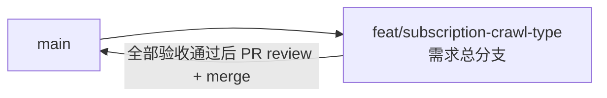

# 订阅抓取类型独立控制 - 实现 Plan

**功能名称**: 订阅抓取类型独立控制
**关联 PRD**: `docs/product/draft/20260820-subscription-crawl-type-prd.md`（v1.0）
**关联技术提案**: `docs/engineering/proposals/20260820-proposal-subscription-crawl-type.md`（v1.0）
**Plan 版本**: v1.0
**创建日期**: 2026-08-20
**作者**: Deliay
**feat-branch**: `feat/subscription-crawl-type`（需求总分支）

## 1. 概述

本 Plan 基于已产出的 PRD v1.0 与技术提案 v1.0 编写，指导订阅抓取类型独立控制的编码实施。实施全程遵循 `docs/engineering/common-rules.md`：TDD（先写测试再实现）、契约式开发（先更新契约再联调）、核心逻辑单元测试覆盖率 ≥ 80%、合并前 review。

### 1.1 实施范围

- **做**：
  - 契约更新：`contracts/bilibili-crawler.openapi.yaml` 的 `SubscribeRequest` 新增必填 `type`（enum: `danmaku`/`dynamic`）、`SubscriptionItem` 新增 `type`、DELETE `/api/b/subscription/{mid}` 新增必填 query `type`。
  - 类型模型：新增 `SubscriptionType` 枚举（`Dynamic`/`Danmaku`，MongoDB 序列化为小写字符串，与契约 enum 值一致）；`SubscriptionRecord` 扩展 `Type` 字段。
  - `SubscriptionService` 签名调整：`Subscribed` 事件载荷扩展为 `(mid, type)`；`SubscribeAsync`/`UnsubscribeAsync` 增加 type 维度；`GetMidsAsync` 增加按类型过滤参数；upsert 过滤条件由 `{ Mid }` 改为 `{ Mid, Type }`。
  - Controller：`BilibiliSubscriptionController` 解析并校验 type（缺失/非法 400，错误信息列出合法取值；解析大小写不敏感、落库统一小写）；GET 列表返回带 type 的条目；DELETE 增加必填 type query。
  - 抓取链路过滤：`SpaceTimelineJob` 仅处理 `dynamic`；`LiveStatusJob` 与 `LiveEventSource` 仅处理 `danmaku`；`Subscribed` 事件由各订阅方自行判断类型，事件源不做分发过滤。
  - 存量迁移：`MongoDbInitializer` 新增 `subscription_type_split_v1` 幂等迁移，存量记录拆为 `dynamic` + `danmaku` 双订阅；索引从 `Mid` 单字段唯一索引重建为 `(Mid, Type)` 复合唯一索引。
  - 测试覆盖：订阅服务/迁移/Controller 的新增与适配测试，既有测试适配新签名且无回归。
- **不做**：
  - 新增 `dynamic`/`danmaku` 之外的抓取类型（类型集合保持可扩展，留待后续）；
  - 抓取链路本身的风控、频率治理（已由 412 修复提案覆盖）；
  - 前端改动：已确认 `apps/web` 无任何 subscription API 调用（亦无生成客户端），契约变更当前只影响后端与 YAML。

### 1.2 现状基线

- `SubscriptionRecord`（`servers/api/Persistence/Entities/SubscriptionRecord.cs`，16 行）：仅 `Id`/`Mid`/`SubscribedAt` 三字段，无类型维度。
- `SubscriptionService`（`servers/api/Services/SubscriptionService.cs`，62 行，接口与实现同文件）：`event Action<long>? Subscribed`（L9）；`GetMidsAsync`（L23-30）全表投影 `Mid`，无过滤参数；`SubscribeAsync`（L39-54）`Filter.Eq(Mid)` + `SetOnInsert(SubscribedAt)` upsert，仅 `UpsertedId is not null` 时触发 `Subscribed`（L50-53）；`UnsubscribeAsync`（L56-61）按 `Mid` 删除。
- `BilibiliSubscriptionController`（`servers/api/Controllers/BilibiliSubscriptionController.cs`，40 行）：GET 返回 `{ items }`（L10-16）；POST 校验 `Mid is null or <= 0` → 400（L18-28）；DELETE `{mid}` → 204/404（L30-35）；DTO `SubscribeRequest(long Mid)`（L38）与 `SubscriptionItemDto(long Mid, DateTime? SubscribedAt)`（L40）同文件定义。
- `MongoDbInitializer`（`servers/api/Persistence/MongoDbInitializer.cs`，415 行）：`EnsureSubscriptionsIndexesAsync`（L45-51）建 `Mid` 升序唯一索引；已有 3 个 `zvtuber_meta` 标记迁移（`space_timeline_pub_ts_backfill_v1` L182、`live_event_gift_price_backfill_v2` L245、`live_event_text_index_backfill_v1` L314），模式为「开头查 meta 标记存在即跳过，完成 `InsertOneAsync` 标记」；`DropIndexIfExistsAsync`（L134-142）可复用于旧索引清理。
- `Program.cs`：DI 注册 `MongoDbInitializer`（L30）与 `ISubscriptionService`（L33）；启动块 L65-72 依次 `EnsureIndexesAsync` → 三个 Backfill——**本次迁移与索引重建的顺序需在此块内调整**（见 Phase 4）。
- 抓取消费方三处 `GetMidsAsync` 调用：`SpaceTimelineJob.RunOnceAsync`（`servers/api/Jobs/SpaceTimelineJob.cs:42`，事件订阅 L35）、`LiveStatusJob.RunOnceAsync`（`servers/api/Jobs/LiveStatusJob.cs:54`，事件订阅 L47）、`LiveEventSource.ReconcileAsync`（`servers/api/Live/LiveEventSource.cs:51`，30s 对账，不订阅事件）。
- 契约：`contracts/bilibili-crawler.openapi.yaml` `/api/b/subscription`（L38-66）、`/api/b/subscription/{mid}`（L67-77）；schema `SubscribeRequest`（L324-330，required `[mid]`）、`SubscriptionItem`（L331-339）、`SubscriptionList`（L340-346）。
- 测试：`tests/Z.Vtuber.Tests` 共约 247 个用例；`SubscriptionServiceTests.cs`（5 例，Testcontainers）、`SubscriptionOnboardingTests.cs`（2 例，直接 wire `Subscribed` 事件）、`MongoDbInitializerTests.cs`（迁移测试范本：`Backfill_*_IsIdempotent`、`*_Marker_PreventsRerun` 命名约定）、`MongoDbFixture.cs`（mongo:7.0，`ResetAsync` drop 集合后重跑 `EnsureIndexesAsync`）；Controller 测试模式已有（`BilibiliLiveControllerTests.cs` 等）。
- 前端：`apps/web` 仅有 Vite 脚手架，`subscription` 零匹配，无接入。

## 2. 分支与提交流程

遵循 `z-git` 规范（仅 merge、禁止 rebase/squash）与 Conventional Commits：

- 本需求开发全程只使用需求总分支 `feat/subscription-crawl-type`：实现、测试、文档全部直接在该分支上提交，不再切开发子分支。
- 需求总 PR 已存在（`https://github.com/Deliay/z-vtuber/pull/35`，base: main），后续提交直接推送到该分支更新 PR；全部验收通过后 review 通过即 merge（仅 merge，禁止 rebase/squash）。
- 提交信息使用 Conventional Commits（`feat:` / `test:` / `docs:` / `refactor:` 等），实现与测试分开提交。

## 3. 实施阶段

按 z-coding 开发流程推进，全程 TDD；契约更新（Phase 0）先行。本需求仅 `servers/api` 一个实现子项目 + 契约文件，无前端任务。

### Phase 0: 契约更新

| # | 任务 | 产出 |
|---|------|------|
| 0.1 | 更新 `contracts/bilibili-crawler.openapi.yaml`：① `SubscribeRequest`（L324-330）`required` 改为 `[mid, type]`，新增 `type: string, enum: [danmaku, dynamic]`；② `SubscriptionItem`（L331-339）新增 `type`（同 enum）；③ POST 响应 400 描述补充「type 缺失或非法」；④ DELETE `/api/b/subscription/{mid}`（L67-77）新增必填 query 参数 `type`（enum 同上），400 描述同步 | 契约更新（`docs:`/`feat(contract):` 提交） |

### Phase 1: 类型模型与订阅服务（TDD）

| # | 任务 | 关键文件 | 测试重点 |
|---|------|---------|---------|
| 1.1 | 新增 `SubscriptionType` 枚举（`Dynamic`/`Danmaku`），MongoDB 序列化为小写字符串（`[BsonRepresentation(BsonType.String)]` + 约定或序列化设置保证落库值为 `dynamic`/`danmaku`，与契约 enum 一致）；`SubscriptionRecord` 新增 `Type` 字段 | `servers/api/Persistence/Entities/SubscriptionType.cs`（新增）、`SubscriptionRecord.cs` | 集成测试断言落库文档的 `Type` 字段为小写字符串值 |
| 1.2 | `ISubscriptionService` 签名调整：`event Action<long, SubscriptionType>? Subscribed`；`SubscribeAsync(long mid, SubscriptionType type, ...)` 过滤条件改 `{ Mid, Type }`、仅真正插入时携带 type 触发事件；`GetMidsAsync(SubscriptionType type, ...)` 按类型过滤投影；`UnsubscribeAsync(long mid, SubscriptionType type, ...)` 按 `(Mid, Type)` 删除；`GetAllAsync` 返回含 Type 的完整记录 | `servers/api/Services/SubscriptionService.cs` | 扩展 `SubscriptionServiceTests.cs`（Testcontainers）：同 mid 双类型各自幂等、重复订阅不触发事件、`GetMidsAsync` 按类型严格过滤、取消仅删目标 (mid, type) 不影响另一类型、非正 mid 抛异常（回归） |

### Phase 2: Controller 校验与响应（TDD）

| # | 任务 | 关键文件 | 测试重点 |
|---|------|---------|---------|
| 2.1 | `SubscribeRequest` 增加 `Type`（string?）；POST 解析 type：缺失或不在枚举内 → 400 且错误信息列出 `danmaku, dynamic`；解析大小写不敏感、转枚举后落库统一小写；mid 非法校验保留并存；成功返回 200 `SubscriptionItemDto`（含 type）。`SubscriptionItemDto` 增加 `Type`；GET 列表每条目带 type。DELETE 增加必填 query `type`：缺失/非法 → 400；该 (mid, type) 未订阅 → 404；成功 → 204 | `servers/api/Controllers/BilibiliSubscriptionController.cs` | 新建 `tests/Z.Vtuber.Tests/BilibiliSubscriptionControllerTests.cs`（参照既有 Controller 测试模式）：type 缺失 400、type 非法 400（大小写混杂合法值 200）、mid 非法 400、双类型各 200 且 GET 列表含 type、DELETE 缺 type 400 / 未订阅 404 / 成功 204 |

### Phase 3: 抓取链路类型过滤（TDD）

| # | 任务 | 关键文件 | 测试重点 |
|---|------|---------|---------|
| 3.1 | `SpaceTimelineJob`：`GetMidsAsync` 调用点（L42）改传 `SubscriptionType.Dynamic`；`OnSubscribed`（L35/L49）仅在 `type == Dynamic` 时立即补抓 | `servers/api/Jobs/SpaceTimelineJob.cs` | 增补/适配 Job 测试：danmaku 订阅事件不触发动态补抓 |
| 3.2 | `LiveStatusJob`：`GetMidsAsync` 调用点（L54）改传 `SubscriptionType.Danmaku`；`OnSubscribed`（L47/L67）仅在 `type == Danmaku` 时走 `CrawlLiveImmediatelyAsync` | `servers/api/Jobs/LiveStatusJob.cs` | 适配 `SubscriptionOnboardingTests.cs`（事件载荷改 (mid, type)）：danmaku 订阅触发立即抓取、dynamic 订阅不触发、重复订阅不重复触发 |
| 3.3 | `LiveEventSource`：对账循环（L51）改传 `SubscriptionType.Danmaku`，仅 danmaku 订阅的 mid 进入 roomId 解析与连接对账 | `servers/api/Live/LiveEventSource.cs` | 增补对账过滤测试（仅 danmaku mid 建立连接；取消 danmaku 订阅后下一轮对账断开） |

### Phase 4: 存量迁移与索引重建（TDD）

| # | 任务 | 关键文件 | 测试重点 |
|---|------|---------|---------|
| 4.1 | `MongoDbInitializer` 新增迁移 `SubscriptionTypeSplitMigrationKey = "subscription_type_split_v1"`：找出所有无 `Type` 字段（或为空）的存量文档，每条原位置写入 `Type="dynamic"`，并以 `{ Mid, Type="danmaku" }` + 原 `SubscribedAt` upsert 第二条记录；迁移判断**以数据状态为准**（存在无 Type 记录即处理），meta 标记仅作快速跳过；复用批处理 500 模式 | `servers/api/Persistence/MongoDbInitializer.cs` | 新建 `SubscriptionTypeSplitMigrationTests.cs`（Testcontainers，参照 `MongoDbInitializerTests.cs` 命名约定）：存量 N 条 → 2N 条双类型、原 `SubscribedAt` 保留、重复执行/中断重跑幂等、meta 标记写入、清洗期间新增同 key 订阅不冲突 |
| 4.2 | 索引重建与启动顺序：`EnsureSubscriptionsIndexesAsync` 改为「`DropIndexIfExistsAsync` 删旧 `Mid` 唯一索引 → 建 `(Mid, Type)` 复合唯一索引」；**`Program.cs` 启动块（L65-72）调整顺序为：先删旧 Mid 唯一索引 → 执行 `subscription_type_split_v1` 迁移 → 再建复合唯一索引**（旧唯一索引不先删则迁移插入同 Mid 第二条必然冲突；迁移先于复合索引避免与唯一索引竞争）；其余集合索引与其余迁移顺序不变 | `servers/api/Persistence/MongoDbInitializer.cs`、`servers/api/Program.cs` | 集成测试：含存量数据的库走完完整启动序列后双类型记录齐全、复合唯一索引存在且同 (mid, type) 重复插入被拒 |

### Phase 5: 编排验证与测试收口

| # | 任务 | 验收 |
|---|------|------|
| 5.1 | z-aspire-orchestrator 编排验证：AppHost 拉起 MongoDB + api，分别订阅 `dynamic` 与 `danmaku`，观察仅对应类型抓取生效；手工构造无 Type 存量数据后重启，验证迁移为双类型且抓取无缺口 | 手工验证记录 |
| 5.2 | 全量回归 `dotnet test tests/Z.Vtuber.Tests`（基线约 247 例） | 全部通过 |
| 5.3 | 覆盖率核验：订阅服务、Controller 校验、迁移逻辑等核心逻辑 ≥ 80% | 达标 |
| 5.4 | 同步更新 `servers/api/AGENTS.md` 模块结构（订阅类型维度、`Subscribed` 事件载荷、迁移清单加 `subscription_type_split_v1`） | 文档同步 |

## 4. 并行策略

- 本需求仅 `servers/api` + 契约，按 z-coding 工作流以 subagent 委托开发。
- Phase 0（契约）先行独立提交，不阻塞后端编码（后端为契约生成源，两者以契约为准对齐）。
- Phase 1（类型模型与服务）是 Phase 2/3/4 的共同依赖，必须最先完成。
- Phase 2（Controller）、Phase 3（抓取过滤）、Phase 4（迁移与索引）在 Phase 1 完成后相互独立，可拆分三个委托并行。
- Phase 5 最后收口。
- 每阶段完成后更新 todo 并提交（实现与测试分开提交）。

## 5. 验收对照

| PRD 功能点 | 实现任务 | 验证方式 |
|-----------|---------|---------|
| 功能点 1：按类型创建订阅（双类型独立、同类型幂等、非法类型拒绝） | 0.1、1.1、1.2、2.1 | 订阅服务集成测试（幂等/过滤）+ Controller 测试（合法 200/非法 400） |
| 功能点 2：创建订阅类型必填校验（缺失 400、不产生记录、与 mid 校验并存） | 0.1、2.1 | Controller 测试：type 缺失 400、错误信息含合法取值、库中无记录 |
| 功能点 3：按类型控制抓取行为（动态/弹幕严格过滤、取消单类型互不影响、列表可见类型） | 1.2、2.1、3.1、3.2、3.3 | Job/LiveEventSource 过滤测试 + `SubscriptionOnboardingTests` 适配 + DELETE/GET 测试 |
| 功能点 4：存量订阅数据清洗（双类型、幂等、无数据缺口） | 4.1、4.2、5.1 | 迁移集成测试（幂等/重跑/标记）+ 完整启动序列测试 + Aspire 手工验证 |
| 非功能：契约变更同步、破坏性变更确认无现存调用方 | 0.1 | 契约 review；已确认 `apps/web` 无 subscription 调用（1.2 基线） |
| 非功能：既有测试无回归 | 3.1-3.3、5.2 | 全量 `dotnet test`（约 247 例基线） |

## 6. 风险与依赖

| 项 | 说明 | 应对 |
|---|------|------|
| 索引与迁移顺序 | 旧 `Mid` 唯一索引存在时，迁移插入同 Mid 的 danmaku 记录必然冲突 | 启动顺序固定为「删旧索引 → 迁移 → 建复合唯一索引」（Phase 4.2），并以完整启动序列集成测试锁定 |
| 新旧代码混部 | 旧实例并行写入会再次产生无 Type 记录 | 部署先停旧实例再启新实例；迁移判断以数据状态为准（存在无 Type 记录即处理），重启可安全重跑兜底 |
| 枚举序列化一致性 | DB 值与契约 enum 必须同为小写 `dynamic`/`danmaku` | 落库值以集成测试断言锁定；Controller 边界解析非法值即 400，枚举不携带未知值 |
| 取消订阅生效延迟 | 无取消事件，弹幕连接停止依赖 30s 对账收敛 | 可接受（提案已决策）；测试以对账断开断言锁定语义 |
| 依赖 | 现有 `SubscriptionService`/三个抓取消费方/`MongoDbInitializer` 迁移框架 | 就地扩展，不重构；`GetMidsAsync` 签名变更的全部调用点已在 1.2 基线枚举完整 |

## 7. 相关文档

- PRD：`docs/product/draft/20260820-subscription-crawl-type-prd.md`
- 技术提案：`docs/engineering/proposals/20260820-proposal-subscription-crawl-type.md`
- 契约：`contracts/bilibili-crawler.openapi.yaml`
- 开发规范：`docs/engineering/common-rules.md`、`docs/engineering/backend-rules.md`
- 上一期 Plan：`docs/engineering/plans/20260820-plan-bilibili-412-fix.md`
