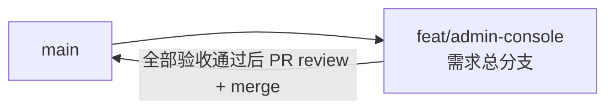

# 管理后台初版（订阅管理 + Cookie 管理）- 实现 Plan

**功能名称**: 管理后台初版（订阅管理 + Cookie 管理）
**关联 PRD**: `docs/product/draft/20260822-admin-console-prd.md`（v1.0）
**关联技术提案**: `docs/engineering/proposals/20260822-proposal-admin-console.md`（v1.0）
**Plan 版本**: v1.0
**创建日期**: 2026-08-22
**作者**: Deliay
**feat-branch**: `feat/admin-console`（需求总分支）

## 1. 概述

本 Plan 基于已产出的 PRD v1.0 与技术提案 v1.0 编写，指导管理后台初版的编码实施。实施全程遵循 `docs/engineering/common-rules.md`：TDD（先写测试再实现）、契约式开发（基于 OpenAPI 契约生成类型）、核心逻辑单元测试覆盖率 ≥ 80%、合并前 review。遵循 `docs/engineering/frontend-rules.md`：组件文件 PascalCase、组件目录 kebab-case、React 内置状态管理、包管理器 npm。

本需求为纯前端需求：契约 `contracts/bilibili-crawler.openapi.yaml` 现有订阅/Cookie 端点完全满足需求，**无契约变更、无后端变更**；z-coding 流程中「更新 Contract」阶段确认无需执行（已核对契约，见 1.2）。

### 1.1 实施范围

- **做**：
  - 测试设施引入：`apps/web` 新增 `vitest`、`@testing-library/react`、`@testing-library/jest-dom`、`jsdom` devDependencies，`vite.config.ts` 补充 test 配置，`package.json` 增加 `test` 脚本。
  - 契约类型生成：新增 `openapi-typescript` devDependency 与 `codegen` 脚本，从 `contracts/bilibili-crawler.openapi.yaml` 生成 `src/api/schema.d.ts`（自动生成勿手改）。
  - API 客户端：`src/api/client.ts` 基于生成类型封装 5 个端点函数（`listSubscriptions` / `subscribe` / `unsubscribe` / `listCookies` / `addCookie`），统一 base URL 与错误处理。
  - 后台布局：`App.tsx` 重构为左菜单右内容布局（`AdminLayout`），菜单含「订阅管理」「Cookie 管理」，默认选中订阅管理，选中项高亮。
  - 订阅管理页 `SubscriptionPage`：订阅列表（mid / 类型 / 订阅时间 / 取消按钮）、新增表单（mid + 必选 type）、行内二次确认取消。
  - Cookie 管理页 `CookiePage`：Cookie 列表（id / 状态 / 最近校验时间 / 最近使用时间，不含明文）、录入表单（textarea，空值拦截）。
  - 组件/单元测试覆盖上述全部逻辑，覆盖率 ≥ 80%。
- **不做**：
  - 任何后端 API 与契约变更（现有契约完全满足需求）；
  - 鉴权/登录（PRD 明确本期不做）；
  - 直播事件、空间动态等其他数据的可视化页面；
  - Cookie 删除/订阅编辑等契约不支持的操作；
  - 路由库、UI 组件库、Zustand 等额外依赖引入（提案 6.1 已决策）。

### 1.2 现状基线

- `apps/web/src/App.tsx`（27 行）：Vite 脚手架落地页，仅一次 `${API_URL}/health` 探测展示 API 状态；base URL 约定 `import.meta.env.VITE_API_URL ?? '/api'`（L4）已在用，客户端封装沿用。
- `apps/web/src/main.tsx`：标准入口，无需变更。
- `apps/web/package.json`（25 行）：scripts 仅 `dev`/`build`（`tsc -b && vite build`）/`lint`（oxlint）/`preview`；dependencies 仅 react/react-dom 19.2.8；devDependencies 含 typescript ~6.0.2、vite ^8.2.0、oxlint ^1.75.0、@vitejs/plugin-react ^6.0.4；**无测试框架、无 codegen 工具**。
- `apps/web/vite.config.ts`（12 行）：仅 react 插件与 server 配置（host/port 5173 strictPort），无 test 块。
- 契约已核对（`contracts/bilibili-crawler.openapi.yaml`）：
  - `GET /api/b/subscription`（L38-48）→ `SubscriptionList`；`POST /api/b/subscription`（L49-66）body `SubscribeRequest` required `[mid, type]`，type enum `[danmaku, dynamic]`，400 为「mid 非法或 type 缺失/非法」。
  - `DELETE /api/b/subscription/{mid}`（L67-86）必填 query `type`（enum 同上），响应 204 / 400 / 404（未订阅）。
  - `GET /api/b/cookie`（L9-19）→ `CookieList`；`POST /api/b/cookie`（L20-37）body `CookieAddRequest` required `[cookie]`，200 幂等，400 为空 Cookie。
  - Schema：`SubscriptionItem`（mid int64 / type / subscribedAt date-time，L344-356）；`CookieItem`（id / status enum `[active, offline]` / lastCheckedAt、lastUsedAt 可空 date-time，L310-325），契约不返回 Cookie 明文。
- 后端 `servers/api` 与 `tests/Z.Vtuber.Tests` 本需求零变更。

## 2. 分支与提交流程

遵循 z-git 规范与 Conventional Commits：

- 本需求开发全程只使用需求总分支 `feat/admin-console`：实现、测试、文档全部直接在该分支上提交，不再切开发子分支（沿用上一需求 `feat/subscription-crawl-type` 的既定做法）。
- 需求总 PR 已存在（`https://github.com/Deliay/z-vtuber/pull/44`，base: main），后续提交直接推送到该分支更新 PR；全部验收通过后 review 通过即 merge。
- 提交信息使用 Conventional Commits（`feat:` / `test:` / `docs:` / `chore:`），实现与测试分开提交。

## 3. 实施阶段

按 z-coding 开发流程推进，全程 TDD。本需求仅 `apps/web` 一个实现子项目，无契约更新、无后端任务。

### Phase 0: 测试设施与契约客户端基础（TDD）

| # | 任务 | 关键文件 | 测试重点 |
|---|------|---------|---------|
| 0.1 | 新增 devDependencies：`vitest`、`@testing-library/react`、`@testing-library/jest-dom`、`jsdom`、`openapi-typescript`；`package.json` 增加脚本 `test`（`vitest run`）与 `codegen`（`openapi-typescript ../../contracts/bilibili-crawler.openapi.yaml -o src/api/schema.d.ts`）；`vite.config.ts` 补充 vitest test 配置（jsdom 环境、setup 文件引入 jest-dom） | `apps/web/package.json`、`apps/web/vite.config.ts`、`apps/web/src/test/setup.ts`（新增） | `npm run test` 可运行空测试套件 |
| 0.2 | 执行 `npm run codegen` 生成 `src/api/schema.d.ts`，文件头标注「自动生成勿手改」；不入库手改，契约变更后重新 codegen | `apps/web/src/api/schema.d.ts`（新增） | 生成类型可被 tsc 正常引用（`npm run build` 通过） |
| 0.3 | 实现 `src/api/client.ts`：基于 schema 类型封装 `listSubscriptions` / `subscribe` / `unsubscribe` / `listCookies` / `addCookie`；base URL 沿用 `import.meta.env.VITE_API_URL ?? '/api'`；统一注入 JSON 头；非 2xx 抛出含服务端错误描述的 `Error`；`unsubscribe` 对 404 单独区分（提示「该订阅已不存在」） | `apps/web/src/api/client.ts`（新增）、`apps/web/src/api/client.test.ts`（新增） | 单测（mocked fetch）：5 个端点 method/path/body/query 拼接正确（DELETE query `type`）、非 2xx 抛错含服务端描述、404 与 400 区分 |

### Phase 1: 后台布局与菜单导航（TDD）

| # | 任务 | 关键文件 | 测试重点 |
|---|------|---------|---------|
| 1.1 | `App.tsx` 重构为左菜单右内容布局：菜单配置抽为数组（`{ key, label, component }`，为后续扩展预留）；当前页用 `useState<'subscriptions' \| 'cookies'>` 管理，默认 `'subscriptions'`；选中项高亮（`aria-current`）；`App.css` 调整布局与菜单样式；移除脚手架落地页与 `/health` 探测 | `apps/web/src/App.tsx`、`apps/web/src/App.css`、`apps/web/src/App.test.tsx`（新增） | 组件测试（mock client）：默认渲染订阅管理页；点击菜单切换内容区；当前菜单项高亮 |
| 1.2 | 菜单项对应页面先挂占位组件（渲染页面标题即可），保证 Phase 1 独立可验收；Phase 2/3 替换为真实页面 | `apps/web/src/pages/subscription/SubscriptionPage.tsx`、`apps/web/src/pages/cookie/CookiePage.tsx`（新增占位） | 随 1.1 测试覆盖 |

### Phase 2: 订阅管理页（TDD）

| # | 任务 | 关键文件 | 测试重点 |
|---|------|---------|---------|
| 2.1 | 订阅列表：表格展示 mid、类型中文标签（`danmaku→弹幕`、`dynamic→动态`）、`subscribedAt` 本地化时间、取消按钮；空列表展示空状态提示；挂载与每次变更后重新 GET 全量列表；列表加载失败展示「服务不可用」错误提示 | `apps/web/src/pages/subscription/SubscriptionPage.tsx`、`SubscriptionPage.test.tsx` | 组件测试（vi.mock client）：列表渲染、同 mid 双类型独立条目、空态、加载失败提示 |
| 2.2 | 新增订阅表单：mid 数字输入 + type 单选「弹幕/动态」+ 提交；前端校验：type 未选阻止提交并提示、mid 空/非正整数阻止提交并提示；提交中禁用按钮防重复提交；成功提示并刷新列表；400 展示服务端错误描述 | 同上 | 组件测试：type 未选拦截、mid 非法拦截、成功刷新列表、400 错误展示、提交中禁用 |
| 2.3 | 取消订阅：行内二次确认（点击「取消」→ 变为「确认取消 / 返回」）；确认后调用 `unsubscribe`；204 刷新列表；404 提示「该订阅已不存在」并刷新列表（保持真实状态） | 同上 | 组件测试：二次确认交互、确认后条目消失、取消一类不影响同 mid 另一类（以刷新后列表断言）、404 提示 |

### Phase 3: Cookie 管理页（TDD）

| # | 任务 | 关键文件 | 测试重点 |
|---|------|---------|---------|
| 3.1 | Cookie 列表：表格展示 id（截断）、status 中文标签与颜色标识（`active→可用`、`offline→离线`，未识别值原样展示兜底）、`lastCheckedAt`/`lastUsedAt` 本地化时间（空值显示「-」）；空态提示；加载失败提示 | `apps/web/src/pages/cookie/CookiePage.tsx`、`CookiePage.test.tsx` | 组件测试（vi.mock client）：列表渲染、状态映射、可空时间显示「-」、空态 |
| 3.2 | 录入 Cookie 表单：textarea 粘贴 + 提交；空/纯空白前端拦截并提示；提交中禁用；成功提示、清空输入并刷新列表；400 展示服务端错误描述；任何位置不渲染 Cookie 明文 | 同上 | 组件测试：空值拦截、成功清空+刷新、400 展示、列表无明文 |

### Phase 4: 编排验证与测试收口

| # | 任务 | 验收 |
|---|------|------|
| 4.1 | z-aspire-orchestrator 编排验证：AppHost 拉起 MongoDB + api + web，打开后台完成订阅新增（双类型）/取消与 Cookie 录入，与 `curl` 直接调用 API 的结果交叉核对一致性 | 手工验证记录 |
| 4.2 | `npm run test`、`npm run lint`、`npm run build` 全绿；核心逻辑覆盖率 ≥ 80% | 全部通过 |
| 4.3 | 后端回归确认：`dotnet test tests/Z.Vtuber.Tests` 不受影响（本需求零后端变更，执行一次确认即可） | 全部通过 |
| 4.4 | 同步更新 `apps/web/AGENTS.md`（模块结构补充 api/client、pages、测试与 codegen 说明） | 文档同步 |

## 4. 并行策略

- 本需求仅 `apps/web`，按 z-coding 工作流以 subagent 委托开发。
- Phase 0（测试设施 + 客户端）先行：契约类型与 `api/client.ts` 是全部页面的公共依赖，必须最先完成并独立提交。
- Phase 1（布局）依赖 Phase 0 的 client 类型（页面占位需挂载）。
- Phase 2（订阅页）与 Phase 3（Cookie 页）相互独立，在 Phase 0+1 完成后可拆分两个委托并行。
- Phase 4 最后收口。
- 每阶段完成后提交（实现与测试分开提交），实现分支即需求总分支 `feat/admin-console`。

## 5. 验收对照

| PRD 功能点 | 实现任务 | 验证方式 |
|-----------|---------|---------|
| 功能点 1：后台整体布局与导航（左菜单右内容、高亮、默认订阅页、免鉴权） | 1.1、1.2 | App 组件测试 + 手工验证 |
| 功能点 2：订阅列表（mid/类型/时间、双类型独立条目、空态） | 0.3、2.1 | SubscriptionPage 组件测试 |
| 功能点 3：新增订阅（类型必选、mid 校验、幂等无重复） | 0.3、2.2 | 组件测试（校验拦截/400 展示）+ 编排验证幂等 |
| 功能点 4：取消订阅（二次确认、类型互不影响、404 提示） | 0.3、2.3 | 组件测试（确认交互/404/刷新后列表断言） |
| 功能点 5：Cookie 列表（标识/状态/时间、无明文、空态） | 0.3、3.1 | CookiePage 组件测试（契约本身不返回明文） |
| 功能点 6：录入 Cookie（空值拦截、幂等无重复） | 0.3、3.2 | 组件测试（拦截/400 展示）+ 编排验证幂等 |
| 非功能：操作即时生效、列表与服务端一致 | 2.1-2.3、3.1-3.2（操作后全量刷新） | Aspire 手工验证与 curl 交叉核对 |
| 非功能：核心逻辑覆盖率 ≥ 80%、build/lint/test 全绿 | 4.2 | `npm run test/lint/build` |
| 非功能：不影响既有接口调用方 | 无契约/后端变更（1.2 基线已核对） | 契约 review + `dotnet test` 回归 |

## 6. 风险与依赖

| 项 | 说明 | 应对 |
|---|------|------|
| 依赖 | `contracts/bilibili-crawler.openapi.yaml` 现有订阅/Cookie 端点 | 已核对满足需求（1.2）；契约演进后重新 `npm run codegen` 获得类型错误提示 |
| 依赖 | 后端服务可达（`VITE_API_URL` 或 `/api` 代理） | Aspire 编排下沿用现有服务发现；列表加载失败展示「服务不可用」不白屏 |
| 首次引入测试框架 | vitest/jsdom 与现有 `tsc -b`、`oxlint` 共存 | Phase 0 即锁定 `npm run test`/`build`/`lint` 三命令全绿，后续阶段不得破坏 |
| 类型生成文件漂移 | `schema.d.ts` 手改后与契约不一致 | 文件头标注勿手改；仅以 codegen 产物为准 |
| 取消订阅幂等语义 | 后端 404 表示已取消 | 前端 404 单独提示并刷新列表，以服务端状态为准（不做本地推断） |
| 无 URL 导航 | 刷新后回到默认订阅页 | 内网工具两个页面可接受（提案 6.1 已决策），菜单配置数组为未来引入路由预留 |

## 7. 相关文档

- PRD：`docs/product/draft/20260822-admin-console-prd.md`
- 技术提案：`docs/engineering/proposals/20260822-proposal-admin-console.md`
- 契约：`contracts/bilibili-crawler.openapi.yaml`
- 开发规范：`docs/engineering/common-rules.md`、`docs/engineering/frontend-rules.md`
- 上一期 Plan：`docs/engineering/plans/20260820-plan-subscription-crawl-type.md`
