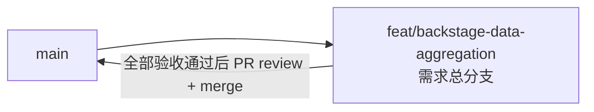

# 管理后台数据聚合（订阅主播昵称 + Cookie 帐号昵称）- 实现 Plan

**功能名称**: 管理后台数据聚合（订阅主播昵称 + Cookie 帐号昵称）
**关联 PRD**: `docs/product/draft/20260828-backstage-data-aggregation-prd.md`（v1.0）
**关联技术提案**: `docs/engineering/proposals/20260828-proposal-backstage-data-aggregation.md`（v1.1）
**Plan 版本**: v1.0
**创建日期**: 2026-08-28
**作者**: Deliay
**feat-branch**: `feat/backstage-data-aggregation`（需求总分支）

## 1. 概述

本 Plan 基于 PRD v1.0 与技术提案 v1.1 编写，指导管理后台数据聚合的编码实施。实施全程遵循 `docs/engineering/common-rules.md`（TDD、契约式开发、核心逻辑覆盖率 ≥ 80%）、`backend-rules.md`（后端为契约生成源）与 `frontend-rules.md`（组件 PascalCase、目录 kebab-case、React 内置状态、npm）。

### 1.0 上游阻塞核实结论（首轮打回问题复查）

首轮打回指出的阻塞问题「nav 拿不到 uname」经重新反编译核实 **不成立**，提案 v1.1 的技术路径可行：

- `Mikibot.Crawler` 1.0.9（`servers/api/Z.Vtuber.csproj:13`）的 `NavInfo` 是 struct，成员为 `Mid`/`Name`/`WbiInfo`；**属性级带有 `JsonPropertyName` 特性**：`Mid→"mid"`、`Name→"uname"`、`WbiInfo→"wbi_img"`（ikdasm 反编译 `~/.nuget/packages/mikibot.crawler/1.0.9/lib/net10.0/Mikibot.Crawler.dll` 确认）。
- 因此 `IBiliApiClient.GetNavInfoV2Async` 返回的 `NavInfo.Name` 即为 B 站 nav 响应的 `uname`，直连（Mikibot `HttpCrawler.GetAsync`，`PropertyNameCaseInsensitive + CamelCase`）与拟真（`BrowserishBiliApiClient`，`JsonPropertyName` 特性优先于 options）两条通道均能正确绑定。
- **实现注意**：C# 侧属性名是 `nav.Name`，不是提案 5.2 文字中的 `nav.Uname`；落库字段沿用提案数据模型命名 `Uname`，映射为 `Uname = nav.Name`。
- 次要问题在提案 v1.1 中已更正或本 Plan 已吸收：集合名复数（`bilibili_cookies`/`bilibili_subscriptions`，见 1.2）；`ParseRaw` 仅做 `JsonNode.Parse` 透传，昵称提取字段本 Plan 明确为 channel JSON 的 `uName`（见 1.2 与 Phase 3）；前端两个 `.test.tsx` 已纳入结构清单；`GetLatestByMidsAsync` 可空约定见 Phase 1。

### 1.1 实施范围

- **做**：
  - 契约：`contracts/bilibili-crawler.openapi.yaml` 新增 `GET /api/b/backstage/subscription` 与 `GET /api/b/backstage/cookie` 两个只读 path 及 4 个 schema；前端 `npm run codegen` 重新生成 `schema.d.ts`。
  - 后端持久层：新增 `CookieAccountInfoRecord` 实体与 `CookieAccountInfoRepository`（按 `CookieId` upsert / 批量查询）；`MongoDbInitializer` 新增集合常量 `bilibili_cookie_account_info` 与 `CookieId` 唯一索引；`AccountBasicInfoRepository` 新增 `GetLatestByMidsAsync` 批量查询。
  - 后端任务：`CookieProbeJob` 在 `GetNavInfoV2Async` 探测成功（`nav.Mid > 0`）时将 `Mid`/`Name` 落库，落库失败仅记日志，探测状态机（cooldown/offline）行为不变。
  - 后端接口：新增 `BilibiliBackstageController`（前缀 `/api/b/backstage`），两个聚合只读端点，内存 join，昵称取不到时 `streamer`/`account` 或 `name` 为 `null`。
  - 前端：`client.ts` 新增两个聚合接口方法；`SubscriptionPage`/`CookiePage` 切换聚合接口并各新增一个昵称列（空值显示「暂无资料」）；现有交互（新增/取消订阅、录入 Cookie）不变。
  - 测试：仓储集成测试（Testcontainers MongoDB）、`CookieProbeJob` 落库单元测试、聚合端点测试、前端两页面组件测试；核心逻辑覆盖率 ≥ 80%。
- **不做**：
  - 头像、帐号 ID、直播间号等昵称以外字段的展示；
  - 页面加载时对 B 站的实时请求（昵称全部读库）；
  - 昵称编辑能力、后台鉴权；
  - 存量数据迁移回填（探测周期分钟级自然补齐，提案 6.1 已决策）。

### 1.2 现状基线

- **NavInfo 契约**（Mikibot.Crawler 1.0.9）：`NavInfo { long Mid; string Name; WbiInfo WbiInfo }`，`Name` 绑定 JSON `uname`（见 1.0）。
- **CookieProbeJob**（`servers/api/Jobs/CookieProbeJob.cs:29-33`）：每条 active Cookie 调用 `bili.GetNavInfoV2Async(record.Cookie, ct)`，`nav.Mid <= 0` 抛异常进 offline 分支；风控异常进 cooldown 分支。`RunOnceAsync` 为 `internal override`，测试可直接调用。
- **主播资料存储**（`servers/api/Services/AccountInfoCrawler.cs:47-57`）：channel API（`ukamnads.icu/api/v2/channel`）返回 `data.channel` 对象整体存入 `AccountBasicInfoRecord.Data`（JSON 字符串），channel 对象含 `uId`/`roomId`/`uName` 等字段（测试样例 `tests/Z.Vtuber.Tests/SubscriptionOnboardingTests.cs:18`）。**昵称提取路径：`Data` JSON 的 `uName` 字段**，缺失/解析失败按 `name = null` 处理。
- **集合常量**（`servers/api/Persistence/MongoDbInitializer.cs:6-17`）：`Cookies="bilibili_cookies"`、`Subscriptions="bilibili_subscriptions"`、`AccountBasicInfo="bilibili_account_basic_info"` 等；索引模式为每集合一个 `EnsureXxxIndexesAsync` 私有方法，由 `EnsureIndexesAsync`（:23-34）顺序调用，唯一索引示例 :46-50。
- **实体风格**：`CookieRecord`（`Persistence/Entities/CookieRecord.cs`）：`ObjectId Id`、`string Cookie`、`Status`、`LastCheckedAt/LastUsedAt/CooldownUntil`（可空 UTC）；`AccountBasicInfoRecord`：`Mid`/`RoomId` 带 `[BsonRepresentation(Int64)]`、`FetchedAt` 带 `[BsonDateTimeOptions(Utc)]`。
- **仓储风格**（`Persistence/AccountBasicInfoRepository.cs`）：`sealed class XxxRepository(IMongoDatabase database)` 主构造函数，`database.GetCollection<T>(MongoCollectionNames.X)`；`UpsertAsync` 按业务键 filter + `IsUpsert`；`GetLatestByMidAsync` 按 `FetchedAt` 倒序 `FirstOrDefaultAsync`（返回标注未加 `?` 但实际可空——新方法不再沿用该不严谨标注，见 Phase 1）。
- **Controller 风格**：`[ApiController] [Route("api/b/xxx")]`，构造注入服务/仓储；成功 `Ok(new { items })`，错误 `BadRequest(new { error })`；DTO 用文件内 record 或匿名对象；枚举 camelCase 字符串由 `Program.cs:15` 的 `JsonStringEnumConverter` 保证；Cookie 本体不出 DTO。
- **服务接口**：`ISubscriptionService.GetAllAsync` → `IReadOnlyList<SubscriptionRecord>`（按 `SubscribedAt` 升序）；`ICookiePoolService.GetActiveAsync` → `IReadOnlyList<CookieRecord>`（active 且未冷却，与现有 `/api/b/cookie` 列表口径一致）。
- **DI**（`servers/api/Program.cs`）：仓储 `AddSingleton`（:33-39），服务 `AddSingleton<IXxx, Xxx>`（:41-44），Job `AddHostedService`（:66-70）；启动时调用 `MongoDbInitializer.EnsureIndexesAsync`（:74-94），新集合索引加入 `EnsureIndexesAsync` 即随启动自动初始化；Controller 无需注册。
- **契约现状**（`contracts/bilibili-crawler.openapi.yaml`，506 行）：`paths:` :8-225，`components.schemas:` :303 起；`CookieItem` :310-325、`CookieList` :326-332、`SubscriptionItem` :344-356、`SubscriptionList` :357-363；列表统一 `{ items: [...] }` 包装。
- **测试设施**（`tests/Z.Vtuber.Tests/`，扁平结构）：`MongoDbFixture`（Testcontainers `mongo:7.0`，`zvtuber_test` 库，`ResetAsync` drop 全部集合后跑 `EnsureIndexesAsync`——**新集合须加入 drop 清单**）；`[Collection("mongo")]` + `IAsyncLifetime`；Controller 测试手工 `new` 控制器 + `Ok()` helper 断言 `OkObjectResult`；`CookieProbeJobTests` 纯单测（`MockBiliApiClient`/`MockCookiePoolService`，`Fakes.cs`）。
- **前端现状**：`client.ts` 以 `request<T>` 封装、`ApiError` 携带 `status/serverMessage`，类型全部来自 `schema.d.ts`；两页面原生 `<table>`，列定义在 JSX `<thead>`（`SubscriptionPage.tsx:147-153`、`CookiePage.tsx:121-131`），`useEffect` 全量加载；测试统一 `vi.mock('../../api/client')` + `vi.mocked(...)`。
- **构建配置**：`servers/api/Z.Vtuber.csproj` `net10.0` + `Nullable enable`；测试项目 xunit 2.9.3 + Testcontainers.MongoDb 4.13.0。
- **编排**：`infra/apphost/AppHost.cs` 一键拉起 mongo + api + web，`dotnet run`（project `infra/apphost`）本地验证。

## 2. 分支与提交流程

遵循 z-git 规范与 Conventional Commits：

- 本需求开发全程只使用需求总分支 `feat/backstage-data-aggregation`：实现、测试、文档全部直接在该分支提交，不切开发子分支（沿用上一需求 `feat/admin-console` 的既定做法）。
- 需求总 PR 已存在（`https://github.com/Deliay/z-vtuber/pull/51`，base: main），后续提交直接推送更新该 PR；全部验收通过后 review 通过即 merge。
- 提交信息使用 Conventional Commits（`feat:` / `test:` / `docs:` / `chore:`），实现与测试分开提交。

## 3. 实施阶段

按 z-coding 开发流程推进，全程 TDD（先写测试再实现）。

### Phase 0: 契约更新与客户端类型生成

| # | 任务 | 关键文件 | 验收 |
|---|------|---------|------|
| 0.1 | 契约新增 2 个 path：`GET /api/b/backstage/subscription` → `BackstageSubscriptionList`；`GET /api/b/backstage/cookie` → `BackstageCookieList`（仅 200 响应，只读无 body） | `contracts/bilibili-crawler.openapi.yaml`（paths 段） | YAML 语法合法，path 与现有风格一致 |
| 0.2 | 契约新增 4 个 schema：`BackstageSubscriptionItem`（`mid` int64 / `type` enum[danmaku,dynamic] / `subscribedAt` date-time / `streamer` 可空 `BackstageStreamerRef`）、`BackstageStreamerRef`（`name` 可空 string）、`BackstageCookieItem`（`id` / `status` enum[active,offline] / `lastCheckedAt`、`lastUsedAt` 可空 date-time / `account` 可空 `BackstageAccountRef`）、`BackstageAccountRef`（`name` 可空 string）；列表包装沿用 `{ items: [...] }` | 同上（components.schemas 段） | 字段可空性与提案 3.1 一致 |
| 0.3 | `npm run codegen` 重新生成 `apps/web/src/api/schema.d.ts`（自动生成勿手改） | `apps/web/src/api/schema.d.ts` | `npm run build` 通过 |

### Phase 1: 持久层——Cookie 帐号信息集合与批量查询（TDD）

| # | 任务 | 关键文件 | 测试重点 |
|---|------|---------|---------|
| 1.1 | 新增 `CookieAccountInfoRecord` 实体：`[BsonId] ObjectId Id`、`ObjectId CookieId`、`[BsonRepresentation(Int64)] long Mid`、`string? Uname`、`[BsonDateTimeOptions(Utc)] DateTime FetchedAt` | `servers/api/Persistence/Entities/CookieAccountInfoRecord.cs`（新增） | 随 1.3 集成测试覆盖序列化 |
| 1.2 | `MongoCollectionNames` 新增 `CookieAccountInfo = "bilibili_cookie_account_info"`；新增 `EnsureCookieAccountInfoIndexesAsync`（`CookieId` 升序唯一索引，命名风格沿用现有如 `CookieId_1`），并入 `EnsureIndexesAsync` 调用链 | `servers/api/Persistence/MongoDbInitializer.cs` | 集成测试：重复 upsert 同 CookieId 不产生重复文档（唯一索引生效） |
| 1.3 | 新增 `CookieAccountInfoRepository`：`UpsertAsync(CookieAccountInfoRecord, ct)`（按 `CookieId` filter + `$set` Mid/Uname/FetchedAt + `IsUpsert`）；`GetByCookieIdsAsync(IReadOnlyCollection<ObjectId>, ct)` → `Task<Dictionary<ObjectId, CookieAccountInfoRecord>>`（`$in` 查询；空入参直接返回空字典，**可空约定：无数据的 CookieId 不出现在字典中**，调用方以 `TryGetValue` 判缺失） | `servers/api/Persistence/CookieAccountInfoRepository.cs`（新增）、`tests/Z.Vtuber.Tests/CookieAccountInfoRepositoryTests.cs`（新增） | 集成测试（mongo fixture）：upsert 新增/更新幂等、批量查询只返回命中项、空入参、唯一索引冲突表现为更新而非插入 |
| 1.4 | `AccountBasicInfoRepository` 新增 `GetLatestByMidsAsync(IReadOnlyCollection<long> mids, ct)` → `Task<Dictionary<long, AccountBasicInfoRecord>>`（`Mid $in` 查询后内存按 mid 分组取 `FetchedAt` 最新；空入参返回空字典；**无资料的 mid 不出现在字典中**——可空标注约定：以字典缺失表达 null，不沿用 `GetLatestByMidAsync` 的非可空标注风格） | `servers/api/Persistence/AccountBasicInfoRepository.cs`、`tests/Z.Vtuber.Tests/AccountBasicInfoRepositoryTests.cs` | 集成测试：多 mid 同 mid 多版本取最新、部分 mid 无资料、空入参 |
| 1.5 | `MongoDbFixture.ResetAsync` 的 drop 清单加入 `bilibili_cookie_account_info`；`Program.cs` 注册 `AddSingleton<CookieAccountInfoRepository>()` | `tests/Z.Vtuber.Tests/MongoDbFixture.cs`、`servers/api/Program.cs` | 全部既有 mongo 集成测试仍绿 |

### Phase 2: CookieProbeJob 落库改造（TDD）

| # | 任务 | 关键文件 | 测试重点 |
|---|------|---------|---------|
| 2.1 | `CookieProbeJob` 构造函数注入 `CookieAccountInfoRepository`；`nav.Mid > 0` 探测成功后 `UpsertAsync(new CookieAccountInfoRecord { CookieId = record.Id, Mid = nav.Mid, Uname = nav.Name, FetchedAt = DateTime.UtcNow })`；落库包独立 try/catch，失败仅 `LogWarning`，**不进入 cooldown/offline 分支、不影响探测状态机**；`nav.Mid <= 0` 与异常分支逻辑零改动 | `servers/api/Jobs/CookieProbeJob.cs`、`tests/Z.Vtuber.Tests/CookieProbeJobTests.cs` | 单测（Mock 仓储 + 既有 MockBiliApiClient/MockCookiePoolService）：探测成功触发 upsert 且字段映射正确（`Uname = nav.Name`）；落库抛异常时 cooldown/offline 计数不变；`nav.Mid <= 0`/风控/异常路径不产生 upsert 调用 |

### Phase 3: Backstage 聚合接口（TDD）

| # | 任务 | 关键文件 | 测试重点 |
|---|------|---------|---------|
| 3.1 | 新增 `BilibiliBackstageController`（`[Route("api/b/backstage")]`），构造注入 `ISubscriptionService`/`ICookiePoolService`/`AccountBasicInfoRepository`/`CookieAccountInfoRepository` | `servers/api/Controllers/BilibiliBackstageController.cs`（新增）、`tests/Z.Vtuber.Tests/BilibiliBackstageControllerTests.cs`（新增） | 见 3.2/3.3 |
| 3.2 | `GET subscription`：`GetAllAsync` → distinct mids → `GetLatestByMidsAsync` → 内存 join；`streamer` = 字典命中 ? `{ name = ExtractName(record.Data) }` : `null`；`ExtractName` 用 `JsonNode.Parse` 解析 channel JSON 取 `uName` 字符串，解析异常/字段缺失/非字符串一律返回 `null`（提取失败的行不拖垮整个接口） | 同上 | 测试（mongo fixture + 真实订阅/资料数据）：有资料行昵称正确、同 mid 双类型共享同一昵称、无资料行 `streamer: null`、Data 缺 `uName` 时 `name: null`、Data 非法 JSON 时 `name: null` 且其余行正常 |
| 3.3 | `GET cookie`：`GetActiveAsync` → 收集 `Id` → `GetByCookieIdsAsync` → 内存 join；`account` = 字典命中 ? `{ name = rec.Uname }` : `null`；DTO 不含 Cookie 本体（沿用脱敏 `id`） | 同上 | 测试：已落库行昵称正确、未探测行 `account: null`、同帐号多 Cookie 各自成行均关联成功、响应不包含 Cookie 原文 |

### Phase 4: 前端页面切换与昵称列（TDD）

| # | 任务 | 关键文件 | 测试重点 |
|---|------|---------|---------|
| 4.1 | `client.ts` 新增 `listBackstageSubscriptions` / `listBackstageCookies`，类型取自 `schema.d.ts` 新 schema，沿用 `request<T>` 封装 | `apps/web/src/api/client.ts`、`apps/web/src/api/client.test.ts` | 单测（mocked fetch）：method/path 正确、非 2xx 抛 `ApiError` 含服务端描述 |
| 4.2 | `SubscriptionPage` 改用 `listBackstageSubscriptions`，表格新增「主播昵称」列（首列），`streamer?.name ?? '暂无资料'`；其余交互（新增表单、二次确认取消）不变 | `apps/web/src/pages/subscription/SubscriptionPage.tsx`、`SubscriptionPage.test.tsx` | 组件测试（`vi.mock` client）：昵称渲染、`streamer: null` 与 `name: null` 均显示「暂无资料」、同 mid 双类型各自成行、既有交互回归（新增/取消/空态/加载失败） |
| 4.3 | `CookiePage` 改用 `listBackstageCookies`，表格新增「帐号昵称」列，`account?.name ?? '暂无资料'`；其余交互（录入表单、状态标识、时间展示）不变 | `apps/web/src/pages/cookie/CookiePage.tsx`、`CookiePage.test.tsx` | 组件测试：昵称渲染、`account: null` 显示占位、状态列不受昵称影响、录入交互回归、列表无明文 |

### Phase 5: 编排验证与测试收口

| # | 任务 | 验收 |
|---|------|------|
| 5.1 | z-aspire-orchestrator 编排验证：`dotnet run`（`infra/apphost`）拉起 mongo + api + web；录入 Cookie 待探测周期后 Cookie 页出现帐号昵称；订阅页对已有资料主播展示昵称；`curl` 两个聚合端点与页面展示交叉核对 | 手工验证记录 |
| 5.2 | `dotnet test tests/Z.Vtuber.Tests` 全绿（含既有回归）；`npm run test` / `npm run lint` / `npm run build` 全绿；核心逻辑覆盖率 ≥ 80% | 全部通过 |
| 5.3 | 契约 review：实际响应与 `contracts/bilibili-crawler.openapi.yaml` 一致（字段名、可空性、枚举值） | 一致 |
| 5.4 | 同步更新 `servers/api/AGENTS.md`（Persistence 集合数 9→10、新增 backstage Controller 与仓储说明）与 `apps/web/AGENTS.md`（聚合接口说明，如结构有变） | 文档同步 |

## 4. 并行策略

- 本需求跨 `contracts` / `servers/api` / `apps/web`，按 z-coding 工作流以 subagent 委托开发。
- Phase 0（契约）必须最先完成：前端类型与后端 DTO 都以契约为准。
- Phase 1（持久层）与 Phase 0 无依赖、可与 Phase 0 并行；Phase 2（Job 落库）依赖 Phase 1 的仓储；Phase 3（聚合接口）依赖 Phase 0 + Phase 1。
- Phase 4（前端）依赖 Phase 0 的 codegen 产物，与 Phase 1-3 后端工作可并行（mock 契约即可写组件测试）。
- Phase 5 最后收口。
- 每阶段完成后提交（实现与测试分开提交），实现分支即需求总分支 `feat/backstage-data-aggregation`。

## 5. 验收对照

| PRD 功能点 | 实现任务 | 验证方式 |
|-----------|---------|---------|
| 功能点 1：订阅列表展示主播昵称（含双类型关联、占位、新订阅一致） | 0.1-0.2、1.4、3.2、4.2 | 聚合端点测试 + SubscriptionPage 组件测试 + 编排验证 |
| 功能点 2：Cookie 列表展示帐号昵称（含未探测占位、首探后可见、状态互不影响） | 0.1-0.2、1.1-1.3、2.1、3.3、4.3 | CookieProbeJob 单测 + 聚合端点测试 + CookiePage 组件测试 + 编排验证 |
| 功能点 3：后台聚合数据接口（一次取齐、只读、现有管理操作不变） | 0.1-0.2、3.1-3.3、4.1 | 端点测试 + 契约 review（5.3）+ 既有订阅/Cookie 测试回归（5.2） |
| 非功能：页面加载不触发对 B 站实时请求 | 3.2/3.3（仅读库 join） | 端点测试（无 IBiliApiClient 依赖） |
| 非功能：Cookie 原文不出接口 | 3.3（DTO 脱敏 id） | 端点测试 + 前端无明文断言 |
| 非功能：核心逻辑覆盖率 ≥ 80%、全量测试绿 | 5.2 | `dotnet test` / `npm run test` |

## 6. 风险与依赖

| 项 | 说明 | 应对 |
|---|------|------|
| 依赖 | Mikibot.Crawler 1.0.9 `NavInfo.Name`（`[JsonPropertyName("uname")]`） | 已反编译核实（1.0）；升级该包时需复查模型字段，测试锁定字段映射（2.1） |
| 依赖 | channel API payload 含 `uName` 字段 | 以 `AccountInfoCrawler` 落库现状与测试样例为准；字段缺失按 `name = null` 降级，不阻塞列表（3.2） |
| 依赖 | `CookieProbeJob` / `AccountInfoCrawler` 周期任务在运行 | 昵称沉淀依赖周期任务；PRD 已约定允许合理延迟 |
| 存量 Cookie 无昵称数据 | 首次探测前 `account = null` | PRD 验收允许占位；探测周期分钟级自然补齐，不做迁移（提案 6.1） |
| 落库失败影响探测 | 昵称落库是附加动作 | 独立 try/catch 仅记日志，状态机零改动（2.1 测试锁定） |
| 唯一索引冲突 | 并发 upsert 同 CookieId | `CookieId` 唯一索引 + `IsUpsert`（1.2/1.3 集成测试覆盖） |
| 契约漂移 | 前后端 DTO 与契约不一致 | 前端类型全部来自 codegen；5.3 契约 review 核对实际响应 |

## 7. 相关文档

- PRD：`docs/product/draft/20260828-backstage-data-aggregation-prd.md`
- 技术提案：`docs/engineering/proposals/20260828-proposal-backstage-data-aggregation.md`（v1.1）
- 契约：`contracts/bilibili-crawler.openapi.yaml`
- 开发规范：`docs/engineering/common-rules.md`、`docs/engineering/backend-rules.md`、`docs/engineering/frontend-rules.md`
- 上一期 Plan：`docs/engineering/plans/20260822-plan-admin-console.md`
