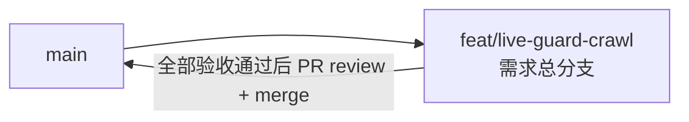

# 舰长数据抓取 - 实现 Plan

**功能名称**: 舰长数据抓取
**关联 PRD**: `docs/product/draft/20260831-live-guard-crawl-prd.md`（v1.0）
**关联技术提案**: `docs/engineering/proposals/20260831-proposal-live-guard-crawl.md`（v1.0）
**Plan 版本**: v1.0
**创建日期**: 2026-08-31
**作者**: Deliay
**feat-branch**: `feat/live-guard-crawl`（需求总分支）

## 1. 概述

本 Plan 基于 PRD v1.0 与技术提案 v1.0 编写，指导舰长数据抓取的编码实施。实施全程遵循 `docs/engineering/common-rules.md`（TDD、契约式开发、核心逻辑覆盖率 ≥ 80%）、`backend-rules.md`（后端为契约生成源）与 `frontend-rules.md`（npm、组件测试 Vitest + RTL）。

### 1.0 上游核实结论（Mikibot 反编译复查）

对 `Mikibot.Crawler` 1.0.9（`~/.nuget/packages/mikibot.crawler/1.0.9/lib/net10.0/Mikibot.Crawler.dll`，ilspycmd 反编译）核实，提案技术路径**可行**，但有两处细节需在实现时更正：

- `BiliLiveCrawler.GetRoomGuardList(long roomId, long bId, int page = 1, CancellationToken token = default)` 重载**存在**，返回 `ValueTask<GuardInfo>`，无需升级包。
- **实际请求路径与提案 3.1 文字不一致**：Mikibot 内部调用 `GET https://api.live.bilibili.com/xlive/app-room/v2/guardTab/topList?roomid={roomId}&page={page}&ruid={bId}&page_size=29`（提案写的 `guardList/topList`/`room_id` 有误，实为 `guardTab/topList`/`roomid`），且**不带 wbi 签名**。拟真通道按此直调即可，提案实现点 4 的「wbi 签名直调」简化为「与 Mikibot 同参直调 HTTP」，实现时以本结论为准。
- `GuardInfo` 为 struct：`Info(PageInfo)` + `List<GuardUserInfo>` + `Top3`；`PageInfo` 字段为 `Count`(JSON `num` 总人数) / `Current`(`now` 当前页) / `PageCount`(`page` 总页数)，均带 `JsonPropertyName` 特性。翻页终止条件「`page >= Info.PageCount` 或本页 `List` 为空」成立。
- `GuardUserInfo` 为 struct：`Uid`(`uid`) / `RoomUid`(`ruid`) / `UserName`(`username`) / `RoomRank`(`rank`) / `Avatar`(`face`) / `Online`(`is_alive`) / `GuardType`(`guard_level`，1 总督/2 提督/3 舰长) / `MedalInfo{Name(medal_name), Level(medal_level)}`。落库映射：`GuardLevel = GuardType`、`MedalName = MedalInfo.Name`、`MedalLevel = MedalInfo.Level`。
- `Top3` 仅首页返回且与 `List` 头部重复：合并名单**只取各页 `List`**（按 `Uid` 去重兜底），`Top3` 不单独入库，避免重复计数。

### 1.1 实施范围

- **做**：
  - 契约：`contracts/bilibili-crawler.openapi.yaml` 各订阅类型枚举由 `[danmaku, dynamic]` 扩展为 `[danmaku, dynamic, guard]`（纯增量，不新增端点）；前端 `npm run codegen` 重新生成 `schema.d.ts`。
  - 类型模型：`SubscriptionType` 新增 `Guard = 2`（字符串序列化落库 `"guard"`）；订阅 CRUD、Controller 校验、`(Mid, Type)` 幂等机制天然复用。
  - 持久层：新增 `LiveGuardRecord`/`LiveGuardEntry` 实体、`LiveGuardRepository`（当日快照 upsert + 已抓 mid 查询）、`MongoCollectionNames.LiveGuards = "bilibili_live_guards"` 与 `(Mid, Date)` 唯一索引。
  - 客户端：`IBiliApiClient` 新增 `GetRoomGuardListAsync`，直连（Mikibot `BiliLiveCrawler`）/拟真（同参 HTTP 直调）/装饰器（退避键 `guard:{roomId}`）三实现。
  - 任务：新增 `LiveGuardJob`——每日 23:00（北京时间，可配置）开启抓取窗口，窗口内周期计算「Guard 订阅 mid − 当日已有快照 mid」差集逐个抓取：roomId 解析（缺失即时补抓一次基础信息）→ 分页全量抓取（页间随机延迟 + 页数上限）→ 覆盖写当日快照；`Subscribed(Guard)` 事件收敛为触发同一差集检查。
  - `AccountInfoJob` 的 mid 集合并入 Guard 类型，保证 roomId 进入常规周期维护。
  - 前端：`SubscriptionPage` 类型选项/展示增加「舰长」。
  - 测试：Job 单测、仓储集成测试（Testcontainers）、订阅 guard 用例、前端组件测试；核心逻辑覆盖率 ≥ 80%。
- **不做**：舰长数据的查询/分析 API 与后台展示；名单变化实时推送；历史回填与存量迁移（纯增量上线）。

### 1.2 现状基线

- **订阅类型**（`servers/api/Persistence/Entities/SubscriptionType.cs`，13 行）：`Dynamic = 0` / `Danmaku = 1`，成员级 `[BsonRepresentation(BsonType.String)]` 落库小写字符串；新增 `Guard = 2` 沿用同模式。
- **订阅服务**（`servers/api/Services/SubscriptionService.cs`）：`event Action<long, SubscriptionType>? Subscribed`（:9）、`GetMidsAsync(SubscriptionType type, ct)` 按类型过滤投影（:23-31）、`SubscribeAsync` 按 `{Mid, Type}` upsert 且仅真正插入时触发事件（:40-57）。新增枚举值后零改动可用。
- **订阅 Controller**（`servers/api/Controllers/BilibiliSubscriptionController.cs`）：POST/DELETE 均以 `Enum.TryParse<SubscriptionType>(ignoreCase: true)` + `Enum.IsDefined` 校验（:38-41、:62-65）——**加入 `Guard` 枚举后自动接受 `guard`**，仅需把 4 处错误文案 `:29/:35/:41/:53/:59/:65` 的「danmaku, dynamic」更新为含 guard。
- **周期任务基座**（`servers/api/Jobs/PeriodicJobBase.cs`）：`protected abstract TimeSpan Interval`、`internal abstract RunOnceAsync(ct)`（`InternalsVisibleTo("Z.Vtuber.Tests")`，:3），异常兜底记日志。最相似范本 `SpaceTimelineJob.cs`：构造注入 `IBiliApiClient`/`ICookiePoolService`/`ISubscriptionService`/仓储/`CrawlLockProvider`/options/logger（:19-36）；`_cookiePool.NextAsync(ct)` 取 cookie、`NoAvailableCookieException` 记警告跳过（:73-82）；`CrawlBackoffActiveException` 记信息跳过本轮（:94-98）；锁键模式 `_locks.GetLock($"space:{mid}")`（:59）。
- **roomId 解析**（`servers/api/Persistence/AccountBasicInfoRepository.cs:28-36`）：`GetLatestRoomIdByMidAsync(long mid, ct)` 返回 `Task<long?>`（可空，无记录即 null）。
- **基础信息即时补抓**（`servers/api/Services/AccountInfoCrawler.cs`）：`IAccountInfoCrawler.CrawlAsync(long mid, ct)`（:9-12），内部自带 `account:{mid}` 锁（:23）、失败仅记日志不抛出（:64-67），可直接注入复用。
- **AccountInfoJob**（`servers/api/Jobs/AccountInfoJob.cs:27-37`）：`RunOnceAsync` 当前为 `GetMidsAsync(Dynamic) ∪ GetMidsAsync(Danmaku)` 去重（:30-32），需并入 Guard。
- **客户端三实现**：接口 `IBiliApiClient` 定义于 `servers/api/Crawlers/BiliApiClient.cs:21-27`；直连经 `accountProvider.GetProviderAsync(cookie)` 解析 Mikibot crawler（:43-55）；拟真 `BrowserishBiliApiClient` 模式为 `EnsureWarmupAsync` + `DelayAsync` + 带 Cookie 头 HTTP 直调 + `BilibiliApiResponse<T>` 解包（:77-104、:133-184）；装饰器 `ResilientBiliApiClient.ExecuteWithResilienceAsync(cookie, target, direct, browser)`（:54-102），target 键风格 `live:{roomId}`/`space:{mid}`（:40、:48）。
- **持久层初始化**（`servers/api/Persistence/MongoDbInitializer.cs`）：`MongoCollectionNames` 常量 :6-18；`EnsureIndexesAsync` 顺序调用各集合 `EnsureXxxIndexesAsync`（:24-36）；唯一索引范例 `EnsureSubscriptionCompositeIndexAsync`（:45-54，`Unique = true` + 显式 `Name`）。
- **DI**（`servers/api/Program.cs`）：仓储 `AddSingleton`（:35-41）、服务接口（:45-48）、Job `AddHostedService`（:70-74）、启动 `EnsureIndexesAsync`（:93）；`JsonStringEnumConverter(CamelCase)`（:15）保证 API 层枚举输出小写。
- **配置**（`servers/api/Configuration/BilibiliCrawlerOptions.cs`）：节 `BilibiliCrawler`，现有延迟配置 `BrowserMinDelaySeconds = 2` / `BrowserMaxDelaySeconds = 5`（:25-26）风格可参照。
- **契约**（`contracts/bilibili-crawler.openapi.yaml`，590 行）：枚举出现 6 处——POST 400 描述 :66、DELETE query `type` :73-79（枚举 :79、描述 :76）及其 400 描述 :84、`SubscribeRequest.type` :364-367、`SubscriptionItem.type` :374-377、`BackstageSubscriptionItem.type` :401-403。
- **前端**（`apps/web/src/pages/subscription/SubscriptionPage.tsx`）：`TYPE_LABELS` 映射 :12-13、表单 `useState<'danmaku' | 'dynamic' | ''>` :22、类型下拉选项 :123-124、`handleCancel` 联合类型 :82 与行内断言 :180；类型来自 `schema.d.ts`（codegen 生成，`npm run codegen`）。
- **测试设施**（`tests/Z.Vtuber.Tests/`，扁平结构）：`MongoDbFixture.ResetAsync` drop 清单 :27-39（**新集合须加入**）后跑 `EnsureIndexesAsync`；`Fakes.cs` 有 `FakeBiliApiClient`（:10，**接口新增方法会破坏其编译，需同步增补**）、`FakeCookiePoolService`/`MockCookiePoolService`；Job 单测范本 `CookieProbeJobTests.cs`、`LiveStatusJobTests.cs`；迁移测试命名范本 `MongoDbInitializerTests.cs`。
- **编排**：`infra/apphost` 一键拉起 mongo + api + web（`dotnet run`，project `infra/apphost`）。

## 2. 分支与提交流程

遵循 z-git 规范（仅 merge、禁止 rebase/squash）与 Conventional Commits：

- 本需求开发全程只使用需求总分支 `feat/live-guard-crawl`：实现、测试、文档全部直接在该分支提交，不切开发子分支（沿用近两期需求的既定做法）。
- 需求总 PR 已存在（`https://github.com/Deliay/z-vtuber/pull/56`，base: main），后续提交直接推送更新该 PR；全部验收通过后 review 通过即 merge。
- 提交信息使用 Conventional Commits（`feat:` / `test:` / `docs:` / `chore:`），实现与测试分开提交。

## 3. 实施阶段

按 z-coding 开发流程推进，全程 TDD（先写测试再实现）；契约更新（Phase 0）先行。

### Phase 0: 契约枚举扩展与客户端类型生成

| # | 任务 | 关键文件 | 验收 |
|---|------|---------|------|
| 0.1 | 契约 6 处类型枚举 `[danmaku, dynamic]` → `[danmaku, dynamic, guard]`：POST 400 描述（:66）、DELETE query `type` 枚举+描述（:76-79）及 400 描述（:84）、`SubscribeRequest.type`（:364-367）、`SubscriptionItem.type`（:374-377）、`BackstageSubscriptionItem.type`（:401-403）；各描述文案补充「guard 舰长」 | `contracts/bilibili-crawler.openapi.yaml` | YAML 语法合法；无新增端点，纯增量 |
| 0.2 | `npm run codegen` 重新生成 `apps/web/src/api/schema.d.ts`（自动生成勿手改） | `apps/web/src/api/schema.d.ts` | `npm run build` 通过 |

### Phase 1: 类型模型与持久层（TDD）

| # | 任务 | 关键文件 | 测试重点 |
|---|------|---------|---------|
| 1.1 | `SubscriptionType` 新增 `Guard = 2`（`[BsonRepresentation(BsonType.String)]`）；订阅服务/Controller 零逻辑改动，仅更新 Controller 6 处错误文案为「danmaku, dynamic, guard」 | `servers/api/Persistence/Entities/SubscriptionType.cs`、`servers/api/Controllers/BilibiliSubscriptionController.cs` | `SubscriptionServiceTests.cs` 增补：guard 订阅幂等、`GetMidsAsync(Guard)` 严格过滤、取消 guard 不影响同 mid 其他类型；订阅端点 guard 用例（200/非法 400，按既有 Controller 测试模式，无则新建 `BilibiliSubscriptionControllerTests.cs`） |
| 1.2 | 新增 `LiveGuardRecord` 实体：`[BsonId] ObjectId Id`、`[BsonRepresentation(Int64)] long Mid`、`[BsonRepresentation(Int64)] long RoomId`、`string Date`（北京时间 `yyyy-MM-dd`）、`List<LiveGuardEntry> Guards`、`int GuardCount`、`[BsonDateTimeOptions(Utc)] DateTime FetchedAt`；内嵌 `LiveGuardEntry`：`[BsonRepresentation(Int64)] long Uid`、`string UserName`、`int GuardLevel`、`string? MedalName`、`int MedalLevel` | `servers/api/Persistence/Entities/LiveGuardRecord.cs`（新增） | 随 1.4 集成测试覆盖序列化 |
| 1.3 | `MongoCollectionNames` 新增 `LiveGuards = "bilibili_live_guards"`；新增 `EnsureLiveGuardIndexesAsync`：`(Mid asc, Date asc)` 唯一索引 `Mid_1_Date_1`，并入 `EnsureIndexesAsync` 调用链 | `servers/api/Persistence/MongoDbInitializer.cs` | 集成测试：同 (Mid, Date) 重复 upsert 为一行（唯一索引生效） |
| 1.4 | 新增 `LiveGuardRepository`（`sealed class`，主构造注入 `IMongoDatabase`，风格对齐 `AccountBasicInfoRepository`）：`UpsertDailySnapshotAsync(LiveGuardRecord, ct)`——filter `{Mid, Date}` + `ReplaceOneAsync(IsUpsert = true)` 整体替换；`GetMidsWithSnapshotAsync(string date, ct)` → `Task<IReadOnlyList<long>>`（`Date == date` 投影 `Mid`，空结果返回空列表） | `servers/api/Persistence/LiveGuardRepository.cs`（新增）、`tests/Z.Vtuber.Tests/LiveGuardRepositoryTests.cs`（新增） | 集成测试（mongo fixture）：upsert 新增/同日覆盖更新幂等、GuardCount 与 Guards 一致、`GetMidsWithSnapshotAsync` 只返回当日有快照的 mid、跨日同 mid 互不影响 |
| 1.5 | `MongoDbFixture.ResetAsync` drop 清单加入 `LiveGuards`；`Program.cs` 注册 `AddSingleton<LiveGuardRepository>()` | `tests/Z.Vtuber.Tests/MongoDbFixture.cs`、`servers/api/Program.cs` | 全部既有 mongo 集成测试仍绿 |

### Phase 2: 客户端三实现（TDD）

| # | 任务 | 关键文件 | 测试重点 |
|---|------|---------|---------|
| 2.1 | `IBiliApiClient` 新增 `Task<GuardInfo> GetRoomGuardListAsync(string cookie, long roomId, long bId, int page = 1, CancellationToken ct = default)`（单页语义，翻页归 Job） | `servers/api/Crawlers/BiliApiClient.cs`（接口段 :21-27） | 随 2.2-2.4 覆盖 |
| 2.2 | 直连 `BiliApiClient`：`accountProvider.GetProviderAsync(cookie)` → `GetRequiredService<BiliLiveCrawler>()` → `GetRoomGuardList(roomId, bId, page, ct)`（模式对齐 `GetLiveRoomInfoAsync`，:43-48） | `servers/api/Crawlers/BiliApiClient.cs` | 单测：provider 解析与参数透传（page 默认值 1） |
| 2.3 | 拟真 `BrowserishBiliApiClient`：`EnsureWarmupAsync` + `DelayAsync` + 带 Cookie 头直调 `GET https://api.live.bilibili.com/xlive/app-room/v2/guardTab/topList?roomid={roomId}&page={page}&ruid={bId}&page_size=29`（与 Mikibot 内部实现同参，**无 wbi 签名**，见 1.0），`BilibiliApiResponse<GuardInfo>` 解包、code ≠ 0 抛异常 | `servers/api/Crawlers/BrowserishBiliApiClient.cs`、`tests/Z.Vtuber.Tests/BrowserishBiliApiClientTests.cs` | 单测（fake handler，对齐既有 `BrowserishBiliApiClientTests` 模式）：URL/参数正确、`GuardInfo` 字段绑定（num/now/page、guard_level、medal_info）、非 0 code 抛异常 |
| 2.4 | 装饰器 `ResilientBiliApiClient`：`ExecuteWithResilienceAsync(cookie, $"guard:{roomId}", direct, browser)`（模式对齐 :47-49） | `servers/api/Crawlers/ResilientBiliApiClient.cs`、`tests/Z.Vtuber.Tests/ResilientBiliApiClientTests.cs`、`tests/Z.Vtuber.Tests/Fakes.cs` | 单测：退避键 `guard:{roomId}`、直连风控降级拟真；`FakeBiliApiClient` 同步增补新方法（编译适配） |

### Phase 3: LiveGuardJob（TDD）

| # | 任务 | 关键文件 | 测试重点 |
|---|------|---------|---------|
| 3.1 | `BilibiliCrawlerOptions` 新增配置（均有默认值）：`GuardDailyCrawlHour = 23`、`GuardCheckIntervalMinutes = 10`、`GuardPageDelayMinSeconds = 2`、`GuardPageDelayMaxSeconds = 5`、`GuardMaxPages = 50` | `servers/api/Configuration/BilibiliCrawlerOptions.cs` | 配置绑定单测（默认值） |
| 3.2 | 新增 `LiveGuardJob : PeriodicJobBase`：`Interval = GuardCheckIntervalMinutes`；构造注入 `ISubscriptionService`/`IBiliApiClient`/`ICookiePoolService`/`AccountBasicInfoRepository`/`LiveGuardRepository`/`IAccountInfoCrawler`/`CrawlLockProvider`/`BilibiliCrawlerOptions`/`TimeProvider`/logger；`Program.cs` 注册 `AddHostedService<LiveGuardJob>()` 与 `AddSingleton(TimeProvider.System)`。**时间口径**：以 `TimeProvider` 取 UTC 再 +8h 得北京时间（固定 UTC+8，不依赖系统时区），窗口判断与快照 `Date` 共用该口径 | `servers/api/Jobs/LiveGuardJob.cs`（新增）、`servers/api/Program.cs` | 见 3.3-3.6（`RunOnceAsync` 为 `internal`，测试直接调用，`TimeProvider` 用 `FakeTimeProvider` 控制北京时间） |
| 3.3 | 调度窗口与差集补抓：`RunOnceAsync` 先判「北京时间 ≥ 当日 `GuardDailyCrawlHour`:00」，未到直接返回（空转）；窗口内 `GetMidsAsync(Guard)` − `GetMidsWithSnapshotAsync(当日)` 得差集，逐个 `CrawlLockedAsync`（锁键 `guard:{mid}`）；`OnSubscribed` 仅 `type == Guard` 时 `_ = RunOnceAsync(CancellationToken.None)` 触发同一差集检查（不直接抓单 mid，逻辑收敛单一路径） | 同上、`tests/Z.Vtuber.Tests/LiveGuardJobTests.cs`（新增） | 单测：23:00 前不抓（零客户端调用）；23:00 后差集触发；已有快照 mid 不重复抓；差集为空零请求；非 Guard 订阅事件不触发 |
| 3.4 | roomId 解析与即时补抓：`GetLatestRoomIdByMidAsync(mid)` 为 null 时调用一次 `IAccountInfoCrawler.CrawlAsync(mid, ct)` 后重查；仍为 null 记日志跳过本轮（每轮每 mid 至多补抓一次） | 同上 | 单测：有 roomId 不补抓；无 roomId 补抓成功继续抓取；补抓后仍无 roomId 跳过且不写快照；补抓每轮至多一次 |
| 3.5 | 分页全量抓取与失败策略：cookie 取自 `NextAsync`（`NoAvailableCookieException` 记警告跳过）；`page = 1` 起循环，终止条件「本页 `List` 为空 或 `page >= Info.PageCount`」取先，`GuardMaxPages` 兜底；翻页前 `Task.Delay` 随机 `[GuardPageDelayMinSeconds, GuardPageDelayMaxSeconds]`（延迟函数可注入/虚方法以便测试）；各页 `List` 合并按 `Uid` 去重（`Top3` 不入库，见 1.0）；`CrawlBackoffActiveException` 记信息跳过本轮；其他异常/单页失败**整轮放弃不落库** | 同上 | 单测：跨页合并完整无漏页；List 空即终止；到达 PageCount 终止；页数上限兜底；单页失败无 upsert 调用；空名单（首页即空）落空列表快照；退避异常跳过；页间延迟被调用 N-1 次 |
| 3.6 | 快照落库：成功后 `UpsertDailySnapshotAsync`——`Mid`/`RoomId`/`Date`（北京时间当日）/`Guards`（`GuardUserInfo` → `LiveGuardEntry` 映射，见 1.0）/`GuardCount = Guards.Count`/`FetchedAt = utc now` | 同上 | 单测：字段映射正确（含 MedalName 可空）、GuardCount 一致、Date 为北京时间口径 |

### Phase 4: AccountInfoJob 基础信息覆盖 Guard 订阅（TDD）

| # | 任务 | 关键文件 | 测试重点 |
|---|------|---------|---------|
| 4.1 | `AccountInfoJob.RunOnceAsync` mid 集合由「Dynamic ∪ Danmaku」改为「Dynamic ∪ Danmaku ∪ Guard」去重（`AccountInfoJob.cs:30-32`）；`OnSubscribed` 现状已全类型触发补抓（:39），无需改动 | `servers/api/Jobs/AccountInfoJob.cs` | 增补/适配 Job 测试：guard 订阅 mid 进入基础信息抓取集合、三类型去重 |

### Phase 5: 前端订阅类型选项（TDD）

| # | 任务 | 关键文件 | 测试重点 |
|---|------|---------|---------|
| 5.1 | `SubscriptionPage`：`TYPE_LABELS` 增加 `guard: '舰长'`（:12-13）；表单类型联合类型与下拉选项增加 guard（:22、:123-124）；`handleCancel` 联合类型与行内断言同步（:82、:180）；建议以 codegen 后的 `SubscriptionItem['type']` 类型替代硬编码联合类型（如现状注释允许，保持最小改动则仅扩枚举值） | `apps/web/src/pages/subscription/SubscriptionPage.tsx`、`SubscriptionPage.test.tsx` | 组件测试（`vi.mock` client）：类型下拉含「舰长」、选择 guard 提交调用 `subscribe({mid, type: 'guard'})`、列表 guard 行显示「舰长」、取消 guard 订阅调用 `unsubscribe(mid, 'guard')`、既有弹幕/动态用例回归 |

### Phase 6: 编排验证与测试收口

| # | 任务 | 验收 |
|---|------|------|
| 6.1 | z-aspire-orchestrator 编排验证：`dotnet run`（`infra/apphost`）拉起 mongo + api + web；订阅真实主播 guard 类型，23:00 窗口（或临时调低 `GuardDailyCrawlHour`）观察定时抓取、分页延迟与快照落库日志；模拟 23:00 后重启验证当日缺快照自动补抓；同日重复触发验证收敛一行；取消 guard 订阅后抓取停止、其他类型不受影响 | 手工验证记录 |
| 6.2 | `dotnet test tests/Z.Vtuber.Tests` 全绿（含既有回归）；`npm run test` / `npm run lint` / `npm run build` 全绿；核心逻辑覆盖率 ≥ 80% | 全部通过 |
| 6.3 | 契约 review：实际响应与 `contracts/bilibili-crawler.openapi.yaml` 一致（枚举值含 guard） | 一致 |
| 6.4 | 同步更新 `servers/api/AGENTS.md`（Persistence 集合清单加 `bilibili_live_guards`、Jobs 加 `LiveGuardJob`、Crawlers 新方法、配置项）与 `apps/web/AGENTS.md`（类型选项说明，如有结构变化） | 文档同步 |

## 4. 并行策略

- 本需求跨 `contracts` / `servers/api` / `apps/web`，按 z-coding 工作流以 subagent 委托开发。
- Phase 0（契约）必须最先完成：前端类型与后端 DTO 都以契约为准。
- Phase 1（类型模型与持久层）与 Phase 0 无依赖、可并行；Phase 2（客户端）依赖 Phase 1 的接口形态（仅依赖 `GuardInfo`，实际可与 Phase 1 并行，但接口改动人少、串行代价低）；Phase 3（Job）依赖 Phase 1 + Phase 2。
- Phase 4（AccountInfoJob）仅依赖 Phase 1.1 的枚举，改动极小，可并入 Phase 3 委托。
- Phase 5（前端）依赖 Phase 0 的 codegen 产物，与后端 Phase 1-4 可并行（mock 契约即可写组件测试）。
- Phase 6 最后收口。
- 每阶段完成后提交（实现与测试分开提交），实现分支即需求总分支 `feat/live-guard-crawl`。

## 5. 验收对照

| PRD 功能点 | 实现任务 | 验证方式 |
|-----------|---------|---------|
| 功能点 1：新增订阅类型「舰长」（创建可见、幂等、类型独立、后台可选） | 0.1-0.2、1.1、5.1 | 订阅服务/端点 guard 用例 + SubscriptionPage 组件测试 + 编排验证 |
| 功能点 2：舰长名单全量分页抓取（23:00 定时、补抓三场景、完整名单、空名单快照、页间延迟、失败不阻塞） | 3.1-3.6 | LiveGuardJob 单测（窗口/差集/翻页/失败策略）+ 编排验证（重启补抓、延迟日志） |
| 功能点 3：每日快照存储（每日一行、字段完整、覆盖写、历史序列） | 1.2-1.5、3.6 | LiveGuardRepository 集成测试（唯一索引/覆盖幂等）+ Job 单测字段映射 + 编排验证 |
| 功能点 4：按订阅精确控制抓取范围（未订阅不抓、取消停止、新订阅及时首抓） | 3.3、4.1 | Job 单测（差集以 Guard 订阅为准）+ 编排验证（取消后停止） |
| 非功能：roomId 缺失即时补抓（打回意见 1） | 3.4 | Job 单测三路径（有/补抓成功/补抓失败） |
| 非功能：时间触发 + 补抓口径（打回意见 2） | 3.2、3.3 | Job 单测（23:00 前空转/窗口内差集/事件收敛） |
| 非功能：既有抓取链路不劣化、风控治理接入 | 2.4、3.5 | Resilient 单测 + 全量回归（6.2） |
| 非功能：核心逻辑覆盖率 ≥ 80%、全量测试绿 | 6.2 | `dotnet test` / `npm run test` |

## 6. 风险与依赖

| 项 | 说明 | 应对 |
|---|------|------|
| 依赖 | Mikibot.Crawler 1.0.9 `GetRoomGuardList(roomId, bId, page)` 与 `GuardInfo`/`GuardUserInfo` 模型 | 已反编译核实（1.0）；升级该包时复查模型字段，测试锁定字段映射（2.3/3.6） |
| 提案路径偏差 | 提案 3.1 拟真通道写的 `guardList/topList`+wbi 签名与实际不符 | 以 1.0 反编译结论为准：`guardTab/topList`、参数 `roomid/ruid/page/page_size=29`、无签名；实现后如直连/拟真响应不一致，以拟真单测锁定解析 |
| 23:00 抓取高峰 | 全量订阅集中翻页，mid 串行 + 页间延迟，时长随订阅数线性增长 | 本期规模可接受（提案 6.1 已决策）；`GuardCheckIntervalMinutes`/延迟配置运行期可调 |
| 跨零点重试 | 23:00–24:00 窗口内失败的 mid 重试成功后落次日快照，前一日保持缺失 | 语义可接受（提案实现点 3 已决策）；Job 单测锁定 Date 口径 |
| 大航海人数多的主播 | 数千人翻页耗时长、PageInfo 异常可能死循环 | `GuardMaxPages = 50` 兜底；页间延迟配置可调（3.5） |
| `FakeBiliApiClient` 编译破坏 | 接口新增方法后 Fakes 必须同步实现 | 纳入 Phase 2.4 任务清单，编译即暴露 |
| 唯一索引冲突 | 同日并发触发（定时+事件+重启补抓重叠） | (Mid, Date) 唯一索引 + ReplaceOne upsert（1.3/1.4 集成测试覆盖）；Job 层 `guard:{mid}` 锁串行化 |
| 契约漂移 | 前后端与契约枚举不一致 | 前端类型全部来自 codegen；6.3 契约 review 核对 |

## 7. 相关文档

- PRD：`docs/product/draft/20260831-live-guard-crawl-prd.md`
- 技术提案：`docs/engineering/proposals/20260831-proposal-live-guard-crawl.md`
- 契约：`contracts/bilibili-crawler.openapi.yaml`
- 开发规范：`docs/engineering/common-rules.md`、`docs/engineering/backend-rules.md`、`docs/engineering/frontend-rules.md`
- 前置 Plan：`docs/engineering/plans/20260820-plan-subscription-crawl-type.md`（订阅类型化）
