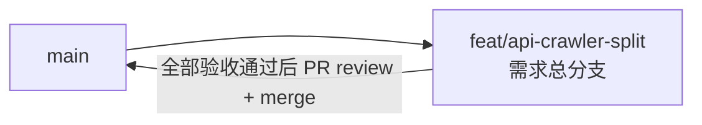

# 抓取与 API 服务拆分 - 实现 Plan

**功能名称**: 抓取与 API 服务拆分
**关联 PRD**: `docs/product/draft/20260901-api-crawler-split-prd.md`（v1.0）
**关联技术提案**: `docs/engineering/proposals/20260901-proposal-api-crawler-split.md`（v1.3）
**Plan 版本**: v1.0
**创建日期**: 2026-09-01
**作者**: Deliay
**feat-branch**: `feat/api-crawler-split`（需求总分支）

## 1. 概述

本 Plan 基于 PRD v1.0 与技术提案 v1.3 编写，指导抓取与 API 服务拆分的编码实施。实施全程遵循 `docs/engineering/common-rules.md`（TDD、契约式开发、核心逻辑覆盖率 ≥ 80%）与 `backend-rules.md`。本期为纯结构性拆分：契约零变更（`contracts/bilibili-crawler.openapi.yaml` 不动）、无前端改动、不做数据迁移、不借机重构业务逻辑。

### 1.1 实施范围

- **做**：
  - 新建 `servers/common`（`Z.Vtuber.Common` 类库）与 `servers/crawler`（`Z.Vtuber.Crawler` Worker 项目）；
  - 新建 `servers/Z.Vtuber.slnx`，纳入 api/common/crawler + tests + apphost（仓库现状无任何 sln/slnx，按需求意图新建并配置 `../` 上溯相对路径）；
  - 按提案 2.3 归属表搬运代码并调整命名空间（纯搬运，不改成员与逻辑）；
  - 弹幕事件通道改造为 Redis pub/sub：crawler 落库同时 `PUBLISH live-event:{roomId}`，api 侧 `LiveEventBus` 按订阅计数驱动按需 `SUBSCRIBE`/`UNSUBSCRIBE`；
  - crawler 独立宿主（`Host.CreateApplicationBuilder` + 最小 Kestrel），提供 `GET /health`（进程存活 + MongoDB 连通性）；
  - 新增 `servers/crawler/Dockerfile` 与 `.github/workflows/build-crawler-image.yml`（镜像 `zero-tools/z-vtuber-crawler`）；api 的 Dockerfile 与流水线同步补充 `servers/common`；
  - Aspire 编排增加 crawler 项目与 Redis 资源（`AddRedis("messaging")`），两服务引用 `Aspire.StackExchange.Redis`；
  - 测试工程引用调整为三项目并补 Redis 容器集成测试，现有用例平移回归。
- **不做**：
  - 任何契约变更、业务功能新增、数据库结构/历史数据迁移、前端改造；
  - crawler 对外暴露 `/health` 以外的 HTTP 接口；
  - 拆分测试工程（保持 `tests/Z.Vtuber.Tests` 单工程，提案 6.1 已决策）。

### 1.2 现状基线（已核查）

- **无 sln/slnx**：仓库（含 main）不存在任何解决方案文件，`servers/Z.Vtuber.slnx` 为新建而非挪动。
- **api 工程**（`servers/api/Z.Vtuber.csproj`）：`Microsoft.NET.Sdk.Web` + net10.0；包：Microsoft.AspNetCore.OpenApi 10.0.10、Aspire.MongoDB.Driver 13.4.6、MongoDB.Driver 3.9.0、Mikibot.Crawler 1.0.9（拆分后 api 移除最后一项）。
- **源文件盘点**（`servers/api` 共 57 个 .cs，与提案 2.3 归属表一致）：
  - common：`Persistence/` 全量 16 个文件（9 实体 + `SubscriptionType` + 6 仓储 + `MongoDbInitializer` + `BsonConvert` + `BackstageDataAggregationExtensions`）；`Services/` 中 `CookiePoolService`、`SubscriptionService`、`LiveSessionTracker`、`LiveStatusStateMachine`、`PubTsExtractor`、`SpaceTimelinePaging`；`Live/LiveEvent.cs`。
  - crawler：`Crawlers/` 9 个文件、`Jobs/` 6 个文件、`Live/` 中 `LiveEventSource`/`DanmakuClientFactory`/`DanmakuEventNormalizer`/`GiftPriceExtractor`/`LiveEventTextExtractor`、`Services/` 中 `AccountInfoCrawler`/`CookieNavProbeService`、`Configuration/BilibiliCrawlerOptions.cs`。
  - api 保留：`Controllers/` 6 个、`Live/LiveEventBus.cs`、`Program.cs`、appsettings。
- **Options 归属已确认**：6 个 Controller 均不引用 `BilibiliCrawlerOptions`（仅 `BilibiliLiveController` 注入 `ILiveEventBus`），故 `BilibiliCrawlerOptions` 归 crawler，api appsettings 移除 `BilibiliCrawler` 节（`servers/api/appsettings.json:9-23`）。
- **Program.cs**（`servers/api/Program.cs`）：抓取侧注册 :24-30（Options）、:50-65（抓取通道/风控/退避）、:66（DanmakuClientFactory）、:68（CrawlLockProvider）、:70-74（4 Job + LiveEventSource）平移至 crawler；api 保留 Controllers/OpenApi/健康检查/mongo/仓储/共享服务/`ILiveEventBus`；启动索引初始化与回填（:78-98）为幂等逻辑，**两个服务均执行**（提案 4.1）。
- **Dockerfile**（`servers/api/Dockerfile`）：两阶段构建，restore 前仅拷贝 `servers/api/Z.Vtuber.csproj`——拆分后须先拷贝 common 与 api 两个 csproj 再 restore。
- **流水线**（`.github/workflows/build-api-image.yml`）：`release`/`release/**` 推送或手动触发，paths 过滤 `servers/api/**`，tag `${DOCKER_ENDPOINT}/zero-tools/z-vtuber-api:{sha}` 与 `:latest`；crawler 流水线照此复刻，镜像名 `z-vtuber-crawler`。
- **编排**（`infra/apphost/AppHost.cs`）：mongo（`AddMongoDB("mongo")`）+ api + web；`Z.Vtuber.AppHost.csproj` 引用 Aspire.Hosting.MongoDB 13.4.6——新增 `Aspire.Hosting.Redis`（同版本体系）与 crawler 项目引用。
- **测试工程**（`tests/Z.Vtuber.Tests/Z.Vtuber.Tests.csproj`）：xunit 2.9.3 + Testcontainers.MongoDb 4.13.0，单一 `ProjectReference` 指向 api——改为引用 common/crawler/api 三项目，并新增 Redis 容器测试设施。
- **appsettings**：`BilibiliCrawler` 节（`servers/api/appsettings.json:9-23`）整体迁往 `servers/crawler/appsettings.json`。

## 2. 分支与提交流程

遵循 z-git 规范与 Conventional Commits：

- 本需求开发全程只使用需求总分支 `feat/api-crawler-split`：实现、测试、文档全部直接在该分支提交，不切开发子分支（沿用上期 `feat/backstage-data-aggregation` 的既定做法）。
- 需求总 PR 已存在（`https://github.com/Deliay/z-vtuber/pull/58`，base: main），后续提交直接推送更新该 PR；全部验收通过后 review 通过即 merge。
- 提交信息使用 Conventional Commits（`refactor:` / `feat:` / `test:` / `chore:` / `docs:`），实现与测试分开提交。
- 合并 PR 后按 z-git 规范删除远端与本地 `feat/api-crawler-split` 分支。

## 3. 实施阶段

按 z-coding 开发流程推进，全程 TDD。本期无契约变更（跳过契约 Phase），先搬运转绿，再做通道改造与流水线。

### Phase 0: 工程骨架——common/crawler 项目与 slnx

| # | 任务 | 关键文件 | 验收 |
|---|------|---------|------|
| 0.1 | 新建 `servers/common/Z.Vtuber.Common.csproj`：`Microsoft.NET.Sdk` 类库，net10.0 + `Nullable enable` + `ImplicitUsings enable`，包引用 `MongoDB.Driver` 3.9.0 | `servers/common/Z.Vtuber.Common.csproj`（新增） | `dotnet build` 通过 |
| 0.2 | 新建 `servers/crawler/Z.Vtuber.Crawler.csproj`：`Microsoft.NET.Sdk.Worker`，net10.0 + `Nullable enable` + `ImplicitUsings enable`；`FrameworkReference Microsoft.AspNetCore.App`（供最小 Kestrel 与 `AddHealthChecks`）；包引用 `Mikibot.Crawler` 1.0.9、`Aspire.MongoDB.Driver` 13.4.6、`MongoDB.Driver` 3.9.0、`Aspire.StackExchange.Redis`（13.4.6 同体系版本）；`ProjectReference` 指向 common | `servers/crawler/Z.Vtuber.Crawler.csproj`（新增） | `dotnet build` 通过 |
| 0.3 | api csproj 增加 `ProjectReference` 指向 common，新增 `Aspire.StackExchange.Redis` 包引用（Mikibot.Crawler 的移除在 Phase 1 搬运完成后进行） | `servers/api/Z.Vtuber.csproj` | `dotnet build` 通过 |
| 0.4 | 新建 `servers/Z.Vtuber.slnx`：纳入 `api/Z.Vtuber.csproj`、`common/Z.Vtuber.Common.csproj`、`crawler/Z.Vtuber.Crawler.csproj`、`../tests/Z.Vtuber.Tests/Z.Vtuber.Tests.csproj`、`../infra/apphost/Z.Vtuber.AppHost.csproj`（相对路径 `../` 上溯正确） | `servers/Z.Vtuber.slnx`（新增） | `dotnet build servers/Z.Vtuber.slnx` 全量通过 |

### Phase 1: 代码搬运与命名空间调整（纯搬运，TDD 回归）

| # | 任务 | 关键文件 | 测试重点 |
|---|------|---------|---------|
| 1.1 | 搬运 common 归属文件（清单见 1.2），命名空间 `Z.Vtuber.Persistence` → `Z.Vtuber.Common.Persistence`、`Z.Vtuber.Services`（共享 6 项）→ `Z.Vtuber.Common.Services`、`Z.Vtuber.Live.LiveEvent` → `Z.Vtuber.Common.Live`；不改任何类型成员与逻辑 | `servers/common/**`（新增）、`servers/api/**`（删除已搬出文件） | 随 1.5 全量回归 |
| 1.2 | 搬运 crawler 归属文件（清单见 1.2），命名空间 `Z.Vtuber.Crawlers` → `Z.Vtuber.Crawler.Crawlers`、`Z.Vtuber.Jobs` → `Z.Vtuber.Crawler.Jobs`、抓取侧 `Z.Vtuber.Live.*` → `Z.Vtuber.Crawler.Live`、`Z.Vtuber.Services`（AccountInfoCrawler/CookieNavProbeService）→ `Z.Vtuber.Crawler.Services`、`Z.Vtuber.Configuration` → `Z.Vtuber.Crawler.Configuration` | `servers/crawler/**`（新增）、`servers/api/**`（删除已搬出文件） | 随 1.5 全量回归 |
| 1.3 | api 侧保留代码补 `using Z.Vtuber.Common.*` 引用；api csproj 移除 `Mikibot.Crawler` 包引用；api `Program.cs` 暂时保留全部 DI 注册与 HostedService（编译通过即可，瘦身在 Phase 3 与 crawler 宿主同步进行，避免中间态丢功能） | `servers/api/**`、`servers/api/Z.Vtuber.csproj` | `dotnet build` 通过 |
| 1.4 | 测试工程 csproj 改为引用 common/crawler/api 三项目；测试用例 `using` 同步调整为新命名空间（平移，不改断言） | `tests/Z.Vtuber.Tests/Z.Vtuber.Tests.csproj`、`tests/Z.Vtuber.Tests/*.cs` | `dotnet test` 全绿 |
| 1.5 | 全量回归：`dotnet build servers/Z.Vtuber.slnx` + `dotnet test` 全绿；核对无遗留 `Z.Vtuber.Persistence`/`Z.Vtuber.Jobs` 等旧命名空间引用（含反射/约定绑定处全量检查） | 全仓库 | 构建与测试全绿 |

> 说明：Phase 1 完成后抓取逻辑代码已在 crawler 项目中，但 crawler 尚无宿主入口、api 仍注册并运行全部任务（行为与拆分前一致，可随时发布）。事件通道与宿主拆分在后续 Phase 完成。

### Phase 2: 弹幕事件通道改造为 Redis pub/sub（TDD）

| # | 任务 | 关键文件 | 测试重点 |
|---|------|---------|---------|
| 2.1 | crawler 侧新增事件发布：抽象 `ILiveEventPublisher`（`PublishAsync(LiveEvent, ct)`），Redis 实现 `RedisLiveEventPublisher`——频道 `live-event:{roomId}`，载荷为 `LiveEvent` JSON；`LiveEventSource` 在归一化出事件并落库 `bilibili_live_event` 的同时调用发布（发布失败仅记日志，不影响落库与长连接）；连接由 `builder.AddRedisClient("messaging")` 注入 | `servers/crawler/Live/RedisLiveEventPublisher.cs`（新增）、`servers/crawler/Live/LiveEventSource.cs`、`tests/Z.Vtuber.Tests/RedisLiveEventPublisherTests.cs`（新增） | 单测（mock publisher）：落库成功路径触发一次发布且频道/载荷正确；发布异常不影响落库与后续事件；集成测试（Testcontainers Redis）：发布后可订阅收到同载荷 |
| 2.2 | api 侧 `LiveEventBus` 数据源改为 Redis 订阅：保留 SSE 订阅门控与 `type` 过滤语义，注入 `IConnectionMultiplexer`；**按需订阅**——某 roomId 首个 SSE 订阅者加入时 `SUBSCRIBE live-event:{roomId}`，订阅计数归零时 `UNSUBSCRIBE`；收到消息后反序列化为 `LiveEvent` 走既有门控分发 | `servers/api/Live/LiveEventBus.cs`、`servers/api/Program.cs`（注册 Redis 客户端） | 单测（mock 订阅端）：首个订阅者触发订阅、计数归零触发退订、type 过滤不变；集成测试（Testcontainers Redis）：pub → sub → SSE 门控链路端到端 |
| 2.3 | 既有 `LiveEventBusTests` 平移适配新实现（进程内事件源用例改为 Redis 注入事件） | `tests/Z.Vtuber.Tests/LiveEventBusTests.cs` | 全绿 |

> 语义约定（提案 5.2 实现点 2）：Redis pub/sub 为 fire-and-forget，api 未订阅期间的事件不补推（与现状「只有在线订阅者收推送」一致），历史事件仍走 `event/range`/`event/search` 查库；事件可靠性以 MongoDB 落库为准。

### Phase 3: 双宿主成型——crawler Program 与 api 瘦身

| # | 任务 | 关键文件 | 测试重点 |
|---|------|---------|---------|
| 3.1 | 新建 `servers/crawler/Program.cs`：`Host.CreateApplicationBuilder`；`AddMongoDBClient("mongo")` + `AddRedisClient("messaging")`；平移原 api `Program.cs` 抓取侧注册（Options 校验注册、`IMongoDatabase`、全部仓储、共享服务、抓取通道/风控/退避、`DanmakuClientFactory`、`CrawlLockProvider`、`ILiveEventPublisher`、4 个 Job 与 `LiveEventSource` 的 `AddHostedService`）；启动时执行 `MongoDbInitializer` 索引初始化与回填（幂等，与 api 并存安全） | `servers/crawler/Program.cs`（新增） | 编排验证（Phase 6） |
| 3.2 | crawler 健康检查：csproj 的 `FrameworkReference Microsoft.AspNetCore.App` 已备（0.2）；宿主内挂最小 Kestrel（端口可配置，默认 8080），`AddHealthChecks` 增加 MongoDB 连通性检查项，`MapHealthChecks("/health")`；仅暴露该路由，无其他端点 | `servers/crawler/Program.cs`、`tests/Z.Vtuber.Tests/CrawlerHealthCheckTests.cs`（新增） | 集成测试：mongo 可达时 `/health` 200，不可达时 503 |
| 3.3 | api `Program.cs` 瘦身：移除 `BilibiliCrawlerOptions` 注册、抓取通道/风控/退避/`DanmakuClientFactory`/`CrawlLockProvider` 注册、4 个 Job 与 `LiveEventSource` 的 `AddHostedService`；保留 Controllers/OpenApi/`AddHealthChecks`/mongo/Redis 客户端/仓储/共享服务/`ILiveEventBus`/backstage 聚合；启动索引初始化保留（幂等） | `servers/api/Program.cs` | `BackstageDataAggregationDiTests` 等 DI 用例适配后全绿；api 进程内无任何周期性抓取任务（启动后无 Job 日志） |
| 3.4 | appsettings 调整：`servers/api/appsettings.json` 移除 `BilibiliCrawler` 节；新建 `servers/crawler/appsettings.json` 携带原 `BilibiliCrawler` 节（值原样平移）与日志节 | `servers/api/appsettings.json`、`servers/crawler/appsettings.json`（新增） | 编排验证：crawler Options `ValidateOnStart` 通过 |

### Phase 4: 镜像与流水线

| # | 任务 | 关键文件 | 验收 |
|---|------|---------|------|
| 4.1 | 新建 `servers/crawler/Dockerfile`：两阶段构建（sdk:10.0 → runtime `mcr.microsoft.com/dotnet/aspnet:10.0`，因含 FrameworkReference 需 aspnet 运行时）；restore 前同时拷贝 `servers/common/Z.Vtuber.Common.csproj` 与 `servers/crawler/Z.Vtuber.Crawler.csproj`；EXPOSE 8080；ENTRYPOINT `dotnet Z.Vtuber.Crawler.dll` | `servers/crawler/Dockerfile`（新增） | 仓库根上下文 `docker build -f servers/crawler/Dockerfile .` 成功 |
| 4.2 | 改造 `servers/api/Dockerfile`：restore 前补拷 `servers/common/Z.Vtuber.Common.csproj`（上下文仍为仓库根） | `servers/api/Dockerfile` | `docker build -f servers/api/Dockerfile .` 成功 |
| 4.3 | 新建 `.github/workflows/build-crawler-image.yml`：复刻 `build-api-image.yml`，paths 过滤 `servers/crawler/**`、`servers/common/**`，tag `${DOCKER_ENDPOINT}/zero-tools/z-vtuber-crawler:{sha}` 与 `:latest`，secrets 复用 | `.github/workflows/build-crawler-image.yml`（新增） | YAML 合法；release 推送验证（合并后） |
| 4.4 | `build-api-image.yml` 的 paths 过滤补充 `servers/common/**`（common 变更同时触发两个镜像重建） | `.github/workflows/build-api-image.yml` | YAML 合法 |

### Phase 5: Aspire 编排

| # | 任务 | 关键文件 | 验收 |
|---|------|---------|------|
| 5.1 | `Z.Vtuber.AppHost.csproj` 新增 `Aspire.Hosting.Redis` 包引用（13.4.6 同体系）与 `servers/crawler` 项目引用 | `infra/apphost/Z.Vtuber.AppHost.csproj` | `dotnet build` 通过 |
| 5.2 | `AppHost.cs` 新增 `builder.AddRedis("messaging")`；新增 `builder.AddProject<Projects.Z_Vtuber_Crawler>("crawler").WithReference(mongo).WithReference(messaging).WithHttpHealthCheck("/health")`；api 增加 `.WithReference(messaging)` | `infra/apphost/AppHost.cs` | `dotnet run`（`infra/apphost`）一键拉起 mongo + Redis + crawler + api + web，Dashboard 全部资源健康 |

### Phase 6: 编排验证与测试收口

| # | 任务 | 验收 |
|---|------|------|
| 6.1 | z-aspire-orchestrator 编排验证：Aspire 一键拉起全部资源；crawler 抓取落库正常（核对 mongo 数据增长）；录入订阅后 SSE `event/subscribe` 实时收到推送（验证 crawler pub → api sub 链路）；`curl` crawler `/health` 与 api 既有端点（健康/订阅/Cookie/直播事件/后台聚合）行为与拆分前一致 | 手工验证记录 |
| 6.2 | 独立性验证：停 crawler，api 查询与后台正常（基于已落库数据）；启回 crawler 后按既有周期继续抓取、不产生重复落库；停 api，crawler 抓取落库不中断 | 手工验证记录 |
| 6.3 | `dotnet test tests/Z.Vtuber.Tests` 全绿（含新增 pub/sub、按需订阅、`/health` 用例与全部既有回归）；核心逻辑覆盖率 ≥ 80%；两个 Dockerfile 本地构建通过 | 全部通过 |
| 6.4 | 契约 review：api 实际响应与 `contracts/bilibili-crawler.openapi.yaml` 一致（字段名、可空性、枚举值），契约文件零 diff | 一致 |
| 6.5 | 文档同步：更新 `servers/api/AGENTS.md`（模块结构改为纯 API 服务、新归属说明）；新增 `servers/common/AGENTS.md` 与 `servers/crawler/AGENTS.md`（模块结构、开发流程沿用 common-rules/backend-rules）；`docs/engineering/backend-rules.md` 项目结构小节补充三项目布局 | 文档同步 |

## 4. 并行策略

- 本需求集中在 `servers/` / `infra/` / `tests/` / `.github/`，按 z-coding 工作流以 subagent 委托开发。
- Phase 0（骨架）最先完成，是一切后续工作的前提。
- Phase 1（搬运）依赖 Phase 0；搬运是机械操作，可按 common / crawler / 测试适配拆分为并行子任务，但必须同批提交保持构建绿。
- Phase 2 的 2.1（crawler 发布）与 2.2（api 订阅）可并行（以 `LiveEvent` JSON 为接口约定）；Phase 2 与 Phase 3 的宿主工作可部分并行，但 3.1 的 DI 平移需包含 2.1 的 `ILiveEventPublisher` 注册，建议 2.1 先行。
- Phase 4（镜像/流水线）与 Phase 2/3 无代码冲突，可并行；Phase 5（编排）依赖 Phase 3 的 crawler 宿主。
- Phase 6 最后收口。
- 每阶段完成后提交（实现与测试分开提交），实现分支即需求总分支 `feat/api-crawler-split`。

## 5. 验收对照

| PRD 功能点 | 实现任务 | 验证方式 |
|-----------|---------|---------|
| 功能点 1：抓取服务独立运行（含健康检查、周期/退避/落库行为不变） | 0.2、1.2、2.1、3.1、3.2、3.4 | 编排验证（6.1）+ `/health` 集成测试（3.2）+ 独立性验证（6.2）+ 既有抓取用例回归（6.3） |
| 功能点 2：API 服务独立运行（端点行为不变、进程内无抓取任务） | 1.1、1.3、2.2、3.3 | 既有端点用例回归（6.3）+ 契约 review（6.4）+ 编排验证（6.1/6.2） |
| 功能点 3：公共能力单一来源复用 | 0.1、1.1、1.4 | 构建确认单份实现被两服务引用（1.5）+ 跨服务读写一致性回归（6.3，共享 mongo fixture） |
| 功能点 4：抓取服务独立构建发布（`z-vtuber-crawler`） | 4.1、4.3、4.4 | Dockerfile 本地构建（6.3）+ 合并后 release 推送验证流水线 |
| 非功能：不引入跨进程同步调用、事件走异步 pub/sub | 2.1、2.2、5.2 | pub → sub 端到端集成测试（2.1/2.2）+ 编排验证（6.1） |
| 非功能：本地编排可同时拉起两服务 | 5.1、5.2 | Aspire 一键编排（6.1） |
| 非功能：契约零变更、数据零迁移、测试全绿、覆盖率 ≥ 80% | 1.5、6.3、6.4 | `dotnet test` + 契约零 diff |

## 6. 风险与依赖

| 项 | 说明 | 应对 |
|---|------|------|
| 依赖 | Aspire 13.4.6 体系的 `Aspire.Hosting.Redis` / `Aspire.StackExchange.Redis` 版本可用 | 与现有 Aspire 包同版本对齐（0.2/5.1）；不可用时报版差并升级整套 Aspire 包（单独提交） |
| 依赖 | `Mikibot.Crawler` 1.0.9 仅 crawler 需要 | 已确认 Controllers 不引用（1.2）；api 移除后全量构建验证（1.5） |
| 命名空间迁移遗漏 | 反射/约定绑定处（OpenAPI、DI）在搬运后失效 | 1.5 全量 grep 旧命名空间 + 全量测试回归 + 编排冒烟（6.1） |
| 双服务同时执行索引初始化/回填 | 两服务启动均跑 `MongoDbInitializer` | 现有实现已幂等（提案 4.1）；编排验证双启动无冲突（6.1/6.2） |
| Redis 通道丢事件 | api 重启窗口内实时推送丢失 | 落库兜底、语义与现状一致（提案 5.2），不补推；集成测试锁定语义 |
| 按需订阅退订竞态 | 最后一个订阅者断开与新订阅并发 | `LiveEventBus` 订阅计数加锁（沿用既有门控的并发处理）；单测覆盖（2.2） |
| Docker restore 漏拷 common csproj | 镜像构建失败 | 4.1/4.2 本地 `docker build` 验证后才提交（6.3） |
| 中间态误发布 | Phase 1 后 api 仍含全部任务 | 各 Phase 均在需求总分支推进，合并前行为完整；全程 `dotnet build servers/Z.Vtuber.slnx` + 测试绿为门禁 |
| 裸部署场景 | 非 Aspire 部署需 Redis/Mongo 连接串环境变量 | 6.5 在 crawler AGENTS.md 中说明所需配置（`ConnectionStrings:mongo`/`ConnectionStrings:messaging`） |

## 7. 相关文档

- PRD：`docs/product/draft/20260901-api-crawler-split-prd.md`（v1.0）
- 技术提案：`docs/engineering/proposals/20260901-proposal-api-crawler-split.md`（v1.3）
- 契约：`contracts/bilibili-crawler.openapi.yaml`（本期不变更）
- 开发规范：`docs/engineering/common-rules.md`、`docs/engineering/backend-rules.md`
- 上一期 Plan：`docs/engineering/plans/20260828-plan-backstage-data-aggregation.md`
