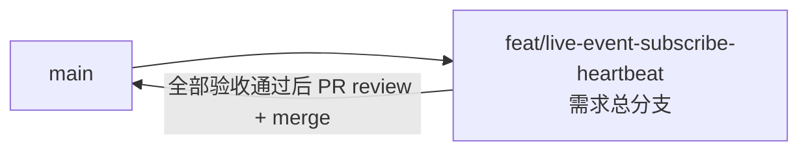

# 直播间实时事件订阅心跳 - 实现 Plan

**功能名称**: 直播间实时事件订阅心跳
**关联 PRD**: `docs/product/draft/20260903-live-event-subscribe-heartbeat-prd.md`
**关联技术提案**: `docs/engineering/proposals/20260903-proposal-live-event-subscribe-heartbeat.md`（v1.0）
**Plan 版本**: v1.0
**创建日期**: 2026-09-03
**作者**: Deliay
**feat-branch**: `feat/live-event-subscribe-heartbeat`（需求总分支）

## 1. 概述

本 Plan 基于 PRD v1.0 与技术提案 v1.0 产出，指导直播间实时事件订阅心跳的编码实施。实施全程遵循 `docs/engineering/common-rules.md`：TDD、契约式开发、核心逻辑单元测试覆盖率 ≥ 80%、合并前 review。

### 1.1 实施范围

- **做**：
  - `BilibiliLiveController.Subscribe` 推送循环重构：`await foreach` 改为「`ChannelReader.WaitToReadAsync` 与 10 秒 `Task.Delay` 竞速」手动循环；进入循环前立即写一帧 `heartbeat`；心跳帧固定为 `event: heartbeat` + `data: {}`。
  - `contracts/bilibili-crawler.openapi.yaml`：`event/subscribe` 端点 description 补充心跳行为（纯描述性变更）。
  - 前端 `apps/web/src/api/schema.d.ts` 重新生成（`npm run codegen`）。
  - Controller 测试补齐心跳用例，既有用例适配（即时心跳导致响应流新增首帧）。
- **不做**：
  - 心跳间隔配置化（常量 10 秒）；
  - 心跳入 `LiveEventBus` / Redis / Mongo；
  - 前端 UI 变更、鉴权变更、`ILiveEventBus` 接口变更。

### 1.2 现状基线

- `BilibiliLiveController.Subscribe`（`servers/api/Controllers/BilibiliLiveController.cs:148-178`）：设置 SSE 响应头后 `eventBus.Subscribe(roomId)`，`await foreach (var liveEvent in subscription.Reader.ReadAllAsync(ct))` 逐事件按 type 过滤写帧，`finally` 中 `eventBus.Unsubscribe(roomId, subscription.Id)`。无事件时循环挂起，连接完全静默。
- `LiveEventBus`（`servers/api/Live/LiveEventBus.cs`）：`Subscribe` 返回 `LiveEventSubscription(Guid Id, ChannelReader<LiveEvent> Reader)`，Channel 为 unbounded + `SingleReader = true`；最后一个订阅者退订时 `channel.Writer.TryComplete()`，`WaitToReadAsync` 将返回 `false`。
- 契约 `contracts/bilibili-crawler.openapi.yaml:170-184`：`event/subscribe` 端点已有 `EventType` 参数，description 未提及心跳；响应为 `text/event-stream`。
- `tests/Z.Vtuber.Tests/BilibiliLiveControllerTests.cs`：已有 `Subscribe_WithTypeFilter_OnlyPushesMatchingEvents` / `Subscribe_WithoutType_PushesAllEvents`，复用 `RunSubscribeAsync` 辅助方法（`DefaultHttpContext` + `MemoryStream` 响应体 + 发布事件 + `Task.Delay(300)` + 取消令牌）。

## 2. 分支与提交流程

遵循 z-git 规范（仅 merge、禁止 rebase/squash）与 Conventional Commits：

- 本需求开发全程只使用需求总分支 `feat/live-event-subscribe-heartbeat`：契约、实现、测试全部直接在该分支上提交，不再切开发子分支。
- 需求总 PR 尚未创建（gh token 失效，见上游产物说明）；实现完成后推送分支，可人工经 `https://github.com/Deliay/z-vtuber/pull/new/feat/live-event-subscribe-heartbeat` 创建 PR 或 gh 重新认证后补建。全部验收通过后 review 通过即 merge（仅 merge，禁止 rebase/squash）。
- 提交信息使用 Conventional Commits（`feat:` / `test:` / `docs:` / `chore:` 等），实现与测试分开提交。

## 3. 实施阶段

按 z-coding 开发流程「契约 → 实现 → 编排 → API 测试」推进，全程 TDD（先写测试再实现）。

### Phase 0: 契约先行

| # | 任务 | 产出 |
|---|------|------|
| 0.1 | `contracts/bilibili-crawler.openapi.yaml:173` `event/subscribe` description 追加心跳行为说明：「连接建立后立即发送一条 heartbeat 事件，之后每 10 秒发送一条（event: heartbeat，data 为空对象 {}）；heartbeat 为连接存活信号，不受 type 过滤影响，且不持久化、不出现在历史事件查询结果中。」 | 契约更新 |
| 0.2 | 同端点 200 响应 description 补充「另含连接级 heartbeat 帧」 | 契约更新 |
| 0.3 | `apps/web` 执行 `npm run codegen` 重新生成 `src/api/schema.d.ts`（描述性变更，无类型结构变化） | 类型重新生成 |

### Phase 1: Subscribe 循环重构（TDD）

| # | 任务 | 关键文件 | 测试重点 |
|---|------|---------|---------|
| 1.1 | 测试先行——`RunSubscribeAsync` 辅助方法扩展：新增可选参数支持「不发布任何事件」「自定义等待时长」；新增用例：a) 连接建立后首帧为 `event: heartbeat\n` + `data: {}\n\n`（无事件时也到达）；b) 缩短心跳间隔后一个等待窗口内收到多条 heartbeat（验证周期发送）；c) 指定 type 过滤时 heartbeat 仍到达、被过滤业务事件仍不推送；d) 业务事件与心跳交错时业务事件内容/顺序不变；e) 连接取消后不再产生心跳 | `tests/Z.Vtuber.Tests/BilibiliLiveControllerTests.cs` | 先红后绿 |
| 1.2 | 心跳间隔可测试化：`BilibiliLiveController` 内定义 `internal static TimeSpan HeartbeatInterval = TimeSpan.FromSeconds(10);`（可变静态字段，测试用例内临时改为几十毫秒后还原）；若测试程序集不可见 internal，则在 `servers/api` 的 csproj 或 `AssemblyInfo` 增加 `InternalsVisibleTo("Z.Vtuber.Tests")` | `servers/api/Controllers/BilibiliLiveController.cs` | 编译通过 |
| 1.3 | 循环重构：`await foreach` 改为手动循环——进入循环前先写一帧即时心跳（`event: heartbeat\n` + `data: {}\n\n` + `FlushAsync`）；每轮 `await Task.WhenAny(reader.WaitToReadAsync(ct).AsTask(), Task.Delay(HeartbeatInterval, ct))` 竞速：`Task.Delay` 先到则写心跳帧进入下一轮；`WaitToReadAsync` 先到则 `await` 取结果，返回 `false`（Channel 完成）时 `break`，返回 `true` 时 `TryRead` 取出事件、按既有 `types` 过滤逻辑决定是否写帧。心跳写帧不经 `ToEventDto` 序列化、不受 `types` 过滤影响；`finally` 中 `Unsubscribe` 清理逻辑不变；抽 `WriteHeartbeatAsync(ct)` 私有方法保持写帧路径统一 | `servers/api/Controllers/BilibiliLiveController.cs` | 1.1 全部用例转绿；既有 `Subscribe_*` 用例适配后通过（响应流新增首帧 heartbeat，断言需相应调整） |

### Phase 2: 编排验证与测试收口

| # | 任务 | 验收 |
|---|------|------|
| 2.1 | z-aspire-orchestrator 编排验证：AppHost 拉起 MongoDB + Redis + api，`curl -N http://localhost:<port>/api/b/live/123456/event/subscribe` 观察即时心跳与约 10 秒周期心跳；带 `type=danmaku` 参数订阅验证心跳不受过滤影响；`Ctrl+C` 断开后服务端无异常风暴 | 手工验证通过 |
| 2.2 | 全量回归 `dotnet test tests/Z.Vtuber.Tests`，重点确认 `Subscribe_WithTypeFilter_OnlyPushesMatchingEvents` / `Subscribe_WithoutType_PushesAllEvents` 无回归 | 全部通过 |
| 2.3 | 覆盖率核验：`Subscribe` 心跳与过滤核心路径覆盖率 ≥ 80% | 达标 |
| 2.4 | 同步更新 `servers/api/AGENTS.md` 模块结构描述（`Subscribe` 端点含连接级心跳行为） | 文档同步 |

## 4. 并行策略

- 本需求仅 `servers/api` 一个实现子项目，改动集中在单个方法，按 `write-implementation.md` 以单个 subagent 委托开发即可，无需并行拆分。
- Phase 0（契约）与 Phase 1（实现）文件不相交，可并行委托；Phase 1 内部 1.1 → 1.3 为同一 TDD 闭环，必须串行。
- 每阶段完成后更新 todo 并提交（实现与测试分开提交）。

## 5. 验收对照

| PRD 功能点 | 实现任务 | 验证方式 |
|-----------|---------|---------|
| 功能点 1：连接建立即时心跳 | 1.3（循环前即时写帧） | Controller 测试 a)（首帧为 heartbeat）+ 手工 `curl -N` 验证 |
| 功能点 2：周期心跳（10 秒、无业务数据） | 1.2、1.3（定时器竞速 + 固定帧 `data: {}`） | Controller 测试 b)（缩短间隔验证节奏）+ 手工观察 10 秒周期 |
| 功能点 3：心跳不受 type 过滤影响、不持久化 | 1.3（心跳独立于过滤分支、不进总线/仓储） | Controller 测试 c) + 契约评审 + 代码评审（无持久化路径） |
| 非功能：既有事件推送内容/顺序/过滤行为不变 | 1.3（过滤逻辑原样保留） | 既有用例回归 + 测试 d) |
| 非功能：断开后心跳自然终止、无异常风暴 | 1.3（`ct` 取消传播 + `finally` 清理） | 测试 e) + 手工断开验证 |

## 6. 风险与依赖

| 项 | 说明 | 应对 |
|---|------|------|
| `WaitToReadAsync` 返回 `false` 后空转 | 最后一个订阅者退订时 Channel 完成，若未 `break` 将每轮立即返回并狂写心跳 | 1.3 明确 `false` 时 `break`，代码评审把关 |
| 心跳节奏顺延 | 每轮重建 `Task.Delay`，事件密集时心跳间隔 > 10 秒 | 提案 6.1 已决策：满足 PRD「约 10 秒」语义，连接活跃时心跳顺延不影响存活判定 |
| 既有测试断言失效 | 响应流新增首帧 heartbeat，原 `CountOccurrences` / `Contains` 断言多数兼容，但需逐一核对 | 1.1/1.3 中适配既有用例，2.2 全量回归兜底 |
| 间隔可测试化引入可变静态 | `internal static` 可变字段存在测试间串扰风险（并行测试） | 用例内改后还原；xUnit 同测试类默认串行，不新增并行化 |
| SSE 写帧并发 | 禁止心跳与业务事件并发写响应体 | 所有写帧保持在同一请求循环内串行执行（提案约束），代码评审把关 |

## 7. 相关文档

- PRD：`docs/product/draft/20260903-live-event-subscribe-heartbeat-prd.md`
- 技术提案：`docs/engineering/proposals/20260903-proposal-live-event-subscribe-heartbeat.md`
- 契约：`contracts/bilibili-crawler.openapi.yaml`
- 开发规范：`docs/engineering/common-rules.md`、`docs/engineering/backend-rules.md`
- 上一期 Plan：`docs/engineering/plans/20260901-plan-api-crawler-split.md`
