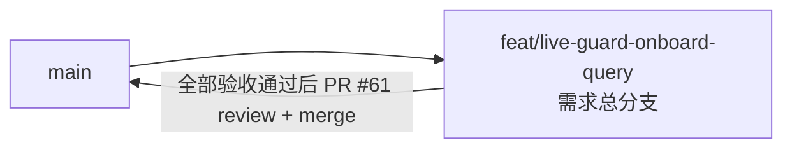

# 在舰查询 - 实现 Plan

**功能名称**: 在舰查询
**关联 PRD**: `docs/product/draft/20260903-live-guard-onboard-query-prd.md`（v1.3）
**关联技术提案**: `docs/engineering/proposals/20260903-proposal-live-guard-onboard-query.md`（v1.3）
**Plan 版本**: v1.0
**创建日期**: 2026-09-03
**作者**: Deliay
**feat-branch**: `feat/live-guard-onboard-query`（需求总分支）

## 1. 概述

本 Plan 基于 PRD v1.3 与技术提案 v1.3 产出，指导在舰查询 API 的编码实施。实施全程遵循 `docs/engineering/common-rules.md`：TDD、契约式开发、核心逻辑单元测试覆盖率 ≥ 80%、合并前 review。

### 1.1 实施范围

- **做**：
  - `contracts/bilibili-crawler.openapi.yaml`：新增 `GET /api/b/live/{roomId}/guard`（operationId `listOnboardGuardUids`），新增参数 `StartedDate`/`EndedDate`（`format: date`，必填）与 `OnboardMode`（枚举 `any`/`all`，可选默认 `any`），新增 schema `LiveGuardOnboardItem`/`LiveGuardOnboardList`；路径参数复用既有 `components/parameters/RoomId`。
  - `LiveGuardRepository`（servers/common）扩展 `GetOnboardGuardEntriesAsync(roomId, dates, requireAllDays, ct)`：聚合管道 `$match`（RoomId + Date `$in`）→ `$unwind` Guards → `$sort` Date 倒序 → `$group`（uid + days `$addToSet` + latest `$first`），all 口径过滤 `days.Count == dates.Count`，结果按 uid 升序。
  - `MongoDbInitializer.EnsureLiveGuardIndexesAsync` 新增非唯一复合索引 `RoomId_1_Date_1`。
  - `BilibiliLiveGuardController`（servers/api，新增）：参数解析校验（必填 / `yyyy-MM-dd` 严格格式 / 起≤止 / 范围 ≤366 天 / mode 枚举），日期展开后调用仓储，返回 `{ total, items }`。
  - 仓储与 Controller 集成测试补齐。
  - 前端 `apps/web` 执行 `npm run codegen` 重新生成 `src/api/schema.d.ts`。
- **不做**：
  - crawler 抓取链路任何改动；
  - 分页（去重后的 uid 名单一次返回）；
  - 跨直播间汇总查询、缓存、新增配置项、前端 UI。

### 1.2 现状基线

- `LiveGuardRepository`（`servers/common/Persistence/LiveGuardRepository.cs`）：现仅有 `UpsertDailySnapshotAsync`（Mid+Date 幂等 upsert）与 `GetMidsWithSnapshotAsync(date)` 两个方法，无按 RoomId 的读路径。
- 实体 `LiveGuardRecord`/`LiveGuardEntry`（`servers/common/Persistence/Entities/LiveGuardRecord.cs`）：`LiveGuardEntry` 字段齐备（`Uid` long、`UserName` string、`GuardLevel` int、`MedalName` string?、`MedalLevel` int），响应条目可直接复用，无需改实体。
- `MongoDbInitializer.EnsureLiveGuardIndexesAsync`（`servers/common/Persistence/MongoDbInitializer.cs:171-179`）：现仅创建唯一索引 `Mid_1_Date_1`，前缀为 Mid，无法命中 `RoomId + Date` 过滤，需新增索引。
- DI 基线（`servers/api/Program.cs`）：`LiveGuardRepository`、`MongoDbInitializer` 均已注册为 Singleton，启动时执行幂等索引初始化——新 Controller 直接构造注入仓储即可，无新增注册。
- Controller 风格基线：`BilibiliLiveController` 统一 `[Route("api/b/...")]`，参数非法返回 `BadRequest(new { error = "..." })`；`BilibiliBackstageControllerTests` 为「直接实例化 Controller + 真实仓储」的集成测试范式。
- 测试基线：`tests/Z.Vtuber.Tests/LiveGuardRepositoryTests.cs` 使用 `[Collection("mongo")]` + `MongoDbFixture.ResetAsync()` 范式；其 `Record(...)` 辅助方法 `RoomId` 固定为 `123456`，roomId 过滤用例需扩展该辅助方法支持自定义 RoomId。
- 契约基线（`contracts/bilibili-crawler.openapi.yaml`）：`/api/b/live/{roomId}/...` 前缀惯例已建立；既有 `StartedAt`/`EndedAt` 参数为 `format: date-time`、可选、UTC 语义，**不可复用**，须新增 `StartedDate`/`EndedDate`。

## 2. 分支与提交流程

遵循 z-git 规范（仅 merge、禁止 rebase/squash）与 Conventional Commits：

- 本需求开发全程只使用需求总分支 `feat/live-guard-onboard-query`（已存在并已推送远端，当前含 PRD v1.3 与技术提案 v1.3）：契约、实现、测试全部直接在该分支上提交，不再切开发子分支。
- 需求总 PR 已存在：`https://github.com/Deliay/z-vtuber/pull/61`（base=main）。实现提交推送后 PR 自动更新，全部验收通过后 review 通过即 merge。
- 提交信息使用 Conventional Commits，实现与测试分开提交：`feat:`（契约/仓储/Controller 实现）、`test:`（测试用例）、`chore:`（codegen 产物）等。

## 3. 实施阶段

按 z-coding 开发流程「契约 → 实现 → 编排 → API 测试」推进，全程 TDD（先写测试再实现）。

### Phase 0: 契约先行

| # | 任务 | 产出 |
|---|------|------|
| 0.1 | `contracts/bilibili-crawler.openapi.yaml` 新增 path `/api/b/live/{roomId}/guard`：GET，operationId `listOnboardGuardUids`，summary 中文；参数 `$ref` 既有 `RoomId` + 新增 `StartedDate`/`EndedDate`/`OnboardMode`；200 响应引用 `LiveGuardOnboardList`，400 响应描述参数非法（缺失、格式错误、起晚于止、范围超 366 天、mode 非法） | 契约更新 |
| 0.2 | `components/parameters` 新增 `StartedDate`/`EndedDate`（`type: string`，`format: date`，`required: true`，描述北京时间口径与「起日 00:00 至止日 23:59:59 全天含边界」语义）与 `OnboardMode`（`type: string`，`enum: [any, all]`，`required: false`，`default: any`） | 契约更新 |
| 0.3 | `components/schemas` 新增 `LiveGuardOnboardItem`（`uid` int64、`userName` string、`guardLevel` int32、`medalName` string nullable、`medalLevel` int32）与 `LiveGuardOnboardList`（`total` int32、`items` array） | 契约更新 |
| 0.4 | `apps/web` 执行 `npm run codegen` 重新生成 `src/api/schema.d.ts` | 类型重新生成 |

### Phase 1: 仓储与索引（servers/common，TDD）

| # | 任务 | 关键文件 | 测试重点 |
|---|------|---------|---------|
| 1.1 | 测试先行——扩展 `Record(...)` 辅助方法支持自定义 `RoomId` 与完整条目字段（GuardLevel/MedalName/MedalLevel）；新增用例：a) any 口径跨天去重，同一 uid 多天命中仅出现一次；b) any 口径多天名单信息不一致时取范围内最新一天快照；c) all 口径仅保留命中天数==范围天数的 uid；d) all 口径下某天无快照则结果为空；e) 其他 RoomId 的快照不混入；f) 范围之外日期的快照不影响结果；g) 无任何数据返回空列表；h) `dates` 为空直接返回空列表（不发起查询）；i) 结果按 uid 升序且字段完整（userName/guardLevel/medalName/medalLevel） | `tests/Z.Vtuber.Tests/LiveGuardRepositoryTests.cs` | 先红后绿 |
| 1.2 | 实现 `GetOnboardGuardEntriesAsync(long roomId, IReadOnlyList<string> dates, bool requireAllDays, CancellationToken ct = default)`：`dates` 为空时短路返回空列表；聚合管道 `$match: { RoomId, Date: { $in } }` → `$unwind: "$Guards"` → `$sort: { Date: -1 }` → `$group: { _id: "$Guards.Uid", days: { $addToSet: "$Date" }, latest: { $first: "$Guards" } }`；`requireAllDays` 时在管道或内存过滤 `days.Count == dates.Count`；结果按 uid 升序返回 `latest` 条目 | `servers/common/Persistence/LiveGuardRepository.cs` | 1.1 全部用例转绿 |
| 1.3 | `EnsureLiveGuardIndexesAsync` 追加创建非唯一复合索引 `RoomId_1_Date_1`（`Ascending(RoomId).Ascending(Date)`），沿用既有 `CreateIndexModel` 幂等创建方式 | `servers/common/Persistence/MongoDbInitializer.cs` | `MongoDbInitializerTests` 回归通过（幂等重复初始化） |

### Phase 2: Controller 端点（servers/api，TDD）

| # | 任务 | 关键文件 | 测试重点 |
|---|------|---------|---------|
| 2.1 | 测试先行——新增 `BilibiliLiveGuardControllerTests`（沿用 `BilibiliBackstageControllerTests`「直接实例化 Controller + 真实仓储 + mongo Collection」范式）：a) 正常 200：`total == items.Count`，按 uid 升序去重，条目字段完整；b) 单日查询（startedAt==endedAt）any/all 结果一致；c) mode 缺省按 any；d) mode=all 语义；e) 缺少 startedAt/endedAt → 400；f) 日期格式非法（含 date-time 串）→ 400；g) 起晚于止 → 400；h) 范围 >366 天 → 400；i) mode 非 any/all → 400；j) 直播间无快照 → 200 空名单 | `tests/Z.Vtuber.Tests/BilibiliLiveGuardControllerTests.cs` | 先红后绿 |
| 2.2 | 实现 `BilibiliLiveGuardController`：`[ApiController]` + `[Route("api/b/live")]`，`GET {roomId}/guard`；`DateOnly.TryParseExact("yyyy-MM-dd", CultureInfo.InvariantCulture, DateTimeStyles.None, out ...)` 严格解析；校验顺序：必填 → 格式 → 起≤止 → 范围 ≤366 天 → mode 枚举，失败均 `BadRequest(new { error })`；`DateOnly.AddDays` 展开日期字符串列表；`requireAllDays = mode == "all"`；响应 DTO `{ total, items }`，条目映射自 `LiveGuardEntry` | `servers/api/Controllers/BilibiliLiveGuardController.cs` | 2.1 全部用例转绿 |

### Phase 3: 编排验证与测试收口

| # | 任务 | 验收 |
|---|------|------|
| 3.1 | z-aspire-orchestrator 编排验证：AppHost 拉起 MongoDB + Redis + api + crawler，预置舰长快照数据后 `curl "http://localhost:<port>/api/b/live/<roomId>/guard?startedAt=...&endedAt=..."` 验证 any/all、边界日期、空名单与 400 分支 | 手工验证通过 |
| 3.2 | 全量回归 `dotnet test tests/Z.Vtuber.Tests`，确认既有 `LiveGuardRepositoryTests`、`MongoDbInitializerTests`、`StartupDiTests` 无回归 | 全部通过 |
| 3.3 | 覆盖率核验：仓储聚合方法与 Controller 校验/映射路径覆盖率 ≥ 80% | 达标 |
| 3.4 | 同步更新 `servers/api/AGENTS.md`（`Controllers/` 新增 `BilibiliLiveGuardController` 在舰查询端点）与 `servers/common/AGENTS.md`（`LiveGuardRepository` 扩展只读聚合查询、`RoomId_1_Date_1` 索引） | 文档同步 |

## 4. 并行策略

- 按 `write-implementation.md`，本需求涉及 `servers/common` 与 `servers/api` 两个实现子项目，各以一个 subagent 委托开发；契约与 codegen 可作为独立任务。
- Phase 0（契约）与 Phase 1（common）文件不相交，可并行委托；Phase 2（api）依赖 Phase 1 的仓储方法签名，须在其完成后启动；Phase 3 串行收口。
- Phase 1 内部 1.1 → 1.3、Phase 2 内部 2.1 → 2.2 为同一 TDD 闭环，必须串行。
- 每阶段完成后更新 todo 并提交（实现与测试分开提交）。

## 5. 验收对照

| PRD 功能点 | 实现任务 | 验证方式 |
|-----------|---------|---------|
| 功能点 1：any 口径范围内任意一天在舰即计入、按 uid 去重 | 1.2（`$group` + `$addToSet`） | 仓储测试 a)、Controller 测试 a)/c) |
| 功能点 1：all 口径每一天都在舰才计入，缺快照天结果为空 | 1.2（`days.Count == dates.Count`） | 仓储测试 c)/d)、Controller 测试 d) |
| 功能点 1：条目含昵称/舰长等级/勋章，多天不一致取最新一天快照 | 1.2（`$sort` desc + `$first`） | 仓储测试 b)/i)、Controller 测试 a) |
| 功能点 1：仅指定直播间数据、范围外日期不影响、边界日期全天计入 | 1.2（`$match` RoomId + Date `$in`） | 仓储测试 e)/f)、Controller 测试 b) |
| 功能点 1：全部无数据 / 直播间从未产生快照返回空名单 | 1.2、2.2 | 仓储测试 g)、Controller 测试 j) |
| 功能点 2：日期格式/缺失/起晚于止/mode 非法均返回明确 400 | 2.2 | Controller 测试 e)-i) |
| 非功能：范围上限保护（≤366 天） | 2.2 | Controller 测试 h) |
| 非功能：常规范围秒级返回 | 1.3（`RoomId_1_Date_1` 索引） | 编排手工验证 + 索引存在性检查 |

## 6. 风险与依赖

| 项 | 说明 | 应对 |
|---|------|------|
| 聚合管道驱动语法 | C# 驱动聚合管道与手写 shell 语法存在细节差异（`$first`、`$addToSet` 用法） | 1.2 优先用 `Aggregate().Unwind().Sort().Group()` 强类型 API，不行再退回 `BsonDocument` 管道；以 1.1 测试为准 |
| `$sort` 在 `$group` 前的内存压力 | 单日名单量级为舰长数量级（千级），范围内 unwind 后总量有限 | 范围已限 366 天；`RoomId_1_Date_1` 索引保证 `$match` 前置过滤 |
| 日期口径漂移 | 快照 `Date` 键为北京时间 `yyyy-MM-dd`，Controller 展开必须同为日历日字符串，禁止引入 UTC 换算 | 2.2 仅用 `DateOnly` 日历运算，不做任何时区转换；代码评审把关 |
| 测试辅助方法改动影响既有用例 | `Record(...)` 扩展 RoomId/字段参数可能影响 `LiveGuardRepositoryTests` 既有用例 | 1.1 以新增可选参数/重载方式扩展，3.2 全量回归兜底 |
| 契约参数不可复用误用 | 既有 `StartedAt`/`EndedAt` 语义不同，误 `$ref` 会导致契约语义错误 | 0.2 明确新增 `StartedDate`/`EndedDate`，契约评审把关 |
| codegen 依赖环境 | `apps/web` 的 `npm run codegen` 需要前端依赖可用 | 0.4 失败时记录原因并在 PR 说明，不阻塞后端实现合入 |

## 7. 相关文档

- PRD：`docs/product/draft/20260903-live-guard-onboard-query-prd.md`
- 技术提案：`docs/engineering/proposals/20260903-proposal-live-guard-onboard-query.md`
- 契约：`contracts/bilibili-crawler.openapi.yaml`
- 开发规范：`docs/engineering/common-rules.md`、`docs/engineering/backend-rules.md`
- 上一期 Plan：`docs/engineering/plans/20260831-plan-live-guard-crawl.md`
