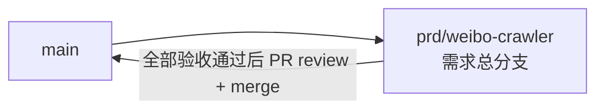

# 微博动态抓取 - 实现 Plan

**功能名称**: 微博动态抓取
**关联 PRD**: `docs/product/draft/20260909-weibo-crawler-prd.md`（v1.0）
**关联技术提案**: `docs/engineering/proposals/20260909-proposal-weibo-crawler.md`（v1.0）
**Plan 版本**: v1.0
**创建日期**: 2026-09-09
**作者**: Deliay
**需求总分支**: `prd/weibo-crawler`

## 1. 概述

本 Plan 基于已产出的 PRD v1.0 与技术提案 v1.0 编写，指导微博动态抓取的编码实施。实施全程遵循 `docs/engineering/common-rules.md`：TDD（先写测试再实现）、契约式开发（先落契约再生成类型）、核心逻辑单元测试覆盖率 ≥ 80%、合并前 review。后端遵循 `docs/engineering/backend-rules.md`，前端遵循 `docs/engineering/frontend-rules.md`。

说明：技术提案中 feat-branch 写作 `feat/weibo-crawler`，实际创建的需求总分支为 `prd/weibo-crawler`（本 Plan 以此为准），实现、测试、文档全部直接提交到该分支。

### 1.1 实施范围

- **做**：
  - 契约：新建 `contracts/weibo-crawler.openapi.yaml`（4 端点，统一前缀 `/api/weibo`）；`apps/web` codegen 增加该契约生成 `src/api/schema-weibo.d.ts`。
  - common：`WeiboSubscriptionRecord` / `WeiboTimelineRecord` 实体、`WeiboSubscriptionRepository` / `WeiboTimelineRepository` 仓储、`WeiboSubscriptionService`（含 `Subscribed` 事件）、`MongoCollectionNames` + `MongoDbInitializer` 新增 2 个集合的幂等索引初始化。
  - crawler：`WeiboCrawlerOptions`、`IWeiboApiClient`/`WeiboApiClient`（m.weibo.cn getIndex）、`WeiboVisitorCookieProvider`（genvisitor2 主 + 三步握手 fallback、定时刷新、失败重建）、`WeiboRiskControlClassifier`、`WeiboMblogParser`、`WeiboTimelineJob`（周期抓取 + 新订阅即时补抓 + 退避门控 + 收敛式翻页）；`Program.cs` 注册与 `appsettings.json` 增加 `WeiboCrawler` 节。
  - api：`WeiboSubscriptionController`（订阅列表/创建/取消）、`WeiboUserController`（动态分页 + 时间范围查询）。
  - 前端：`api/client.ts` 增加微博接口封装；`SubscriptionPage.tsx` 新增平台选择（B站/微博）与平台标识列。
  - 测试：`tests/Z.Vtuber.Tests` 新增单测 + Testcontainers 集成测试；前端 `client.test.ts` / `SubscriptionPage.test.tsx` 扩展。
  - 文档：各目录 `AGENTS.md` 涉及结构描述处同步更新。
- **不做**：
  - 微博热搜、评论、粉丝/关注、搜索；微博扫码登录态；
  - 既有 B 站链路任何行为变更与既有数据迁移；
  - 新增鉴权机制、新增中间件/镜像/Aspire 资源。

### 1.2 现状基线

- 分支 `prd/weibo-crawler` 已基于最新 `origin/main` 切出，PRD 与技术提案已提交（commit `36cca1b`）。
- common：`MongoCollectionNames` 定义于 `servers/common/Persistence/MongoDbInitializer.cs`（同文件内）；`SubscriptionService`（`servers/common/Services/SubscriptionService.cs`）已实现 `Subscribed` 事件 + `SetOnInsert` upsert 幂等模式，`WeiboSubscriptionService` 与其同构。
- crawler：`SpaceTimelineJob : PeriodicJobBase`（`servers/crawler/Jobs/SpaceTimelineJob.cs`）已示范「订阅驱动 + `CrawlLockProvider` per-key 锁 + 事件即时补抓」模式；`CrawlBackoffRegistry`、`RiskControlClassifier` 位于 `servers/crawler/Crawlers/`，按字符串 key 泛化可直接复用；收敛翻页判定 `SpaceTimelinePaging.ShouldContinuePaging` 位于 `servers/common/Services/SpaceTimelinePaging.cs`。
- api：`BilibiliUserController`（`servers/api/Controllers/BilibiliUserController.cs`）已示范分页 clamp（1-100）+ `BadTimeRange` 400 模式；订阅控制器 `BilibiliSubscriptionController` 同目录。
- 前端：`apps/web/package.json` 已有 `codegen` 脚本（openapi-typescript ^7.13.0 → `src/api/schema.d.ts`）；`SubscriptionPage.tsx` 已有 `TYPE_LABELS` 映射模式，平台列沿用同款。
- 测试：`tests/Z.Vtuber.Tests` 含 `MongoDbFixture`（Testcontainers MongoDB）、`RedisFixture`、`Fakes.cs`（手写 fake）、`StartupDiTests`（DI 注册校验），新链路按既有测试形态补齐。

## 2. 分支与提交流程

遵循 z-git 规范与 Conventional Commits：

- 本需求开发全程只使用需求总分支 `prd/weibo-crawler`：实现、测试、文档全部直接在该分支上提交，不再切开发子分支（沿用既定做法）。
- 需求总 PR 已存在（`https://github.com/Deliay/z-vtuber/pull/71`，base: main），后续提交直接推送到该分支更新 PR；全部验收通过后 review 通过即 merge。
- 提交信息使用 Conventional Commits（`feat:` / `test:` / `docs:` / `chore:`），实现与测试分开提交；禁止 rebase/squash，只允许 merge。

## 3. 实施阶段

按 z-coding 开发流程推进，全程 TDD。涉及 `contracts`、`servers/common`、`servers/crawler`、`servers/api`、`apps/web` 五个子项目。

### Phase 0: 契约与 common 数据层（TDD）

| # | 任务 | 关键文件 | 测试重点 |
|---|------|---------|---------|
| 0.1 | 新建微博 API 契约：4 端点（`GET/POST /api/weibo/subscription`、`DELETE /api/weibo/subscription/{uid}`、`GET /api/weibo/user/{uid}/timeline`），结构与错误语义对齐 `bilibili-crawler.openapi.yaml`（uid 非正数 400、重复订阅幂等、退订 204/404、分页 clamp、时间范围非法 400） | `contracts/weibo-crawler.openapi.yaml`（新建） | 契约可被 openapi-typescript 正常解析（随 Phase 3 codegen 验证） |
| 0.2 | 实体与集合名：`WeiboSubscriptionRecord`（Uid/SubscribedAt）、`WeiboTimelineRecord`（Uid/MblogId/Data/PubTs/FetchedAt）；`MongoCollectionNames` 增加 `WeiboSubscriptions`/`WeiboUserTimeline` | `servers/common/Persistence/Entities/WeiboSubscriptionRecord.cs`、`WeiboTimelineRecord.cs`（新建）、`MongoDbInitializer.cs`（+常量） | 编译通过；随 0.4 集成测试覆盖 |
| 0.3 | 仓储：`WeiboSubscriptionRepository`（按 Uid upsert/删除/列举）；`WeiboTimelineRepository`（`GetExistingMblogIdsAsync` + `BulkUpsertAsync` 按 MblogId SetOnInsert 幂等 + `GetPageAsync` 按 PubTs 过滤分页，对齐 `SpaceTimelineRepository`） | `servers/common/Persistence/WeiboSubscriptionRepository.cs`、`WeiboTimelineRepository.cs`（新建） | Testcontainers 集成测试：upsert 幂等无重复、分页总数与排序、时间范围过滤、MblogId 唯一约束 |
| 0.4 | `MongoDbInitializer.EnsureIndexesAsync` 增加 `weibo_subscriptions`（Uid 唯一）与 `weibo_user_timeline`（MblogId 唯一、`(Uid,-PubTs)`、`(Uid,-MblogId)`）幂等建索引 | `servers/common/Persistence/MongoDbInitializer.cs` | 扩展 `MongoDbInitializerTests`：重复执行幂等、索引存在 |
| 0.5 | `WeiboSubscriptionService`（入 common）：`Subscribed` 事件 + `GetUidsAsync/GetAllAsync/SubscribeAsync/UnsubscribeAsync`，与 `SubscriptionService` 同构（Uid upsert 幂等，仅在新建时触发事件） | `servers/common/Services/WeiboSubscriptionService.cs`（新建） | 单测/集成测试：订阅幂等（重复订阅不重复触发事件）、取消后不再返回、事件载荷正确 |

### Phase 1: crawler 抓取链路（TDD）

| # | 任务 | 关键文件 | 测试重点 |
|---|------|---------|---------|
| 1.1 | `WeiboCrawlerOptions`（节 `WeiboCrawler`：`TimelineIntervalSeconds=60`、`HttpTimeoutSeconds=10`、`CookieRefreshIntervalMinutes=60`、`MaxPagesPerCrawl=5`、`UserAgent`、退避参数 `BackoffBaseSeconds=30`/`BackoffMaxMinutes=15`/`CooldownMinutes=30`/阈值 5），`ValidateOnStart`；`appsettings.json` 增加对应节 | `servers/crawler/Configuration/WeiboCrawlerOptions.cs`（新建）、`servers/crawler/appsettings.json` | 单测：默认值、非法值校验（对齐 `BilibiliCrawlerOptionsTests`） |
| 1.2 | `WeiboMblogParser`：`created_at` Ruby 格式（`ddd MMM dd HH:mm:ss zzz yyyy`，InvariantCulture）→ UTC 秒级时间戳，解析失败置 null 仍落库；从 cards[] 提取 `card_type==9` 的 mblog；字段缺失可空容错 | `servers/crawler/Weibo/WeiboMblogParser.cs`（新建） | 单测：正常/异常时间格式、缺字段、非 9 类型卡片过滤、解析不抛 |
| 1.3 | `WeiboVisitorCookieProvider`：进程内单例 `CookieContainer`；主路径 `POST visitor.passport.weibo.cn/visitor/genvisitor2`（JSONP 正则提取 sub/subp）；fallback DDBOT 三步握手；启动申请（失败重试 3 次间隔 1s）；按 `CookieRefreshIntervalMinutes` 定时刷新；失效信号作废重建并原样重试一次；`SemaphoreSlim` 并发保护 | `servers/crawler/Weibo/WeiboVisitorCookieProvider.cs`（新建） | 单测（fake HttpMessageHandler）：一步申请成功、JSONP 解析、失败回退三步握手、定时刷新、失效重建重试一次、并发申请仅一次 |
| 1.4 | `WeiboRiskControlClassifier`：识别 302 跳 passport / 401 / 403 / JSON `ok!=1` / msg 含「登录/cookie/visitor/auth」关键词，产出风控信号 | `servers/crawler/Weibo/WeiboRiskControlClassifier.cs`（新建） | 单测：各信号命中与正常响应不误判（对齐 `RiskControlClassifierTests`） |
| 1.5 | `IWeiboApiClient`/`WeiboApiClient`：`GetUserTimelineAsync(uid, sinceId?)` 请求 `m.weibo.cn/api/container/getIndex?containerid=107603{uid}`；固定头（移动端 UA、`Referer: https://m.weibo.cn/`、`Accept: application/json`）；返回 `WeiboTimelinePage{HasMore, SinceId, Items}`；命中风控信号时抛专用异常并触发凭证重建 | `servers/crawler/Weibo/IWeiboApiClient.cs`、`WeiboApiClient.cs`（新建） | 单测（fake handler）：URL/请求头、翻页 since_id 透传、卡片提取、风控响应走分类器 |
| 1.6 | `WeiboTimelineJob : PeriodicJobBase`：周期读取全部微博订阅 uid；`CrawlLockProvider` key `weibo:{uid}` 防并发；`CrawlBackoffRegistry.TryAcquire` 退避门控（捕获 `CrawlBackoffActiveException` 跳过）；订阅 `WeiboSubscriptionService.Subscribed` 即时补抓；收敛式翻页（复用 `SpaceTimelinePaging.ShouldContinuePaging` 思路 + `visitedSinceIds` 防游标循环 + `MaxPagesPerCrawl` 上限）；过滤已存在 MblogId 后 `BulkUpsert` | `servers/crawler/Jobs/WeiboTimelineJob.cs`（新建） | 单测（fake client/仓储/服务）：增量过滤不重复入库、本页全已存在即收敛、页数上限、退避期跳过、新订阅即时补抓、风控后登记退避 |
| 1.7 | `Program.cs` 注册微博链路（Options 绑定+校验、仓储、订阅服务、CookieProvider 单例、ApiClient、Job `AddHostedService`）；扩展 `StartupDiTests` 覆盖新注册 | `servers/crawler/Program.cs`、`tests/Z.Vtuber.Tests/StartupDiTests.cs` | DI 校验测试通过；`dotnet build` 全绿 |

### Phase 2: api 查询与订阅端点（TDD）

| # | 任务 | 关键文件 | 测试重点 |
|---|------|---------|---------|
| 2.1 | `WeiboSubscriptionController`（`/api/weibo/subscription`）：GET 列表、POST 创建（uid 缺失/非正数 400，重复订阅幂等 200）、DELETE `{uid}`（204/404） | `servers/api/Controllers/WeiboSubscriptionController.cs`（新建） | 单测（对齐 `BilibiliSubscriptionControllerTests`）：参数校验 400、幂等、404 |
| 2.2 | `WeiboUserController`（`/api/weibo/user/{uid}/timeline`）：page≥1、pageSize clamp 1-100、startedAt/endedAt 过滤、`BadTimeRange` 400；返回 `{ total, page, pageSize, items }`，items 为原始 mblog JSON | `servers/api/Controllers/WeiboUserController.cs`（新建） | 单测（对齐 `BilibiliUserControllerTests`）：clamp、时间范围 400、空结果返回空列表、字段透传 |
| 2.3 | `Program.cs`（api）注册 `WeiboSubscriptionService` 与两个仓储；启动索引初始化已幂等含新集合 | `servers/api/Program.cs` | 随 `StartupDiTests`/控制器测试覆盖 |

### Phase 3: 前端订阅管理（TDD）

| # | 任务 | 关键文件 | 测试重点 |
|---|------|---------|---------|
| 3.1 | codegen 增加微博契约生成：`package.json` codegen 追加 `openapi-typescript ../../contracts/weibo-crawler.openapi.yaml -o src/api/schema-weibo.d.ts`，执行生成 | `apps/web/package.json`、`apps/web/src/api/schema-weibo.d.ts`（生成，勿手改） | `npm run build` 通过，类型可引用 |
| 3.2 | `api/client.ts` 增加 `listWeiboSubscriptions`/`subscribeWeibo`/`unsubscribeWeibo`/`getWeiboTimeline` 封装（base URL 与错误处理沿用现状） | `apps/web/src/api/client.ts`、`client.test.ts` | 单测（mocked fetch）：method/path/body/query 拼接、非 2xx 抛错、404 区分 |
| 3.3 | `SubscriptionPage.tsx`：新增订阅表单增加「平台」选择（B站/微博）；选微博时仅填 uid（前端校验纯数字正整数）；列表增加平台标识列（`PLATFORM_LABELS`，存量条目默认 B站）；取消按钮按平台调对应接口 | `apps/web/src/pages/subscription/SubscriptionPage.tsx`、`SubscriptionPage.test.tsx` | 组件测试（vi.mock client）：平台切换表单、uid 非法拦截、微博订阅创建/取消调用正确端点、列表平台列展示、存量 B 站订阅不受影响 |

### Phase 4: 编排验证与测试收口

| # | 任务 | 验收 |
|---|------|------|
| 4.1 | z-aspire-orchestrator 编排验证：AppHost 拉起 MongoDB + api + crawler + web，创建微博订阅后观察即时补抓与周期入库，`curl` 调 `/api/weibo/user/{uid}/timeline` 与库内数据交叉核对 | 手工验证记录 |
| 4.2 | `dotnet build servers/Z.Vtuber.slnx` 与 `dotnet test tests/Z.Vtuber.Tests` 全绿（含既有 B 站回归）；前端 `npm run test`/`lint`/`build` 全绿；新链路核心逻辑覆盖率 ≥ 80% | 全部通过 |
| 4.3 | 文档同步：`servers/common/AGENTS.md`（新实体/仓储/服务）、`servers/crawler/AGENTS.md`（Weibo/ 目录、WeiboTimelineJob、WeiboCrawler 配置节）、`servers/api/AGENTS.md`（/api/weibo 控制器）、`apps/web/AGENTS.md`（schema-weibo、平台选择） | 文档与代码一致 |

## 4. 并行策略

- 按 z-coding 工作流以 subagent 委托开发。
- Phase 0（契约 + common 数据层）先行：实体/仓储/订阅服务是 crawler 与 api 的公共依赖，必须最先完成并独立提交。
- Phase 1（crawler）与 Phase 2（api）在 Phase 0 完成后相互独立，可拆分两个委托并行；Phase 3（前端）依赖 Phase 0.1 契约，与 Phase 1/2 并行。
- Phase 4 最后收口。
- 每阶段完成后提交（实现与测试分开提交），实现分支即需求总分支 `prd/weibo-crawler`。

## 5. 验收对照

| PRD 功能点 | 实现任务 | 验证方式 |
|-----------|---------|---------|
| 功能点 1：订阅管理新增「微博」类型（创建/区分/幂等/取消/非法 uid 拒绝） | 0.5、2.1、3.1-3.3 | 控制器单测 + 组件测试 + 编排验证幂等 |
| 功能点 2：微博动态周期抓取（持续入库/即时补抓/不重复/未订阅不抓/退避恢复/凭证重建） | 1.1-1.7 | `WeiboTimelineJob` 单测 + Testcontainers 仓储集成测试 + 编排验证 |
| 功能点 3：微博动态对外查询（分页/时间范围/核心字段/空结果） | 0.3、2.2 | 控制器单测 + 仓储分页集成测试 |
| 非功能：不影响既有 B 站链路 | 全部任务（零改动约束） | `dotnet test` 既有用例全绿回归 |
| 非功能：覆盖率 ≥ 80%、构建全绿 | 4.2 | `dotnet test`、`npm run test/lint/build` |
| 提案验收：契约评审 + 前端 codegen 正常 | 0.1、3.1 | 契约 review + `npm run codegen`/`build` |

## 6. 风险与依赖

| 项 | 说明 | 应对 |
|---|------|------|
| 依赖 | m.weibo.cn 公开接口无契约保证 | `WeiboMblogParser` 全字段可空容错，严禁反序列化抛错中断整轮抓取 |
| 依赖 | 访客凭证为运行时自申请，微博可能收紧匿名访问 | genvisitor2 主 + 三步握手 fallback + 失效自动重建；长期失效超出本期范围（PRD 已约束） |
| 风控 | 微博风控敏感度高于 B 站 | 抓取间隔默认 60s（比空间动态 30s 保守），退避/冷却参数独立配置可调 |
| 首次订阅历史 | 收敛式翻页限 5 页，不回放全量历史 | 与 B 站动态抓取语义一致（PRD 要求），可接受 |
| 分支口径 | 提案 feat-branch 与实际需求总分支名称不一致 | 以 `prd/weibo-crawler` 为准（本 Plan 第 1 节已声明） |

## 7. 相关文档

- PRD：`docs/product/draft/20260909-weibo-crawler-prd.md`
- 技术提案：`docs/engineering/proposals/20260909-proposal-weibo-crawler.md`
- 既有契约：`contracts/bilibili-crawler.openapi.yaml`（本期零改动）
- 开发规范：`docs/engineering/common-rules.md`、`docs/engineering/backend-rules.md`、`docs/engineering/frontend-rules.md`
- 上一期 Plan：`docs/engineering/plans/20260822-plan-admin-console.md`
- 需求总 PR：`https://github.com/Deliay/z-vtuber/pull/71`
