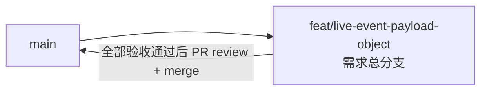

# 直播事件 Payload 结构化存储 - 实现 Plan

**功能名称**: 直播事件 Payload 结构化存储
**关联 PRD**: `docs/product/draft/20260913-live-event-payload-object-prd.md`（v1.0）
**关联技术提案**: `docs/engineering/proposals/20260913-proposal-live-event-payload-object.md`
**Plan 版本**: v1.0
**创建日期**: 2026-09-13
**作者**: Deliay
**feat-branch**: `feat/live-event-payload-object`（需求总分支）

## 1. 概述

本 Plan 基于 PRD v1.0 与技术提案产出，指导直播事件 Payload 结构化存储的编码实施。实施全程遵循 `docs/engineering/common-rules.md`：TDD、契约式开发、核心逻辑单元测试覆盖率 ≥ 80%、合并前 review。

### 1.1 实施范围

- **做**：
  - `LiveEventRecord.Payload`：`string` → `BsonDocument`，挂 `StringTolerantBsonDocumentSerializer` 容错反序列化（过渡期读旧 string 数据不报错）。
  - 新增 `LiveEventPayloadParser`（common）：string → `BsonDocument` 统一解析与降级策略，crawler 落库点与迁移共用。
  - `MongoDbInitializer` 新增幂等迁移 `BackfillLiveEventPayloadObjectAsync`（标记 key `live_event_payload_object_backfill_v1`，原子锁防并发），注册到仅 crawler 启动序列。
  - `LiveEventSource` 落库点：Payload 解析为 `BsonDocument`，失败降级 `{ "raw": 原字符串 }` + 日志，不阻断采集。
  - `BilibiliLiveController.ToEventDto(LiveEventRecord)`：`BsonDocument` → `JsonNode` 适配，响应结构不变；`ToEventDto(LiveEvent)`（SSE）保持 string 路径不变。
  - 既有 backfill（GiftPrice/TextIndex/Sender）对 `record.Payload` 的 string 消费适配（编译修复，抽取语义不变）。
  - 单测 + Testcontainers 集成测试补齐。
- **不做**：OpenAPI 契约与 web 端变更、Redis 频道消息格式变更、抽取器（`LiveEventTextExtractor`/`GiftPriceExtractor`）签名与语义变更、新增索引、派生数据（文本索引/Price）重建、`Mikibot.Crawler` 包改动。

### 1.2 现状基线

- 实体 `LiveEventRecord`（`servers/common/Persistence/Entities/LiveEventRecord.cs:18`）：`Payload` 为 `string`。
- 写入路径 `LiveEventSource`（`servers/crawler/Live/LiveEventSource.cs:177-187`）：`Payload = liveEvent.Payload` 原样拷贝落库；同方法内 `GiftPriceExtractor.ExtractGoldSeeds`（:184）与 `LiveEventTextExtractor.Extract`（:192）均以 string Payload 为输入——抽取/发布路径保持不动，仅改落库构造。
- 读取路径 `BilibiliLiveController.ToEventDto(LiveEventRecord)`（`servers/api/Controllers/BilibiliLiveController.cs:257-264`）：`payload = BilibiliUserController.ParseRaw(record.Payload)`；`ParseRaw(string?)`（`servers/api/Controllers/BilibiliUserController.cs:55-56`）为共享 helper，`ToEventDto(LiveEvent)`（:266-273，SSE）与其他 Controller 仍消费 string 重载，**保留不动**。
- 既有 backfill 对 `record.Payload` 的 string 消费点（实体改型后编译受影响，需适配）：`MongoDbInitializer.cs:403`（GiftPrice）、`:482`（TextIndex）、`:588`（Sender）。
- 迁移范本 `BackfillGiftPriceAsync`（`servers/common/Persistence/MongoDbInitializer.cs:358-425`）：Meta 标记（`zvtuber_meta`）+ 分批 500 + BulkWrite + `MarkMigrationAppliedAsync`（:640）。
- 启动注册：api（`servers/api/Program.cs:62-66`）与 crawler（`servers/crawler/Program.cs:125-129`）启动序列中依次调用 `EnsureIndexesAsync` 与各 backfill；新增迁移仅在 crawler 注册（`BackfillLiveEventSenderAsync` 之后追加），api 不注册——数据写入与迁移职责统一归 crawler，api 只读。
- 测试：`tests/Z.Vtuber.Tests` 已有 `MongoDbFixture`（Testcontainers）、`MongoDbInitializerTests`、`LiveEventRepositoryTests`、`BilibiliLiveControllerTests`、`LiveEventSenderBackfillTests` 等；消费 `LiveEventRecord.Payload` 的既有测试（构造 string Payload 的用例）随实体改型适配。

## 2. 分支与提交流程

遵循 `z-git` 规范（仅 merge、禁止 rebase/squash）与 Conventional Commits：

- 本需求开发全程只使用需求总分支 `feat/live-event-payload-object`：实现、测试全部直接在该分支上提交，不再切开发子分支。
- 需求总 PR 已存在（`https://github.com/Deliay/z-vtuber/pull/85`，base: main），后续提交直接推送到该分支更新 PR；全部验收通过后 review 通过即 merge（仅 merge，禁止 rebase/squash）。
- 提交信息使用 Conventional Commits（`feat:` / `test:` / `docs:` 等），实现与测试分开提交。

## 3. 实施阶段

全程 TDD（先写失败测试再实现）。本需求无契约变更（`payload` 契约本就为 `type: object`），无 Phase 0 契约任务。

### Phase 1: 实体改造与共用解析（common，TDD）

| # | 任务 | 关键文件 | 测试重点 |
|---|------|---------|---------|
| 1.1 | 新增 `StringTolerantBsonDocumentSerializer : SerializerBase<BsonDocument>`：`Deserialize` 时 `BsonType.Document` 原样反序列化、`BsonType.String` 尝试 `BsonDocument.Parse`（失败返回 `{ "raw": 原值 }` 包装文档）、其他类型（Null 等）返回空文档；`Serialize` 按文档原样写入 | `servers/common/Persistence/StringTolerantBsonDocumentSerializer.cs`（新增） | 新建 `StringTolerantBsonDocumentSerializerTests`：文档/合法 JSON 字符串/非法字符串（`{raw}` 包装）/null 四种输入的往返 |
| 1.2 | 新增 `LiveEventPayloadParser`（静态类）：`ToBsonDocument(string payload)` —— 合法 JSON 对象 → `BsonDocument`；非合法 JSON/非对象 JSON → `{ "raw": 原字符串 }` 包装。供 crawler 落库点与迁移共用，行为单点收敛 | `servers/common/Persistence/LiveEventPayloadParser.cs`（新增） | 新建 `LiveEventPayloadParserTests`：各事件类型（danmaku/gift/gift_v2/super_chat/guard_buy/interact）真实报文样例转文档、`gift_v2` 的 `{data, raw}` 嵌套保留 raw 字符串原文、异常报文降级包装 |
| 1.3 | `LiveEventRecord.Payload`：`string` → `BsonDocument`（默认 `new()`），属性挂 `[BsonSerializer(typeof(StringTolerantBsonDocumentSerializer))]`；其余字段不动 | `servers/common/Persistence/Entities/LiveEventRecord.cs` | 随 Phase 2 集成测试覆盖容错读取 |
| 1.4 | 既有 backfill 编译适配：`BackfillGiftPriceAsync`/`BackfillLiveEventTextIndexAsync`/`BackfillLiveEventSenderAsync` 中 `record.Payload` 的 string 消费改为从 `BsonDocument` 还原 string（`ToJson()` 或等价转换；`{raw}` 包装文档取 `raw` 值）后传入抽取器，抽取语义与产出不变 | `servers/common/Persistence/MongoDbInitializer.cs` | 既有 `MongoDbInitializerTests`/`LiveEventSenderBackfillTests` 原样通过（回归锁定语义不变） |

### Phase 2: 幂等历史迁移（common + 仅 crawler 注册，TDD）

| # | 任务 | 关键文件 | 测试重点 |
|---|------|---------|---------|
| 2.1 | 新增 `BackfillLiveEventPayloadObjectAsync`：标记 key `live_event_payload_object_backfill_v1`，存在即跳过；过滤 `Payload` BSON 类型为 String；`_id` 游标分页（`Id > lastId`，SortBy Id，Limit 500，投影 Id/Payload）；每批经 `LiveEventPayloadParser.ToBsonDocument` 解析，成功生成 `UpdateOneModel $set Payload=文档`，解析失败的脏数据跳过并计数（warning 日志含记录 Id）；`BulkWriteAsync` 逐批提交；扫完后 `MarkMigrationAppliedAsync` upsert 标记；记录每批进度与完成统计日志 | `servers/common/Persistence/MongoDbInitializer.cs` | 新建 `LiveEventPayloadBackfillTests`（Testcontainers）：预置 string Payload 记录 → 执行后 BSON 类型变 Document 且内容等价、标记位写入；重复执行幂等；含脏数据时跳过并计数、标记仍可完成；模拟双实例并发执行无错误 |
| 2.2 | 仅 crawler 注册：crawler（`servers/crawler/Program.cs`）启动序列在 `BackfillLiveEventSenderAsync` 之后追加 `await initializer.BackfillLiveEventPayloadObjectAsync();`。api 不注册迁移执行——数据写入与迁移职责统一归 crawler，api 只读。 | `servers/crawler/Program.cs` | 编排验证（Phase 5）覆盖启动执行 |

### Phase 3: crawler 写入适配（TDD）

| # | 任务 | 关键文件 | 测试重点 |
|---|------|---------|---------|
| 3.1 | `LiveEventSource` 构建 `LiveEventRecord` 处（:182）：`Payload = LiveEventPayloadParser.ToBsonDocument(liveEvent.Payload)`；解析降级时记 warning（含 Type/RoomId/OccurredAt），不阻断采集循环；抽取器与 Redis 发布路径（string 语义）完全不动 | `servers/crawler/Live/LiveEventSource.cs` | 集成测试（Testcontainers）：经 `LiveEventSource` 落库的事件文档 Payload 为 BSON Document；异常报文降级落库不阻断；文本索引记录与 Price 与改造前一致（回归） |

### Phase 4: api 读取适配（对外不变，TDD）

| # | 任务 | 关键文件 | 测试重点 |
|---|------|---------|---------|
| 4.1 | `BilibiliLiveController.ToEventDto(LiveEventRecord)`（:263）：`ParseRaw(record.Payload)` → `BsonDocument` → `JsonNode` 转换（`JsonNode.Parse(record.Payload.ToJson())` 或等价）；`{raw}` 包装文档按现状语义返回其 JSON 结构。`ToEventDto(LiveEvent)`（SSE，:272）与 `BilibiliUserController.ParseRaw(string?)` 保留不动 | `servers/api/Controllers/BilibiliLiveController.cs` | `BilibiliLiveControllerTests` 增补：`/event/range`、`/event/search` 对同一数据的响应 JSON 与改造前一致（payload 结构快照）；过渡期旧 string 数据（经容错序列化器读入）正常返回；SSE 消息格式不变（字段集与命名字节级一致） |

### Phase 5: 编排验证与测试收口

| # | 任务 | 验收 |
|---|------|------|
| 5.1 | z-aspire-orchestrator 编排验证：AppHost 拉起 MongoDB + api + crawler，启动日志确认迁移执行完成、标记位写入，新事件落库 Payload 为 object，`/event/range` 可访问且结构不变 | 本地运行通过 |
| 5.2 | z-test 覆盖：事件 range/search 接口回归（payload 结构一致）、迁移后历史事件可正常读取 | 全部通过 |
| 5.3 | 覆盖率核验：核心逻辑 ≥ 80%（容错序列化器、解析器、迁移、读取适配） | 达标 |
| 5.4 | 全量回归 `dotnet test` | 全部通过 |
| 5.5 | 同步更新 `servers/common/AGENTS.md`（`Persistence/` 新增容错序列化器与解析器、迁移列表追加）、`servers/crawler/AGENTS.md`（`LiveEventSource` 落库 Payload 为 BSON 对象）、`servers/api/AGENTS.md`（如需） | 文档同步 |

## 4. 并行策略

- 按 z-coding 工作流以 subagent 委托开发。
- Phase 1 的 1.1/1.2（两个纯新增文件，无相互依赖）可并行；1.3 依赖 1.1；1.4 依赖 1.3（编译解锁）。
- Phase 2 的 2.1 依赖 1.2/1.3 完成；2.2 与 2.1 同提交批次。
- Phase 3 依赖 1.2/1.3；Phase 4 依赖 1.3。Phase 2/3/4 在 Phase 1 完成后可并行委托。
- 每阶段完成后更新 todo 并提交（实现与测试分开提交）。

## 5. 验收对照

| PRD 功能点 | 实现任务 | 验证方式 |
|-----------|---------|---------|
| 功能点 1：新事件以对象持久化（各类型落库为 object、异常报文降级、抽取结果不变） | 1.2、1.3、3.1 | 解析器单测（各类型真实样本 + 降级）+ 写入路径集成测试 + 抽取器既有测试回归 |
| 功能点 2：历史数据迁移（幂等、分批不阻塞、脏数据跳过计数、gift_v2 仅外层转对象） | 2.1、2.2 | 迁移集成测试（类型变更/内容等价/幂等/脏数据跳过/并发安全）+ 编排验证启动日志 |
| 功能点 3：读取路径适配对外不变（range/search/SSE 结构一致、过渡期容错、契约无变更） | 4.1 | Controller 测试（响应快照 + 过渡期容错读取）+ API 回归测试 |
| 边界：迁移中断重启/双实例并发安全 | 2.1 | 集成测试（重复执行幂等 + 并发执行） |
| 非功能：核心逻辑覆盖率 ≥ 80%、零新增依赖、无索引变更 | 全部 | 覆盖率核验 + 代码评审检查 |

## 6. 风险与依赖

| 项 | 说明 | 应对 |
|---|------|------|
| 实体改型的编译波及面 | 既有 3 个 backfill 与多个测试以 string 消费 `record.Payload` | 任务 1.4 单点适配（`BsonDocument` 还原 string 后走既有抽取器），既有 backfill 测试原样通过作为回归锁定 |
| 回滚约束 | 迁移完成后旧代码读 object Payload 会反序列化失败 | 发布说明显式记录：回滚版本必须带容错序列化器；迁移完成前的窗口期可直接回滚 |
| 脏数据处理 | 历史无法解析的 Payload 强行包装会掩盖数据问题 | 迁移跳过 + 计数 + warning 日志（含记录 Id），不阻塞标记完成；运维可审计 |
| `BsonDocument.ToJson()` 输出差异 | 数字/日期等类型的 JSON 表示可能与原 string 解析结果有细微差异（如 `_id` 包装、`$numberLong`） | 使用宽松模式（`JsonWriterSettings`/`ToJson` 默认 relaxed 输出），Controller 测试用响应快照锁定与改造前一致；发现差异实现期在转换单点处理 |
| 迁移期间写入放大 | 每条记录一次 `$set` | 批量 500 + `_id` 游标，无长时间锁；与既有 backfill 同构，模式已验证 |
| 部署顺序 | 仅 crawler 跑迁移，api 滚动更新期间读旧 string 数据 | 容错序列化器消除顺序依赖（提案决策 6.1.2） |

## 7. 相关文档

- PRD：`docs/product/draft/20260913-live-event-payload-object-prd.md`
- 技术提案：`docs/engineering/proposals/20260913-proposal-live-event-payload-object.md`
- 契约：`contracts/bilibili-crawler.openapi.yaml`（本需求无变更）
- 开发规范：`docs/engineering/common-rules.md`、`docs/engineering/backend-rules.md`
- 迁移范本 Plan：`docs/engineering/plans/20260819-plan-live-event-text-search.md`
