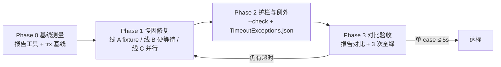

# 测试运行性能优化 - 实现 Plan

**功能名称**: 测试运行性能优化
**关联 PRD**: `docs/product/draft/20260930-test-perf-optimization-prd.md`（v1.0）
**关联技术提案**: `docs/engineering/proposals/20260930-proposal-test-perf-optimization.md`（v1.0）
**Plan 版本**: v1.0
**创建日期**: 2026-09-30
**作者**: Workflow Agent（代起草）
**feat-branch**: `feat/test-perf-optimization`（需求总分支，已推送 origin；需求总 PR：<https://github.com/Deliay/z-vtuber/pull/151>）

## 1. 概述

本 Plan 基于 PRD v1.0 与技术提案 v1.0 编写，指导「测试运行性能优化」的实施。这是纯测试基础设施治理：**不改任何业务代码对外行为、`contracts/` 零改动**。实施分四步：① 报告工具 + 基线——以 trx 建立逐用例耗时基线与慢因占比；② 慢因修复——Mongo fixture 逐用例重建降本（主因）、63 处硬等待改轮询断言/可注入小间隔、并行配置显式化与隔离核查；③ 护栏——报告工具 `--check` 模式 + 例外清单，>5s 未登记用例非零退出；④ 对比验收——同口径报告对比写入需求总 PR，全量连续 3 次全绿。全程遵循 `docs/engineering/common-rules.md`（TDD、覆盖率 ≥ 80%）、`backend-rules.md` 与各服务 `AGENTS.md` 的测试约定（xUnit + Testcontainers，`tests/Z.Vtuber.Tests` 单测试工程）。

### 1.0 上游核实结论（代码现状复查）与偏差

对需求总分支 `feat/test-perf-optimization` 逐项复查提案勘察结论，**三大慢因的引用与计数属实**，下列要点在对应任务中直接使用：

- **测试规模**：`tests/Z.Vtuber.Tests` 171 个测试文件、163 个测试类、1407 个 `[Fact]`/`[Theory]` 用例（提案「171 个测试文件」属实）；`Z.Vtuber.Tests.csproj` 为 xUnit 2.9.3 + Microsoft.NET.Test.Sdk 18.8.1 + Testcontainers 4.13.0 + coverlet.collector（覆盖率设施已具备），与提案 §2.2 一致。
- **Mongo fixture 现状**：`MongoDbFixture.cs:11-13` 静态共享容器（属实）；`InitializeAsync`（:20-27）建独立库（库名含 Guid）后调 `ResetAsync`；`ResetAsync`（:29-83）无条件 `DropCollectionAsync` 28 个集合（:31-61，实际数组 28 项）再依次执行 7 个域 `EnsureIndexesAsync`（:68-82，Live/Cookie/Weibo/Recording/Transcript/Training/Notification）——与提案慢因②逐条吻合；90 个测试类 `IClassFixture<MongoDbFixture>`（grep 统计 90，与提案一致）。
- **硬等待现状**：全工程 `Task.Delay`/`Thread.Sleep` 共 63 处（grep 统计 63，与提案一致），分布吻合：`TranscriptApiTests`(8)、`CookieInvalidEventSubscriberTests`(6)、`CookieCallGateTests`(5)、`LiveGuardJobTests`(4)、`IdleCloseSchedulerTests`(4)、`TranscriptTaskLockTests`(3)、`RecordingLockTests`(3)、`LiveEventSourceLockTimingTests`(3)、`EmotionTaskLockTests`(3)、`BrowserSessionManagerTests`(3) 等。
- **Redis fixture 现状**：`RedisFixture.cs:25-29` `[CollectionDefinition("redis")] RedisCollection : ICollectionFixture<RedisFixture>` 集合 fixture（提案引用 :28-29 语义属实）；15 个文件在 `"redis"` 集合内（其中 6 个同时用 `MongoDbFixture`），集合内天然串行。
- **可复用测试设施**：轮询断言工具已存在——`TestWait.UntilAsync(Func<bool>, TimeSpan)`（`PlaywrightFakes.cs:181-198`，10ms 间隔），仅 3 个文件在用；修复点 3 不必新建工具，扩展现有 `TestWait` 即可（补充 async 谓词与可调间隔）。

**偏差与提案待澄清（3 处，均在本 Plan 收敛）**：

1. **`xunit.runner.json` 实际未生效，慢因①「并行被禁用」与现状不符（偏差 1）**：`tests/Z.Vtuber.Tests/xunit.runner.json:3` 确有 `"parallelizeTestCollections": false`，但 `Z.Vtuber.Tests.csproj` 无 `CopyToOutputDirectory` 项、仓库无 `Directory.Build.props`/`.targets`，实测 `dotnet build` 后 `bin/Debug/net10.0/` **无 `xunit.runner.json`**；xUnit 按测试程序集所在目录查找配置，该设置被静默忽略——当前套件实际以 xUnit 默认值（**集合级并行已开启**）运行，「全部用例串行执行」不成立。收敛：修复点 1 从「恢复并行」改为「**并行配置显式化 + 并行度调优**」（1.8：补复制使设置生效、显式定值、以基线实验决定 `maxParallelThreads`）；慢因优先级以 0.3 基线实测为准，fixture 逐用例重建（偏差 2）预计为主因。
2. **fixture 重建成本是「逐用例」而非「逐类」（偏差 2）**：68 个测试类以 `IAsyncLifetime.InitializeAsync() => fixture.ResetAsync()` 挂接清理（如 `TrainingDatasetRepositoryTests:13-17`），xUnit 每个用例新建类实例并调 `InitializeAsync`——**每条 Mongo 用例都付一次「28 次 DropCollection + 7 域 EnsureIndexesAsync」**，远重于提案「每类一次」的估算。收敛：修复点 2 的首要手段从「共享库」改为「**索引只建一次 + 清数据不清索引 + 清理面裁剪**」（1.1–1.3，隔离语义不弱于现状、68 处调用点零改动）；提案的域级共享库降为可选项（1.4），仅当 1.1–1.3 后仍不达标才启用（避免引入跨类数据污染风险）。
3. **CI 无测试步骤，护栏「接入 CI 测试步骤」前提不成立（偏差 3）**：`.github/workflows/` 仅 9 条 `build-*-image.yml` 镜像构建流水线，**没有任何跑测试的工作流**；提案 §8「既有流水线追加一步报告校验」无落点。收敛：护栏落地点为**报告工具 `--check` + 跑测文档约定**（满足 PRD 功能点 4「测试运行或提交检查中识别」的「测试运行」路径，且校验在测试后进行、对测试总时长零影响）；新增 CI 测试工作流涉及 Docker-in-CI 新流水线，登记为后续建议、不在本期范围（§6）。

### 1.1 实施范围

- **做**：
  - `tests/Z.Vtuber.TestReport`（新增 console 工具，仅 BCL `System.Xml.Linq`）：trx 逐用例耗时解析、降序排行、>5s 标注、`--check` 护栏模式 + 例外清单比对；`servers/Z.Vtuber.slnx` `/tests` 文件夹加入。
  - `tests/Z.Vtuber.Tests`：`MongoDbFixture` 降本改造（1.1–1.3，可选 1.4）、`TestWait` 扩展（1.5）、63 处硬等待按三类口径改写（1.6）、并行隔离核查（1.7）、`xunit.runner.json`/csproj 显式化（1.8）、例外清单 `TimeoutExceptions.json`（2.1）。
  - `servers/` 仅限**测试友好性微调**（如等待间隔/TTL 改为可注入配置、行为不变），提案 §1.3 范围内。
  - 文档：`docs/engineering/common-rules.md` 增「测试性能基线与超时护栏」小节；跑测与例外登记流程说明（3.3）。
  - 基线与优化后报告摘要写入需求总 PR #151 描述（不落库）。
- **不做**：任何业务功能与对外契约变更（`contracts/` 零改动）；`apps/web`（含 Vitest 套件）、`infra/apphost` 零改动；新增 CI 测试工作流（登记为后续建议）；测试框架/容器库更换；删除或弱化任何既有断言；web 测试的 5s 基线治理（本期范围为 `tests/Z.Vtuber.Tests`，与提案 §1.3 一致）。

### 1.2 现状基线（范本）

- fixture 范本：`MongoDbFixture.cs`（静态共享容器 + 逐用例 `ResetAsync`，改造对象）、`RedisFixture.cs`（集合 fixture）。
- 逐用例清理范本：`TrainingDatasetRepositoryTests:13-17`（`IAsyncLifetime.InitializeAsync() => fixture.ResetAsync()`，68 处同款）。
- 轮询断言范本：`TestWait.UntilAsync`（`PlaywrightFakes.cs:181-198`）、`IdleCloseSchedulerTests`（构造注入小间隔 + `TestWait` 轮询，硬等待改写的目标形态）。
- 保留等待/例外候选范本：`RecordingLockTests:53-70`（`Task.Delay(700/700/1500)` 验证锁续期与租约过期）、`TranscriptTaskLockTests`、`EmotionTaskLockTests`、`LiveEventSourceLockTimingTests`。
- 守护测试范本：`ProjectReferenceGuardTests`（结构守护）、`CollectionNamesEquivalenceTests`（常量守护）、`TestIndexHelpers`（索引断言）。

## 2. 分支与提交流程

遵循 z-git 规范（仅 merge、禁止 rebase/squash、分支不复用）与 Conventional Commits：

- 全程只使用需求总分支 `feat/test-perf-optimization`：工具、fixture、测试改写、文档全部直接在该分支提交；需求总 PR #151 已存在，提交照常推送更新分支。
- 提交信息：工具实现 `feat(test):`（或 `chore(test):`）、测试改写 `test:`、fixture/配置改造 `refactor(test):`/`test:`、文档 `docs:`；工具与其单测按 TDD 分「红」「绿」两次提交；硬等待改写按文件批次提交（便于 review 逐批对照断言语义）。
- scope 统一 `test`（改动面均在 `tests/`，`servers/` 测试友好性微调并入同批 `test:` 提交并在信息中注明）。

## 3. 实施阶段

按「基线测量（0）→ 慢因修复（1）→ 护栏与例外（2）→ 对比验收（3）」推进。Phase 0 串行；Phase 1 三线并行；Phase 2 在 1.6 例外登记产出后启动；Phase 3 串行收口。

### Phase 0: 基线测量（串行先行）

| # | 任务 | 关键文件 | 验收 |
|---|------|---------|------|
| 0.1 | **报告工具测试先行（红）**：`TestReportTests`——trx 解析（逐用例 `testName`/`TestMethod.className`/`duration`/`outcome`）；降序排行输出（用例全名 = `className.methodName`、耗时、>5s 标注）；汇总（用例数/总耗时/Top N/超时清单）；`--check` 模式：>5s 且不在例外清单 → 非零退出并列出违规用例，在清单内 → 通过并标注「例外」；例外清单精确匹配（以 `TimeoutExceptions.json` 样例驱动）；trx 文件缺失/无用例 → 报错非零退出。样本 trx 以内嵌 XML fixture 驱动，不依赖真实跑测 | `tests/Z.Vtuber.Tests/TestReportTests.cs` | 红 |
| 0.2 | **报告工具实现（绿）**：`tests/Z.Vtuber.TestReport`（net10.0 console，仅 BCL `System.Xml.Linq`，零新增依赖；`servers/Z.Vtuber.slnx` `/tests` 文件夹加入）。CLI：`dotnet run --project tests/Z.Vtuber.TestReport -- <trx...> [--check] [--exceptions <path>] [--top N]`；默认输出排行与汇总，`--check` 追加护栏判定 | `tests/Z.Vtuber.TestReport/` | 0.1 转绿 |
| 0.3 | **基线采集与慢因归类**：`dotnet test tests/Z.Vtuber.Tests --logger "trx;LogFileName=baseline.trx"` 同一环境连续 2–3 次取稳定值，报告工具出排行；按用例/文件归类慢因占比（fixture 重建 / 硬等待 / 真实计算 / 容器启动），核对本 Plan 修复优先级（偏差 1/2 落点：若 fixture 重建占大头则 1.1–1.3 为主线）；同时记录实际并行口径（输出目录有无 `xunit.runner.json`、观察并行度，偏差 1 核实）。基线摘要（Top 慢用例、总时长、慢因占比、并行口径）写入需求总 PR #151 描述（不落库） | PR #151 描述 | 基线可复现、慢因占比量化 |

### Phase 1: 慢因修复（三线并行，TDD）

**线 A：Mongo fixture 降本（预计主因，偏差 2 落点）**

| # | 任务 | 关键文件 | 验收 |
|---|------|---------|------|
| 1.1 | **fixture 改造测试先行（红）**：`MongoDbFixtureTests`（新增）——①「索引只建一次」：同一 fixture 二次 `ResetAsync` 不再重复 `EnsureIndexesAsync`（以调用计数/日志断言）；②「清数据不清索引」：清理后集合与索引保留、数据为空（`TestIndexHelpers` 断言索引仍在）；③「清理面可裁剪」：按集合/域裁剪时无关集合不动；④ 隔离语义：清理后上一用例数据零残留（类内/类间） | `tests/Z.Vtuber.Tests/MongoDbFixtureTests.cs` | 红 |
| 1.2 | **fixture 实现（绿）**：`MongoDbFixture` 分层——`InitializeAsync` 建库 + **一次性** 7 域 `EnsureIndexesAsync`（记初始化标记）；`ResetAsync` 改「`DeleteManyAsync({})` 清数据、不动索引」，`DropCollectionAsync` 仅保留给确需重建索引的用例（`*MongoSetupTests`/索引迁移类显式调用）；支持 `ResetAsync(params string[] collections)` 裁剪清理面；**68 处 `InitializeAsync() => fixture.ResetAsync()` 调用点零改动**（签名兼容） | `tests/Z.Vtuber.Tests/MongoDbFixture.cs` | 1.1 转绿 |
| 1.3 | **索引语义守护核查**：`Core/Live/Cookie/Weibo/Recording/Transcript/Training/Notification MongoSetupTests`、`CollectionNamesEquivalenceTests` 等在新语义下仍完整断言索引存在/唯一性/等价性（不弱化）；grep 守护 `DropCollectionAsync` 只出现在 fixture 必须路径与显式重建用例 | `tests/Z.Vtuber.Tests/` | 断言不弱化、全绿 |
| 1.4 | **（可选）域级 Collection Fixture 共享库**：仅当 1.1–1.3 后基线仍不达标启动——按域定义 `[CollectionDefinition]` + `ICollectionFixture`（live/cookie/weibo/recording/transcript/training/notification），域内类共享一库、类间 `ResetAsync` 清数据；迁移类归属集合、跨类唯一键前缀/自清理核查 | `tests/Z.Vtuber.Tests/` | 启用后隔离语义不弱于现状、3.2 全绿 |

**线 B：硬等待消除（63 处，按文件分批）**

| # | 任务 | 关键文件 | 验收 |
|---|------|---------|------|
| 1.5 | **轮询断言工具扩展（红→绿）**：`TestWait` 从 `PlaywrightFakes.cs` 迁出为独立 `TestWait.cs`；扩 `UntilAsync(Func<Task<bool>>/Func<bool>, TimeSpan timeout, TimeSpan? interval = 50ms)`（总超时抛出带条件描述，便于定位）；`TestWaitTests` 覆盖成功/超时/间隔生效/async 谓词 | `tests/Z.Vtuber.Tests/TestWait.cs`、`TestWaitTests.cs` | 红→绿 |
| 1.6 | **硬等待改写（三类口径，按文件批次提交）**：① 等待异步副作用（订阅处理/事件落库/后台任务推进）→ `TestWait.UntilAsync` 轮询断言：`TranscriptApiTests`(8)、`CookieInvalidEventSubscriberTests`(6)、`CookieCallGateTests`(5)、`LiveGuardJobTests`(4)、`EmotionTaskScannerTests`/`EmotionTaskRunnerTests`、`LiveStatusPollerTests` 等；② 等待定时器/调度器 → 注入极小间隔 + 轮询断言：`IdleCloseSchedulerTests`(4，构造已注入 delay，改小 + 轮询)、`BrowserSessionManagerTests`(3) 等，被测实现等待间隔硬编码时做 `servers/` 测试友好性微调（可注入配置、行为不变）；③ 锁租约/续期时序类（`RecordingLockTests`、`TranscriptTaskLockTests`、`EmotionTaskLockTests`、`LiveEventSourceLockTimingTests`）→ 优先注入 TTL/续期间隔缩短，确属「验证超时/过期行为本身」的保留必要等待并登记例外清单（2.1）。每批验收：**断言行不删减、不弱化（diff 逐文件对照）**、该批用例全绿 | `tests/Z.Vtuber.Tests/*.cs`（约 30 文件 63 处） | 断言语义等价 + 全绿 |

**线 C：并行安全与配置显式化（偏差 1 落点）**

| # | 任务 | 关键文件 | 验收 |
|---|------|---------|------|
| 1.7 | **并行隔离核查**：`[Collection("redis")]` 15 个文件（6 个兼用 MongoDbFixture）逐个核查跨类 Redis 键冲突（必要时 per-test key 前缀/用后清理，或拆分集合）；共享静态可变状态扫描（当前无命中，保持零新增）；`MongoDbFixture.SharedContainer.StartAsync()` 并发启动竞态加一次性初始化守卫（`SemaphoreSlim`/`Lazy`） | `tests/Z.Vtuber.Tests/RedisFixture.cs` 及 redis 集合用例 | 并行下连续 3 次全绿、无键冲突失败 |
| 1.8 | **并行配置显式化与调优**：`xunit.runner.json` 补 `<CopyToOutputDirectory>PreserveNewest</...>`（或改名 `Z.Vtuber.Tests.xunit.runner.json` 并复制）使设置**显式生效**；`parallelizeTestCollections: true` + `maxParallelThreads` 以 0.3 基线实验定值（单 Mongo 容器过载反而变慢时降值）；留档串行/并行/不同 `maxParallelThreads` 的耗时对比 | `tests/Z.Vtuber.Tests/xunit.runner.json`、`Z.Vtuber.Tests.csproj` | 配置生效可验证（输出目录可见）、耗时取优并留档 |

### Phase 2: 超时护栏与例外清单

| # | 任务 | 关键文件 | 验收 |
|---|------|---------|------|
| 2.1 | **例外清单落地**：`tests/Z.Vtuber.Tests/TimeoutExceptions.json`（`[{ "test": "类全名.方法名", "reason": "理由", "since": "yyyy-MM-dd" }]`，全名口径 = 报告工具输出）；初始条目 = 1.6 口径③保留的必要等待用例，逐条理由、数量最小化；报告工具例外比对由 0.1/0.2 覆盖 | `tests/Z.Vtuber.Tests/TimeoutExceptions.json` | 清单显式、逐条理由可评审 |
| 2.2 | **护栏自验**：临时构造一个 >5s 用例 → `--check` 非零退出且列出违规用例（验证后移除）；清单内例外用例 >5s → `--check` 通过并标注「例外」；未登记 >5s → 失败 | `tests/Z.Vtuber.Tests/TestReportTests.cs` + 手工验证记录 | 构造超时可被识别（PRD 功能点 4） |
| 2.3 | **护栏接入跑测流程**：跑测命令固定串联 `dotnet test --logger trx` + 报告工具 `--check`（本地跑测与提交前验证的默认口径，文档化于 3.3）；护栏为事后校验，**对测试总时长零影响**；CI 测试步骤不存在（偏差 3），本期不新增 CI 工作流，登记为后续建议 | 跑测说明（3.3 文档） | 跑一次测试即出排行 + 超时拦截 |

### Phase 3: 对比验收与收口

| # | 任务 | 验收 |
|---|------|------|
| 3.1 | 对比验收：同一环境同一测量方式产优化后报告，与基线对比——单用例 ≤5s（例外除外）、总时长降幅、Top 榜前后对照，写入需求总 PR #151 描述 | 单 case ≤5s、降幅显著且有据 |
| 3.2 | 全量回归：`dotnet test` **连续 3 次全绿、无新增间歇失败**；断言语义等价抽查（1.6 各批 diff 逐文件过一遍：无断言删除/放宽、无用例删除）；护栏 `--check` 通过；`git diff` 确认 `contracts/`、`apps/web/`、`infra/` 零改动 | 全绿 + diff 无违规 |
| 3.3 | 文档同步：`docs/engineering/common-rules.md` 增「测试性能基线与超时护栏」小节（跑测命令、报告生成方式、5s 基线、例外登记流程与最小化原则）；各服务 `AGENTS.md` 开发流程小节补一句跑测口径指引（统一指向 common-rules 新小节，避免九处重复）；本 Plan 与提案/PRD 链接互验 | 文档与实现一致 |
| 3.4 | 手工验证（可选但推荐）：本地完整走一遍护栏流程——跑测 → 报告排行 → `--check` 通过 → 临时例外验证标注正确 | 手工验证记录 |

## 4. 并行策略

- **Phase 0 串行**（0.1→0.2→0.3）：报告工具是基线解析与护栏的共同基础；0.3 基线口径（偏差 1 核实）供 1.8 决策。
- **Phase 1 三线并行，线内串行**（亦为 subagent 子项目划分）：
  - **线 A fixture**：1.1→1.2→1.3→（1.4 视基线决策）——`MongoDbFixture.cs`/`MongoDbFixtureTests.cs` 归线 A 单线；
  - **线 B 硬等待**：1.5→1.6——`TestWait*.cs` 与各 `*Tests.cs` 慢等待文件归线 B（不与线 A 文件重叠）；
  - **线 C 并行配置**：1.7→1.8——`xunit.runner.json`、`Z.Vtuber.Tests.csproj`、`RedisFixture.cs` 归线 C。
- **文件冲突规避**：`MongoDbFixture.cs` 归线 A；同名 `*Tests.cs` 若既含硬等待又含 fixture 调用，改造按「fixture 语义归 A、等待改写归 B」拆提交；`servers/` 测试友好性微调由用到它的线（B）随批提交。
- **依赖关系**：1.6 口径③产出例外登记候选 → 2.1；1.8 的 `maxParallelThreads` 定值依赖 0.3 基线与 1.7 完成；1.4 依赖 1.1–1.3 后的基线复测决策；3.x 全线完成后串行收口。
- 全部提交在需求总分支 `feat/test-perf-optimization`。

## 5. 验收对照

| PRD 功能点 / 成功标准 | 实现任务 | 验证方式 |
|-----------|---------|---------|
| 功能点 1：测试耗时基线与慢因分析报告（逐用例耗时与分布、慢因类别占比、可重复生成） | 0.1、0.2、0.3 | 0.3 基线报告（含慢因归类）+ 报告工具单测 + 生成命令文档化（3.3） |
| 功能点 2：慢测试修复（例外除外单用例 ≤5s、断言不弱化、全量通过无新增 flaky） | 1.1–1.8 | 3.1 报告对比、3.2 连续 3 次全绿 + diff 断言抽查 |
| 功能点 3：例外清单管理（显式登记逐条理由、数量最小化、随 PR 评审） | 2.1 | 2.1 清单评审 + 3.2 无滥登记 |
| 功能点 4：慢测试长效护栏（超时用例自动识别、护栏自身对总时长影响可忽略） | 2.2、2.3 | 2.2 构造超时被识别（事后校验零测试时开销） |
| 成功标准：单 case ≤5s（例外除外）/ 慢用例可见性（每次运行可出耗时排行）/ 新增慢用例防控 / 例外可评审 | 3.1、2.3 | 报告输出与 `--check` 拦截记录 |
| 非功能：不改产品对外行为、契约零改动 | 1.1 实施范围约束 | 3.2 `git diff` 确认 `contracts/`、`apps/web/`、`infra/` 零改动 |
| 非功能：兼容（优化前后验证语义等价） | 1.3、1.6 批次验收 | 3.2 断言 diff 抽查、守护测试全绿 |
| 边界：用例确需 >5s（真实等待） | 1.6 口径③、2.1 | 例外清单逐条理由 |
| 边界：不同环境耗时波动（稳定测量方式判定） | 0.3 同环境多次测量、阈值 5s 远大于抖动 | 3.1 同口径对比 |
| 质量门槛（TDD、覆盖率 ≥80%、不删弱断言） | 0.1/0.2、1.1/1.2、1.5 红绿提交 | 红-绿提交记录、覆盖率报告 |

## 6. 风险与依赖

| 项 | 说明 | 应对 |
|---|------|------|
| 并行配置实际未生效（偏差 1） | 提案慢因①「全串行」不成立——`xunit.runner.json` 未复制到输出目录，当前实为默认并行；修复优先级可能与提案不同 | 0.3 记录实际并行口径并实测慢因占比；修复点按基线占比排序；1.8 显式化配置并实验 `maxParallelThreads` 取优 |
| ResetAsync 逐用例全量重建（偏差 2） | 提案按「每类一次」估算，实际 68 类逐用例付「28 drop + 7 域索引」，预计为主因 | 1.1–1.3 索引一次化 + `DeleteManyAsync` 清数据 + 清理面裁剪（68 处调用点零改动、隔离不弱化）；仍不达标启用 1.4 域级共享库（污染风险以唯一键/自清理兜底） |
| CI 无测试步骤（偏差 3） | 提案 §8「接入 CI 测试步骤」无落点（仅镜像构建流水线） | 护栏落地点= 报告工具 `--check` + 跑测文档约定；CI 测试工作流登记为后续建议不在本期，避免引入 Docker-in-CI 新流水线 |
| 并行暴露隐式共享状态 | redis 键冲突、静态可变状态、容器启动竞态 → flaky | 1.7 逐项核查修复隔离而非回退并行；连续 3 次全绿验证；配置显式化后行为可预期 |
| 轮询断言过紧引入新 flaky | 总超时过小、机器慢 | 统一轮询参数（50ms 间隔、5s 总超时），超时消息带条件描述；必要时用例级放宽并登记例外 |
| 改写弱化断言 | 换等待方式时误删/放宽断言（违反 PRD 约束） | 每批「断言行不删减不弱化」diff 对照作为验收项；3.2 逐文件抽查 |
| 机器性能差异误报 | 阈值判定受环境影响 | 5s 阈值远大于环境抖动；基线/优化后同环境同命令测量；例外清单兜底 |
| 例外清单膨胀 | 为过护栏滥登记例外 | 逐条理由 + 数量最小化随 PR 评审（2.1、3.2）；护栏输出对例外保持「标注可见」而非静默 |
| 真实时序类用例（锁租约过期等） | 本质需要真实时间流逝 | 注入 TTL/续期间隔缩短（`servers/` 测试友好性微调）；剩余保留必要等待登记例外（提案 §3.2 修复点 3 口径） |
| 依赖 | Docker（Testcontainers，现状具备）、dotnet 10 SDK、需求总 PR #151 已存在 | 均已核实（§1.0）；.NET 10、xUnit、TDD、覆盖率为项目既有规范 |

## 7. 相关文档

- PRD：`docs/product/draft/20260930-test-perf-optimization-prd.md`（v1.0）
- 技术提案：`docs/engineering/proposals/20260930-proposal-test-perf-optimization.md`（v1.0）
- 开发规范：`docs/engineering/common-rules.md`、`docs/engineering/backend-rules.md`
- 模块规范：`servers/common/AGENTS.md`、`servers/api/AGENTS.md`、`servers/crawler/AGENTS.md`、`servers/cookie/AGENTS.md`、`servers/notifier/AGENTS.md`、`servers/recording/AGENTS.md`、`servers/recording-transcript-api/AGENTS.md`、`servers/recording-transcript-consumer/AGENTS.md`、`servers/training/AGENTS.md`、`apps/web/AGENTS.md`
- 需求总 PR：<https://github.com/Deliay/z-vtuber/pull/151>
