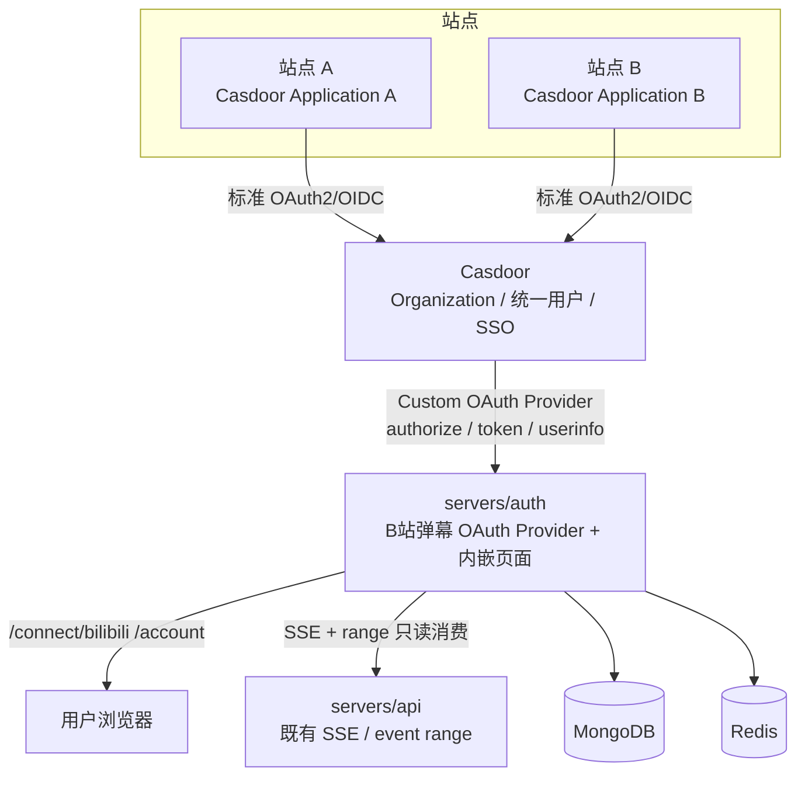
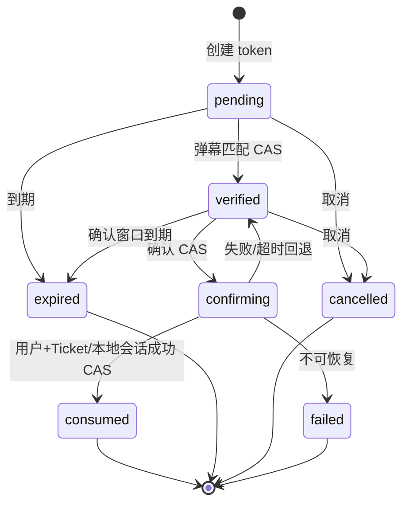

# B站弹幕帐号认证（多站点统一登录） - 实现 Plan

**功能名称**: B站弹幕帐号认证（多站点统一登录）
**关联 PRD**: `docs/product/draft/20261119-danmaku-account-auth-prd.md`（v2.1）
**关联技术提案**: `docs/engineering/proposals/20261119-proposal-danmaku-account-auth.md`（v2.1）
**Plan 版本**: v1.0
**创建日期**: 2026-11-19
**作者**: Workflow Agent（代起草）
**需求总分支**: `feat/danmaku-account-auth`（需求总 PR #199，方案文档已批准 @ `f575f6d`）
**实现分支**: `feat/danmaku-account-auth-impl`（自需求总分支切出，PR 回需求总分支）

## 1. 概述

依据 PRD v2.1 与技术提案 v2.1，本期从零新增 `servers/auth` 服务，落地六件事：

1. **多房间弹幕事件源**：按 `Auth:Danmaku:RoomIds`（JSON `Array<string>`，默认 `["30066"]`）为每个房间建立独立 SSE 订阅、重连退避、短窗口补投、去重、多实例选主与健康状态；`roomId` 全程字符串。**不修改 crawler**，auth 只消费既有 `GET /api/b/live/{roomId}/event/subscribe?type=danmaku` 与 `GET /api/b/live/{roomId}/event/range`。
2. **一次性弹幕 token**：10 位 `[A-Za-z0-9]`（去混淆 56 字符集，约 58 bit 熵）、默认 5 分钟、一次性、仅存 HMAC 摘要；创建/轮询/确认/取消全链路，弹幕匹配用 Mongo 原子 CAS 防并发。
3. **首次注册/绑定**：识别后展示 B 站 UID/昵称/头像，用户确认本人后才创建/复用平台用户（`auth_users`，以 B 站 UID 唯一）；页面明确显示「B 站账号绑定成功」。
4. **Casdoor Custom OAuth Provider**：auth 提供 `/oauth/authorize`、`/oauth/token`、`/oauth/userinfo`、`/oauth/logout`；首次绑定后页面带一次性 Provider Ticket 跳 `/oauth/authorize`，由 Casdoor 创建/关联统一用户并建立浏览器 SSO 会话；之后同 Organization 下的站点通过 Casdoor SSO 漫游，不再发弹幕/注册。
5. **auth 内嵌页面**：`GET /connect/bilibili`（弹幕验证/注册页）与 `GET /account`（账号中心）由 auth 直接托管（`wwwroot` 静态 HTML/JS/CSS，无 Node/npm、无 Razor Pages），同源调用 `/api/auth/*` 与 `/oauth/*`；**`apps/web` 零改动**。
6. **可部署可测试**：`contracts/auth.openapi.yaml`、Mongo 集合/索引/TTL、Redis 限流与选主、健康检查、Dockerfile、镜像流水线、AppHost 编排、Casdoor 配置核对清单、单元/集成/端到端测试。

### 1.0 现状核实结论（读码确认，需求总分支 @ `f575f6d`）

- **无认证基础设施、无 auth 服务**：`servers/` 下无 `auth` 目录；`servers/api/Program.cs:112` 仅有 `app.UseAuthorization()` 占位，全仓库无 Authentication/Authorization/JWT/OAuth Provider 实现；`servers/Z.Vtuber.slnx` 无 auth 项目。
- **既有 SSE 与历史事件端点可直接消费**：`servers/api/Controllers/BilibiliLiveController.cs:150` 的 `GET /api/b/live/{roomId}/event/subscribe` 返回 `text/event-stream`，连接建立立即发 `event: heartbeat`，之后每 10 秒一次（`HeartbeatInterval`，L21）；`:71` 的 `GET /api/b/live/{roomId}/event/range` 支持 `type`/`startedAt`/`endedAt`/`page`/`pageSize`，`pageSize` 被钳制到 1..100（L93），响应 `items[].{roomId,type,occurredAt,liveSessionId,payload}`，`payload` 为对象（L258-265）。SSE 的 `data` 同样是含 `payload` 对象的 JSON。
- **发送者解析现状**：`servers/common/live/Live/LiveEventTextExtractor.cs:21` 的 `Extract(type, payload)` 只返回 `Text/SenderName/SenderUid/SenderMedal`（`info[1]`、`info[2][0]`、`info[2][1]`、`info[3][1]`），**不提取头像**。提案中的头像路径 `payload.info[0][15].user.base.face` / `origin_info.face` 需要 auth 侧补充解析。
- **crawler 订阅边界（关键依赖）**：`servers/crawler/Live/LiveEventSource.cs:49` 的 `ReconcileAsync` 只从 `SubscriptionType.Danmaku` 订阅的 mid 反查 roomId（L54-61）建立连接。因此 auth 消费的 SSE 是否有 30066 的弹幕，取决于上游是否已有该房间的 Danmaku 订阅/事件源；本 Plan 遵守评审结论**不修改 crawler**，把「事件源对 RoomIds 有数据」作为部署前置条件，并用 `/api/auth/danmaku/rooms`、`/health/ready` 与创建 token 的 503 显式暴露（见 §1.1-1）。
- **服务骨架可完全复用既有范式**：`servers/training/Program.cs:15-21`（`AddHealthChecks().AddCheck<MongoDbHealthCheck>` + `AddMongoDBClient("mongo")` + `AddRedisClient("messaging")`）、`servers/cookie/Program.cs:36-49`（`IMongoDatabase`、`IConnectionMultiplexer`）、`servers/common/live/Mongo/LiveMongoSetup.cs:8`（`MongoDbInitializer` + 幂等建索引）可直接照搬；`servers/training/MongoDbHealthCheck.cs` 为健康检查先例。
- **Redis 锁实现不可直接复用**：`RedisDistributedLockProvider` 位于 `servers/cookie/Locking/`（服务私有），跨服务不互引；auth 需要自己的轻量 `RoomLeaderLease`（`SET NX PX` + Lua 续期/释放），不新增公共依赖。
- **当前没有任何 Mongo TTL 索引先例**（全仓库检索 `ExpireAfter` 无结果），auth 将是首个使用 TTL 的服务；设计需避免「access token 过期即删除导致 refresh 失效」的错误索引（见 §1.1-10）。
- **编排/镜像范式**：`infra/apphost/AppHost.cs:13-18`（`AddProject` + `WithReference` + `WithExternalHttpEndpoints`）、`infra/apphost/Z.Vtuber.AppHost.csproj` 的 `ProjectReference` 清单、`servers/training/Dockerfile` 与 `.github/workflows/build-training-image.yml` 的两阶段构建/路径触发模式可直接复制。
- **契约与 codegen 现状**：`contracts/` 8 份按服务切分；`apps/web/package.json:12` 的 `codegen` 是**显式文件清单**，新增 `contracts/auth.openapi.yaml` 不会被 web 自动生成类型，符合「`apps/web` 零改动」。
- **测试设施**：`tests/Z.Vtuber.Tests` 已引用全部服务与 `Testcontainers.MongoDb`/`Testcontainers.Redis`；现有测试以「直接实例化控制器/服务 + `StubHandler`」为主（如 `BilibiliVideoDownloadControllerTests.cs:26-52`），**未使用 `WebApplicationFactory`**，测试项目也没有 `Microsoft.AspNetCore.Mvc.Testing` 包。auth 的 HTTP 端到端测试将使用「真实 Kestrel + 临时端口 + `AuthApp.Build` 测试接缝」实现，避免新增测试包。
- **静态页面零先例**：现有服务都没有 `wwwroot`/`UseStaticFiles`；auth 是首个托管页面服务，需显式配置静态文件、页面控制器与安全响应头。
- **无 `apps/web`、`servers/api`、`servers/crawler` 改动需求**：登录页/账号中心在 auth；站点只接 Casdoor；api/crawler 仅作为事件源被读取。

### 1.1 口径澄清（规划期裁定，随实现评审）

1. **事件源可用性是部署前置条件，不在 auth 内造弹幕**：auth 启动即按 `RoomIds` 建订阅，但不自动创建 crawler 的 Danmaku 订阅、不修改 crawler。上线前必须确认 `RoomIds` 中每个房间在事件源有数据（可手工通过既有 `/api/b/subscription` 建立 Danmaku 订阅，或用运维已有订阅）；某房间无数据只影响该房间，全部房间未就绪时创建 token 返回 `503 AUTH_DANMAKU_SOURCE_UNAVAILABLE`，页面不显示「假等待」。Phase 0 增加事件源预检与联调项。
2. **`roomId` 全链路字符串**：配置 `RoomIds` 为 `string[]`；比较、Mongo 字段、API 响应一律 `string`；解析 SSE/range 的 `roomId` 时兼容 JSON number/string，统一 `GetRawText()`/`ToString()` 后按 `Ordinal` 比较；路径拼接使用字符串。
3. **头像解析在 auth 内完成**：文本/UID/昵称/粉丝牌复用 `LiveEventTextExtractor.Extract`；新增 auth 私有的 `DanmakuAvatarExtractor` 读取 `payload.info[0][15].user.base.face`，回退 `...user.base.origin_info.face`，缺失/畸形返回 `null`。**不修改 `servers/common/live`**，避免影响 api/crawler 既有行为。
4. **`returnTo` 在 casdoor 模式必填**：`POST /api/auth/login-requests` 在 casdoor 模式下必须收到合法的本服务 `/oauth/authorize` 相对 URL，否则 400 `AUTH_INVALID_REQUEST`（页面提示从站点登录入口进入）；standalone 模式可省略。`returnTo` 只允许相对路径、必须以 `/oauth/authorize` 开头、禁止 `//`/绝对 URL/CRLF；服务端重新解析并校验其中的 `client_id`/`redirect_uri`/`response_type`，再写入 Provider Ticket。
5. **standalone 模式使用 opaque token，不引入 JWT 依赖**：提案中的 `Auth:Jwt:*`（PEM/Issuer/Audience）在实现期收敛为 `Auth:Standalone:*`（`AccessTokenSeconds=900`、`RefreshTokenDays=30`），本地会话表 `auth_sessions` 存哈希，`/api/auth/sessions/refresh` 与 `/api/auth/sessions/logout` 与 OAuth token 同构轮换；confirm 同时设置与 casdoor 同构的 Provider Session Cookie，使 `/account` 在两种模式下都可用；standalone 仅用于本地开发/降级，PRD 主链路不依赖它。此变更为减少一个签名库依赖与密钥运维面，评审时确认。
6. **账号中心「重新验证」走 Casdoor 重新授权**：casdoor 模式下 Provider Session 存在时 `/oauth/authorize` 会静默签发 code，无法强制重验；因此 `/account` 的「重新验证」= `POST /api/auth/provider-sessions/logout` 后跳转可选的 `Auth:Casdoor:ReauthorizeUrl`（配置为站点/Casdoor 的登录入口）；未配置时该按钮隐藏并提示从站点登录。账号中心本身不绕过 `returnTo` 规则。
7. **Provider Ticket 一次性先消费**：`/oauth/authorize?ticket=...` 先用 CAS 消费 ticket（`ConsumedAt=null && ExpiresAt>now`）再创建 Provider Session/授权码；并发重放只有一个成功；消费后后续步骤失败返回 500/`access_denied`，用户重新走完整流程（不签发半成品 code）。
8. **Cookie 安全属性按部署协议决定**：`auth_provider_session` 固定 `HttpOnly; SameSite=Lax; Path=/`，`Secure` 在 `Auth:PublicBaseUrl` 为 `https` 时强制开启，本地 `http` 开发可关闭；`Auth:TrustForwardedHeaders=true` 时启用 `UseForwardedHeaders`（X-Forwarded-For/Proto），用于反代后的 IP 限流与 Secure 判定，默认 false（不信任外部头）。
9. **限流失败策略**：Redis 限流不可用时 **fail-open**（记 warning，不阻断 token 创建），安全底线仍由 58 bit 熵 + 5 分钟 TTL + 一次性 + HMAC 保证；`/health/ready` 会报告 Redis 不健康。弹幕侧同 UID 超限只丢弃事件并记审计/指标（弹幕发送方无法收到 HTTP 429），页面保持 pending；OAuth token 端点超限返回标准 `429`（`AUTH_TOKEN_RATE_LIMITED` 语义收敛到 OAuth `too_many_requests`）。
10. **TTL 索引设计**：`auth_login_requests.ExpiresAt` TTL **+1 小时**（保留记录以区分 404/expired）；`auth_provider_tickets.ExpiresAt`、`auth_oauth_codes.ExpiresAt`、`auth_provider_sessions.ExpiresAt`、`auth_audit_logs.OccurredAt`（90 天）TTL=0；`auth_provider_tokens` **只在 `RefreshExpiresAt` 上建 TTL**（access 过期由代码判断），避免 access 过期时整条文档被 TTL 删除导致 refresh 失效。
11. **状态以服务端 UTC 计算为准**：读取时若 `pending` 且 `ExpiresAt<=now` 或 `verified` 且 `ConfirmExpiresAt<=now`，返回 `expired`；后台 `LoginRequestScanner` 每 30 秒把超时记录 CAS 迁移为 `expired`；页面倒计时只作展示。`consumed` 后不可取消；`cancelled` 幂等返回 204。
12. **错误体与新增错误码**：账号中心 API 统一 `{ "error": { "code": "...", "message": "..." } }`；OAuth 端点用标准 `{ "error": "...", "error_description": "..." }`。新增 `401 AUTH_UNAUTHORIZED`（`/api/auth/me`、`/account` 未登录）与 `401 invalid_client`（OAuth Client 认证失败）；其余沿用提案 §3.5。
13. **页面实现为静态文件 + 页面控制器**：`servers/auth/wwwroot/connect/{index.html,connect.js,connect.css}`、`wwwroot/account/{index.html,account.js}`、`wwwroot/shared/site.css`；`PagesController` 用 `IWebHostEnvironment` 读取 HTML 并返回 `text/html`，统一设置 `Content-Security-Policy`（`default-src 'self'; script-src 'self'; style-src 'self'; img-src 'self' https://*.hdslb.com data:; connect-src 'self'; frame-ancestors 'none'; base-uri 'none'; form-action 'self'`）、`Referrer-Policy: no-referrer`、`X-Content-Type-Options: nosniff`、`X-Frame-Options: DENY`；静态资源由 `UseStaticFiles` 提供。不引入 Node、不引入 Razor Pages。
14. **前端 JS 数据安全**：所有服务端数据用 `textContent` 渲染，禁止 `innerHTML`；token/pollToken 不落 `localStorage`，关闭/刷新页面即放弃当前请求（旧 token 自然过期）；轮询串行 `setTimeout`，终态停止。
15. **不新增 `servers/api` 依赖**：提案 §10.1 的 `api.WithReference(auth)`/`AuthService:BaseUrl` 在本仓库没有 api 侧消费方，Plan 不做，避免无效服务依赖；auth 直接 `WithExternalHttpEndpoints()` 对外，`api`/`crawler`/`apps/web` 零改动。
16. **契约不进入 web codegen**：`contracts/auth.openapi.yaml` 仅用于文档/外部接入与测试对照；`apps/web/package.json` 的 codegen 清单不改。
17. **资料同步边界**：首次绑定写入 B 站昵称/头像；后续验证更新 `auth_users` 最新资料与 `/oauth/userinfo` 返回值；Casdoor 侧 User mapping 只填空白字段（官方语义），本期不承诺自动覆盖，作为后续 Admin API 增强。
18. **多实例房间可用性口径**：`/api/auth/danmaku/rooms` 增加 `role`（`leader|standby|disconnected`）与 `available`（系统级是否已有实例在消费该房间）两个增量字段；`connected` 仍表示本实例 SSE 是否连接；页面用 `available` 决定是否允许获取 token、用 `role/connected` 做诊断；`/health/ready` 对 follower（standby 且 Redis 中 leader 租约存在）视为就绪，避免负载均衡摘除仍可处理 API 的实例；全部房间 `available=false` 才 503。
19. **`clientNonce` 与 `AdminApiKey` 本期为预留**：`clientNonce` 只存摘要并写审计，不做强制设备绑定；`AdminApiKey` 只保留配置位，不开放未定义的管理端点（避免出现契约外接口），后续需要再单独立项。

### 1.2 实施范围

- **做**：
  - `contracts/auth.openapi.yaml`（账号中心 API + OAuth Provider + 健康/房间状态）。
  - `servers/auth` 全新服务：`Auth/`（token/摘要/状态机/用户/ticket/session/standalone）、`OAuth/`（authorize/token/userinfo/logout、code/PKCE/token）、`Danmaku/`（多房间 host、单房间 SSE、帧解析、补投、头像/发送者解析、选主租约、健康注册表）、`Controllers/`（登录请求、房间、me、session、页面、健康）、`Persistence/`（8 类记录 + 仓储 + `AuthMongoSetup`）、`Configuration/`（Auth/Danmaku/OAuthProvider/Casdoor/Standalone）、`wwwroot/`（验证页 + 账号中心 + 共享样式）、`Program.cs`/`AuthApp` 测试接缝、`Dockerfile`、`appsettings*.json`、`Properties/launchSettings.json`、`Z.Vtuber.Auth.csproj`、`AGENTS.md`。
  - `servers/Z.Vtuber.slnx`、`infra/apphost/AppHost.cs`/`Z.Vtuber.AppHost.csproj`、`.github/workflows/build-auth-image.yml`。
  - `tests/Z.Vtuber.Tests`：核心原语、状态机、持久化、多房间事件源、账号中心 API、OAuth Provider、页面、端到端（Testcontainers Mongo/Redis + 假 SSE 源 + 假 Casdoor 调用序列）与安全用例；测试项目新增 auth 项目引用。
  - 文档同步：`servers/auth/AGENTS.md`、`docs/engineering/backend-rules.md` 服务清单、PRD 验收勾选、提案/Plan 互链；Casdoor 配置核对清单（Plan + auth AGENTS）。
- **不做**：
  - 修改 `servers/crawler/**`、`apps/web/**`、`servers/api/**`（仅在需要时读取既有 SSE/range）。
  - 修改 Casdoor 源码/前端插件；不做 Casdoor 自定义登录页。
  - 密码/邮箱/手机号注册、B 站 OAuth/扫码、多平台弹幕、账号合并/迁移/自助注销、完整管理后台。
  - 弹幕内容审核、抽奖、互动；历史事件全文检索扩容。
  - 真实 Casdoor 实例部署、真实 B 站弹幕接入改造、生产反代/Caddy 配置（运维按 AGENTS 清单执行）。
  - 将 auth 契约加入 `apps/web` codegen；JWT 签名库/Data Protection 新依赖。

## 2. 分支与提交流程

- 需求总分支 `feat/danmaku-account-auth`（PR #199，方案文档已 approved @ `f575f6d`）：**本 Plan 直接提交到该分支**，作为 PR #199 的追加提交；不另开需求分支。
- 实现分支 `feat/danmaku-account-auth-impl`（自需求总分支切出）：按 z-coding「编写实现」流程推进，实现 PR 目标分支为 `feat/danmaku-account-auth`；不直接往已批准的方案 PR 混入实现提交，便于评审隔离。实现完成后合并回需求总分支。
- 遵循 z-git：只允许 merge，禁止 rebase/squash；开工前工作区必须 clean（当前 `f575f6d` clean）。
- 提交顺序（Conventional Commits，测试与实现分开）：
  1. `docs(auth):` 本实现 Plan（本提交，需求总分支）；
  2. `feat(auth):` 服务骨架、配置、项目/slnx/AppHost/Dockerfile/CI（无业务逻辑）；
  3. `feat(contracts):` `contracts/auth.openapi.yaml`；
  4. `test(auth):` 核心原语/校验/纯函数测试；`feat(auth):` Token/摘要/ReturnTo/Cookie/选项校验实现；
  5. `test(auth):` 持久化/状态机/用户/ticket/session/code/token 测试；`feat(auth):` 对应仓储与服务；
  6. `test(auth):` 多房间事件源测试；`feat(auth):` SSE/补投/选主/健康实现 + `RoomEventSourceHost`；
  7. `test(auth):` 账号中心 API/页面测试；`feat(auth):` 登录请求/房间/me/session 控制器 + `wwwroot` 页面；
  8. `test(auth):` OAuth Provider 测试；`feat(auth):` authorize/token/userinfo/logout 实现；
  9. `test(auth):` 端到端/安全/限流/审计测试；`feat(auth):` 收口修复；
  10. `docs(auth):` `servers/auth/AGENTS.md`、backend-rules、PRD 验收勾选、提案/Plan 互链。
- 每个提交前运行对应测试；收口提交前跑全量后端测试与 `TestReport --check`（单用例 ≤5s）。

## 3. 实施阶段

### Phase 0: 骨架、配置与部署接线（先行）

| # | 任务 | 关键文件 | 验收 |
|---|------|---------|------|
| 0.1 | 新建 Web 项目 `Z.Vtuber.Auth`（`Microsoft.NET.Sdk.Web`，net10.0，端口 8087），引用 `common/core`、`common/live`，包 `Aspire.MongoDB.Driver`/`Aspire.StackExchange.Redis`/`MongoDB.Driver`（版本对齐 13.4.6/3.9.0）；加入 `servers/Z.Vtuber.slnx` 与 tests 项目引用 | `servers/auth/Z.Vtuber.Auth.csproj`、`servers/Z.Vtuber.slnx`、`tests/Z.Vtuber.Tests/Z.Vtuber.Tests.csproj` | `dotnet build` 通过 |
| 0.2 | 配置模型：`AuthOptions`（Mode/PublicBaseUrl/AccountCenterUrl/TokenPepper/LoginTokenTtlSeconds/ConfirmWindowSeconds/ProviderTicketSeconds/ProviderSessionDays/RateLimit/AllowedOrigins/AdminApiKey/AllowDegradedRedis/TrustForwardedHeaders/Standalone）、`DanmakuOptions`（RoomIds/BaseUrl/SubscribePath/RangePath/BackfillWindowSeconds/NotReadyGraceSeconds/ReadTimeoutSeconds/MaxBackfillPages/LeaderLockTtlSeconds/ReconnectMaxSeconds）、`OAuthProviderOptions`（ClientId/ClientSecret/RedirectUri/Issuer/AccessTokenSeconds/RefreshTokenDays/AuthorizationCodeSeconds）、`CasdoorOptions`（Endpoint/Organization/ApplicationName/ReauthorizeUrl）；`ValidateOnStart` + 自定义校验器（pepper ≥32、RoomIds 非空/去重/纯数字、casdoor 必填 client/secret/redirect、standalone 必填 pepper、BaseUrl 绝对地址） | `servers/auth/Configuration/*.cs` | 非法配置启动失败；单元测试覆盖 |
| 0.3 | `Program.cs` 拆出可测试接缝 `AuthApp.Build(args, overrides)`：注册 Controllers/Options/Mongo/Redis/健康检查/HttpClient/仓储/服务/后台任务；启动时 `AuthMongoSetup.EnsureIndexesAsync()`；`appsettings.json` 放非敏感默认（RoomIds `["30066"]`、Mode=`casdoor`、AccountCenterUrl=`/connect/bilibili`）；`appsettings.Development.json` 放本地开发默认（Mode=`standalone`、PublicBaseUrl=`http://localhost:8087`、dev pepper 提示） | `servers/auth/Program.cs`、`servers/auth/appsettings*.json` | `dotnet run` 能起服务；`/health` 可访问 |
| 0.4 | 编排：AppHost 新增 auth（`WithReference(mongo/messaging/api)`、`Auth:Danmaku:BaseUrl=api`、`Auth:Danmaku:RoomIds:0=30066`、`Auth:PublicBaseUrl`、`Auth:Mode=standalone`、dev pepper、`WithExternalHttpEndpoints()`、`WithHttpHealthCheck("/health")`）；csproj 加 ProjectReference；**不加 api → auth 引用** | `infra/apphost/AppHost.cs`、`infra/apphost/Z.Vtuber.AppHost.csproj` | Aspire 启动能看到 auth 并访问页面 |
| 0.5 | 镜像：两阶段 Dockerfile（复制 common core/live + auth csproj，publish，EXPOSE 8080）；CI `build-auth-image.yml`（release 分支/路径 `servers/auth/**`、`servers/common/core/**`、`servers/common/live/**`，镜像 `zero-tools/z-vtuber-auth`） | `servers/auth/Dockerfile`、`.github/workflows/build-auth-image.yml` | 本地 `docker build` 通过；workflow 语法校验 |
| 0.6 | 事件源预检（部署/联调项）：确认 30066（及配置房间）在既有 SSE 有 danmaku 事件（心跳/事件计数）；无数据时明确记录「部署前置未满足」 | 联调记录 | 有事件才进入 Phase 9 手工验收 |
| 0.7 | `servers/auth/AGENTS.md` 初版：定位、模块、配置、路由、事件源依赖、Casdoor 拓扑、部署与核对清单 | `servers/auth/AGENTS.md` | 与实现同步维护 |

### Phase 1: 契约先行

| # | 任务 | 关键文件 | 验收 |
|---|------|---------|------|
| 1.1 | `contracts/auth.openapi.yaml`（OpenAPI 3.1.0）：`GET /connect/bilibili`、`GET /account`（`text/html`）；`GET /api/auth/danmaku/rooms`（含 `role/connected/available`）；`POST/GET /api/auth/login-requests`、`.../confirm`、`.../cancel`；`GET /api/auth/me`；`POST /api/auth/provider-sessions/logout`；standalone `/api/auth/sessions/refresh` / `/api/auth/sessions/logout`；`GET /oauth/authorize`、`POST /oauth/token`、`GET /oauth/userinfo`、`POST /oauth/logout`；`GET /health`、`/health/ready`。Schema：请求/响应 DTO、错误体、`X-Poll-Token`、Provider Session Cookie、Bearer security scheme | `contracts/auth.openapi.yaml` | OpenAPI 解析通过（`npx @redocly/cli lint` 或仓库等价校验）；operationId 唯一 |
| 1.2 | 契约与提案对齐核对：状态 `pending/verified/confirming/consumed/expired/cancelled/failed`；错误码表（含新增 401 `AUTH_UNAUTHORIZED`/`invalid_client`）；Provider Ticket 60s/一次性；授权码 5 分钟/PKCE；access 1h/refresh 30d；房间 `roomId` string | 契约 + Plan §1.1 | 逐项一致 |
| 1.3 | 契约不加入 `apps/web` codegen 清单；`apps/web` 零 diff | `apps/web/package.json` | `git diff apps/web` 为空 |

### Phase 2: 核心原语测试先行（红）

| # | 任务 | 关键文件 | 验收 |
|---|------|---------|------|
| 2.1 | `AuthTokenGeneratorTests`：长度 10、字符集为去混淆 56 字符且属于 `[A-Za-z0-9]`、抽样分布/多次不重复、poll token `p_` 前缀 43 字符 base64url、RequestId 为 UUIDv7 形态 | `tests/Z.Vtuber.Tests/AuthTokenGeneratorTests.cs` | 红 |
| 2.2 | `AuthTokenHasherTests`：同 pepper 稳定、不同 pepper 不同、输出 base64url、固定时间比较（相等/不等/长度不同）、token 明文不出现在摘要 | `tests/Z.Vtuber.Tests/AuthTokenHasherTests.cs` | 红 |
| 2.3 | `ReturnToValidatorTests`：合法 `/oauth/authorize?...`；拒绝绝对 URL、`//evil`、`/account`、`/oauth/authorizex`、含 CRLF、缺 client_id/redirect_uri/response_type、client_id 不匹配、redirect_uri 非精确、response_type≠code；解析 PKCE S256 参数 | `tests/Z.Vtuber.Tests/ReturnToValidatorTests.cs` | 红 |
| 2.4 | `PkceTests`：S256 challenge 校验通过；错误 verifier；`plain` 拒绝；缺 code_challenge 时按配置允许/拒绝 | `tests/Z.Vtuber.Tests/PkceTests.cs` | 红 |
| 2.5 | `DanmakuFrameParserTests`：多行 `data:` 拼接、`event:`、注释 `:` 忽略、CRLF、空行分帧、坏 JSON 不抛、缺 event 默认 message、`heartbeat` 帧 | `tests/Z.Vtuber.Tests/DanmakuFrameParserTests.cs` | 红 |
| 2.6 | `DanmakuSenderParserTests`：复用 extractor 的 text/uid/name/medal；头像 `info[0][15].user.base.face`、回退 `origin_info.face`、缺失/非 10 位文本/UID≤0/畸形 payload | `tests/Z.Vtuber.Tests/DanmakuSenderParserTests.cs` | 红 |
| 2.7 | `AuthOptionsValidationTests`：pepper 长度、RoomIds 空/重复/非数字、Mode 非法、casdoor 缺 client/secret/redirect、standalone 缺 pepper、PublicBaseUrl 非法、RateLimit 非正 | `tests/Z.Vtuber.Tests/AuthOptionsValidationTests.cs` | 红 |
| 2.8 | `ProviderTicketRulesTests`/`ProviderSessionCookieTests`：ticket 60s/一次性规则；Cookie 名/HttpOnly/SameSite/Secure 按 https；滑动续期阈值；清除 Cookie | `tests/Z.Vtuber.Tests/ProviderTicketRulesTests.cs`、`ProviderSessionCookieTests.cs` | 红 |

### Phase 3: 核心原语实现（绿）

| # | 任务 | 关键文件 | 验收 |
|---|------|---------|------|
| 3.1 | `TokenGenerator`（`RandomNumberGenerator.GetInt32(56)` 逐位、`Guid.CreateVersion7()`、32 字节 base64url）；`TokenHasher`（HMACSHA256(pepper) → base64url、`FixedTimeEquals`） | `servers/auth/Auth/TokenGenerator.cs`、`TokenHasher.cs` | 2.1/2.2 转绿 |
| 3.2 | `ReturnToValidator`（相对路径/白名单/参数解析）、`Pkce`（S256 only；plain 拒绝） | `servers/auth/Auth/ReturnToValidator.cs`、`servers/auth/OAuth/Pkce.cs` | 2.3/2.4 转绿 |
| 3.3 | `DanmakuFrameParser`（SSE 帧）；`DanmakuSenderParser`（复用 `LiveEventTextExtractor` + `DanmakuAvatarExtractor`）；`DanmakuPayloadReader` 统一处理 SSE/range 的 payload 对象/字符串 | `servers/auth/Danmaku/DanmakuFrameParser.cs`、`DanmakuSenderParser.cs`、`DanmakuAvatarExtractor.cs` | 2.5/2.6 转绿 |
| 3.4 | 配置校验器与选项注册；`Auth:PublicBaseUrl`/`Mode`/`RoomIds` 等启动校验 | `servers/auth/Configuration/*Validator.cs` | 2.7 转绿；非法配置启动失败 |
| 3.5 | Cookie 写入/读取/清理帮助类（`auth_provider_session`、`Secure` 按 scheme）；ticket/session 规则常量 | `servers/auth/OAuth/ProviderSessionCookie.cs`、`servers/auth/Auth/ProviderSecurityRules.cs` | 2.8 转绿 |

### Phase 4: 持久化与登录请求状态机

| # | 任务 | 关键文件 | 验收 |
|---|------|---------|------|
| 4.1 | 记录模型：`AuthLoginRequestRecord`（RequestId/TokenHash/PollTokenHash/ClientNonceHash/ClientId/ReturnTo/Platform/Status/ExpiresAt/ConfirmExpiresAt/时间线/SourceRoomId/Sender*/FailureCode/ClientIp/UserAgent/Version）、`AuthUserRecord`（Platform/PlatformUid/DisplayName/AvatarUrl/Status/ProviderSubject/LastSourceRoomId/时间线/LoginCount）、`AuthProviderSessionRecord`、`AuthProviderTicketRecord`、`AuthOAuthCodeRecord`、`AuthProviderTokenRecord`、`AuthSessionRecord`（standalone）、`AuthAuditLogRecord` | `servers/auth/Persistence/*Record.cs` | 序列化/字段名与契约一致 |
| 4.2 | `AuthMongoSetup`：唯一索引（RequestId/TokenHash/`{Platform,PlatformUid}`/ProviderSubject/SessionIdHash/TicketHash/CodeHash/AccessTokenHash/RefreshTokenHash）、查询索引（`{Status,ExpiresAt}`、`{SenderUid,CreatedAt}`、`{UserId,CreatedAt}` 等）、TTL（login request ExpiresAt+1h、ticket/code/session TTL=0、audit 90d、provider token 仅 RefreshExpiresAt）；幂等 `EnsureIndexesAsync` | `servers/auth/Persistence/AuthMongoSetup.cs` | 索引存在；TTL 语义测试 |
| 4.3 | 仓储：登录请求、用户、会话、ticket、code、token、审计；原子方法 `TryMarkVerifiedAsync`、`TryStartConfirmAsync`、`TryConsumeAsync`、`TryRotateRefreshAsync`、`TryConsumeTicketAsync`、`TryConsumeCodeAsync` | `servers/auth/Persistence/*Repository.cs` | CAS 并发用例（Testcontainers Mongo） |
| 4.4 | `LoginRequestService`：创建（token 冲突重试 5 次）、查询（poll token 校验/状态计算）、确认两段 CAS、取消；`LoginRequestScanner`（30s 过期迁移） | `servers/auth/Auth/LoginRequestService.cs`、`LoginRequestScanner.cs` | 状态迁移/幂等/并发测试 |
| 4.5 | `UserService`：以 `(Platform,PlatformUid)` upsert，重复键竞态回读、昵称/头像/LastLoginAt/LoginCount 更新、禁用拒绝、`ProviderSubject=bili_{uid}` | `servers/auth/Auth/UserService.cs` | 唯一性/竞态/禁用测试 |
| 4.6 | `AuditLogger`（事件枚举、脱敏 Detail、best-effort 写入、TTL 90d） | `servers/auth/Auth/AuditLogger.cs` | 不含 token/ticket/code 明文 |
| 4.7 | `LoginRequestService` 与 `LoginRequestScanner` DI 注册、启动初始化索引 | `servers/auth/Program.cs` | 可解析；启动幂等 |

状态机（实现与测试共同锁定）：

### Phase 5: 多房间弹幕事件源

| # | 任务 | 关键文件 | 验收 |
|---|------|---------|------|
| 5.1 | `RoomLeaderLease`：Redis `StringSet NX PX` 获取、Lua 比较续期、比较删除；每房间 15s 租约、5s 续期/重试；`AllowDegradedRedis=true` 时跳过选主 | `servers/auth/Danmaku/RoomLeaderLease.cs` | 选主/续期/释放/Redis 不可用降级测试 |
| 5.2 | `RoomEventSource`：单房间循环（选主→SSE 连接→帧读取→断线退避 1/2/4/8/16/30s+抖动→稳定 60s 重置）；`ReadTimeoutSeconds` 无帧断线；独立 CTS/健康；`LastOccurredAt` 记录 | `servers/auth/Danmaku/RoomEventSource.cs` | 重连/读超时/取消隔离测试 |
| 5.3 | `DanmakuBackfillClient`：连接成功后从 `max(LastOccurredAt-2s, now-BackfillWindow)` 分页拉 `RangePath`（pageSize=100，最多 `MaxBackfillPages`，按 occurredAt 升序处理，截断记 warning）；失败不阻塞实时流 | `servers/auth/Danmaku/DanmakuBackfillClient.cs` | 补投顺序/窗口/截断/失败降级测试 |
| 5.4 | 去重：`(roomId, occurredAt ticks, uid, text)` 时间窗集合（有界，如 10k/10 分钟），实时与补投合并去重 | `servers/auth/Danmaku/DanmakuDeduplicator.cs` | 重复事件只处理一次 |
| 5.5 | `DanmakuEventHandler`：文本 `Trim()` 后 `^[A-Za-z0-9]{10}$` 预过滤；同 UID 分钟限流（Redis，超限丢弃+审计）；token 摘要查 `pending` 并 CAS `→verified`（写 SourceRoomId/Sender/ConfirmExpiresAt/Version++）；UID≤0/非配置房间忽略 | `servers/auth/Danmaku/DanmakuEventHandler.cs` | 匹配/CAS 并发/非配置房间/限流测试 |
| 5.6 | `RoomEventSourceHost : BackgroundService`：按 `RoomIds` 建/停每个源；启动即订阅；`DanmakuHealthRegistry` 保存每房间 `role`（leader/standby/disconnected）、`connected`、`available`（本实例连接或 Redis 观察到其他实例持租约）、`lastFrameAt/lastEventAt/lastError`；不支持热更新（重启生效） | `servers/auth/Danmaku/RoomEventSourceHost.cs`、`DanmakuHealthRegistry.cs` | 多房间默认/多值/去重/非法配置/独立生命周期/standby 可用性测试 |
| 5.7 | 命名 HttpClient：`DanmakuSource`（BaseUrl、`Timeout=InfiniteTimeSpan`、`Accept: text/event-stream`、`ResponseHeadersRead`）；range client 默认超时 | `servers/auth/Program.cs` | 长连接不被默认 100s 截断 |
| 5.8 | `DanmakuRoomsController`：`GET /api/auth/danmaku/rooms` 返回配置房间与快照（`roomId/role/connected/available/lastHeartbeatAt/lastEventAt`，不返回事件内容/地址/token）；全部 `available=false` 供创建 token 503 判定 | `servers/auth/Controllers/DanmakuRoomsController.cs` | 契约一致；单实例/多实例 follower 视图测试；无信息泄露 |

### Phase 6: 账号中心 API 与内嵌页面

| # | 任务 | 关键文件 | 验收 |
|---|------|---------|------|
| 6.1 | `LoginRequestsController`：`POST /api/auth/login-requests`（参数/returnTo/限流/房间 `available` 判定/201 token 一次）、`GET /{requestId}`（`X-Poll-Token`）、`POST .../confirm`（casdoor ticket 或 standalone tokens + Provider Session Cookie）、`POST .../cancel`（204/409） | `servers/auth/Controllers/LoginRequestsController.cs` | API 用例全绿；错误码与契约一致 |
| 6.2 | `MeController`、`ProviderSessionsController`、standalone `SessionsController`：`GET /me`（Provider Session Cookie 或 Bearer）、`POST provider-sessions/logout`（204 + 清 Cookie）、`POST sessions/refresh` / `POST sessions/logout` | `servers/auth/Controllers/MeController.cs`、`ProviderSessionsController.cs`、`SessionsController.cs` | 会话解析/退出/刷新测试 |
| 6.3 | `ProviderTicketService`：casdoor 模式确认后解析 ReturnTo、生成 60s 一次性 ticket（只存摘要）、返回 `redirectUrl`（原 ReturnTo + ticket，保留原 query）；缺失/非法 ReturnTo → 400 | `servers/auth/Auth/ProviderTicketService.cs` | ticket 规则/重放/拼接测试 |
| 6.4 | `StandaloneSessionService`：opaque access/refresh（哈希存储）、900s/30d、轮换、撤销、多设备；登录成功后设置 Provider Session Cookie（与 casdoor 同构）供账号中心使用 | `servers/auth/Auth/StandaloneSessionService.cs` | 刷新轮换/撤销/过期/账号中心测试 |
| 6.5 | `PagesController`：`GET /connect/bilibili`、`GET /account` 读取 `wwwroot` HTML 返回 `text/html` + 安全头；`return_to` 仅用于前端传给创建请求，服务端不信任客户端 | `servers/auth/Controllers/PagesController.cs` | 200/html/关键元素/安全头测试 |
| 6.6 | `wwwroot/connect/`：获取 token、房间列表/状态、倒计时、复制、串行轮询、verified 展示昵称/UID/头像 + 「这是我/不是我」、confirm 成功页、自动/手动跳转 `redirectUrl`、429/503/410/403/404 文案、重新获取、隐私提示；`textContent` 渲染 | `servers/auth/wwwroot/connect/*` | 手工/E2E 全流程；无 innerHTML |
| 6.7 | `wwwroot/account/`：`/api/auth/me` 展示绑定状态/昵称/UID/头像、退出登录、可选重新验证（§1.1-6）、未登录跳转 `/connect/bilibili` | `servers/auth/wwwroot/account/*` | 手工/E2E；无 token 泄露 |
| 6.8 | `UseStaticFiles()`、CORS（`Auth:AllowedOrigins` 仅 `/api/auth/*`）、异常中间件（`AuthException` → 统一错误体，未预期 → 500 `AUTH_INTERNAL`，不回显内部细节） | `servers/auth/Program.cs`、`Middleware/AuthExceptionMiddleware.cs` | 错误体一致；CORS 白名单测试 |

### Phase 7: OAuth Provider

| # | 任务 | 关键文件 | 验收 |
|---|------|---------|------|
| 7.1 | `ProviderSessionService`：创建 32 字节 Cookie/哈希入库、按 Cookie 解析、滑动续期（≥5 分钟写一次）、撤销、过期/禁用校验 | `servers/auth/Auth/ProviderSessionService.cs` | 会话生命周期测试 |
| 7.2 | `AuthorizationCodeService`：32 字节 code、哈希存储、5 分钟、一次性、绑定 client/redirect/scope/PKCE、`TryConsumeCodeAsync` | `servers/auth/OAuth/AuthorizationCodeService.cs` | code 重放/过期/错配测试 |
| 7.3 | `ProviderTokenService`：access（1h）/refresh（30d）opaque、仅存哈希、签发/校验/轮换（单文档原子更新）/撤销 | `servers/auth/OAuth/ProviderTokenService.cs` | 轮换/撤销/过期测试 |
| 7.4 | `OAuthAuthorizeController`：校验 client_id/redirect_uri 精确/response_type/state；ticket 优先（CAS 消费→建会话+code）；无 ticket 有会话→code；都没有→302 `Auth:AccountCenterUrl?return_to=<当前 authorize 相对 URL>`；用户取消→`redirect_uri?error=access_denied&state`；带 ticket 的 302 加 `Referrer-Policy: no-referrer` | `servers/auth/OAuth/OAuthAuthorizeController.cs` | 全部分支测试；非法参数不重定向到未校验地址 |
| 7.5 | `OAuthTokenController`：Basic/form client 认证（恒定时间）、`authorization_code`（code/redirect/PKCE/原子消费）、`refresh_token`（哈希/未撤销/未过期/轮换）、限流；错误 `invalid_client` 401、`invalid_grant`/`unsupported_grant_type` 400 | `servers/auth/OAuth/OAuthTokenController.cs` | 授权码/刷新全矩阵测试 |
| 7.6 | `OAuthUserInfoController`：Bearer access → 哈希查询 → 过期/撤销/禁用校验；返回 `sub=bili_{uid}`、`preferred_username`、`name`、`picture`、`bilibili_uid`、`bilibili_room_id`（最近来源，可空） | `servers/auth/OAuth/OAuthUserInfoController.cs` | Casdoor 映射字段测试 |
| 7.7 | `OAuthLogoutController`：校验 client/token，撤销 access/refresh/Provider Session；Casdoor 不调用也兼容 | `servers/auth/OAuth/OAuthLogoutController.cs` | 注销幂等测试 |
| 7.8 | `Auth:Mode=standalone` 时 `/oauth/*` 返回 404；`casdoor` 模式启用；错误不泄露内部细节 | `servers/auth/Program.cs`/控制器策略 | 模式开关测试 |
| 7.9 | `AuthException`/OAuth 错误辅助：账号中心错误体 vs OAuth 标准错误体分离；所有失败路径审计（不含 secret） | `servers/auth/Auth/AuthException.cs`、`OAuth/OAuthErrors.cs` | 错误映射测试 |
| 7.10 | Provider Ticket 端到端：confirm → redirectUrl → `/oauth/authorize?ticket` → code → `/oauth/token` → `/oauth/userinfo` | 集成测试 | 全链路通过 |

### Phase 8: 健康、限流、安全与可观测

| # | 任务 | 关键文件 | 验收 |
|---|------|---------|------|
| 8.1 | `RedisRateLimiter`：Lua `INCR`+`PEXPIRE`；键前缀按提案 §4.2（IP 分钟/天、client 小时、UID 分钟、OAuth client+IP 分钟）；Redis 异常 fail-open + warning | `servers/auth/Auth/RedisRateLimiter.cs` | 计数器/过期/降级测试 |
| 8.2 | 健康检查：`/health` 仅存活（不跑依赖检查）、`/health/ready` 检查 Mongo + Redis + 至少一个房间 `available`（leader 已连接或在 `NotReadyGraceSeconds` 内有帧，或 follower 观察到 leader 租约）；`MongoDbHealthCheck`/`RedisHealthCheck`/`DanmakuReadyHealthCheck` | `servers/auth/Health/*.cs`、`servers/auth/Program.cs` | 就绪/不就绪/多实例 follower 矩阵测试 |
| 8.3 | 安全中间件：安全头（CSP/Referrer-Policy/X-Content-Type-Options/X-Frame-Options）；`UseForwardedHeaders` 仅在 `TrustForwardedHeaders=true`；请求体/参数长度上限；`return_to`/redirect 校验 | `servers/auth/Middleware/*.cs` | 头与开放重定向测试 |
| 8.4 | 日志与指标：结构化日志只含 requestId/uid/roomId/status/耗时；`System.Diagnostics.Metrics` 计数器（token created/verified/confirm、房间连接/重连/补投、OAuth 成功/失败）；不打印 SSE 完整 data/token/code/ticket/Authorization | `servers/auth/Observability/AuthMetrics.cs` | 日志 grep 安全测试 |
| 8.5 | 审计：`login_request_created/danmaku_verified/confirm_succeeded/confirm_failed/cancelled/expired/rate_limited/oauth_authorize/oauth_token_issued/oauth_userinfo/logout`，脱敏字段，TTL 90d | `servers/auth/Auth/AuditLogger.cs` | 审计记录无明文 |
| 8.6 | 启动/依赖降级：Mongo 初始化失败启动失败；Redis 不可用仍可启动但 readiness 不健康；`AllowDegradedRedis=true` 时所有实例订阅；不产生脏数据 | `servers/auth/Program.cs`/host | 降级测试 |
| 8.7 | 安全测试：DB/日志无 token/pollToken/ticket/code/access/refresh 明文；pepper/secret 缺失启动失败；授权码/ticket/token 重放篡改拒绝；redirect/PKCE/CORS 拒绝 | `tests/Z.Vtuber.Tests/AuthSecurityTests.cs` | 全绿 |

### Phase 9: 集成与端到端测试

| # | 任务 | 关键文件 | 验收 |
|---|------|---------|------|
| 9.1 | `FakeDanmakuSource`：测试内真实 Kestrel，按 RoomId 提供 `/event/subscribe`（脚本化 heartbeat/danmaku/断线/慢读/坏帧）与 `/event/range`（分页 JSON，roomId 数字/字符串混用） | `tests/Z.Vtuber.Tests/AuthFakes/FakeDanmakuSource.cs` | 可脚本化，单用例 ≤5s |
| 9.2 | `AuthApiFactory`：用 `AuthApp.Build` + 临时端口启动真实 auth（Testcontainers Mongo/Redis + FakeDanmakuSource 配置），提供 `HttpClient`、清库、等待就绪 | `tests/Z.Vtuber.Tests/AuthFakes/AuthApiFactory.cs` | 启动/停止干净 |
| 9.3 | 多房间 E2E：`RoomIds=["30066"]` 创建→发 token→verified→confirm→ticket→authorize→token→userinfo；`["30066","12345"]` 在 12345 也能验证；未配置房间忽略；全部未就绪 503 | `tests/Z.Vtuber.Tests/AuthDanmakuEndToEndTests.cs` | 全绿 |
| 9.4 | 断线/补投/多实例 E2E：某房间断线/恢复、10 分钟窗口补投、重复事件不重复登录、部分房间不可用不影响其他；注入短租约/时钟验证 leader 停止后 follower 接管、follower 的 `available=true`/readiness 不被摘除 | `tests/Z.Vtuber.Tests/AuthDanmakuResilienceTests.cs` | 全绿；单用例 ≤5s |
| 9.5 | 登录请求矩阵：过期/已用/错 pollToken/并发抢 token/确认窗口超时/取消/并发 confirm 只有一个成功 | `tests/Z.Vtuber.Tests/AuthLoginRequestTests.cs` | 全绿 |
| 9.6 | OAuth 矩阵：错误 client/redirect/PKCE/过期/已消费 code、refresh 轮换、Provider Session 有效静默 code、无会话跳页面、ticket 重放拒绝 | `tests/Z.Vtuber.Tests/AuthOAuthProviderTests.cs` | 全绿 |
| 9.7 | 用户/限流/审计：并发 upsert 唯一、禁用拒绝、昵称/头像更新；IP/client/UID 429 或丢弃；审计无明文 | `tests/Z.Vtuber.Tests/AuthUserAndRateLimitTests.cs` | 全绿 |
| 9.8 | 页面：`PagesController` 200/html/关键元素/安全头；静态资源可访问；`return_to` 非法回退；无 `apps/web` 依赖 | `tests/Z.Vtuber.Tests/AuthPagesTests.cs` | 全绿；JS 交互手工验收清单 |

### Phase 10: 收口验证、编排与文档

| # | 任务 | 验收 |
|---|------|------|
| 10.1 | 全量后端：`dotnet build` + `dotnet test tests/Z.Vtuber.Tests --logger "trx;LogFileName=tests.trx"` + `dotnet run --project tests/Z.Vtuber.TestReport -- ... --check`（单用例 ≤5s，慢用例登记例外并说明） | 全绿 |
| 10.2 | Aspire 手工验收：启动 auth/api/mongo/redis；访问 `/connect/bilibili`、`/account`；真实 30066 发 token（或假源）完成验证；standalone 全流程；`/health`/`/health/ready`/`/api/auth/danmaku/rooms` | 记录通过 |
| 10.3 | Casdoor 联调（外部环境）：按 `servers/auth/AGENTS.md` 核对清单建 Organization/Application A/B + Custom Provider；首次注册→站点 A→站点 B SSO；清 Casdoor 会话保留 Provider Session→静默；清 Provider Session→重验仍同一用户；退出 | 记录通过 |
| 10.4 | Docker/CI：`docker build -f servers/auth/Dockerfile .` 成功；镜像含 wwwroot；workflow 路径触发正确；`EXPOSE 8080` | 通过 |
| 10.5 | 文档同步：`servers/auth/AGENTS.md`（模块/路由/配置/事件源依赖/Casdoor 清单/部署/安全）、`docs/engineering/backend-rules.md` 服务清单、PRD 验收勾选、提案/Plan 互链 | 与实现一致 |
| 10.6 | 回归 grep：`git diff` 确认 `servers/crawler/**`、`apps/web/**`、`servers/api/**` 零改动；既有直播/SSE/录播测试无新增失败 | 零回归 |
| 10.7 | 安全 grep：全仓/DB/日志无 10 位 token 明文、pollToken、ticket、code、access/refresh token、Authorization；密钥不落库/不写日志 | 通过 |

## 4. 并行策略

- **Phase 0/1 单线程**：项目骨架、配置、Program/DI、契约必须先冻结，避免并行改 `Program.cs`/csproj/契约冲突。
- 骨架完成后按子项目并行（z-coding 建议的 `@general` 委托），文件所有权互斥：
  - **A 线（核心/持久化）**：`Auth/`、`Persistence/`、`Configuration/` 与对应测试；先 Phase 2.1-2.4/2.7 → 3 → 4。
  - **B 线（弹幕）**：`Danmaku/` 与对应测试；依赖 A 线的状态机/仓储接口（可先按接口 Mock/内存实现），Phase 2.5/2.6 → 3.3 → 5。
  - **C 线（OAuth）**：`OAuth/` 与对应测试；依赖 A 线的用户/会话/仓储，Phase 2.4/2.8 → 3.2/3.5 → 7。
  - **D 线（页面/账号中心）**：`Controllers/`、`wwwroot/` 与对应测试；依赖 A/C 线的服务接口，Phase 6。
- `Program.cs`/DI 注册在 A/B/C/D 各自完成后由主线统一合并（或每线只追加自己的注册块，冲突时主线解决），避免并发编辑同一文件。
- 测试与实现分开提交；每线提交前跑自己的测试；收口由主线跑全量 + TestReport + 手工验收。
- 契约/生成物归契约线；`servers/auth` 代码归各线；`docs/**/AGENTS.md` 收口统一更新。三条线无文件写交集（除 `Program.cs`，由主线串行）。

## 5. 验收对照

| PRD 功能点/验收 | 实现任务 | 验证方式 |
|-----------------|---------|---------|
| 功能点 1：多站点统一登录入口、同组织 SSO、站点不设密码 | 7.4/7.5/10.3 | 9.6 + 手工 10.3 |
| 功能点 2：首次弹幕注册/绑定、10 位 token、确认后注册成功、同一 UID 不重复 | 5.5/6.1/6.6/4.4/4.5 | 9.3/9.5/9.7 + 手工 10.2 |
| 功能点 3：默认 30066、多房间、房间独立、全部不可用提示 | 5.1-5.8/8.2 | 9.3/9.4/8.2 |
| 功能点 4：账号确认与防冒用、2 分钟窗口、拒绝作废、并发仅一条 | 4.4/5.5/6.1/6.6 | 9.5/9.3 |
| 功能点 5：Casdoor 统一登录、ticket 跳转、同 UID 一个用户、SSO、Casdoor 不可用不半注册 | 6.3/7.1-7.10 | 9.6/9.7 + 手工 10.3 |
| 功能点 6：账号中心、复用账号、退出、禁用提示 | 6.2/6.7/4.5 | 9.7 + 手工 10.2 |
| 功能点 7：安全/风控/可运营：限流、统一错误、审计、房间可观测 | 8.1-8.7 | 8.1-8.7/9.7/10.7 |
| 非功能：token 创建 P95≤300ms、识别≤3s、SSO≤3s、重连 30s、多房间并行 | 5.2/5.5/8.1 + 索引 | 10.2 手工/压测记录 |
| 安全：token 一次性/5 分钟/HMAC、ticket 60s、code 5 分钟/PKCE、session 30d HttpOnly/Secure/Lax | 3.1/4/6.3/7 | 9.5/9.6/10.7 |
| 兼容：不修改 crawler/apps/web/api；既有 SSE/录播零回归 | 1.2/10.6 | `git diff` + 全量测试 |
| 契约同步、覆盖率 ≥80%、单用例 ≤5s | 1.1/2-9/10.1 | 契约校验 + 全量测试 + TestReport |
| AppHost/Dockerfile/CI 可构建部署；Casdoor 核对清单 | 0.4/0.5/10.4/10.3 | 手工/CI |

## 6. 风险与依赖

| 项 | 说明 | 应对 |
|---|------|------|
| 事件源对配置房间无数据 | auth 只消费、不改 crawler；30066 若无 Danmaku 订阅则只有 heartbeat，token 永远 pending | Phase 0.6 预检；`/api/auth/danmaku/rooms`/`/health/ready` 暴露；全部未就绪 503；文档明确「部署前置」；需运维用既有订阅 API 建订阅 |
| Casdoor 外部配置未知/不可用 | 首次注册/SSO 依赖 Casdoor Provider/Application/Organization 正确 | 假 Casdoor 调用序列测试；`servers/auth/AGENTS.md` 核对清单；错误 2s 内反馈；不产生半注册（本地绑定保留，可重试） |
| Provider Ticket 跨域/重放 | ticket 在 URL 中，可能经 Referer 泄露 | 同源页面；ticket 60s 一次性；302 加 `Referrer-Policy: no-referrer`；只存摘要；CAS 消费 |
| 多实例重复消费弹幕 | 多实例同时订阅导致重复处理 | 每房间 Redis 选主；Mongo CAS 兜底；去重集合；Redis 不可用 `AllowDegradedRedis` 显式降级 |
| Redis 不可用 | 限流/选主失效 | 限流 fail-open + warning；选主可降级为全实例订阅（CAS 去重）；readiness 不健康告警 |
| Mongo TTL 误删 refresh | access 过期即 TTL 删除整条 token 文档 | 只在 `RefreshExpiresAt` 建 TTL；access 过期代码校验；测试锁定 |
| 事件源数字/字符串 roomId 混用 | 配置 string 与 SSE number 比较失败 | 统一 `GetRawText()` 转 invariant string；契约/测试覆盖 |
| SSE 断线/慢读/坏帧 | 用户发 token 无响应 | 读超时 60s；退避重连；10 分钟补投；预过滤坏帧；页面明确重试 |
| 补投窗口高流量截断 | 1000 条 page 上限可能不足 10 分钟 | 分页从新到旧拉取、按 `occurredAt` 升序处理；截断 warning/指标；token 5 分钟 TTL 保证近期事件优先 |
| Cookie Secure 与反代协议 | http 本地/HTTPS 生产行为不同 | `Auth:PublicBaseUrl` 决定 Secure；`TrustForwardedHeaders` 可选；联调覆盖 |
| 静态页 XSS/CSP | token/昵称渲染、第三方脚本 | 全部 `textContent`；无第三方脚本；CSP 同源；安全头测试 |
| 页面 JS 无自动化测试 | 测试项目无浏览器测试设施 | 页面控制器/静态资源/API 全测；JS 纯函数集中；手工 E2E 清单（10.2/10.3）；后续可接 Playwright |
| 测试慢/依赖容器 | Mongo/Redis 容器、SSE 重连等待 | Testcontainers 共享 fixture；`TestWait.UntilAsync`；退避/时钟可注入；慢用例登记例外 |
| standalone 与提案 JWT 差异 | 提案写 JWT/`Auth:Jwt:*` | §1.1-5 明确 opaque token 收敛，评审确认；PRD 主链路不依赖 |
| 新服务运维成本 | 部署/监控/密钥增加 | 复用既有 Docker/CI/健康检查范式；密钥环境变量/secret；单服务低资源 |
| 隐私合规 | UID/昵称/头像/IP/UA | 最小化收集；页面告知；审计脱敏；TTL 清理；注销工单入口 |

## 7. 相关文档

- PRD：`docs/product/draft/20261119-danmaku-account-auth-prd.md`（v2.1）
- 技术提案：`docs/engineering/proposals/20261119-proposal-danmaku-account-auth.md`（v2.1）
- 需求总 PR：[#199](https://github.com/Deliay/z-vtuber/pull/199)
- 既有 SSE/事件契约：`contracts/bilibili-crawler.openapi.yaml`（`subscribeLiveEvents`、`listLiveEventsRange`）
- 既有 SSE/事件实现：`servers/api/Controllers/BilibiliLiveController.cs`、`servers/api/Live/LiveEventBus.cs`
- 发送者解析：`servers/common/live/Live/LiveEventTextExtractor.cs`
- 既有服务范式：`servers/training/Program.cs`、`servers/cookie/Program.cs`、`servers/training/Dockerfile`、`.github/workflows/build-training-image.yml`
- 开发规范：`docs/engineering/common-rules.md`、`docs/engineering/backend-rules.md`、`servers/auth/AGENTS.md`（实现期创建）
- Casdoor：<https://casdoor.ai/docs/overview/>、<https://casdoor.ai/docs/application/overview/>、<https://casdoor.ai/docs/session/single-sign-on/>、<https://casdoor.ai/docs/provider/oauth/CustomProvider/>、<https://casdoor.ai/docs/provider/oauth/user-mapping/>
