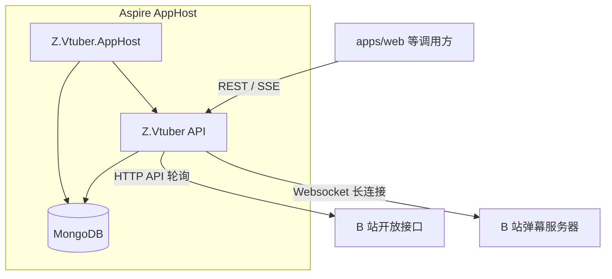
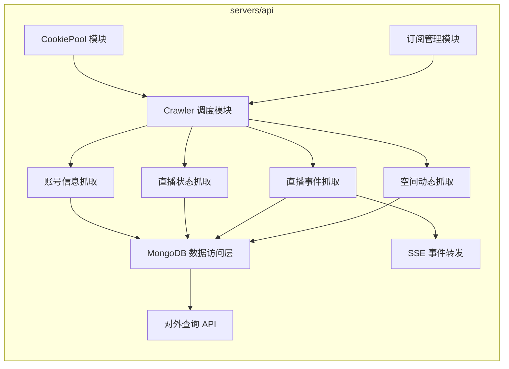
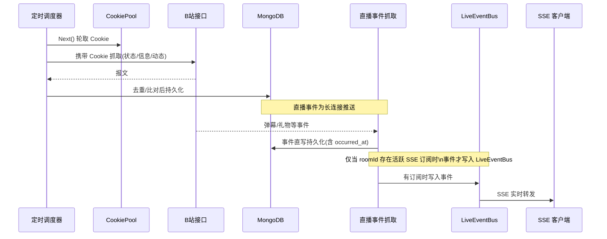
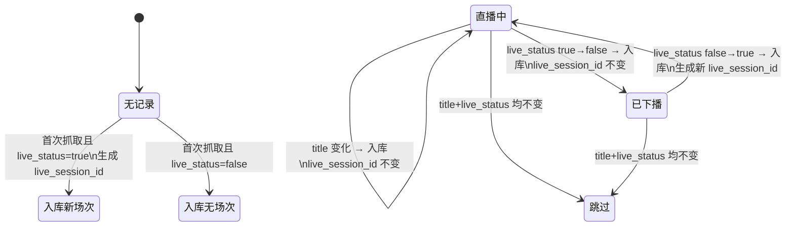

# B站主播数据抓取与订阅服务 - 技术提案

**功能名称**: B站主播数据抓取与订阅服务
**关联 PRD**: `docs/product/draft/20260813-bilibili-live-crawler-prd.md`
**技术提案版本**: v1.0
**创建日期**: 2026-08-13
**作者**: Deliay
**feat-branch**: `feat/bilibili-live-crawler`

## 1. 概述

### 1.1 背景

依据关联 PRD，需要为 Z.Vtuber 建设 B 站数据采集与服务能力。抓取能力基于开源库 [Mikibot.Crawler](https://github.com/Deliay/Mikibot/tree/main/Mikibot.Crawler)（直播弹幕长连接 + B 站 HTTP API 封装），持久化采用新增的 MongoDB 基础设施，服务编排使用 Microsoft Aspire，全部能力落地于现有 `servers/api`（Z.Vtuber，C# / .NET 10 / ASP.NET Core Web API）。

### 1.2 目标

- 引入 MongoDB 并由 Aspire 编排，API 通过 Aspire 集成引用。
- 实现 Cookie 池（round-robin 调度 + 定时探活自动下线）。
- 实现四类抓取任务：账号基本信息（1 天）、直播状态（15 秒，含场次划分与变化去重）、直播间事件（长连接持续抓取）、空间动态（分页 + 断点查重续抓）。
- 对外提供 6 个数据 API（含 SSE 实时事件转发）。
- 全程 TDD，核心逻辑单元测试覆盖率 ≥ 80%。

### 1.3 范围

- **做**：MongoDB 基础设施与编排、Cookie 池、订阅管理、四类抓取任务、数据持久化、6 个对外 API、对应测试。
- **不做**：前端页面、对外鉴权、多实例分布式调度（本期单实例运行）、历史数据迁移。

## 2. 技术架构

### 2.1 系统架构图



### 2.2 技术栈

| 层级 | 技术选型 | 说明 |
|------|---------|------|
| 后端 | C# / .NET 10 + ASP.NET Core Web API | 现有 `servers/api` |
| 抓取库 | Mikibot.Crawler（NuGet 包，1.0.8，兼容 net10.0） | CookieJar、AddBilibiliCrawlers、BilibiliAccount（wbi 签名）、DanmakuClient、CommandSubscriber |
| 数据库 | MongoDB（Aspire 编排） | `Aspire.Hosting.MongoDB` + `Aspire.MongoDB.Driver` |
| 定时任务 | BackgroundService + PeriodicTimer | 原生轻量，满足 1 天 / 15 秒 / 探活周期 |
| 实时推送 | Server-Sent Events（text/event-stream） | 对应 EventSource 消费端 |
| 测试 | xUnit + Testcontainers（MongoDB） | 单元 + 集成测试 |
| 编排 | Microsoft Aspire（infra/apphost） | 现有 AppHost 增加 MongoDB 资源 |

### 2.3 模块划分



| 模块 | 职责 | 关键技术点 |
|------|------|-----------|
| CookiePool | Cookie 录入/查询、round-robin 选取、定时探活与自动下线 | GetNavInfoV2 探活、状态字段管理 |
| 订阅管理 | 订阅 mid 列表的增删查 | 幂等订阅 |
| Crawler 调度 | 按周期驱动各抓取任务，为每个请求分配 Cookie | BackgroundService + PeriodicTimer、轮播选择器 |
| 账号信息抓取 | 每日抓取 space/acc/info 并入库 | BiliLiveCrawler.GetAsync + BilibiliApiResponse\<JsonElement\> |
| 直播状态抓取 | 15 秒抓取、变化去重、场次 UUID 划分 | GetLiveRoomInfo、末条记录比对 |
| 直播事件抓取 | 直播间长连接事件持久化与实时分发 | DanmakuClient + CommandSubscriber、直写 Mongo 持久化、按订阅门控的 Channel 分发 |
| 空间动态抓取 | 动态分页抓取、断点查重、严格去重入库 | GetAsync 手动封装 dynamic/space 接口 |
| 数据访问层 | MongoDB 集合读写 | MongoDB Driver、索引设计 |
| 对外查询 API | 6 个 REST/SSE 端点 | Controller + SSE 流式响应 |

## 3. API 设计

### 3.1 API 契约

契约文件放置于 `contracts/`（OpenAPI YAML），后端为契约生成源。以下端点统一前缀 `/api/b`。

#### 接口 1: 获取订阅主播列表

- **请求**
  - Method: GET
  - Path: /api/b/subscription
- **响应**
  - Status: 200
  - Body:
    ```json
    { "items": [{ "mid": 1150976664, "subscribedAt": "2026-08-13T00:00:00Z" }] }
    ```

#### 接口 2: 订阅主播

- **请求**
  - Method: POST
  - Path: /api/b/subscription
  - Body:
    ```json
    { "mid": 1150976664 }
    ```
- **响应**
  - Status: 200（幂等，重复订阅返回 200）/ 400（mid 非法）

#### 接口 3: 取消订阅

- **请求**
  - Method: DELETE
  - Path: /api/b/subscription/{mid}
- **响应**
  - Status: 204 / 404（未订阅）

#### 接口 4: 查询主播账号基本信息

- **请求**
  - Method: GET
  - Path: /api/b/user/{mid}
- **响应**
  - Status: 200 / 404（未抓取过该主播）
  - Body: `bilibili_account_basic_info` 最新一条的完整 Data（B 站原始报文 JSON）

#### 接口 5: 分页查询直播状态历史

- **请求**
  - Method: GET
  - Path: /api/b/live/{roomId}/state/all?page={page}&pageSize={pageSize}
- **响应**
  - Status: 200
  - Body:
    ```json
    {
      "total": 120,
      "page": 1,
      "pageSize": 20,
      "items": [{
        "roomId": 123456,
        "title": "晚间杂谈",
        "liveStatus": true,
        "liveSessionId": "7f2b...uuid",
        "createdAt": "2026-08-13T12:00:00Z"
      }]
    }
    ```

#### 接口 6: 查询当前直播状态

- **请求**
  - Method: GET
  - Path: /api/b/live/{roomId}/state/current
- **响应**
  - Status: 200 / 404（无记录）
  - Body: `created_at` 最新的一条 `bilibili_live_status`

#### 接口 7: 订阅直播间实时事件（SSE）

- **请求**
  - Method: GET
  - Path: /api/b/live/{roomId}/event/subscribe
- **响应**
  - Status: 200
  - Content-Type: text/event-stream
  - 说明: 自连接建立时刻起，将该直播间正在发生的事件以 SSE 逐条推送；仅推送连接之后的事件，不补历史。事件格式：
    ```
    event: <事件类型>
    data: <事件 JSON，含 occurredAt>

    ```

#### 接口 8: 查询时间段内直播事件

- **请求**
  - Method: GET
  - Path: /api/b/live/{roomId}/event/range?startedAt={}&endedAt={}
- **响应**
  - Status: 200 / 400（时间范围非法）
  - Body:
    ```json
    { "items": [{ "type": "danmaku", "occurredAt": "...", "payload": { } }] }
    ```

#### 接口 9: 分页查询空间动态

- **请求**
  - Method: GET
  - Path: /api/b/user/{mid}/space?page={page}&pageSize={pageSize}
- **响应**
  - Status: 200
  - Body: 分页结构同接口 5，items 为 `bilibili_user_space_timeline` 记录（含动态 id 与原始报文）

### 3.2 内部接口

| 内部接口 | 说明 |
|---------|------|
| `ICookiePoolService.Next()` | round-robin 返回一个有效 Cookie；无有效 Cookie 时抛出可观测异常 |
| `ICookiePoolService.MarkOffline(cookie)` | 探活失败时下线 Cookie |
| `ISubscriptionService` | 订阅增删查，供调度器获取抓取目标 |
| `ILiveEventBus` | 直播事件的内存分发总线（仅用于 SSE 实时转发），基于 `Channel<T>` 实现。**订阅门控**：仅当某 roomId 存在至少一个活跃 SSE 订阅时才接收事件写入；无订阅时不创建/不写入对应 Channel，最后一个订阅断开后立即移除并停止写入，避免资源浪费 |

## 4. 数据模型

### 4.1 数据库设计

数据库：`zvtuber`。所有集合均含 `_id`（ObjectId）与 `created_at`（UTC），时间字段统一 UTC 存储。

#### 集合: bilibili_cookies

| 字段 | 类型 | 说明 |
|------|------|------|
| cookie | string | Cookie 内容（敏感，禁止入日志） |
| status | string | `active` / `offline` |
| last_checked_at | datetime | 最近探活时间 |
| last_used_at | datetime | 最近被调度时间（round-robin 依据） |

索引：`status + last_used_at`。

#### 集合: bilibili_subscriptions

| 字段 | 类型 | 说明 |
|------|------|------|
| mid | long | B 站用户 mid |
| subscribed_at | datetime | 订阅时间 |

索引：`mid` 唯一索引（保证幂等）。

#### 集合: bilibili_account_basic_info

| 字段 | 类型 | 说明 |
|------|------|------|
| mid | long | 主播 mid |
| room_id | long | 直播间房间 ID（从 Data 中提取冗余，供直播状态抓取取用） |
| data | object | `space/acc/info` 接口 `BilibiliApiResponse<JsonElement>.Data` 原始报文 |
| fetched_at | datetime | 抓取时间 |

索引：`mid + fetched_at`（降序）。

#### 集合: bilibili_live_status

| 字段 | 类型 | 说明 |
|------|------|------|
| room_id | long | 房间 ID |
| title | string | 直播间标题 |
| live_status | bool | 是否在播 |
| live_session_id | string | 直播场次 UUID（开播时生成） |
| created_at | datetime | 抓取时间 |

索引：`room_id + created_at`（降序）。

#### 集合: bilibili_live_event

| 字段 | 类型 | 说明 |
|------|------|------|
| room_id | long | 房间 ID |
| live_session_id | string | 所属直播场次（可为空，事件到达时按当前场次填充） |
| type | string | 事件类型（danmaku / gift / super_chat / interact 等） |
| payload | object | 事件原始报文 |
| occurred_at | datetime | 事件时间 |

索引：`room_id + occurred_at`。

#### 集合: bilibili_user_space_timeline

| 字段 | 类型 | 说明 |
|------|------|------|
| mid | long | 主播 mid |
| dynamic_id | string | 动态 id（B 站动态唯一标识） |
| data | object | 动态原始报文 |
| fetched_at | datetime | 抓取时间 |

索引：`dynamic_id` 唯一索引（严格去重）、`mid + fetched_at`。

### 4.2 缓存设计

本期不引入缓存；末条直播状态、当前直播场次等热数据由调度任务在内存中维护，查询 API 直接走 MongoDB 索引查询。

## 5. 技术实现方案

### 5.1 核心流程



### 5.2 关键实现点

#### 实现点 1: Mikibot.Crawler 接入

- **描述**: Mikibot.Crawler 已发布 NuGet 包（[Mikibot.Crawler 1.0.8](https://www.nuget.org/packages/Mikibot.Crawler)，兼容 net10.0），`servers/api` 直接通过 `<PackageReference>` 引用并锁定版本。
- **技术细节**: 通过 `AddBilibiliCrawlers()` 注册；每次抓取前用当前轮取到的 Cookie 构造 `CookieJar` 并初始化 `BilibiliAccount`（wbi 签名）；HTTP 抓取统一走库的 `GetAsync`；直播事件用 `DanmakuClient.ConnectAsync(roomId)` + `CommandSubscriber` 订阅 `DanmuMsg`、`SendGift`、`SuperChatMessage` 等已知事件（参考 [Mikibot.Crawler/Program.cs](https://github.com/Deliay/Mikibot/blob/main/Mikibot.Crawler/Program.cs)）。
- **风险点**: 上游包版本升级可能带来 API 变动 → csproj 锁定版本，升级显式进行并回归测试。

#### 实现点 2: Cookie 探活与 round-robin

- **描述**: 探活任务（周期 5 分钟，可配置）遍历 `active` Cookie 调用 `GetNavInfoV2`，返回未登录/失败则置为 `offline`。调度时按 `last_used_at` 最早优先选取 `active` Cookie，实现 round-robin。
- **技术细节**: 探活失败一次即下线，同时记录日志（不含 Cookie 明文）；全部失效时抓取任务暂停并输出告警日志。

#### 实现点 3: 直播状态去重与场次划分

- **描述**: 15 秒任务对每个被订阅主播（room_id 取自其最新 `bilibili_account_basic_info`）调 `GetLiveRoomInfo`，取该 room_id 末条记录比对：



- **风险点**: 进程重启后内存状态丢失 → 比对依据始终从 Mongo 取末条记录，不依赖内存。

#### 实现点 4: 空间动态断点续抓

- **描述**: 接口（[dynamic/space 文档](https://github.com/bilibili-plugins/bilibili-api-collect/blob/master/docs/dynamic/space.md)）不在库内，用库的 `GetAsync` 手动封装。动态线性分页：抓取一页后取全部 `dynamic_id` 做 `where in (...)` 查询，命中数量与页大小相等说明已接上历史，停止翻页；否则继续翻下一页（用上一页 offset/last_id 游标），直至接上或无更多数据。
- **技术细节**: 入库依赖 `dynamic_id` 唯一索引 + upsert 忽略重复键冲突，保证严格去重。
- **风险点**: 接口分页参数（offset 字符串游标）需按文档实现，以集成测试验证。

#### 实现点 5: SSE 实时事件转发（订阅门控）

- **描述**: `DanmakuClient` 事件经 `CommandSubscriber` 归一化为内部事件后**始终直写 Mongo**（`bilibili_live_event`，持久化链路不依赖 EventBus，保证事件数据完整沉淀）。SSE 实时转发链路实行**订阅门控**，避免无消费者时的资源浪费：
  - `ILiveEventBus` 按 roomId 惰性创建 `Channel`：仅当某 roomId 有第一个 SSE 订阅进入时才创建并开始接收事件写入；
  - 直播事件抓取侧写入前检查该 roomId 当前订阅数，**无订阅则跳过 EventBus 写入**（仅做持久化）；
  - SSE 连接断开时注销订阅，当 roomId 的最后一个订阅断开后，移除对应 `Channel` 并停止向 EventBus 写入；后续有新订阅再重新惰性创建。
- **技术细节**: 订阅计数用 `ConcurrentDictionary<long, SubscriptionRefCount>` 维护（Interlocked 增减），SSE 端点在 `Request.HttpContext.RequestAborted` 触发时注销；写入侧使用 `TryWrite`，Channel 不存在即视为无订阅直接跳过。
- **风险点**: 长连接断开 → 后台 watchdog 自动重连并记录断档日志；订阅计数泄漏（连接异常断开未注销）→ 注销逻辑挂在 `RequestAborted` 与 `finally` 双保险上。

## 6. 技术决策

### 6.1 决策列表

| 决策 | 选项 A | 选项 B | 最终选择 | 原因 |
|------|--------|--------|---------|------|
| Mikibot.Crawler 引用方式 | NuGet 包引用（锁定版本） | git submodule + 项目引用 | A | 官方已发布 NuGet 包（1.0.8，兼容 net10.0），引入与升级成本最低，不引入 submodule 维护负担 |
| 定时任务框架 | BackgroundService + PeriodicTimer | Quartz.NET / Hangfire | A | 周期固定且简单，不引入额外存储依赖 |
| 实时推送协议 | SSE (text/event-stream) | WebSocket | A | 需求明确 EventSource，单向推送足够 |
| 数据库 | MongoDB | PostgreSQL + JSONB | A | 需求指定 MongoDB，原始报文 Schema 灵活 |
| 直播状态比对依据 | Mongo 末条记录 | 内存缓存 | A | 重启安全，逻辑唯一入口 |

### 6.2 依赖与约束

| 类型 | 内容 | 说明 |
|------|------|------|
| 依赖 | Mikibot.Crawler（NuGet，1.0.8） | csproj PackageReference 锁定版本 |
| 依赖 | Aspire.Hosting.MongoDB / Aspire.MongoDB.Driver | AppHost 与 API 分别引入 |
| 约束 | 抓取周期固定（1 天 / 15 秒） | 遵守 PRD 风控约束 |
| 约束 | 单实例运行 | 定时任务不做分布式锁，多副本部署需另行设计 |

## 7. 项目结构

```
z-vtuber/
├── infra/apphost/
│   └── AppHost.cs                # 增加 AddMongoDB 资源并向 api 注入连接
├── servers/api/
│   ├── Controllers/
│   │   ├── BilibiliSubscriptionController.cs
│   │   ├── BilibiliUserController.cs        # user/{mid}、user/{mid}/space
│   │   └── BilibiliLiveController.cs        # state/all、state/current、event/subscribe、event/range
│   ├── Crawlers/                 # CookieJar 工厂、动态接口封装
│   ├── Jobs/                     # CookieProbeJob / AccountInfoJob / LiveStatusJob / SpaceTimelineJob
│   ├── Live/                     # Danmaku 长连接管理、LiveEventBus、SSE 广播
│   ├── Persistence/              # Mongo 集合访问（CookiePool、Subscription、各业务集合）
│   └── Program.cs
├── contracts/
│   └── bilibili-crawler.openapi.yaml
└── tests/
    └── Z.Vtuber.Tests/           # xUnit 单元 + Testcontainers 集成测试
```

## 8. 测试策略

### 8.1 测试覆盖要求

- 单元测试覆盖率: >= 80%（核心逻辑：状态去重/场次划分、动态查重续抓、Cookie 轮询与下线、EventBus 订阅门控）
- API 测试覆盖的端点: 本提案 3.1 全部 9 个端点

### 8.2 测试类型

| 类型 | 工具 | 覆盖范围 |
|------|------|---------|
| 单元测试 | xUnit + NSubstitute | 去重比对、场次状态机、分页查重、round-robin 选取、EventBus 订阅门控（无订阅不写入/末订阅断开移除 Channel） |
| 集成测试 | xUnit + Testcontainers(MongoDB) | 持久化与唯一索引去重、查询 API 分页 |
| API 测试 | z-test 工作流 | 契约端点全量验证 |
| 外部接口 | 手动验证 + 录制样例报文 | B 站接口以样例报文 mock，不做 CI 直连 |

## 9. 部署方案

### 9.1 环境规划

| 环境 | 用途 | 部署方式 |
|------|------|---------|
| 本地开发 | 开发与联调 | `dotnet run` AppHost（Aspire 拉起 MongoDB 容器 + api + web） |
| 测试 | API/E2E 测试 | Aspire 测试编排 / Testcontainers |

### 9.2 配置管理

| 配置项 | 说明 | 默认值 |
|--------|------|--------|
| ConnectionStrings__mongo | Aspire 注入的 MongoDB 连接 | 由 AppHost 编排 |
| BilibiliCrawler__StatusIntervalSeconds | 直播状态抓取周期 | 15 |
| BilibiliCrawler__AccountInfoIntervalHours | 账号信息抓取周期 | 24 |
| BilibiliCrawler__CookieProbeIntervalMinutes | Cookie 探活周期 | 5 |

Cookie 不落配置文件，运行时通过管理接口/数据库录入。

## 10. 验收标准

- [ ] 技术方案评审通过
- [ ] Contract 评审通过（`contracts/bilibili-crawler.openapi.yaml`）
- [ ] 代码实现完成（含 MongoDB Aspire 编排）
- [ ] 单元测试覆盖达标（≥80%）
- [ ] API 测试通过
- [ ] E2E 测试通过

## 11. 相关文档

- 关联 PRD：`docs/product/draft/20260813-bilibili-live-crawler-prd.md`
- 开发规范：`docs/engineering/common-rules.md`、`docs/engineering/backend-rules.md`
- Mikibot.Crawler 源码：https://github.com/Deliay/Mikibot/tree/main/Mikibot.Crawler
- B 站动态接口文档：https://github.com/bilibili-plugins/bilibili-api-collect/blob/master/docs/dynamic/space.md
