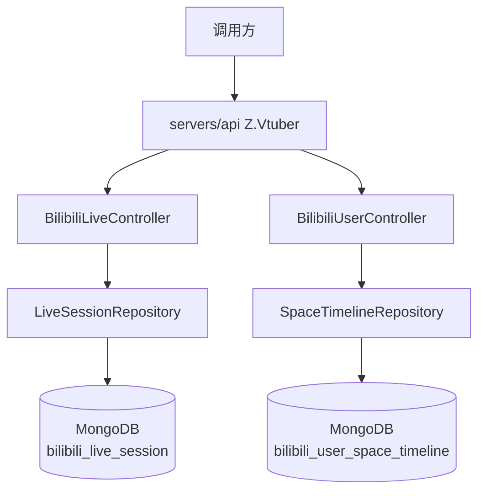
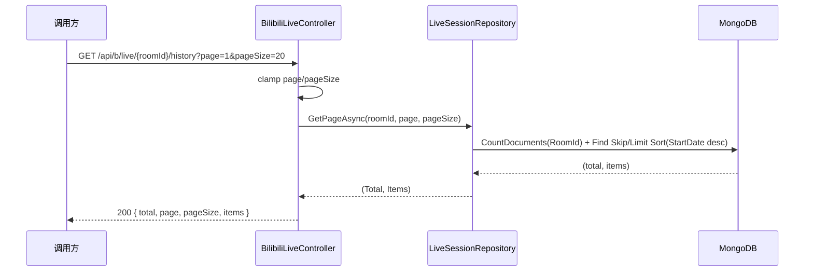

# 直播场次历史查询与分页排序统一 - 技术提案

**功能名称**: 直播场次历史查询与分页排序统一
**关联 PRD**: `docs/product/draft/20260815-bilibili-live-history-prd.md`
**技术提案版本**: v1.1
**创建日期**: 2026-08-15
**作者**: Deliay
**feat-branch**: `feat/bilibili-live-history`

> v1.1 修订：按评审意见，空间动态分页排序不再新增 `PublishedAt` 字段，直接使用实体已有的 `DynamicId` 倒序（B 站动态 ID 单调递增，倒序即创建时间倒序），无需改动抓取侧与实体结构。

## 1. 概述

### 1.1 背景

依据关联 PRD，需要：

1. 新增 `GET /api/b/live/{roomId}/history` 接口，分页查询 `bilibili_live_session` 集合中指定直播间的历史场次。数据已由 `AccountInfoCrawler.PersistLiveSessionsAsync`（`servers/api/Services/AccountInfoCrawler.cs:70-108`）持续写入，`LiveSessionRepository` 已存在（`Program.cs:28` 已注册单例），但 Controller 尚未暴露查询端点。
2. 统一所有分页接口按创建时间倒序。现状盘点：
   - `GET /api/b/live/{roomId}/state/all` → `LiveStatusRepository.GetPageAsync` 已按 `CreatedAt` 倒序，**无需改动**（`servers/api/Persistence/LiveStatusRepository.cs:19-30`）。
   - `GET /api/b/user/{mid}/space` → `SpaceTimelineRepository.GetPageAsync` 当前按 `FetchedAt`（抓取时间）倒序（`servers/api/Persistence/SpaceTimelineRepository.cs:51-62`）。实体 `SpaceTimelineRecord` 已有 `DynamicId` 字段（B 站动态 ID，单调递增），排序改为 `DynamicId` 倒序即为创建时间倒序。

### 1.2 目标

- 新增 `GET /api/b/live/{roomId}/history` 分页接口，按 `StartDate`（开播时间，即场次的创建时间）倒序返回。
- 将空间动态分页接口的排序从 `FetchedAt` 倒序调整为 `DynamicId` 倒序。
- 为排序行为补齐真实断言的测试（现有 `GetPage_PaginatesInDescendingOrder` 仅断言分页不断言排序）。
- 全程 TDD，核心逻辑单元测试覆盖率 ≥ 80%。

### 1.3 范围

**做：**

- `LiveSessionRepository` 增加/改造分页查询方法（返回 `Total` + `Items`）。
- `BilibiliLiveController` 新增 `GET {roomId}/history` 端点。
- `contracts/bilibili-crawler.openapi.yaml` 新增 `LiveSessionHistoryPage` 契约。
- 空间动态分页排序改为 `DynamicId` 倒序（仅仓储层排序与索引调整）。
- 仓储层排序断言测试补齐。

**不做：**

- 不改动抓取链路与数据写入逻辑（`DynamicId` 已随抓取入库，无需实体/抓取侧变更）。
- 不做前端页面（`apps/web` 目前无列表页消费，不在本期范围）。
- 不新增鉴权（与现有一致，无鉴权）。
- 不改动非分页端点（如 `event/range` 的 `OccurredAt` 升序属事件时间线语义，非分页接口，保持原样）。

## 2. 技术架构

### 2.1 系统架构图



### 2.2 技术栈

| 层级 | 技术选型 | 说明 |
|------|---------|------|
| 后端 | C# / .NET 10, ASP.NET Core Web API | 沿用现有 |
| 数据库 | MongoDB（Aspire.MongoDB.Driver + MongoDB.Driver） | 沿用现有 |
| 契约 | OpenAPI YAML（`contracts/`） | 后端为生成源 |
| 测试 | xUnit + Testcontainers | 沿用现有 |

### 2.3 模块划分

| 模块 | 职责 | 关键技术点 |
|------|------|-----------|
| `Controllers/BilibiliLiveController` | 新增 history 端点，分页参数校验与响应组装 | `[FromQuery]` 参数 clamp，匿名对象响应 |
| `Persistence/LiveSessionRepository` | roomId 过滤 + StartDate 倒序分页 | 复用已有 `RoomId + StartDate desc` 复合索引 |
| `Persistence/SpaceTimelineRepository` | 分页排序从 FetchedAt 改为 DynamicId 倒序 | DynamicId 为单调递增字符串，补充对应索引 |

## 3. API 设计

### 3.1 API 契约

#### 接口 1: 查询直播间历史场次

- **请求**
  - Method: GET
  - Path: `/api/b/live/{roomId}/history`
  - Path 参数: `roomId` (long, 直播间号)
  - Query 参数: `page` (int, 默认 1, ≥1)、`pageSize` (int, 默认 20, 1–100)
- **响应**
  - Status: 200
  - Body:
    ```json
    {
      "total": 42,
      "page": 1,
      "pageSize": 20,
      "items": [
        {
          "liveId": "string",
          "roomId": 123456,
          "title": "string",
          "coverUrl": "string | null",
          "parentArea": "string | null",
          "area": "string | null",
          "isFinish": true,
          "startDate": "2026-08-10T12:00:00Z",
          "stopDate": "2026-08-10T15:00:00Z | null",
          "danmakuCount": 0,
          "totalIncome": 0,
          "watchCount": 0,
          "likeCount": 0,
          "payCount": 0,
          "maxOnlineCount": 0
        }
      ]
    }
    ```

排序：`startDate` 倒序（开播时间即场次创建时间）。`isFinish=false` 的进行中场次 `stopDate` 为 `null`，由 `isFinish` 标识进行中状态。

#### 接口 2: 空间动态分页（行为修正）

- `GET /api/b/user/{mid}/space` 的响应结构、分页参数不变，仅排序从 `fetchedAt` 倒序改为 `dynamicId` 倒序（B 站动态 ID 单调递增，倒序即创建时间倒序；契约中补充说明排序语义）。

### 3.2 内部接口

- `LiveSessionRepository.GetByRoomIdAsync`（`servers/api/Persistence/LiveSessionRepository.cs:51-60`）当前只返回 items 且仅被测试使用，需统一改造为与其他仓储一致的签名：

```csharp
Task<(long Total, IReadOnlyList<LiveSessionRecord> Items)> GetPageAsync(long roomId, int page, int pageSize, CancellationToken ct = default);
```

## 4. 数据模型

### 4.1 数据库设计

#### 集合: `bilibili_live_session`（实体 `LiveSessionRecord`，无 schema 变更）

| 字段 | 类型 | 说明 |
|------|------|------|
| Id | ObjectId | 主键 |
| LiveId | string | B站场次唯一ID（唯一索引） |
| RoomId | long | 直播间号 |
| Title | string | 直播标题 |
| CoverUrl / ParentArea / Area | string? | 封面 / 父分区 / 分区 |
| IsFinish | bool | 是否已下播 |
| StartDate | DateTime | 开播时间（UTC），排序键 |
| StopDate | DateTime? | 下播时间（UTC） |
| DanmakuCount / TotalIncome / WatchCount / LikeCount / PayCount / MaxOnlineCount | long / double | 场次指标 |
| FetchedAt | DateTime | 抓取时间（不参与排序） |

索引：已有 `RoomId asc + StartDate desc` 复合索引（`MongoDbInitializer.cs:91-103`），完全覆盖新接口查询，**无需新增索引**。

#### 集合: `bilibili_user_space_timeline`（实体 `SpaceTimelineRecord`，无 schema 变更）

| 字段 | 类型 | 说明 |
|------|------|------|
| DynamicId | string | B站动态 ID（已有字段，单调递增，排序键），倒序即创建时间倒序 |
| Mid / Data / FetchedAt | — | 不变 |

排序说明：`DynamicId` 为数值型字符串且单调递增。实现时按数值语义倒序排序（如 `Convert.ToInt64` 后比较，或将查询条件统一为零填充等长字符串；实现时以测试验证为准）。索引：在 `MongoDbInitializer` 中补充 `Mid asc + DynamicId desc` 复合索引（如尚无）。

### 4.2 缓存设计

无缓存，直接查询 MongoDB。

## 5. 技术实现方案

### 5.1 核心流程



### 5.2 关键实现点

#### 实现点 1: history 端点

- **描述**: `BilibiliLiveController` 注入 `LiveSessionRepository`，新增 `GetHistory(long roomId, [FromQuery] int page = 1, [FromQuery] int pageSize = 20)`，`page = Math.Max(1, page)`、`pageSize = Math.Clamp(pageSize, 1, 100)`，返回 `Ok(new { total, page, pageSize, items = ... })`，与既有端点模式完全一致。
- **技术细节**: 复用现有匿名对象 + 私有 `ToDto` 风格；契约新增 `LiveSessionHistoryPage` / `LiveSession` schema。
- **风险点**: 无（索引已就绪，数据链路已存在）。

#### 实现点 2: 空间动态排序统一为 DynamicId 倒序

- **描述**: `SpaceTimelineRepository.GetPageAsync` 排序从 `FetchedAt` 倒序改为 `DynamicId` 倒序（数值语义）。`DynamicId` 已随抓取入库，实体与抓取侧零改动。
- **技术细节**: `DynamicId` 存储为 string，需保证排序按数值而非字典序（不同长度数字串字典序与数值序不一致）；`MongoDbInitializer` 补充 `Mid + DynamicId desc` 复合索引（如尚无）。
- **风险点**: 字符串字段的数值排序需选实现方案（查询时转换 / 存储侧规范化为等长），以测试断言兜底。

#### 实现点 3: 排序测试补齐

- **描述**: 为 `LiveSessionRepository`、`LiveStatusRepository`、`SpaceTimelineRepository` 的分页查询补充严格倒序断言（插入乱序数据，断言返回顺序与翻页后不重不漏；空间动态用例覆盖不同长度 `DynamicId` 的数值序正确性）。
- **技术细节**: 沿用 xUnit + Testcontainers `MongoDbFixture`、`[Collection("mongo")]` 模式。

## 6. 技术决策

### 6.1 决策列表

| 决策 | 选项 A | 选项 B | 最终选择 | 原因 |
|------|--------|--------|---------|------|
| history 排序键 | StartDate（开播时间） | FetchedAt（抓取时间） | A | 场次的业务创建时间即开播时间，符合 PRD「创建时间倒序」 |
| 空间动态排序键 | DynamicId 倒序 | 新增 PublishedAt 字段 | A（评审意见） | DynamicId 单调递增且已入库，倒序即创建时间倒序，无需实体/抓取侧变更 |
| DynamicId 数值序 | 查询时转 long 比较 | 字典序直接排 | A | 不同长度数字串字典序与数值序不一致，需数值语义 |
| 仓储签名 | 复用 GetByRoomIdAsync | 统一为 (Total, Items) 的 GetPageAsync | B | 与其他仓储分页签名一致 |

### 6.2 依赖与约束

| 类型 | 内容 | 说明 |
|------|------|------|
| 依赖 | `LiveSessionRepository`（已注册） | 无需新增基础设施 |
| 依赖 | `SpaceTimelineRecord.DynamicId`（已有字段） | 无需数据迁移 |
| 约束 | 契约先行 | 先更新 `contracts/bilibili-crawler.openapi.yaml` 再实现 |
| 约束 | TDD，核心逻辑覆盖率 ≥ 80% | `docs/engineering/common-rules.md` |

## 7. 项目结构

```
servers/api/
├── Controllers/
│   └── BilibiliLiveController.cs        # 新增 GET {roomId}/history
├── Persistence/
│   ├── LiveSessionRepository.cs         # 统一 GetPageAsync(Total, Items)
│   ├── SpaceTimelineRepository.cs       # 排序改 DynamicId desc（数值语义）
│   └── MongoDbInitializer.cs            # 补充 Mid+DynamicId desc 索引
└── Program.cs                           # 无变更（仓储已注册）
contracts/
└── bilibili-crawler.openapi.yaml        # 新增 /api/b/live/{roomId}/history
tests/Z.Vtuber.Tests/                    # 排序断言测试补齐
```

## 8. 测试策略

### 8.1 测试覆盖要求

- 单元测试覆盖率: >= 80%（核心逻辑）
- API 测试覆盖的端点: `GET /api/b/live/{roomId}/history`、`GET /api/b/user/{mid}/space`

### 8.2 测试类型

| 类型 | 工具 | 覆盖范围 |
|------|------|---------|
| 集成测试（仓储层） | xUnit + Testcontainers Mongo | 三个仓储分页方法：倒序断言、翻页不重不漏、total 正确；DynamicId 不同长度数值序 |
| API 测试 | z-test 工作流 | history 端点：默认参数、参数 clamp、空列表、进行中场次 |
| 回归测试 | xUnit | 现有 `LiveSessionRepositoryTests` 适配新签名 |

## 9. 部署方案

### 9.1 环境规划

| 环境 | 用途 | 部署方式 |
|------|------|---------|
| 本地开发 | 开发/调试 | Aspire 编排（z-aspire-orchestrator） |
| 测试 | 集成/API 测试 | Testcontainers |

### 9.2 配置管理

无新增配置项。

## 10. 验收标准

- [ ] 技术方案评审通过
- [ ] Contract 评审通过（`/api/b/live/{roomId}/history` + 排序语义说明）
- [ ] 代码实现完成
- [ ] 单元测试覆盖达标（≥80%）
- [ ] API 测试通过
- [ ] 所有分页接口排序均为创建时间倒序（空间动态按 `DynamicId` 倒序，含回归验证）

## 11. 相关文档

- 关联 PRD：`docs/product/draft/20260815-bilibili-live-history-prd.md`
- 关联 Contract：`contracts/bilibili-crawler.openapi.yaml`
- 开发规范：`docs/engineering/common-rules.md`、`docs/engineering/backend-rules.md`
- 既有提案：`docs/engineering/proposals/20260813-proposal-bilibili-live-crawler.md`
