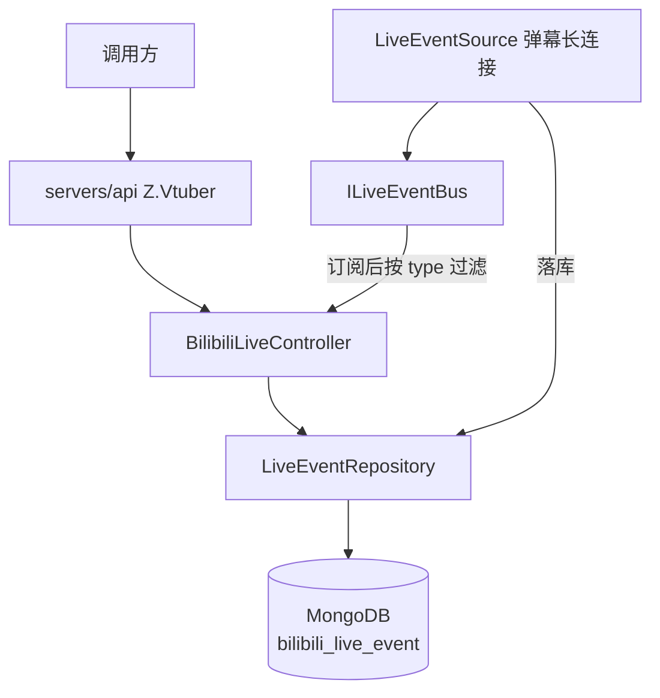
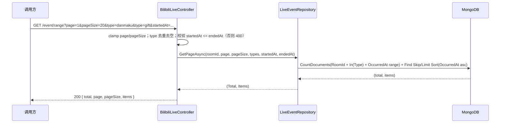

# 直播事件查询与订阅筛选 - 技术提案

**功能名称**: 直播事件查询与订阅筛选
**关联 PRD**: `docs/product/draft/20260815-live-event-filter-prd.md`
**技术提案版本**: v1.0
**创建日期**: 2026-08-15
**作者**: Deliay
**feat-branch**: `feat/live-event-filter`

## 1. 概述

### 1.1 背景

依据关联 PRD，需要增强直播事件的两个端点。现状盘点：

| 端点 | 现状 | 问题 |
|------|------|------|
| `GET /api/b/live/{roomId}/event/range` | `LiveEventRepository.GetRangeAsync` 按 `RoomId + OccurredAt` 范围一次性 `ToListAsync` 返回全部事件，`startedAt`/`endedAt` 必填，响应为 `{ items }` | 无分页、无类型筛选、日期必填，大数据量响应体不可控 |
| `GET /api/b/live/{roomId}/event/subscribe` | Controller 订阅 `ILiveEventBus` 后全量写 SSE | 无法按类型过滤，订阅方被动接收全部事件 |

事件类型由 `DanmakuEventNormalizer` 归一化（`danmaku`、`gift`、`super_chat`、`guard_buy`、`interact`、`entry_effect`、`watched_change`、`room_update`、`online_rank_count`、`online_rank_v2`、`online_rank_v3`、`anchor_lot_start`、`anchor_lot_award`、`popularity_red_pocket_start`、`hot_rank_settlement`，未映射命令回退为命令名小写）。集合 `bilibili_live_event` 既有索引为 `RoomId asc + OccurredAt asc`。

### 1.2 目标

- `event/range` 新增 `page`/`pageSize` 分页与可重复 `type` 筛选，`startedAt`/`endedAt` 改为可选（单侧可用），响应调整为分页结构。
- `event/subscribe` 新增可重复 `type` 参数，服务端过滤后再写 SSE。
- 全程 TDD，核心逻辑单元测试覆盖率 ≥ 80%。

### 1.3 范围

**做：**

- `contracts/bilibili-crawler.openapi.yaml`：`event/range` 新增 `Page`/`PageSize`/`type` 参数、`startedAt`/`endedAt` 改可选、响应改为分页 schema；`event/subscribe` 新增 `type` 参数。
- `LiveEventRepository` 新增分页查询方法（类型集合 + 可选时间范围过滤 + Count/Find）。
- `BilibiliLiveController`：`event/range` 端点透传与校验新参数；`event/subscribe` 端点按 `type` 集合过滤推送。
- 仓储层与 API 层测试补齐。

**不做：**

- 不改变事件归一化规则（`DanmakuEventNormalizer` 不动）。
- 不改变 SSE 推送格式与既有订阅语义（不传 `type` 时全量推送）。
- 不做前端改动、不新增鉴权。

## 2. 技术架构

### 2.1 系统架构图



### 2.2 技术栈

| 层级 | 技术选型 | 说明 |
|------|---------|------|
| 后端 | C# / .NET 10, ASP.NET Core Web API | 沿用现有 |
| 数据库 | MongoDB（Aspire.MongoDB.Driver + MongoDB.Driver） | 沿用现有 |
| 契约 | OpenAPI YAML（`contracts/`） | 后端为生成源 |
| 测试 | xUnit + Testcontainers | 沿用现有 |

### 2.3 模块划分

| 模块 | 职责 | 关键技术点 |
|------|------|-----------|
| `Controllers/BilibiliLiveController` | `event/range` 参数接收/校验、`event/subscribe` 类型过滤 | 可重复 query 绑定 `string[]`，`startedAt > endedAt` 返回 400，SSE 循环内按 `HashSet<string>` 过滤 |
| `Persistence/LiveEventRepository` | 分页 + 类型 + 时间范围查询 | `Filter.In(Type)` 叠加 `Gte/Lte(OccurredAt)`，Count 与 Find 同一过滤条件 |
| `Persistence/MongoDbInitializer` | 索引维护 | 复用既有 `RoomId + OccurredAt` 索引，不新增 |

## 3. API 设计

### 3.1 API 契约

#### 接口 1: 直播事件分页查询（增强）

- **请求**
  - Method: GET
  - Path: `/api/b/live/{roomId}/event/range`
  - Query 参数：
    | 参数 | 类型 | 必填 | 说明 |
    |------|------|------|------|
    | `page` | integer | 否 | 页码，默认 1（复用共享参数 `Page`） |
    | `pageSize` | integer | 否 | 每页条数，默认 20，上限 100（复用共享参数 `PageSize`） |
    | `type` | array[string] | 否 | 事件类型筛选，可重复传入（`type=danmaku&type=gift`，style: form, explode: true）；不传返回全部类型 |
    | `startedAt` | string (date-time) | 否 | 起始时间（含边界，UTC），由必填**放宽为可选**，缺省不限制下界 |
    | `endedAt` | string (date-time) | 否 | 截止时间（含边界，UTC），由必填**放宽为可选**，缺省不限制上界 |
- **响应**（结构由 `{ items }` 调整为分页结构）：
  - Status: 200
  - Body:
    ```json
    {
      "total": 120,
      "page": 1,
      "pageSize": 20,
      "items": [
        {
          "roomId": 1727076670,
          "type": "danmaku",
          "occurredAt": "2026-08-15T08:00:00Z",
          "liveSessionId": "string",
          "payload": {}
        }
      ]
    }
    ```
- **过滤语义**：`type` 多值为合集（OR）；时间范围含起止边界；排序维持 `occurredAt` 升序。
- **错误**：`startedAt > endedAt` 或时间格式非法 → 400。

#### 接口 2: 直播事件订阅（增强）

- **请求**
  - Method: GET
  - Path: `/api/b/live/{roomId}/event/subscribe`
  - Query 参数：`type`（array[string]，可选，可重复），语义同接口 1。
- **响应**：`text/event-stream` 不变，仅推送 `type` 匹配的事件；不传 `type` 推送全部。

#### 请求/响应示例

- `GET /api/b/live/1727076670/event/range?type=danmaku&type=super_chat&startedAt=2026-08-15T00:00:00Z&page=1&pageSize=20` → 200 + 分页结构，仅含两类事件。
- `GET /api/b/live/1727076670/event/subscribe?type=danmaku` → SSE 流中仅出现 `event: danmaku`。
- `GET /api/b/live/1727076670/event/range?startedAt=2026-08-16T00:00:00Z&endedAt=2026-08-15T00:00:00Z` → 400：
  ```json
  { "type": "https://tools.ietf.org/html/rfc9110#section-15.5.1", "title": "Bad Request", "status": 400, "detail": "startedAt must not be later than endedAt." }
  ```

### 3.2 内部接口

```csharp
// LiveEventRepository
Task<(long Total, IReadOnlyList<LiveEventRecord> Items)> GetPageAsync(
    long roomId, int page, int pageSize,
    IReadOnlyCollection<string>? types = null,
    DateTime? startedAt = null, DateTime? endedAt = null,
    CancellationToken ct = default);
```

原 `GetRangeAsync` 由新分页方法取代（仅 `event/range` 一个调用点，同步替换）。

## 4. 数据模型

### 4.1 数据库设计

集合 `bilibili_live_event`（实体 `LiveEventRecord`）**无 schema 变更**：

| 字段 | 类型 | 说明 |
|------|------|------|
| Id | ObjectId | 主键 |
| RoomId | long | 直播间 ID（既有索引首字段） |
| Type | string | 归一化事件类型，本期作为 `$in` 过滤条件 |
| OccurredAt | DateTime | 事件发生时间（既有索引次字段，排序键） |
| LiveSessionId | string? | 所属场次 |
| Payload | string | 原始事件 JSON |

- 索引：复用既有 `RoomId asc + OccurredAt asc`。查询主谓词为 `RoomId =` 且叠加 `OccurredAt` 范围，`Type` 的 `$in` 在该索引扫描范围内过滤；单直播间单场事件量级（十万级）下代价可接受，暂不新增 `RoomId + Type + OccurredAt` 复合索引（见 6.1 决策）。

### 4.2 缓存设计

无缓存，直接查询 MongoDB。

## 5. 技术实现方案

### 5.1 核心流程



`event/subscribe` 流程：Controller 解析 `type` 集合（去重、忽略空值）→ 订阅 `ILiveEventBus` → SSE 循环内若集合非空且 `!set.Contains(liveEvent.Type)` 则跳过该事件，其余逻辑（`event:`/`data:` 写出、`finally` 取消订阅）不变。

### 5.2 关键实现点

#### 实现点 1: 可重复 query 参数绑定

- **描述**: 两个端点以 `[FromQuery] string[]? type` 接收可重复参数；ASP.NET Core 模型绑定天然支持 `type=a&type=b`。Controller 层统一做去重（`StringComparer.Ordinal`）与空值剔除，空数组按"未传入"处理。
- **风险点**: OpenAPI 契约需显式声明 `style: form, explode: true`，避免代码生成方按逗号拼接解析。

#### 实现点 2: 仓储层组合过滤

- **描述**: `GetPageAsync` 用 `FilterDefinitionBuilder` 组合：`Eq(RoomId)` 恒有，`types` 非空叠加 `In(Type, types)`，`startedAt`/`endedAt` 非空叠加 `Gte/Lte(OccurredAt)`；`CountDocuments` 与 `Find` 共用同一过滤条件，保证 `total` 与 `items` 一致；排序维持 `SortBy(OccurredAt)` 升序。
- **风险点**: 无（过滤条件叠加为既有模式，与其他仓储的分页实现一致）。

#### 实现点 3: 时间参数放宽与校验

- **描述**: `startedAt`/`endedAt` 由必填 `DateTime` 改为可选 `DateTime?`，校验逻辑与其他分页端点统一复用 `BilibiliUserController.BadTimeRange`（`startedAt > endedAt` → 400）。
- **风险点**: 错误提示文案统一为 `startedAt must not be later than endedAt.`（与现状其他端点一致，原 `endedAt must not be earlier than startedAt.` 废弃）。

#### 实现点 4: SSE 订阅过滤

- **描述**: 过滤发生在 Controller 的 SSE 写出循环内，不改动 `ILiveEventBus` 接口与实现——总线仍按直播间投递，订阅方各自过滤。未匹配的事件在写出前直接 `continue`。
- **技术细节**: 使用 `HashSet<string>` 承载类型集合，单次判断 O(1)，不影响推送时延。
- **风险点**: 同房间多个订阅方过滤条件互不影响（各订阅独立 channel，既有架构已保证）。

## 6. 技术决策

### 6.1 决策列表

| 决策 | 选项 A | 选项 B | 最终选择 | 原因 |
|------|--------|--------|---------|------|
| 类型过滤位置（range） | 仓储层 `$in` 过滤 | 查出后内存过滤 | A | 内存过滤无法支撑正确分页与 total，违背性能要求 |
| 是否新增 `RoomId+Type+OccurredAt` 索引 | 复用既有 `RoomId+OccurredAt` | 新增复合索引 | A | 主谓词 `RoomId` 等值已大幅收敛扫描范围；type 为低选择性字段，复合索引收益有限且增加写入开销；后续实测不达标再补 |
| 订阅过滤位置 | Controller SSE 循环内过滤 | `ILiveEventBus` 增加带过滤的订阅接口 | A | 不改动总线契约，改动面最小；过滤为 O(1) 判断，无性能差异 |
| 日期参数处理 | 放宽为可选 | 保持必填 | A | PRD 明确要求日期筛选可选；对既有传参调用方兼容 |
| `type` 非法值 | 忽略（匹配不到即空结果） | 400 报错 | A | 类型为开放集合（未映射命令回退小写名），无法穷举校验；静默空结果语义清晰 |
| `GetRangeAsync` 处理 | 由 `GetPageAsync` 取代 | 保留两方法 | A | 仅一个调用点，避免重复实现 |

### 6.2 依赖与约束

| 类型 | 内容 | 说明 |
|------|------|------|
| 依赖 | 事件类型归一化规则 | `DanmakuEventNormalizer`，本期不改 |
| 约束 | 契约先行 | 先更新 `contracts/bilibili-crawler.openapi.yaml` 再实现 |
| 约束 | TDD，核心逻辑覆盖率 ≥ 80% | `docs/engineering/common-rules.md` |
| 约束 | 分页/时间参数规范统一 | 复用共享参数 `Page`/`PageSize` 与 `BadTimeRange` 校验风格 |
| 约束 | `event/range` 响应结构变化 | PRD 已明确为分页改造，items 内字段不变 |

## 7. 项目结构

```
servers/api/
├── Controllers/
│   └── BilibiliLiveController.cs        # event/range 分页+筛选；event/subscribe 类型过滤
├── Persistence/
│   └── LiveEventRepository.cs           # GetPageAsync（类型 + 时间范围 + 分页）
contracts/
└── bilibili-crawler.openapi.yaml        # 两端点契约更新（type 参数、可选时间、分页响应）
tests/Z.Vtuber.Tests/                    # 组合过滤/分页边界/SSE 过滤/参数校验测试
```

## 8. 测试策略

### 8.1 测试覆盖要求

- 单元测试覆盖率: >= 80%（核心逻辑）
- API 测试覆盖的端点: `GET /api/b/live/{roomId}/event/range`、`GET /api/b/live/{roomId}/event/subscribe`

### 8.2 测试类型

| 类型 | 工具 | 覆盖范围 |
|------|------|---------|
| 集成测试（仓储层） | xUnit + Testcontainers Mongo | 类型合集过滤、时间含边界/单侧边界/无时间、范围内翻页不重不漏、total 正确 |
| 单元测试（参数处理） | xUnit | type 去重、空值剔除、空集合等价未传入 |
| 集成测试（订阅过滤） | xUnit | 发布多类型事件，订阅方仅收到匹配类型；不传 type 全量收到 |
| API 测试 | z-test 工作流 | 两端点：多 type 筛选、可选日期组合、`startedAt > endedAt` → 400、不传新参数行为回归 |

## 9. 部署方案

### 9.1 环境规划

| 环境 | 用途 | 部署方式 |
|------|------|---------|
| 本地开发 | 开发/调试 | Aspire 编排（z-aspire-orchestrator） |
| 测试 | 集成/API 测试 | Testcontainers |

### 9.2 配置管理

无新增配置项，无数据迁移，随服务正常发布即可。

## 10. 验收标准

- [ ] 技术方案评审通过
- [ ] Contract 评审通过（`event/range` 分页/type/可选时间，`event/subscribe` type 参数）
- [ ] 代码实现完成
- [ ] 单元测试覆盖达标（≥80%）
- [ ] API 测试通过（两端点筛选 + 兼容性回归）

## 11. 相关文档

- 关联 PRD：`docs/product/draft/20260815-live-event-filter-prd.md`
- 关联 Contract：`contracts/bilibili-crawler.openapi.yaml`
- 开发规范：`docs/engineering/common-rules.md`、`docs/engineering/backend-rules.md`
- 既有提案：`docs/engineering/proposals/20260815-proposal-pagination-time-range.md`
