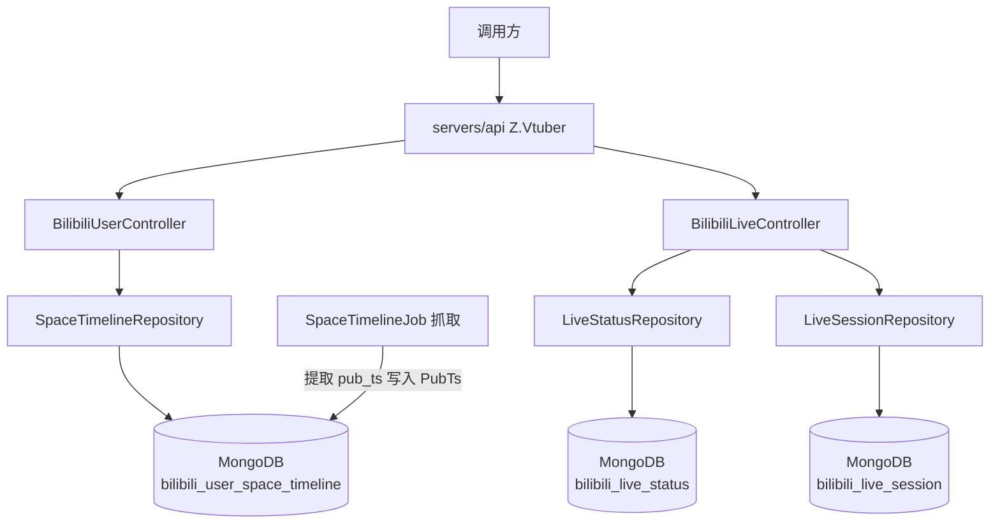
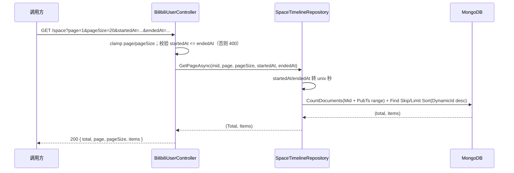

# 分页列表时间范围筛选 - 技术提案

**功能名称**: 分页列表时间范围筛选
**关联 PRD**: `docs/product/draft/20260815-pagination-time-range-prd.md`
**技术提案版本**: v1.0
**创建日期**: 2026-08-15
**作者**: Deliay
**feat-branch**: `feat/pagination-time-range`

## 1. 概述

### 1.1 背景

依据关联 PRD，需要为系统内所有分页接口增加时间范围检索能力。现状盘点（共 3 个分页接口）：

| 接口 | 仓储 | 集合 | 业务时间字段 | 现状 |
|------|------|------|-------------|------|
| `GET /api/b/user/{mid}/space` | `SpaceTimelineRepository` | `bilibili_user_space_timeline` | 动态发布时间 `pub_ts`（藏于原始 JSON `data.modules.module_author.pub_ts`） | 仅按 `DynamicId` 倒序分页，**发布时间未结构化存储，无法查询** |
| `GET /api/b/live/{roomId}/state/all` | `LiveStatusRepository` | `bilibili_live_status` | `CreatedAt`（记录时间） | 仅按 `CreatedAt` 倒序分页，无时间过滤 |
| `GET /api/b/live/{roomId}/history` | `LiveSessionRepository` | `bilibili_live_session` | `StartDate`（开播时间） | 仅按 `StartDate` 倒序分页，无时间过滤 |

核心难点在动态接口：`pub_ts` 是 B 站原始动态 JSON 内的字段（unix 秒级时间戳字符串），当前 `SpaceTimelineRecord.Data` 以不透明字符串整体存储，MongoDB 层无法直接按它过滤。需将其在写入侧提取为独立字段，存量数据一次性回填。

### 1.2 目标

- 3 个分页接口统一新增可选 query 参数 `startedAt` / `endedAt`（date-time，与既有 `GET /event/range` 参数命名一致），按各自业务时间字段过滤。
- 动态发布时间 `pub_ts` 在抓取入库时提取为 `SpaceTimelineRecord.PubTs`（long，unix 秒），存量数据幂等回填，并补充 `Mid + PubTs desc` 复合索引。
- 全程 TDD，核心逻辑单元测试覆盖率 ≥ 80%。

### 1.3 范围

**做：**

- `contracts/bilibili-crawler.openapi.yaml`：3 个分页端点新增 `startedAt` / `endedAt` 可选参数及语义说明。
- `SpaceTimelineRecord` 新增 `PubTs` 字段；`SpaceTimelineJob` 入库时从原始 JSON 提取 `pub_ts`；存量数据回填；新增复合索引。
- `SpaceTimelineRepository` / `LiveStatusRepository` / `LiveSessionRepository` 分页方法增加时间范围过滤。
- 3 个 Controller 端点透传并校验时间参数（`startedAt > endedAt` 返回 400）。
- 仓储层与 API 层测试补齐。

**不做：**

- 不做前端筛选 UI（`apps/web` 尚无列表页，不在本期范围）。
- 不改动非分页端点（`event/range` 已有独立时间范围参数，保持原样）。
- 不改动排序语义（各接口维持既有倒序规则，仅在过滤条件上叠加）。
- 不新增鉴权。

## 2. 技术架构

### 2.1 系统架构图



### 2.2 技术栈

| 层级 | 技术选型 | 说明 |
|------|---------|------|
| 后端 | C# / .NET 10, ASP.NET Core Web API | 沿用现有 |
| 数据库 | MongoDB（Aspire.MongoDB.Driver + MongoDB.Driver） | 沿用现有 |
| 契约 | OpenAPI YAML（`contracts/`） | 后端为生成源 |
| 测试 | xUnit + Testcontainers | 沿用现有 |

### 2.3 模块划分

| 模块 | 职责 | 关键技术点 |
|------|------|-----------|
| `Controllers/BilibiliUserController` / `BilibiliLiveController` | 时间参数接收与校验 | `[FromQuery] DateTime?`，`startedAt > endedAt` 返回 400 |
| `Persistence/SpaceTimelineRepository` | 按 `PubTs` 范围过滤 + `DynamicId` 倒序分页 | unix 秒与 DateTime 换算，null PubTs 排除 |
| `Persistence/LiveStatusRepository` / `LiveSessionRepository` | 按 `CreatedAt` / `StartDate` 范围过滤 | 复用既有复合索引 |
| `Jobs/SpaceTimelineJob` | 入库时提取 `pub_ts` → `PubTs` | `System.Text.Json` 解析 `modules.module_author.pub_ts` |
| `Persistence/MongoDbInitializer` | 新索引 + 存量回填 | 幂等回填 `PubTs` 为 null 的记录 |

## 3. API 设计

### 3.1 API 契约

3 个分页端点统一新增两个可选 query 参数（契约中定义共享参数 `StartedAt` / `EndedAt` 并在各端点引用）：

| 参数 | 类型 | 必填 | 说明 |
|------|------|------|------|
| `startedAt` | string (date-time) | 否 | 起始时间（含边界，UTC），缺省表示不限制下界 |
| `endedAt` | string (date-time) | 否 | 截止时间（含边界，UTC），缺省表示不限制上界 |

#### 接口 1: 空间动态分页（增强）

- **请求**
  - Method: GET
  - Path: `/api/b/user/{mid}/space`
  - Query 参数: `page`、`pageSize`（既有）+ `startedAt`、`endedAt`（新增，可选）
- **响应**：结构不变（`SpaceTimelinePage`），`items` 仅包含发布时间落在范围内的动态，`total` 为范围内真实条数。
- **过滤语义**：按动态发布时间（原始数据 `pub_ts`）过滤；`pub_ts` 缺失的历史记录在时间范围查询中被排除。
- **错误**：`startedAt > endedAt` 或时间格式非法 → 400。

#### 接口 2: 直播状态历史分页（增强）

- `GET /api/b/live/{roomId}/state/all`：同上新增 `startedAt` / `endedAt`，按 `createdAt` 过滤。

#### 接口 3: 直播场次历史分页（增强）

- `GET /api/b/live/{roomId}/history`：同上新增 `startedAt` / `endedAt`，按 `startDate`（开播时间）过滤。

#### 请求/响应示例（以 space 为例）

- **请求**：`GET /api/b/user/1150976664/space?page=1&pageSize=20&startedAt=2026-07-01T00:00:00Z&endedAt=2026-08-01T00:00:00Z`
- **响应**
  - Status: 200
  - Body:
    ```json
    {
      "total": 35,
      "page": 1,
      "pageSize": 20,
      "items": [
        {
          "mid": 1150976664,
          "dynamicId": "string",
          "fetchedAt": "2026-07-15T08:00:00Z",
          "data": { "modules": { "module_author": { "pub_ts": "1752600000" } } }
        }
      ]
    }
    ```
- **错误响应**（`startedAt > endedAt`）：
  - Status: 400
  - Body:
    ```json
    { "type": "https://tools.ietf.org/html/rfc9110#section-15.5.1", "title": "Bad Request", "status": 400, "detail": "startedAt must not be later than endedAt." }
    ```

### 3.2 内部接口

仓储分页方法签名统一扩展（向后兼容的可选参数）：

```csharp
// SpaceTimelineRepository
Task<(long Total, IReadOnlyList<SpaceTimelineRecord> Items)> GetPageAsync(
    long mid, int page, int pageSize, DateTime? startedAt = null, DateTime? endedAt = null, CancellationToken ct = default);

// LiveStatusRepository / LiveSessionRepository 同构
```

## 4. 数据模型

### 4.1 数据库设计

#### 集合: `bilibili_user_space_timeline`（实体 `SpaceTimelineRecord`，**schema 变更**）

| 字段 | 类型 | 说明 |
|------|------|------|
| Id | ObjectId | 主键 |
| Mid | long | UP 主 mid |
| DynamicId | string | B站动态 ID（唯一索引，排序键） |
| **PubTs** | **long?** | **新增：动态发布时间（unix 秒），提取自 `Data` 的 `modules.module_author.pub_ts`；缺失为 null** |
| Data | string | 原始动态 JSON（不变） |
| FetchedAt | DateTime | 抓取时间（不变） |

- 新增复合索引：`Mid asc + PubTs desc`（支撑时间范围过滤）。
- 既有 `Mid + DynamicId` 索引保留，排序仍按 `DynamicId` 数值倒序。
- 时间换算：`startedAt`/`endedAt`（DateTime，UTC）→ unix 秒后与 `PubTs` 比较，条件为 `PubTs >= ToUnixSeconds(startedAt) && PubTs <= ToUnixSeconds(endedAt)`；`PubTs` 为 null 的记录在带时间条件的查询中天然被排除（null 不满足比较）。

#### 集合: `bilibili_live_status` / `bilibili_live_session`（无 schema 变更）

- 分别在既有过滤条件上叠加 `CreatedAt` / `StartDate` 范围条件，复用既有索引（`RoomId + CreatedAt desc`、`RoomId + StartDate desc`）。

### 4.2 缓存设计

无缓存，直接查询 MongoDB。

## 5. 技术实现方案

### 5.1 核心流程



### 5.2 关键实现点

#### 实现点 1: `pub_ts` 写入侧提取

- **描述**: `SpaceTimelineJob` 在写入 `SpaceTimelineRecord` 前，用 `System.Text.Json` 解析动态 item，读取 `modules.module_author.pub_ts`（字符串，unix 秒），`long.TryParse` 成功则赋给 `PubTs`，失败/缺失则为 null。
- **技术细节**: 解析失败仅影响时间筛选可见性，不阻断入库；`DynamicId` 唯一索引保证重复抓取时 upsert 语义不变。
- **风险点**: B 站动态类型多样（视频、图文、直播等），个别类型可能缺少 `module_author.pub_ts`——按 null 处理并在测试中覆盖。

#### 实现点 2: 存量数据回填

- **描述**: 在 `MongoDbInitializer`（或独立启动任务）中对 `PubTs == null` 的存量记录做一次性幂等回填：逐条解析 `Data` JSON 提取 `pub_ts` 并 `$set`。
- **技术细节**: 分批处理（如每批 500 条），回填幂等（重复执行无副作用）；服务启动时执行，完成后对后续启动为空操作。
- **风险点**: 存量数据量大时启动耗时增加；以批量+只处理 null 记录控制代价。

#### 实现点 3: 仓储层时间范围过滤

- **描述**: 三个仓储的 `GetPageAsync` 增加可选时间参数，叠加到现有 `FilterDefinition` 上（`builder.Gte/Lte`）。space 仓储内部完成 DateTime → unix 秒换算，对外保持 DateTime 语义统一。
- **技术细节**: `CountDocuments` 与 `Find` 使用同一过滤条件，保证 `total` 与 `items` 一致。
- **风险点**: 无（既有分页逻辑不变，仅加过滤条件）。

#### 实现点 4: 参数校验

- **描述**: Controller 层在 clamp 分页参数之外，校验 `startedAt > endedAt` 时返回 `BadRequest`（ProblemDetails）；时间格式非法由模型绑定自动返回 400。
- **技术细节**: 与既有 `event/range` 端点的参数校验风格保持一致。

## 6. 技术决策

### 6.1 决策列表

| 决策 | 选项 A | 选项 B | 最终选择 | 原因 |
|------|--------|--------|---------|------|
| 动态发布时间查询方式 | 入库时提取 `pub_ts` 为独立字段 | 查询时解析 `Data` JSON 内存过滤 | A | 内存过滤无法支撑服务端分页与正确 total，违背性能要求 |
| `PubTs` 字段类型 | long（unix 秒） | DateTime | A | 与原始数据口径一致，避免时区/精度换算歧义；仓储内部统一换算 |
| 时间参数命名 | `startedAt` / `endedAt` | `from` / `to` | A | 与既有 `event/range` 端点命名一致 |
| 存量数据处理 | 启动时幂等回填 | 不回填（老数据不可按时间筛选） | A | PRD 要求范围内结果完整，不回填会造成老动态"消失"于时间筛选 |
| `pub_ts` 缺失记录 | 时间筛选中排除 | 按 `FetchedAt` 兜底 | A | PRD 明确发布时间口径，入库时间不得替代 |
| 与既有评审决定的关系 | 上期评审决定"不新增 PublishedAt 字段"（排序用 DynamicId 代替） | 本期新增 PubTs | B | 上期决定仅针对排序语义；本期为过滤语义，DynamicId 无法表达时间范围，必须结构化发布时间 |

### 6.2 依赖与约束

| 类型 | 内容 | 说明 |
|------|------|------|
| 依赖 | B 站原始动态 JSON 含 `modules.module_author.pub_ts` | 已由线上接口确认 |
| 约束 | 契约先行 | 先更新 `contracts/bilibili-crawler.openapi.yaml` 再实现 |
| 约束 | TDD，核心逻辑覆盖率 ≥ 80% | `docs/engineering/common-rules.md` |
| 约束 | 向后兼容 | 新参数可选，不传时行为与现状一致 |

## 7. 项目结构

```
servers/api/
├── Controllers/
│   ├── BilibiliUserController.cs        # space 端点新增 startedAt/endedAt
│   └── BilibiliLiveController.cs        # state/all、history 端点新增 startedAt/endedAt
├── Jobs/
│   └── SpaceTimelineJob.cs              # 入库时提取 pub_ts → PubTs
├── Persistence/
│   ├── Entities/SpaceTimelineRecord.cs  # 新增 PubTs 字段
│   ├── SpaceTimelineRepository.cs       # 时间范围过滤 + unix 秒换算
│   ├── LiveStatusRepository.cs          # CreatedAt 范围过滤
│   ├── LiveSessionRepository.cs         # StartDate 范围过滤
│   └── MongoDbInitializer.cs            # Mid+PubTs desc 索引 + 存量回填
contracts/
└── bilibili-crawler.openapi.yaml        # 3 端点新增 StartedAt/EndedAt 共享参数
tests/Z.Vtuber.Tests/                    # 提取/回填/过滤/校验测试
```

## 8. 测试策略

### 8.1 测试覆盖要求

- 单元测试覆盖率: >= 80%（核心逻辑）
- API 测试覆盖的端点: `GET /api/b/user/{mid}/space`、`GET /api/b/live/{roomId}/state/all`、`GET /api/b/live/{roomId}/history`

### 8.2 测试类型

| 类型 | 工具 | 覆盖范围 |
|------|------|---------|
| 单元测试 | xUnit | `pub_ts` 提取：正常/缺失/非法格式/不同动态类型 |
| 集成测试（仓储层） | xUnit + Testcontainers Mongo | 时间范围过滤边界（含起止边界）、单侧边界、null PubTs 排除、范围内翻页不重不漏、total 正确 |
| 集成测试（回填） | xUnit + Testcontainers Mongo | 回填正确性、幂等性（重复执行结果一致） |
| API 测试 | z-test 工作流 | 3 端点：带/不带时间参数、参数非法（startedAt > endedAt、格式错误）→ 400、兼容性回归（不传参数结果不变） |

## 9. 部署方案

### 9.1 环境规划

| 环境 | 用途 | 部署方式 |
|------|------|---------|
| 本地开发 | 开发/调试 | Aspire 编排（z-aspire-orchestrator） |
| 测试 | 集成/API 测试 | Testcontainers |

### 9.2 配置管理

无新增配置项。回填逻辑随服务启动自动执行，无需运维介入。

## 10. 验收标准

- [ ] 技术方案评审通过
- [ ] Contract 评审通过（3 端点 `startedAt`/`endedAt` 参数及语义说明）
- [ ] 代码实现完成
- [ ] 单元测试覆盖达标（≥80%）
- [ ] API 测试通过（3 端点时间范围检索 + 兼容性回归）
- [ ] 存量动态 `pub_ts` 回填完成且幂等

## 11. 相关文档

- 关联 PRD：`docs/product/draft/20260815-pagination-time-range-prd.md`
- 关联 Contract：`contracts/bilibili-crawler.openapi.yaml`
- 开发规范：`docs/engineering/common-rules.md`、`docs/engineering/backend-rules.md`
- 既有提案：`docs/engineering/proposals/20260815-proposal-bilibili-live-history.md`
