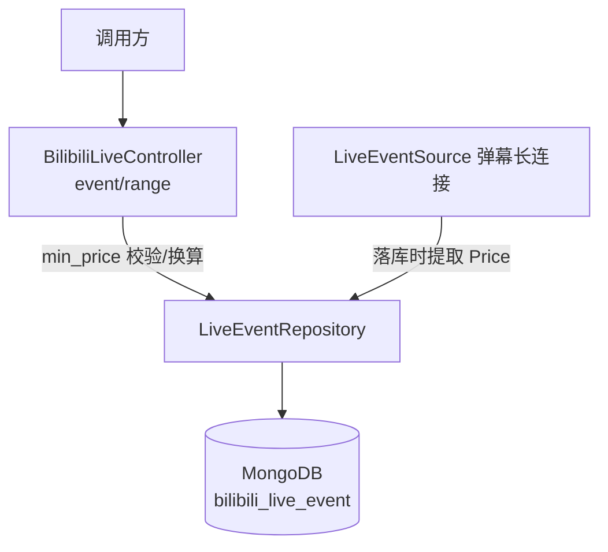
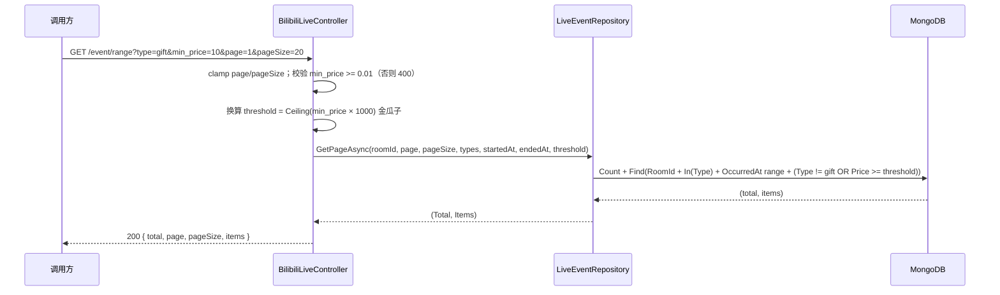

# 礼物事件金额筛选 - 技术提案

**功能名称**: 礼物事件金额筛选
**关联 PRD**: `docs/product/draft/20260817-gift-min-price-filter-prd.md`
**技术提案版本**: v1.0
**创建日期**: 2026-08-17
**作者**: Deliay
**feat-branch**: `impl/gift-min-price-filter`

## 1. 概述

### 1.1 背景

依据关联 PRD，需要让礼物事件查询支持按最低金额筛选。现状盘点：

| 项 | 现状 | 问题 |
|----|------|------|
| `GET /api/b/live/{roomId}/event/range` | `LiveEventRepository.GetPageAsync` 支持 RoomId + 类型集合 + 可选 OccurredAt 范围 + 分页 | 无金额维度过滤，礼物事件只能全量拉回后客户端自行筛选 |
| 礼物金额数据 | 礼物事件金额存在于原始 payload JSON（`SEND_GIFT`/`COMBO_SEND` 的 `data.price`，单位金瓜子，1 元 = 1000 金瓜子），落库实体 `LiveEventRecord` 无金额字段 | MongoDB 无法对 JSON 字符串 payload 内的数值做高效范围过滤 |

### 1.2 目标

- `event/range` 新增可选参数 `min_price`（元，最小 0.01），仅过滤礼物（`gift`）类型事件，金额低于该值的礼物不返回；不传不限制。
- 礼物事件落库时提取金额到实体字段，仓储层用范围条件过滤，`total` 为筛选后真实条数。
- 全程 TDD，核心逻辑单元测试覆盖率 ≥ 80%。

### 1.3 范围

**做：**

- `contracts/bilibili-crawler.openapi.yaml`：`event/range` 新增 `min_price` 参数契约。
- `LiveEventRecord` 新增 `Price` 字段（long，金瓜子）；落库链路从 payload 提取礼物金额。
- `LiveEventRepository.GetPageAsync` 增加金额下限过滤。
- `BilibiliLiveController` 的 `event/range` 端点接收、校验 `min_price` 并透传。
- 仓储层、参数处理与提取逻辑的测试补齐。

**不做：**

- 不改 `event/subscribe`（本期不对订阅推送做金额过滤）。
- 不回填历史数据：历史礼物事件无 `Price` 字段，按金额 0 处理（PRD 已明确该语义）。
- 不改变事件归一化规则与事件响应结构，不做前端改动。

## 2. 技术架构

### 2.1 系统架构图



### 2.2 技术栈

| 层级 | 技术选型 | 说明 |
|------|---------|------|
| 后端 | C# / .NET 10, ASP.NET Core Web API | 沿用现有 |
| 数据库 | MongoDB（Aspire.MongoDB.Driver + MongoDB.Driver） | 沿用现有 |
| 契约 | OpenAPI YAML（`contracts/`） | 后端为实现基准 |
| 测试 | xUnit + Testcontainers | 沿用现有 |

### 2.3 模块划分

| 模块 | 职责 | 关键技术点 |
|------|------|-----------|
| `Controllers/BilibiliLiveController` | `min_price` 接收与校验，元 → 金瓜子换算 | `decimal?` 绑定；`< 0.01` → 400；`Ceiling(min_price × 1000)` 转 long |
| `Live/GiftPriceExtractor`（新增） | 从礼物 payload JSON 提取金额（金瓜子） | `System.Text.Json` 读 `data.price`，仅 `coin_type=gold` 计金额 |
| `Live/LiveEventSource` | 落库时调用提取器填充 `Price` | 仅 `type == "gift"` 时提取，其余类型 `Price = 0` |
| `Persistence/LiveEventRepository` | 组合金额下限过滤 | `Ne(Type, "gift") \| Gte(Price, threshold)`，Count 与 Find 共用过滤条件 |

## 3. API 设计

### 3.1 API 契约

#### 接口 1: 直播事件分页查询（增强）

- **请求**
  - Method: GET
  - Path: `/api/b/live/{roomId}/event/range`
  - Query 参数（仅列新增，既有 `page`/`pageSize`/`type`/`startedAt`/`endedAt` 不变）：
    | 参数 | 类型 | 必填 | 说明 |
    |------|------|------|------|
    | `min_price` | number | 否 | 礼物金额下限（元），最小 0.01；仅作用于 `gift` 类型事件，含边界；不传不限制 |
- **响应**：200 + 既有分页结构（`total`/`page`/`pageSize`/`items`），结构不变。
- **过滤语义**：`min_price` 传入时，礼物事件需满足「金额 ≥ min_price」才返回；非礼物类型事件不受 `min_price` 影响，照常返回。
- **错误**：`min_price < 0.01` 或无法解析为数值 → 400：
  ```json
  { "type": "https://tools.ietf.org/html/rfc9110#section-15.5.1", "title": "Bad Request", "status": 400, "detail": "min_price must be at least 0.01." }
  ```

#### 请求/响应示例

- `GET /api/b/live/1727076670/event/range?type=gift&min_price=10&page=1&pageSize=20` → 200，仅含金额 ≥ 10 元的礼物事件，`total` 为筛选后真实条数。
- `GET /api/b/live/1727076670/event/range?type=danmaku&type=gift&min_price=10` → 200，弹幕照常返回，礼物仅返回金额 ≥ 10 元部分。
- `GET /api/b/live/1727076670/event/range?type=gift` （不传 `min_price`）→ 200，全部礼物事件，与现状一致。
- `GET /api/b/live/1727076670/event/range?min_price=0.001` → 400。

### 3.2 内部接口

```csharp
// LiveEventRepository：新增可选金额下限（金瓜子）
Task<(long Total, IReadOnlyList<LiveEventRecord> Items)> GetPageAsync(
    long roomId, int page, int pageSize,
    IReadOnlyCollection<string>? types = null,
    DateTime? startedAt = null, DateTime? endedAt = null,
    long? minPriceGoldSeeds = null,
    CancellationToken ct = default);

// GiftPriceExtractor（新增，静态）
static long ExtractGoldSeeds(string type, string payload);
// type != "gift" → 0；解析失败或非付费（coin_type != "gold"）→ 0；否则返回 data.price
```

## 4. 数据模型

### 4.1 数据库设计

集合 `bilibili_live_event`（实体 `LiveEventRecord`）新增一个字段：

| 字段 | 类型 | 说明 |
|------|------|------|
| Price | long | 礼物金额（金瓜子，1 元 = 1000 金瓜子）；仅 `gift` 类型写入，其余类型与历史缺省记录视为 0 |

- 历史数据不回填：缺省 `Price` 的既有记录按 0 处理，传入 `min_price` 时不返回（PRD 3.5 已明确）。
- 索引：复用既有 `RoomId asc + OccurredAt asc`，不新增索引（见 6.1 决策）。

### 4.2 缓存设计

无缓存，直接查询 MongoDB。

## 5. 技术实现方案

### 5.1 核心流程



落库流程：`LiveEventSource` 在 `InsertAsync` 前调用 `GiftPriceExtractor.ExtractGoldSeeds(liveEvent.Type, liveEvent.Payload)` 填充 `LiveEventRecord.Price`，其余链路（总线发布、SSE 推送）不变。

### 5.2 关键实现点

#### 实现点 1: 金额提取

- **描述**: `GiftPriceExtractor` 用 `JsonDocument` 解析 payload，读取 `data.price`（金瓜子）；仅当 `type == "gift"` 且 `data.coin_type == "gold"`（付费）时返回该值，其余情况（非礼物、免费银瓜子礼物、解析失败）返回 0。
- **风险点**: B 站原始 payload 中 `price` 字段语义（单价/总价）需在集成测试中用真实样本核对；若为单价需乘以 `data.num`，提取器内单点修正即可，不影响其他模块。

#### 实现点 2: 参数校验与换算

- **描述**: Controller 以 `[FromQuery] decimal? min_price` 接收（参数名按需求约定为蛇形 `min_price`）；`< 0.01m` → 400 `min_price must be at least 0.01.`；换算 `threshold = (long)Math.Ceiling(min_price.Value * 1000m)`，用 `decimal` 运算避免浮点误差；换算结果传入仓储。
- **风险点**: OpenAPI 契约中该参数需与需求命名严格一致（`min_price`），不随既有 camelCase 参数风格改名。

#### 实现点 3: 仓储层金额过滤

- **描述**: `minPriceGoldSeeds` 非空时叠加过滤 `Ne(Type, "gift") | Gte(Price, threshold)`——即「非礼物事件不受限，礼物事件需达标」；`CountDocuments` 与 `Find` 共用同一过滤条件，保证 `total` 与 `items` 一致；排序维持既有 `OccurredAt` 降序。
- **风险点**: 无（过滤条件叠加为既有模式）。

## 6. 技术决策

### 6.1 决策列表

| 决策 | 选项 A | 选项 B | 最终选择 | 原因 |
|------|--------|--------|---------|------|
| 金额存储形式 | 提取为独立字段（金瓜子 long） | 查询时 `$where`/聚合解析 payload JSON | A | JSON 字符串内数值无法走索引且解析代价高；独立字段过滤简单高效 |
| 金额单位 | 存金瓜子（long） | 存元（decimal/double） | A | 源数据即金瓜子整数，避免浮点精度问题；换算集中在 Controller 单点 |
| 历史数据处理 | 不回填，缺省按 0 | 启动时解析 payload 幂等回填 | A | PRD 已明确「历史缺金额信息视为 0」语义；回填需全量解析历史 payload，代价大于收益 |
| min_price 作用范围 | 仅过滤 gift 类型，其他类型不受影响 | 传入 min_price 时强制只返回 gift | A | PRD 明确语义；与其他筛选条件正交叠加，行为可预期 |
| 是否新增金额索引 | 复用既有 `RoomId+OccurredAt` | 新增 `RoomId+Type+Price` 复合索引 | A | 主谓词 `RoomId` 等值已大幅收敛扫描范围；单直播间单场事件量级（十万级）下范围过滤代价可接受，后续实测不达标再补 |
| 提取时机 | 落库时提取 | 查询时提取 | A | 一次提取多次查询；查询路径零额外开销 |

### 6.2 依赖与约束

| 类型 | 内容 | 说明 |
|------|------|------|
| 依赖 | 礼物事件原始 payload 含 `data.price`/`data.coin_type` | Mikibot 弹幕长连接 `SEND_GIFT`/`COMBO_SEND` 原始 JSON |
| 约束 | 参数命名 `min_price`、最小 0.01、不传不限制 | 需求约定，不可更改 |
| 约束 | 契约先行 | 先更新 `contracts/bilibili-crawler.openapi.yaml` 再实现 |
| 约束 | TDD，核心逻辑覆盖率 ≥ 80% | `docs/engineering/common-rules.md` |

## 7. 项目结构

```
servers/api/
├── Controllers/
│   └── BilibiliLiveController.cs        # event/range 接收/校验 min_price，元→金瓜子换算
├── Live/
│   ├── GiftPriceExtractor.cs            # 新增：从礼物 payload 提取金额（金瓜子）
│   └── LiveEventSource.cs               # 落库时填充 Price
├── Persistence/
│   ├── Entities/LiveEventRecord.cs      # 新增 Price 字段
│   └── LiveEventRepository.cs           # GetPageAsync 增加金额下限过滤
contracts/
└── bilibili-crawler.openapi.yaml        # event/range 新增 min_price 参数契约
tests/Z.Vtuber.Tests/                    # 提取逻辑/参数校验/组合过滤边界测试
```

## 8. 测试策略

### 8.1 测试覆盖要求

- 单元测试覆盖率: >= 80%（核心逻辑）
- API 测试覆盖的端点: `GET /api/b/live/{roomId}/event/range`

### 8.2 测试类型

| 类型 | 工具 | 覆盖范围 |
|------|------|---------|
| 单元测试（金额提取） | xUnit | 付费礼物提取正确、免费礼物（silver）→ 0、非 gift 类型 → 0、payload 解析失败 → 0 |
| 单元测试（参数处理） | xUnit | `min_price` 元→金瓜子换算（含 Ceiling）、`< 0.01` → 400、边界 0.01 合法 |
| 集成测试（仓储层） | xUnit + Testcontainers Mongo | 金额含边界过滤、min_price 与 type/时间叠加、非 gift 类型不受限、缺省 Price（历史记录）按 0 处理、total 正确、翻页不重不漏 |
| API 测试 | z-test 工作流 | `type=gift&min_price` 筛选、不传 `min_price` 行为回归、`min_price < 0.01` → 400 |

## 9. 部署方案

### 9.1 环境规划

| 环境 | 用途 | 部署方式 |
|------|------|---------|
| 本地开发 | 开发/调试 | Aspire 编排（z-aspire-orchestrator） |
| 测试 | 集成/API 测试 | Testcontainers |

### 9.2 配置管理

无新增配置项，无数据迁移（历史数据不回填），随服务正常发布即可。

## 10. 验收标准

- [ ] 技术方案评审通过
- [ ] Contract 评审通过（`event/range` 新增 `min_price` 参数）
- [ ] 代码实现完成
- [ ] 单元测试覆盖达标（≥80%）
- [ ] API 测试通过（金额筛选 + 不传参数兼容性回归）

## 11. 相关文档

- 关联 PRD：`docs/product/draft/20260817-gift-min-price-filter-prd.md`
- 关联 Contract：`contracts/bilibili-crawler.openapi.yaml`
- 开发规范：`docs/engineering/common-rules.md`、`docs/engineering/backend-rules.md`
- 既有提案：`docs/engineering/proposals/20260815-proposal-live-event-filter.md`
