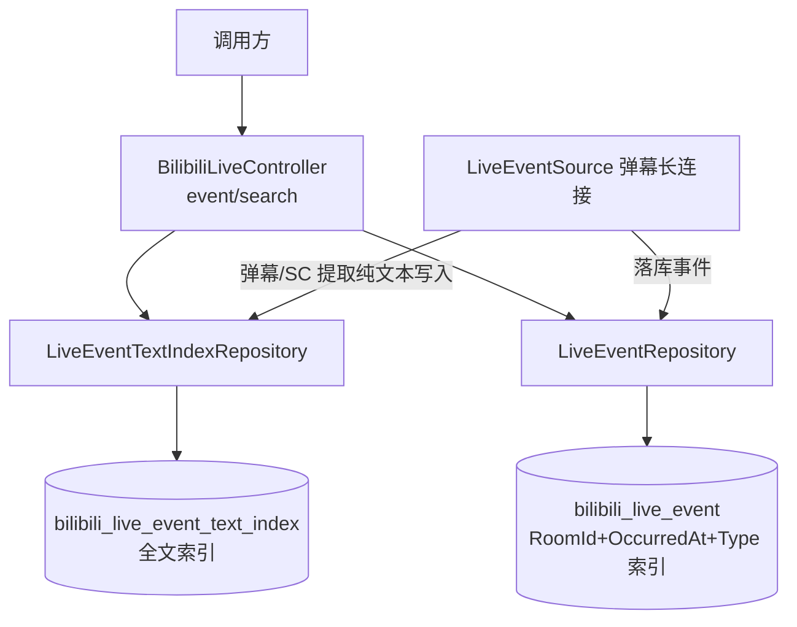
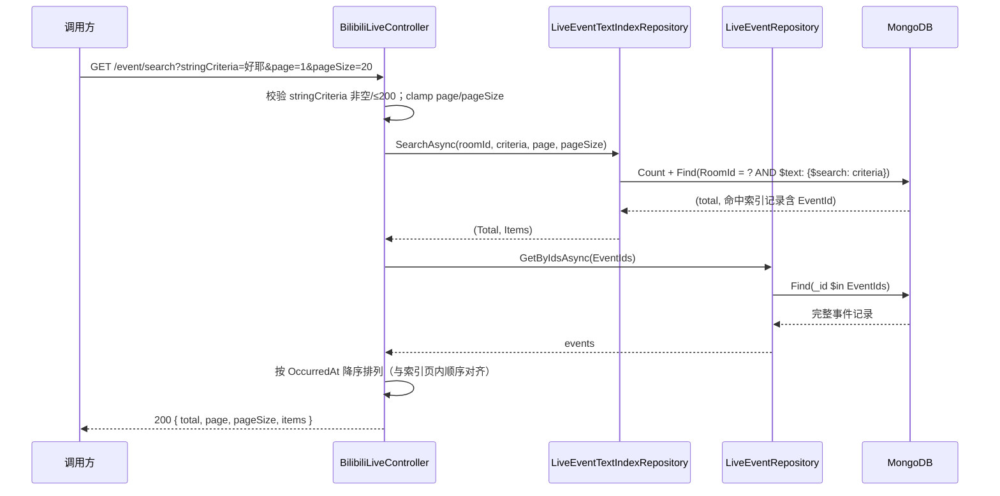

# 直播文字事件搜索 - 技术提案

**功能名称**: 直播文字事件搜索
**关联 PRD**: `docs/product/draft/20260819-live-event-text-search-prd.md`
**技术提案版本**: v1.0
**创建日期**: 2026-08-19
**作者**: Deliay
**feat-branch**: `prd/live-event-text-search`（需求总分支；实现分支另行切出）

## 1. 概述

### 1.1 背景

依据关联 PRD，需要提供直播文字事件（弹幕、SC）的全文搜索能力，并保障多类型事件筛选查询的性能。现状盘点：

| 项 | 现状 | 问题 |
|----|------|------|
| `GET /api/b/live/{roomId}/event/range` | `LiveEventRepository.GetPageAsync` 支持 RoomId + 类型集合 `$in` + 可选 OccurredAt 范围 + Count/Find 分页，排序固定 OccurredAt 降序 | 传入多个 type 时，既有索引（`RoomId+OccurredAt`、`RoomId+Type+OccurredAt`、`RoomId+Type+Price+OccurredAt`）均无法同时服务「多类型 `$in` + 时间排序」，Mongo 需内存排序，数据量增长后劣化 |
| 弹幕/SC 文字内容 | 文字存在于原始 payload JSON（`DANMU_MSG` 的 `info[1]`、`SUPER_CHAT_MESSAGE` 的 `data.message`），落库实体 `LiveEventRecord` 无纯文本字段 | 无法对 JSON 字符串 payload 做全文检索 |
| 搜索接口 | 无 | 调用方只能全量拉取后客户端自行匹配 |

### 1.2 目标

- `bilibili_live_event` 新增 `RoomId + OccurredAt + Type` 复合索引；`event/range` 传入多个 type 时强制按时间排序，让 Mongo 走该索引流式输出有序结果。
- 新增纯文本索引集合 `bilibili_live_event_text_index`：落库弹幕/SC 的纯文本与 `event_id`，建全文索引，支持按关键词反查事件。
- 新增 `GET /api/b/live/{roomId}/event/search`：入参 `roomId + stringCriteria`，搜索索引集合后 join 事件集合，分页返回完整事件。
- 全程 TDD，核心逻辑单元测试覆盖率 ≥ 80%。

### 1.3 范围

**做：**

- `MongoDbInitializer`：`bilibili_live_event` 新增 `RoomId asc + OccurredAt desc + Type asc` 索引；新建 `bilibili_live_event_text_index` 集合及 `{ RoomId: 1, Text: "text" }` 复合全文索引。
- `LiveEventRepository.GetPageAsync`：多类型筛选时强制按 OccurredAt 排序（维持既有降序语义），确保走新索引。
- 新增 `LiveEventTextExtractor`：从弹幕/SC payload 提取纯文本。
- `LiveEventSource`：落库事件时对弹幕/SC 同步写入文本索引记录。
- `MongoDbInitializer`：历史弹幕/SC 事件的文本索引幂等回填（沿用 `Meta` 标记 + 分批模式）。
- 新增 `LiveEventTextIndexRepository`：全文搜索、按 EventId 计数与分页。
- `contracts/bilibili-crawler.openapi.yaml`：新增 `event/search` 端点契约。
- `BilibiliLiveController`：新增 `event/search` 端点，校验入参并组装分页结果。
- 仓储层、提取逻辑与参数校验的测试补齐。

**不做：**

- 不改 `event/subscribe`（订阅推送不做文本过滤）。
- 不支持弹幕/SC 以外类型的文本搜索。
- 不做前端改动；不做相关性排序（`$text` score 不暴露），排序固定按发生时间倒序。

## 2. 技术架构

### 2.1 系统架构图



### 2.2 技术栈

| 层级 | 技术选型 | 说明 |
|------|---------|------|
| 后端 | C# / .NET 10, ASP.NET Core Web API | 沿用现有 |
| 数据库 | MongoDB（Aspire.MongoDB.Driver + MongoDB.Driver） | 沿用现有；全文检索用 MongoDB 原生 text index |
| 契约 | OpenAPI YAML（`contracts/`） | 后端为实现基准 |
| 测试 | xUnit + Testcontainers | 沿用现有 |

### 2.3 模块划分

| 模块 | 职责 | 关键技术点 |
|------|------|-----------|
| `Persistence/MongoDbInitializer` | 新索引与新集合创建；历史文本回填 | `EnsureLiveEventIndexesAsync` 扩展；新增 `EnsureLiveEventTextIndexAsync` 与 `BackfillLiveEventTextIndexAsync` |
| `Live/LiveEventTextExtractor`（新增） | 从 payload 提取弹幕/SC 纯文本 | `System.Text.Json`；弹幕取 `info[1]`，SC 取 `data.message` |
| `Live/LiveEventSource` | 落库时同步写文本索引 | 事件 `InsertAsync` 成功后，弹幕/SC 类型提取文本写入索引集合 |
| `Persistence/LiveEventTextIndexRepository`（新增） | 全文搜索分页 | `$text: { $search }` + RoomId 等值过滤 + Count/Find 分页 |
| `Persistence/LiveEventRepository` | 多类型查询走新索引；按 Id 批量取事件 | 多 type 时强制 `SortByDescending(OccurredAt)`；新增 `GetByIdsAsync` |
| `Controllers/BilibiliLiveController` | `event/search` 端点 | `stringCriteria` 校验；索引命中 → join 事件 → 时间倒序输出 |

## 3. API 设计

### 3.1 API 契约

#### 接口 1: 直播文字事件搜索（新增）

- **请求**
  - Method: GET
  - Path: `/api/b/live/{roomId}/event/search`
  - Query 参数：
    | 参数 | 类型 | 必填 | 说明 |
    |------|------|------|------|
    | `stringCriteria` | string | 是 | 搜索关键词，非空且非纯空白，最大 200 字符；在弹幕/SC 纯文本中全文检索 |
    | `page` | integer | 否 | 页码，从 1 开始，默认 1 |
    | `pageSize` | integer | 否 | 每页条数，1–100，默认 20 |
- **响应**：200 + 既有分页结构（与 `event/range` 一致）：
  ```json
  {
    "total": 42,
    "page": 1,
    "pageSize": 20,
    "items": [
      { "roomId": 1727076670, "type": "danmaku", "occurredAt": "2026-08-18T12:00:00Z", "liveSessionId": "...", "payload": { } }
    ]
  }
  ```
  `items` 按 `occurredAt` 降序，事件结构与 `event/range` 完全一致。
- **错误**：`stringCriteria` 缺失、为空、仅空白或超过 200 字符 → 400：
  ```json
  { "error": "stringCriteria must be non-empty and at most 200 characters." }
  ```

#### 请求/响应示例

- `GET /api/b/live/1727076670/event/search?stringCriteria=好耶&page=1&pageSize=20` → 200，返回该直播间文字内容命中「好耶」的弹幕/SC 事件，`total` 为命中真实条数。
- `GET /api/b/live/1727076670/event/search?stringCriteria=不存在的词xyz` → 200，`items` 为空、`total` 为 0。
- `GET /api/b/live/1727076670/event/search?stringCriteria=` → 400。

#### 接口 2: 直播事件分页查询（行为增强）

- `GET /api/b/live/{roomId}/event/range` 契约不变；传入多个 `type` 时服务端强制按 `occurredAt` 排序查询（与既有降序语义一致），走 `RoomId+OccurredAt+Type` 索引，仅性能行为变化。

### 3.2 内部接口

```csharp
// LiveEventTextExtractor（新增，静态）
static string? ExtractText(string type, string payload);
// type == "danmaku"    → info[1]（弹幕纯文本）
// type == "super_chat" → data.message（SC 纯文本）
// 其他类型 / 解析失败 / 文本为空 → null

// LiveEventTextIndexRepository（新增）
Task InsertAsync(LiveEventTextIndexRecord record, CancellationToken ct = default);
Task<(long Total, IReadOnlyList<LiveEventTextIndexRecord> Items)> SearchAsync(
    long roomId, string criteria, int page, int pageSize, CancellationToken ct = default);

// LiveEventRepository：新增按 Id 批量查询（join 用）
Task<IReadOnlyList<LiveEventRecord>> GetByIdsAsync(
    IReadOnlyCollection<ObjectId> ids, CancellationToken ct = default);
```

## 4. 数据模型

### 4.1 数据库设计

**集合 `bilibili_live_event`（既有）** 新增一个复合索引：

| 索引 | 字段 | 说明 |
|------|------|------|
| 新增 | `RoomId asc + OccurredAt desc + Type asc` | RoomId 等值定位直播间；OccurredAt 作为第二键使索引顺序即结果顺序，多 type `$in` 落在尾部键上做索引级过滤，免除内存排序 |

**集合 `bilibili_live_event_text_index`（新增）**，实体 `LiveEventTextIndexRecord`：

| 字段 | 类型 | 说明 |
|------|------|------|
| Id | ObjectId | 主键 |
| EventId | ObjectId | 反查 `bilibili_live_event._id` |
| RoomId | long | 直播间号，等值过滤前缀 |
| Type | string | 仅 `danmaku` / `super_chat` |
| Text | string | 弹幕/SC 纯文本 |
| OccurredAt | DateTime (UTC) | 事件发生时间，用于命中结果排序与回填去重 |

索引：

| 索引 | 字段 | 说明 |
|------|------|------|
| 全文复合索引 | `RoomId asc + Text text` | MongoDB 复合 text 索引支持等值前缀：先按 RoomId 收敛，再在文本键上 `$text` 检索（每集合仅允许一个 text 索引） |
| 唯一索引 | `EventId asc`（unique） | 保证一次事件只产生一条索引记录，回填幂等 |

### 4.2 缓存设计

无缓存，直接查询 MongoDB。

## 5. 技术实现方案

### 5.1 核心流程

**搜索流程：**



**多类型查询索引命中（event/range）：** `types.Count > 1` 时强制 `SortByDescending(e => e.OccurredAt)`（既有排序本就为时间降序，此处为显式保证并固定 hint 语义）。Mongo 使用 `RoomId asc + OccurredAt desc + Type asc` 索引：RoomId 等值收敛，沿 OccurredAt 键有序扫描即得降序结果，Type `$in` 在尾部键上做索引过滤，无需 SORT 阶段。单类型与无类型查询维持现有计划不变。

**落库写索引流程：** `LiveEventSource` 在事件 `InsertAsync` 成功后，调用 `LiveEventTextExtractor.ExtractText(type, payload)`；返回非空时向 `bilibili_live_event_text_index` 写入 `{ EventId, RoomId, Type, Text, OccurredAt }`（`EventId` 唯一索引兜底重复写入，冲突忽略）。总线发布、SSE 推送链路不变。

**历史回填：** `MongoDbInitializer.BackfillLiveEventTextIndexAsync` 沿用 `BackfillGiftPriceAsync` 模式：`Meta` 集合标记 `live_event_text_index_backfill_v1`，分批（500）扫描 `type $in [danmaku, super_chat]` 的事件，提取文本后批量 upsert 索引记录，完成后写入标记；启动时幂等执行。

### 5.2 关键实现点

#### 实现点 1: 纯文本提取

- **描述**: `LiveEventTextExtractor` 用 `JsonDocument` 解析 payload：弹幕取 `info[1]`（`DANMU_MSG` 协议第二位为弹幕内容），SC 取 `data.message`；仅 `danmaku`/`super_chat` 类型处理，解析失败、字段缺失或文本为空白时返回 `null`（不写索引）。
- **风险点**: Mikibot 透传的 `RawContent` 结构需在集成测试中用真实样本核对 `info` 数组形态（部分协议版本 `info` 为嵌套数组）；若结构偏差，提取器内单点修正即可。

#### 实现点 2: 全文搜索与 join 分页

- **描述**: 分页在索引集合上完成：`$text: { $search: criteria }` + `RoomId` 等值过滤，Count 得 `total`，Skip/Limit 得当前页索引记录（含 EventId 与 OccurredAt）；再用 `_id $in` 批量取事件，按索引记录的 OccurredAt 顺序还原排序。索引记录查询按 `OccurredAt desc, Id desc` 排序保证翻页稳定。
- **风险点**: MongoDB text 索引默认按空格分词，对中文整串匹配依赖子串短语语义有限——`$text` 对 CJK 的支持是按二元组（bigram）切分，可满足关键词子串检索场景；精确短语可用 `$search: "\"短语\""` 透传，契约中不额外暴露该语法，由实现期验证后决定是否转义。

#### 实现点 3: 多类型查询索引保障

- **描述**: `GetPageAsync` 中当 `types is { Count: > 1 }` 时显式保持 `SortByDescending(OccurredAt)` 并对 Find 附加该索引 hint（`Builders<LiveEventRecord>.IndexKeys` 常量复用），确保规划器选中 `RoomId+OccurredAt+Type` 索引；用 `explain()` 在集成测试中验证无 SORT 阶段。
- **风险点**: 尾部 `$in` 过滤的索引扫描量在「时间范围窄、类型稀疏」场景可能偏大；如出现实测不达标，再评估 `RoomId+Type+OccurredAt` 多计划 union 方案，本期按需求约定实现。

## 6. 技术决策

### 6.1 决策列表

| 决策 | 选项 A | 选项 B | 最终选择 | 原因 |
|------|--------|--------|---------|------|
| 全文检索引擎 | MongoDB 原生 text index | 引入 Elasticsearch/Meilisearch | A | 需求为单字段关键词检索，原生 text 索引零新增基础设施，运维成本最低 |
| 索引键序（多类型查询） | `RoomId+OccurredAt+Type` | `RoomId+Type+OccurredAt` | A | 需求指定 RoomId-时间-Type；多 type `$in` 场景下时间键在前可保序输出免除内存排序 |
| 文本存储 | 独立索引集合 + EventId 反查 | `LiveEventRecord` 增加 Text 字段 | A | 需求明确独立索引表；主集合不被搜索需求侵入，非文字事件零冗余 |
| join 方式 | 索引集合分页后 `_id $in` 批量取事件 | MongoDB `$lookup` 聚合 | A | 分页在索引侧先收敛，`$in` 批量取主键简单高效；`$lookup` 无法对 join 后结果高效分页计数 |
| 历史数据 | 启动时幂等回填 | 仅索引新数据 | A | PRD 要求历史事件可搜索；回填沿用既有 Meta 标记模式，幂等可重入 |
| 结果排序 | 按 OccurredAt 降序 | 按 text score 相关性 | A | 与既有事件查询语义一致，行为可预期 |

### 6.2 依赖与约束

| 类型 | 内容 | 说明 |
|------|------|------|
| 依赖 | 弹幕/SC 原始 payload 含 `info[1]` / `data.message` | Mikibot 弹幕长连接原始 JSON |
| 约束 | 搜索入参 `roomId + stringCriteria`，stringCriteria ≤ 200 字符 | 需求约定，不可更改 |
| 约束 | MongoDB 每集合仅允许一个 text 索引 | 全文索引字段固定为 `Text`，后续扩展需重建索引 |
| 约束 | 契约先行 | 先更新 `contracts/bilibili-crawler.openapi.yaml` 再实现 |
| 约束 | TDD，核心逻辑覆盖率 ≥ 80% | `docs/engineering/common-rules.md` |

## 7. 项目结构

```
servers/api/
├── Controllers/
│   └── BilibiliLiveController.cs              # 新增 event/search 端点
├── Live/
│   ├── LiveEventTextExtractor.cs              # 新增：弹幕/SC 纯文本提取
│   └── LiveEventSource.cs                     # 落库时同步写文本索引
├── Persistence/
│   ├── Entities/LiveEventTextIndexRecord.cs   # 新增：文本索引实体
│   ├── LiveEventTextIndexRepository.cs        # 新增：全文搜索分页仓储
│   ├── LiveEventRepository.cs                 # GetByIdsAsync；多 type 强制时间排序+hint
│   └── MongoDbInitializer.cs                  # 新索引/新集合/历史回填
contracts/
└── bilibili-crawler.openapi.yaml              # 新增 event/search 契约
tests/Z.Vtuber.Tests/                          # 提取/校验/搜索/索引计划测试
```

## 8. 测试策略

### 8.1 测试覆盖要求

- 单元测试覆盖率: >= 80%（核心逻辑）
- API 测试覆盖的端点: `GET /api/b/live/{roomId}/event/search`、`GET /api/b/live/{roomId}/event/range`（回归）

### 8.2 测试类型

| 类型 | 工具 | 覆盖范围 |
|------|------|---------|
| 单元测试（文本提取） | xUnit | 弹幕取 `info[1]` 正确、SC 取 `data.message` 正确、非文字类型 → null、解析失败 → null、空白文本 → null |
| 单元测试（参数校验） | xUnit | stringCriteria 空/纯空白/超 200 → 400；边界 200 合法 |
| 集成测试（仓储层） | xUnit + Testcontainers Mongo | 全文搜索命中/无命中、RoomId 隔离、分页不重不漏、total 真实、EventId 唯一约束、join 后时间倒序、多 type 查询 explain 无 SORT 阶段 |
| 集成测试（回填） | xUnit + Testcontainers Mongo | 历史弹幕/SC 回填完整、重复执行幂等（Meta 标记） |
| API 测试 | z-test 工作流 | `event/search` 命中搜索、翻页、空关键词 400；`event/range` 多 type 行为回归 |

## 9. 部署方案

### 9.1 环境规划

| 环境 | 用途 | 部署方式 |
|------|------|---------|
| 本地开发 | 开发/调试 | Aspire 编排（z-aspire-orchestrator） |
| 测试 | 集成/API 测试 | Testcontainers |

### 9.2 配置管理

无新增配置项。发布时 `MongoDbInitializer` 自动创建新索引与新集合并执行历史文本回填（幂等）；数据量大的环境首次启动回填耗时需关注日志，回填期间新事件索引写入不受影响。

## 10. 验收标准

- [ ] 技术方案评审通过
- [ ] Contract 评审通过（`event/search` 新增）
- [ ] 代码实现完成
- [ ] 单元测试覆盖达标（≥80%）
- [ ] API 测试通过（搜索命中/翻页/参数错误 + 多 type 查询回归）
- [ ] 历史弹幕/SC 事件可被搜索命中（回填验证）

## 11. 相关文档

- 关联 PRD：`docs/product/draft/20260819-live-event-text-search-prd.md`
- 关联 Contract：`contracts/bilibili-crawler.openapi.yaml`
- 开发规范：`docs/engineering/common-rules.md`、`docs/engineering/backend-rules.md`
- 既有提案：`docs/engineering/proposals/20260815-proposal-live-event-filter.md`、`docs/engineering/proposals/20260817-proposal-gift-min-price-filter.md`
