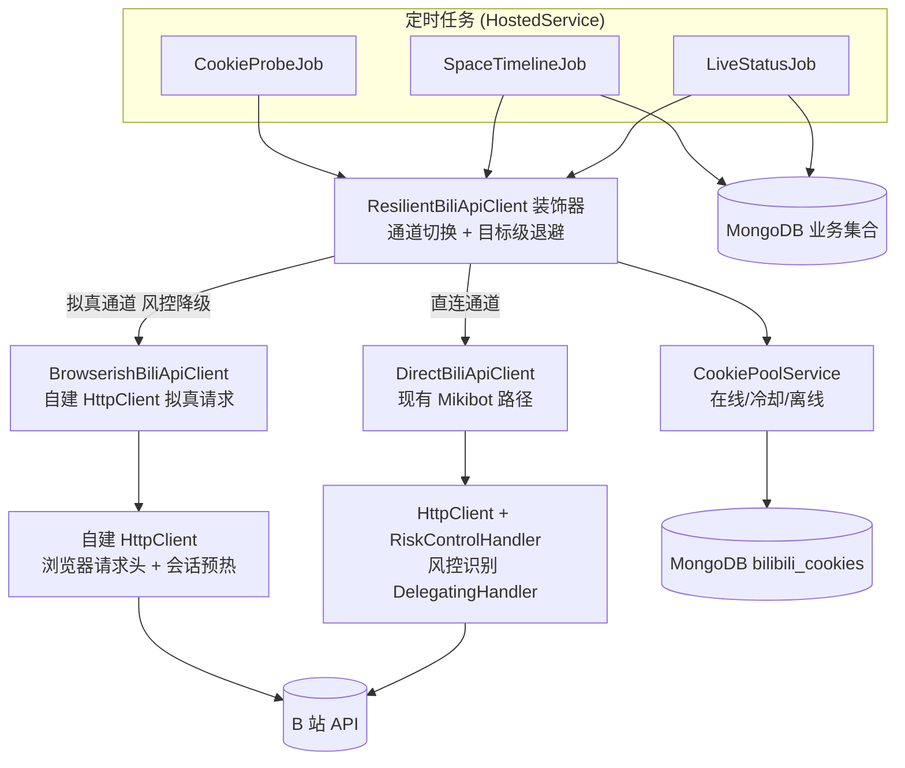
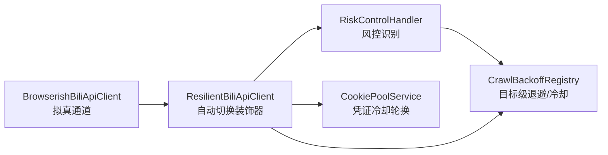
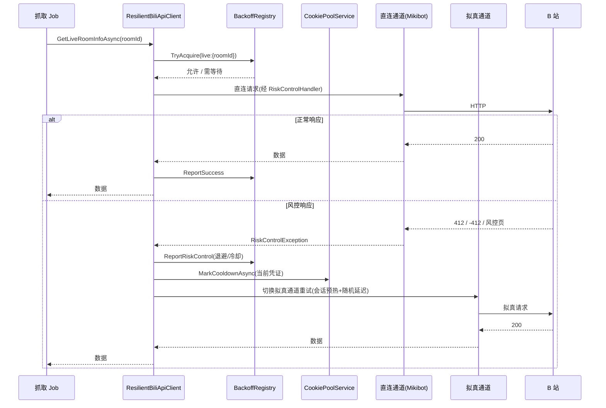

# B 站抓取 412 风控修复 - 技术提案

**功能名称**: B 站抓取 412 风控修复
**关联 PRD**: `docs/product/draft/20260820-bilibili-412-fix-prd.md`
**技术提案版本**: v1.0
**创建日期**: 2026-08-20
**作者**: Deliay
**feat-branch**: `prd/bilibili-412-fix`（需求总分支；实现分支另行切出）

## 1. 概述

### 1.1 背景

抓取链路近期频繁收到 B 站 HTTP 412 响应（「触发哔哩哔哩安全风控策略」），数据采集中断。参考社区修复实践（[lidaxiao issue #2](https://github.com/worldhello-bj/lidaxiao/issues/2) / [PR #3](https://github.com/worldhello-bj/lidaxiao/pull/3)，其核心为「双抓取模式 + 自动切换 + 请求拟真化 + 限速退避」），结合本项目现状定位根因：

- `Crawlers/BiliApiClient.cs` 中直播间信息、Nav 探活、空间动态（wbi 签名）三类请求均经 `BilibiliAccountProvider` 构建的 per-cookie `HttpClient` 进入 **Mikibot.Crawler** 封装，项目代码对请求头、UA 有一定控制点（HttpClient 由我方构建后注入），但当前未设置任何拟真请求头；
- 全链路**无重试、无退避、无限速**：412 时 `EnsureSuccessStatusCode` 直接抛异常，被 Job catch 记日志后按原周期（如 `LiveStatusJob` 15s、`SpaceTimelineJob` 30s 连续翻页且页间无间隔）继续以机械节奏请求，持续加剧风控；
- Cookie 池（`Services/CookiePoolService.cs`）只有「在线/离线」两态，无「冷却」概念，风控与凭证无联动；
- `AccountInfoJob` 走第三方接口 `ukamnads.icu`，与 B 站风控无关，不在本次范围内。

### 1.2 目标

- 在 HTTP 层统一识别风控响应（HTTP 412 / 业务码 -412 / 风控页面特征），抛出专用的 `RiskControlException`；
- 抓取失败时按目标维度指数退避 + 随机抖动 + 冷却，替代当前的固定周期硬重试；
- `IBiliApiClient` 增加「拟真通道」（完整浏览器请求头 + 会话预热 + 拟人延迟）与自动降级装饰器：直连触发风控时自动切换，恢复后自动回升；
- Cookie 池扩展「冷却」状态，风控触发时冷却当前凭证并轮换；
- 全部参数配置化，可通过配置开关回退到现状行为。

### 1.3 范围

- **做**：直播间状态（`GetLiveRoomInfoAsync`）、Nav 探活（`GetNavInfoV2Async`）、空间动态（`GetSpaceDynamicsAsync`）三条 B 站链路的风控识别、退避、双通道切换、凭证冷却与观测日志；
- **不做**：
  - `GetAccountInfoDataAsync`（第三方接口 ukamnads.icu，与 B 站风控无关）；
  - HTML 页面解析式抓取（拟真通道仍调用 JSON 接口，仅请求特征拟真；HTML 解析作为后续备选）；
  - 代理 IP 池；
  - 对外 API 契约变更（`contracts/bilibili-crawler.openapi.yaml` 不变）。

## 2. 技术架构

### 2.1 系统架构图



### 2.2 技术栈

| 层级 | 技术选型 | 说明 |
|------|---------|------|
| 后端 | .NET / C#（现有栈） | 复用现有 Job / Crawler / Cookie 池结构 |
| HTTP | `System.Net.Http` + `DelegatingHandler` | 风控识别与退避挂在现有 HttpClient 管线上 |
| 浏览器拟真 | 自建 `HttpClient` + 完整 Chrome 请求头 | 不引入 Playwright 等重型浏览器栈 |
| 重试退避 | 自研轻量退避注册表 | 不新增 Polly 依赖（见 6.1 决策） |
| 数据库 | MongoDB（现有） | Cookie 池记录扩展冷却字段 |
| 测试 | xUnit + 自研 mock `HttpMessageHandler` + Testcontainers | 补齐 HTTP 层测试模式 |

### 2.3 模块划分



| 模块 | 职责 | 关键技术点 |
|------|------|-----------|
| `RiskControlHandler` | 识别 412/-412/风控页面，抛 `RiskControlException` | `DelegatingHandler`，对普通错误零侵入 |
| `CrawlBackoffRegistry` | 按目标（roomId/mid/cookie）维护退避等级、下次可请求时刻、冷却期 | 指数退避 + 随机抖动，内存态，进程重启即重置 |
| `ResilientBiliApiClient` | `IBiliApiClient` 装饰器：直连优先，风控时降级拟真通道，联动退避与凭证冷却 | 装饰器模式，对 Job 透明 |
| `BrowserishBiliApiClient` | 拟真通道实现：Chrome 请求头、Referer、buvid3 会话预热、2–5s 随机延迟 | 复用相同 JSON 接口，输出模型一致 |
| `CookiePoolService` 扩展 | 凭证三态：在线/冷却/离线；冷却到期自动恢复 | 复用现有 round-robin 与探活 |

## 3. API 设计

### 3.1 API 契约

不新增、不修改对外接口，`contracts/bilibili-crawler.openapi.yaml` 保持不变。前端与数据消费方无感知。

### 3.2 内部接口

#### `RiskControlException`

```csharp
public sealed class RiskControlException : HttpRequestException
{
    public string Target { get; }        // 触发目标标识（roomId/mid/nav 探活等）
    public string? CookieTag { get; }    // 脱敏凭证标识（如哈希前 8 位）
    public TimeSpan? RetryAfter { get; } // 响应头携带时透出
}
```

#### `CrawlBackoffRegistry`

```csharp
public interface ICrawlBackoffRegistry
{
    bool TryAcquire(string key, out TimeSpan wait);   // 是否允许立即请求；否则给出需等待时长
    void ReportSuccess(string key);                    // 成功：退避等级清零
    void ReportRiskControl(string key);                // 风控：退避等级+1，必要时进入冷却
}
```

退避参数（默认值，配置化）：基础间隔 `BackoffBaseSeconds=30`，倍率 2，单次上限 `BackoffMaxMinutes=15`，连续触发 ≥ 5 次进入冷却 `CooldownMinutes=30`，抖动 ±25%。

#### `CookiePoolService` 扩展

```csharp
Task MarkCooldownAsync(string cookie, TimeSpan duration); // 风控冷却：区别于 MarkOfflineAsync
```

`bilibili_cookies` 文档增加 `CooldownUntil`（DateTime?）字段；`NextAsync` 选择条件追加 `CooldownUntil <= now 或为空`；`CookieProbeJob` 对冷却中的凭证跳过探活（不误标离线），到期后由探活自然恢复。

#### 通道选择

```csharp
public enum BiliFetchMode { Direct, Browser, Auto } // 配置 BilibiliCrawler:FetchMode，默认 Auto
```

`ResilientBiliApiClient` 在 `Auto` 下：目标未处于风控状态时走直连；收到 `RiskControlException` 后该目标降级到拟真通道并记录，连续成功 N 次（默认 3）后回升直连。

## 4. 数据模型

### 4.1 数据库设计

#### 集合: `bilibili_cookies`（扩展现有）

| 字段 | 类型 | 说明 |
|------|------|------|
| `CooldownUntil` | DateTime? | 风控冷却截止时间；空或过期即视为可分配；旧文档缺省为 null，向后兼容 |

其余业务集合不变。退避状态（`CrawlBackoffRegistry`）为进程内存态，不落库：进程重启后从正常节奏重新开始，可接受。

### 4.2 缓存设计

不涉及缓存变更。退避注册表 key 约定：`live:{roomId}`、`space:{mid}`、`nav:{cookieHash8}`，与现有 `CrawlLockProvider` 的锁 key 对齐。

## 5. 技术实现方案

### 5.1 核心流程



### 5.2 关键实现点

#### 实现点 1: `RiskControlHandler`（风控识别）

- **描述**: 以 `DelegatingHandler` 挂入 `BilibiliAccountProvider` 构建的 HttpClient 管线（直连通道与 Cookie 探活共用）。识别三类信号：HTTP 状态码 412；JSON 响应体 `code == -412`；HTML 响应包含「安全风控」「错误号: 412」等特征。命中即抛 `RiskControlException`。
- **技术细节**: 识别逻辑为纯函数 `RiskControlClassifier`，独立单测；handler 只做转发与调用分类器。Mikibot 内部若先一步将 412 包成其自有异常，则在 `ResilientBiliApiClient` 中对该异常类型做等价映射（实现时先验证 Mikibot 1.0.8 对非 2xx 的行为）。
- **风险点**: 风控判定误判会把正常业务错误引入退避流程——分类器保持严格（仅上述三类信号），误判宁可漏不可错。

#### 实现点 2: `BrowserishBiliApiClient`（拟真通道）

- **描述**: 自建 `HttpClient`，设置完整 Chrome 请求头（`User-Agent`、`Accept`、`Accept-Language`、`Sec-Ch-Ua` 系列、`Referer: https://www.bilibili.com/` 等），首次请求前访问 `https://www.bilibili.com/` 预热会话获取 `buvid3` cookie，随后以相同 JSON 接口取数；请求间加 2–5s 随机延迟。
- **技术细节**: 直播间信息用 `x/space/wbi/arc/search` 之外的公开接口等价物——实际映射：直播状态 `xlive/web-room/v1/index/getInfoByRoom`，Nav `x/nav/wbi`（复用现有 wbi 签名），空间动态沿用 `x/polymer/web-dynamic/v1/feed/space`。输出模型与直连通道完全一致。
- **风险点**: 拟真头随 B 站策略演化可能失效——UA 等头部配置化，便于不改代码调整；该通道吞吐低，仅作降级手段而非常态。

#### 实现点 3: `CrawlBackoffRegistry`（退避与冷却）

- **描述**: 内存 `ConcurrentDictionary` 维护每个 key 的退避等级与下次可请求时刻；`TryAcquire` 返回需等待时长，Job 收到后本轮直接跳过（不阻塞调度线程）；连续风控达阈值进入 30 分钟冷却。
- **技术细节**: 指数退避 + ±25% 抖动，成功即清零；与 `PeriodicJobBase` 的定时周期解耦——周期照常触发，只是退避期内空转。
- **风险点**: 内存态在进程重启后丢失，重启初期可能再次触发风控——可接受，风控识别链路会立刻重新建立退避。

#### 实现点 4: 凭证冷却联动

- **描述**: `ResilientBiliApiClient` 捕获风控后调用 `CookiePoolService.MarkCooldownAsync` 冷却当前凭证，下次 `NextAsync` 自动轮换其他凭证；`CookieProbeJob` 跳过冷却中的凭证，避免探活失败将其误标离线。
- **技术细节**: 冷却时长默认 30 分钟（配置化）；全部凭证不可用时 Job 记录 Warning 级日志并整体退避。
- **风险点**: 凭证池较小时轮换空间有限，风控期可用性仍受限——属运营补充凭证的范畴，日志中明确提示。

## 6. 技术决策

### 6.1 决策列表

| 决策 | 选项 A | 选项 B | 最终选择 | 原因 |
|------|--------|--------|---------|------|
| 风控识别挂载点 | `DelegatingHandler` 挂入我方构建的 HttpClient | 在 Mikibot 调用外逐个 try-catch 判断 | A | 单点识别、对 Job 透明；项目本就控制 HttpClient 构建，无需绕过 Mikibot |
| 拟真通道取数方式 | 拟真请求头 + 原 JSON 接口 | HTML 页面解析（lidaxiao PR #3 方式） | A | 字段准确性与直连一致、维护成本低；HTML 解析脆，仅作后续备选 |
| 重试退避组件 | 自研轻量注册表 | 引入 Polly | A | 退避需跨 Job 周期持久（内存注册表）且与凭证冷却联动，Polly 管道模式不贴合；不新增依赖 |
| 凭证风控处置 | 扩展现有 Cookie 池加冷却态 | 独立风控凭证组件 | A | 复用 round-robin 与探活，改动最小 |
| 浏览器模拟深度 | 请求级拟真（头 + cookie 预热 + 延迟） | 引入 Playwright 真实浏览器 | A | 无头浏览器部署重、资源消耗大，与收益不成比例 |

### 6.2 依赖与约束

| 类型 | 内容 | 说明 |
|------|------|------|
| 依赖 | Mikibot.Crawler 1.0.8 | 需先验证其对非 2xx 响应的异常行为，决定识别落在 handler 还是异常映射 |
| 依赖 | 现有 `BilibiliAccountProvider` / `CookiePoolService` / `PeriodicJobBase` | 在其上扩展，不重构 |
| 约束 | 不新增对外 API、不改 openapi 契约 | 前端无感知 |
| 约束 | 不新增第三方依赖 | 退避、拟真通道均基于 BCL |
| 约束 | 风控策略由 B 站侧控制 | 关键参数（频率、退避、UA）全部配置化 |

## 7. 项目结构

```
servers/api/
├── Crawlers/
│   ├── BiliApiClient.cs                 # 现有，改为 DirectBiliApiClient 角色（保留类名，由装饰器包装）
│   ├── BrowserishBiliApiClient.cs       # 新增：拟真通道
│   ├── ResilientBiliApiClient.cs        # 新增：自动切换装饰器（IBiliApiClient）
│   ├── RiskControlHandler.cs            # 新增：风控识别 DelegatingHandler + RiskControlClassifier
│   ├── RiskControlException.cs          # 新增
│   └── CrawlBackoffRegistry.cs          # 新增：目标级退避/冷却注册表
├── Configuration/
│   └── BilibiliCrawlerOptions.cs        # 扩展：FetchMode/退避/冷却/拟真头参数
├── Services/
│   └── CookiePoolService.cs             # 扩展：MarkCooldownAsync + NextAsync 过滤冷却
├── Jobs/
│   └── CookieProbeJob.cs                # 调整：跳过冷却中凭证
└── appsettings.json                     # 新增 BilibiliCrawler 节配置项（保守默认值）

tests/Z.Vtuber.Tests/
├── RiskControlClassifierTests.cs        # 新增：412/-412/风控页/误判用例
├── CrawlBackoffRegistryTests.cs         # 新增：退避曲线/抖动/冷却
├── ResilientBiliApiClientTests.cs       # 新增：mock HttpMessageHandler 验证切换与回升
├── BrowserishBiliApiClientTests.cs      # 新增：请求头与会话预热断言
└── CookiePoolServiceTests.cs            # 扩展：冷却轮换用例（Testcontainers）
```

## 8. 测试策略

### 8.1 测试覆盖要求

- 新增类型（分类器、退避注册表、装饰器、拟真通道）单元测试覆盖主要分支；
- HTTP 层测试采用自研 mock `HttpMessageHandler`（项目此前无 HTTP 层测试，本次建立该模式）；
- 既有测试（`dotnet test tests/Z.Vtuber.Tests`，近期 190/190 通过）不得因本次改动回归。

### 8.2 测试类型

| 类型 | 工具 | 覆盖范围 |
|------|------|---------|
| 单元测试 | xUnit + mock HttpMessageHandler | 风控识别正/误判、退避曲线与冷却、通道切换与回升、拟真请求头 |
| 集成测试 | xUnit + Testcontainers (Mongo) | Cookie 冷却字段、轮换与探活跳过 |
| 手工验证 | 本地 Aspire 编排起服务 | 配置 `FetchMode=Browser` 实测抓取；注入 mock 412 验证自动恢复链路 |

## 9. 部署方案

### 9.1 环境规划

| 环境 | 用途 | 部署方式 |
|------|------|---------|
| 本地 | 开发验证 | Aspire 编排（现状） |
| 生产 | 正式运行 | 现有 Docker 镜像流水线（`release` 分支触发），配置经环境变量/appsettings 下发 |

### 9.2 配置管理

`BilibiliCrawler` 配置节新增（默认值取保守侧，均可环境变量覆盖）：

| 配置项 | 默认值 | 说明 |
|--------|--------|------|
| `FetchMode` | `Auto` | `Direct` / `Browser` / `Auto` |
| `BackoffBaseSeconds` | `30` | 退避基础间隔 |
| `BackoffMaxMinutes` | `15` | 单次退避上限 |
| `CooldownMinutes` | `30` | 目标/凭证冷却时长 |
| `BrowserMinDelaySeconds` / `BrowserMaxDelaySeconds` | `2` / `5` | 拟真通道随机延迟区间 |
| `BrowserUserAgent` | Chrome 120 UA | 拟真通道 UA，可在线调整 |

回退开关：`FetchMode=Direct` 且关闭退避配置即等价于现状行为。

## 10. 验收标准

- [ ] 技术方案评审通过
- [ ] 注入 412 响应时抓取链路自动退避并切换拟真通道，恢复后自动回升直连（手工验证记录）
- [ ] 凭证风控冷却与轮换经集成测试验证
- [ ] 单元测试覆盖风控识别、退避、通道切换主要分支，既有测试无回归
- [ ] 对外契约不变（`contracts/bilibili-crawler.openapi.yaml` 无 diff）
- [ ] 风控事件日志包含目标、通道、脱敏凭证标识、退避时长

## 11. 相关文档

- 关联 PRD: `docs/product/draft/20260820-bilibili-412-fix-prd.md`
- 参考问题: [lidaxiao issue #2 — Bilibili 412 错误](https://github.com/worldhello-bj/lidaxiao/issues/2)
- 参考修复: [lidaxiao PR #3 — 双模式（API/浏览器模拟）支持](https://github.com/worldhello-bj/lidaxiao/pull/3)
- 开发规范: `docs/engineering/common-rules.md`、`servers/api/AGENTS.md`
