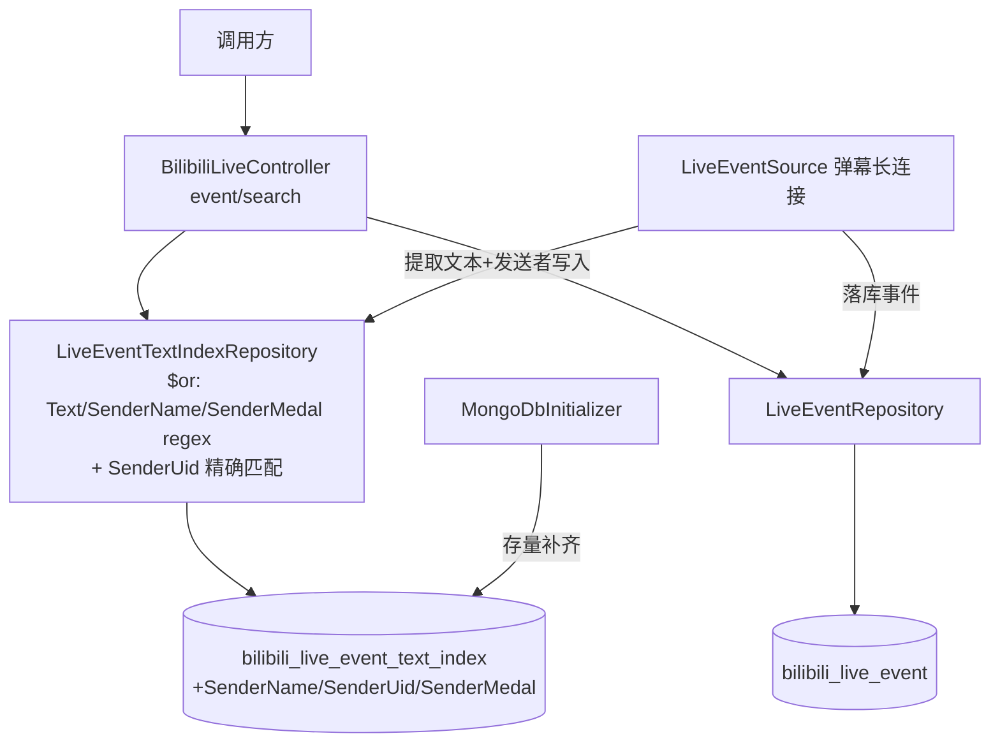
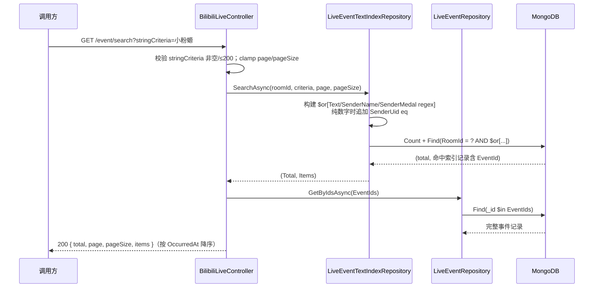

# 直播事件发送者信息搜索 - 技术提案

**功能名称**: 直播事件发送者信息搜索
**关联 PRD**: `docs/product/draft/20260820-live-event-sender-search-prd.md`
**技术提案版本**: v1.0
**创建日期**: 2026-08-20
**作者**: Deliay
**feat-branch**: `prd/live-event-sender-search`（需求总分支；实现分支另行切出）

## 1. 概述

### 1.1 背景

依据关联 PRD，文字事件搜索需在纯文本之外沉淀并可检索发送者的用户名、UID、粉丝牌。现状盘点：

| 项 | 现状 | 问题 |
|----|------|------|
| 索引集合 `bilibili_live_event_text_index` | 实体 `LiveEventTextIndexRecord` 仅含 `EventId/RoomId/Type/Text/OccurredAt` | 无发送者维度，无法按人检索 |
| 提取器 `LiveEventTextExtractor` | 仅从 payload 提取纯文本（弹幕 `info[1]`、SC `data.message`） | 发送者信息（弹幕 `info[2]`/`info[3]`、SC `data.uid`/`data.user_info`/`data.medal_info`）未提取 |
| 搜索 `LiveEventTextIndexRepository.SearchAsync` | 仅对 `Text` 做 regex 子串匹配 | 用户名/粉丝牌/UID 不参与匹配 |
| 历史回填 | `BackfillLiveEventTextIndexAsync`（Meta 标记 `live_event_text_index_backfill_v1`）已执行完毕 | 存量索引记录缺发送者字段 |

### 1.2 目标

- `LiveEventTextIndexRecord` 新增 `SenderName`（用户名）、`SenderUid`、`SenderMedal`（粉丝牌名）三个字段；落库写索引时同步提取沉淀。
- `SearchAsync` 匹配范围扩展为 `Text`/`SenderName`/`SenderMedal` 任一 regex 子串命中；`stringCriteria` 为纯数字时额外 `SenderUid` 精确匹配。
- 新增发送者字段回填（Meta 标记 + 分批模式），存量索引记录补齐三字段。
- 全程 TDD，核心逻辑单元测试覆盖率 ≥ 80%。

### 1.3 范围

**做：**

- `LiveEventTextExtractor`：重构为同时提取纯文本与发送者三元素（单次解析 payload）。
- `LiveEventTextIndexRecord`：新增 `SenderName`/`SenderUid`/`SenderMedal` 字段。
- `LiveEventSource`：落库写索引时写入发送者字段。
- `LiveEventTextIndexRepository.SearchAsync`：`$or` 组合文本/用户名/粉丝牌 regex 匹配 + 纯数字关键词 UID 精确匹配。
- `MongoDbInitializer`：新增 `BackfillLiveEventSenderAsync`，对存量索引记录按 EventId 重建（ReplaceOne upsert）补齐发送者字段。
- `contracts/bilibili-crawler.openapi.yaml`：更新 `event/search` 与 `StringCriteria` 描述（匹配范围扩大，契约结构不变）。
- 提取、搜索匹配、回填的测试补齐。

**不做：**

- 不改搜索接口路径、入参、分页与返回结构。
- 不在返回 DTO 中冗余发送者字段（命中事件 payload 已含完整发送者信息）。
- 不支持弹幕/SC 以外类型；不做粉丝牌等级、UID 子串匹配。

## 2. 技术架构

### 2.1 系统架构图



### 2.2 技术栈

| 层级 | 技术选型 | 说明 |
|------|---------|------|
| 后端 | C# / .NET 10, ASP.NET Core Web API | 沿用现有 |
| 数据库 | MongoDB（Aspire.MongoDB.Driver + MongoDB.Driver） | 沿用现有；regex 残余过滤方案不变 |
| 契约 | OpenAPI YAML（`contracts/`） | 后端为实现基准 |
| 测试 | xUnit + Testcontainers | 沿用现有 |

### 2.3 模块划分

| 模块 | 职责 | 关键技术点 |
|------|------|-----------|
| `Live/LiveEventTextExtractor` | 提取纯文本 + 发送者三元素 | `System.Text.Json` 单次解析；弹幕取 `info[2][0]`(uid)/`info[2][1]`(uname)/`info[3][1]`(medal)，SC 取 `data.uid`/`data.user_info.uname`/`data.medal_info.medal_name` |
| `Persistence/Entities/LiveEventTextIndexRecord` | 索引实体扩展 | 新增 `SenderName`/`SenderUid`/`SenderMedal` |
| `Live/LiveEventSource` | 落库时写发送者字段 | 复用既有写索引位置，填充新字段 |
| `Persistence/LiveEventTextIndexRepository` | 多维度搜索 | `$or` regex + 纯数字 UID 等值；沿用 SearchIndexName hint 与排序 |
| `Persistence/MongoDbInitializer` | 存量发送者补齐 | 新增 Meta 标记 `live_event_text_index_sender_backfill_v1`，分批重建 |

## 3. API 设计

### 3.1 API 契约

#### 接口 1: 直播文字事件搜索（行为增强，契约结构不变）

- `GET /api/b/live/{roomId}/event/search`：路径、入参（`stringCriteria`/`page`/`pageSize`）、分页与返回结构均不变。
- 仅匹配范围扩大：`stringCriteria` 在弹幕/SC 的纯文本、发送者用户名、粉丝牌名称中做不区分大小写的子串匹配，任一命中即返回；`stringCriteria` 为纯数字时额外按发送者 UID 精确匹配。
- 契约变更仅为描述性文本：`event/search` 的 `summary`/`description` 与 `StringCriteria` 参数的 `description` 更新匹配范围说明。
- **错误**：`stringCriteria` 缺失、为空、仅空白或超过 200 字符 → 400（不变）。

#### 请求/响应示例

- `GET /api/b/live/1727076670/event/search?stringCriteria=Zero_Ash` → 200，返回发送者用户名命中「Zero_Ash」的弹幕/SC 事件。
- `GET /api/b/live/1727076670/event/search?stringCriteria=小粉螈` → 200，返回佩戴粉丝牌「小粉螈」的发送者的弹幕/SC 事件（与文本命中结果取合集）。
- `GET /api/b/live/1727076670/event/search?stringCriteria=403496` → 200，返回 UID 为 403496 的发送者的弹幕/SC 事件（与文本/用户名/粉丝牌命中结果取合集）。

### 3.2 内部接口

```csharp
// LiveEventTextExtractor（重构）
// 单次解析 payload，同时提取纯文本与发送者三元素；Text 为空时整体视为无索引价值（维持既有语义）
public sealed record LiveEventTextExtraction(string Text, string SenderName, long SenderUid, string SenderMedal);
static LiveEventTextExtraction? Extract(string type, string payload);
// 弹幕: Text=info[1], SenderUid=info[2][0], SenderName=info[2][1], SenderMedal=info[3][1]（info[3] 为空数组时 Medal=""）
// SC:   Text=data.message, SenderUid=data.uid, SenderName=data.user_info.uname, SenderMedal=data.medal_info.medal_name
// 其他类型 / 解析失败 / Text 空白 → null；发送者字段缺失时对应字段取空（Uid=0、Name/Medal=""），不因此丢弃记录

// LiveEventTextIndexRepository.SearchAsync（签名不变，匹配逻辑扩展）
// filter = RoomId eq AND $or[ Text regex, SenderName regex, SenderMedal regex, (纯数字时) SenderUid eq ]
```

## 4. 数据模型

### 4.1 数据库设计

**集合 `bilibili_live_event_text_index`（既有）**，实体 `LiveEventTextIndexRecord` 新增三个字段：

| 字段 | 类型 | 说明 |
|------|------|------|
| SenderName | string | 发送者用户名；缺失时为空串 |
| SenderUid | long（`BsonRepresentation(Int64)`） | 发送者 UID；缺失时为 0 |
| SenderMedal | string | 发送者粉丝牌（勋章）名称；未佩戴或缺失时为空串 |

索引不变：沿用 `{ RoomId: 1, OccurredAt: -1, Id: -1 }`（`SearchIndexName`，RoomId 等值收敛 + 有序扫描，`$or` regex 作残余过滤）与 `EventId` 唯一索引。发送者字段不另建索引——与既有 Text regex 一致，均为索引有序扫描后的残余过滤，数据量级（单直播间十万级）下满足百毫秒要求。

### 4.2 缓存设计

无缓存，直接查询 MongoDB。

## 5. 技术实现方案

### 5.1 核心流程

**搜索流程（匹配范围扩展）：**



**落库写索引流程：** `LiveEventSource` 在事件 `InsertAsync` 成功后调用 `LiveEventTextExtractor.Extract(type, payload)`；返回非空时写入 `{ EventId, RoomId, Type, Text, SenderName, SenderUid, SenderMedal, OccurredAt }`（`EventId` 唯一索引兜底，冲突忽略）。总线发布、SSE 推送链路不变。

**存量补齐：** `MongoDbInitializer.BackfillLiveEventSenderAsync` 沿用 v1 回填模式：Meta 标记 `live_event_text_index_sender_backfill_v1`，基于 `_id` 游标分批（500）扫描 `type $in [danmaku, super_chat]` 的事件，重新提取文本与发送者字段，按 `EventId` ReplaceOne upsert 重建索引记录（与 v1 回填同构，天然覆盖「v1 已回填但缺发送者字段」与「增量漏写」两类存量），完成后写入标记；启动时在 v1 回填之后幂等执行。

### 5.2 关键实现点

#### 实现点 1: 发送者三元素提取

- **描述**: 重构 `ExtractText` 为 `Extract`，单次 `JsonDocument` 解析同时取文本与发送者字段。提取路径（均经真实样本验证，见下）：
  - 弹幕（`DANMU_MSG`）：`info[2]` 为 `[uid, uname, ...]` 数组，取 `info[2][0]`（number→long）、`info[2][1]`（string）；`info[3]` 为勋章数组，非空时取 `info[3][1]`（勋章名），空数组表示未佩戴 → `SenderMedal=""`。
  - SC（`SUPER_CHAT_MESSAGE`）：`data.uid`（number→long）、`data.user_info.uname`、`data.medal_info.medal_name`。
- **真实样本验证（方案期已验证）**: 通过内网已部署环境 `http://vtuber.internal.fffdan.com` 拉取直播间 `1727076670` 真实数据（弹幕总量 20.6 万+、SC 总量 1300+）抽样核对：
  - 弹幕样本：`info[2]=[403496,"Zero_Ash",...]`、`info[3]=[25,"小粉螈","枝堇Sumire",...]`，未佩戴勋章的弹幕 `info[3]=[]` —— 路径与空值语义成立；
  - SC 样本：`data.uid=663620883`、`data.user_info.uname="lxl-lxl"`、`data.medal_info.medal_name="小粉螈"` —— 路径成立。
- **风险点**: 已消除——提取路径经真实样本验证；实现期以单元测试覆盖 `info[2]`/`info[3]` 缺失、长度不足、类型异常、`medal_info` 缺失等退化样本（发送者字段缺失降级为空值，不丢弃记录）。

#### 实现点 2: 多维度匹配与纯数字 UID 识别

- **描述**: `SearchAsync` 中 regex 转义逻辑（`Regex.Escape` + `i` 选项）复用于 `Text`/`SenderName`/`SenderMedal` 三个字段，以 `Filter.Or` 组合；`stringCriteria` 满足「全部字符为 ASCII 数字且 `long.TryParse` 成功」时追加 `SenderUid eq` 子句。排序（`OccurredAt desc, Id desc`）、`SearchIndexName` hint、Skip/Limit 分页不变。
- **风险点**: `$or` 多分支均为 regex 残余过滤，索引仍负责 RoomId 收敛与时间有序扫描，单直播间十万级数据量下扫描量与现状同量级；如实测不达标，再评估为 `SenderName`/`SenderMedal` 建独立索引的多计划方案，本期按需求约定实现。UID 误伤：纯数字关键词（如「233」）会同时命中 UID=233 的用户与文本含「233」的内容，此为 PRD 约定的合集语义，非缺陷。

#### 实现点 3: 存量补齐与 v1 回填的关系

- **描述**: 新回填独立于 v1 标记执行，ReplaceOne upsert 按 `EventId` 重建整条索引记录（含 Text 与发送者字段），对 v1 已建记录是补齐、对漏建记录是补建，幂等可重入。
- **风险点**: 回填期间新旧记录并存——未补齐的旧记录发送者字段为空，仅文本可命中；补齐完成后语义完整，回填耗时需关注日志（与 v1 回填一致）。

## 6. 技术决策

### 6.1 决策列表

| 决策 | 选项 A | 选项 B | 最终选择 | 原因 |
|------|--------|--------|---------|------|
| 发送者字段存储 | 索引集合内嵌三个标量字段 | 独立发送者集合 join | A | 一事件一发送者，标量内嵌零 join 成本；与 Text 沉淀同构 |
| 匹配方式 | `$or` regex 残余过滤（沿用现状） | 为发送者字段另建索引 | A | 与 Text 检索同方案、同量级性能；regex 语义（子串、忽略大小写）与现状一致 |
| UID 匹配 | 纯数字关键词精确匹配 | UID 也做子串匹配 | A | UID 为精确标识，子串匹配噪声大；PRD 约定精确匹配 |
| 提取器改造 | 重构为单次解析返回完整提取结果 | 新增独立 SenderExtractor 二次解析 | A | 单次解析避免双重 JSON 解析开销，提取逻辑内聚 |
| 存量补齐 | ReplaceOne upsert 重建整条索引记录 | UpdateOne `$set` 仅补发送者字段 | A | 与 v1 回填同构，同时覆盖漏建记录；幂等语义简单 |
| 契约变更 | 仅更新描述文本 | 新增返回字段/新端点 | A | 返回结构为完整事件，payload 已含发送者信息，无冗余必要 |

### 6.2 依赖与约束

| 类型 | 内容 | 说明 |
|------|------|------|
| 依赖 | 弹幕 payload 含 `info[2]`/`info[3]`、SC payload 含 `data.uid`/`data.user_info`/`data.medal_info` | Mikibot 弹幕长连接原始 JSON；已经内网环境真实数据验证（见 5.2 实现点 1） |
| 依赖 | 内网已部署环境 `http://vtuber.internal.fffdan.com` | 可拉取真实弹幕/SC 数据，用于方案验证与测试样本来源 |
| 依赖 | v1 文本回填已完成（Meta 标记 `live_event_text_index_backfill_v1`） | 发送者补齐在其后执行 |
| 约束 | 搜索入参 `roomId + stringCriteria`，stringCriteria ≤ 200 字符 | 需求约定，不可更改 |
| 约束 | 契约先行 | 先更新 `contracts/bilibili-crawler.openapi.yaml` 描述再实现 |
| 约束 | TDD，核心逻辑覆盖率 ≥ 80% | `docs/engineering/common-rules.md` |

## 7. 项目结构

```
servers/api/
├── Controllers/
│   └── BilibiliLiveController.cs              # 不变（校验与组装逻辑复用）
├── Live/
│   ├── LiveEventTextExtractor.cs              # 重构：单次解析提取文本+发送者三元素
│   └── LiveEventSource.cs                     # 写索引时填充发送者字段
├── Persistence/
│   ├── Entities/LiveEventTextIndexRecord.cs   # 新增 SenderName/SenderUid/SenderMedal
│   ├── LiveEventTextIndexRepository.cs        # $or 多维匹配 + 纯数字 UID 精确匹配
│   └── MongoDbInitializer.cs                  # 新增 BackfillLiveEventSenderAsync
contracts/
└── bilibili-crawler.openapi.yaml              # event/search 与 StringCriteria 描述更新
tests/Z.Vtuber.Tests/                          # 提取/匹配/回填测试
```

## 8. 测试策略

### 8.1 测试覆盖要求

- 单元测试覆盖率: >= 80%（核心逻辑）
- API 测试覆盖的端点: `GET /api/b/live/{roomId}/event/search`

### 8.2 测试类型

| 类型 | 工具 | 覆盖范围 |
|------|------|---------|
| 单元测试（提取） | xUnit | 弹幕 `info[2]`/`info[3]` 提取正确、`info[3]=[]` → Medal 空、SC `data.uid`/`user_info.uname`/`medal_info.medal_name` 提取正确、字段缺失降级空值不丢记录、文本空白仍返回 null；样本取自内网环境真实 payload（见 6.2 依赖） |
| 单元测试（UID 识别） | xUnit | 纯数字且可解析为 long → 追加 UID 匹配；含非数字/超 long 范围 → 不追加 |
| 集成测试（仓储层） | xUnit + Testcontainers Mongo | 用户名/粉丝牌/文本任一命中返回、UID 精确命中、合集去重（一事件一记录）、RoomId 隔离、分页不重不漏、total 真实、空 Medal 不被粉丝牌关键词误命中 |
| 集成测试（回填） | xUnit + Testcontainers Mongo | 存量记录补齐发送者字段、漏建记录补建、重复执行幂等（Meta 标记） |
| 真实数据验证 | 内网已部署环境 | 实现完成后用真实弹幕/SC payload 核对提取结果（提取路径已于方案期验证，见 5.2 实现点 1） |
| API 测试 | z-test 工作流 | 按用户名/粉丝牌/UID 搜索命中、按文本搜索回归、翻页、空关键词 400 |

## 9. 部署方案

### 9.1 环境规划

| 环境 | 用途 | 部署方式 |
|------|------|---------|
| 本地开发 | 开发/调试 | Aspire 编排（z-aspire-orchestrator） |
| 测试 | 集成/API 测试 | Testcontainers |

### 9.2 配置管理

无新增配置项。发布时 `MongoDbInitializer` 自动执行发送者字段回填（幂等）；数据量大的环境首次启动回填耗时需关注日志，回填期间新事件索引写入（含发送者字段）不受影响。

## 10. 验收标准

- [ ] 技术方案评审通过
- [ ] Contract 评审通过（`event/search` 描述更新）
- [ ] 代码实现完成
- [ ] 单元测试覆盖达标（≥80%）
- [ ] API 测试通过（用户名/粉丝牌/UID 命中 + 文本搜索回归 + 参数错误）
- [ ] 历史索引记录发送者字段补齐并可被搜索命中（回填验证）

## 11. 相关文档

- 关联 PRD：`docs/product/draft/20260820-live-event-sender-search-prd.md`
- 关联 Contract：`contracts/bilibili-crawler.openapi.yaml`
- 开发规范：`docs/engineering/common-rules.md`、`docs/engineering/backend-rules.md`
- 既有提案：`docs/engineering/proposals/20260819-proposal-live-event-text-search.md`
