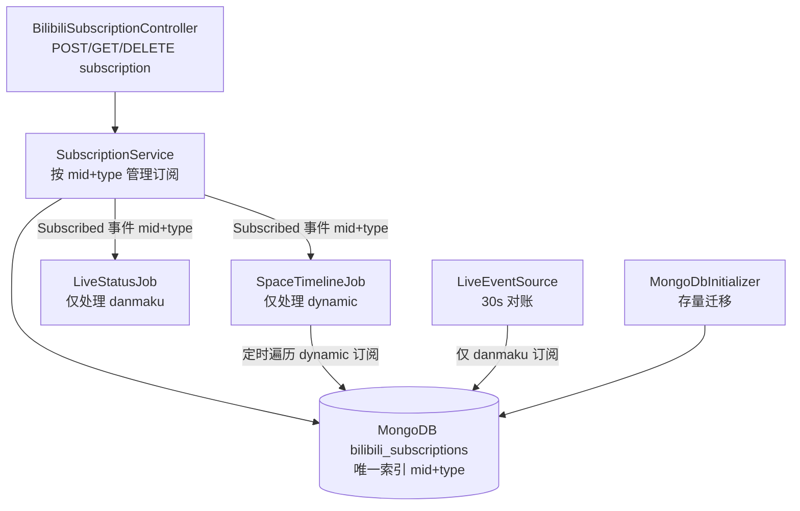
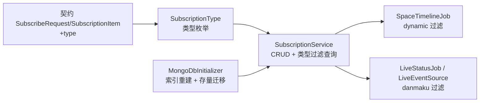
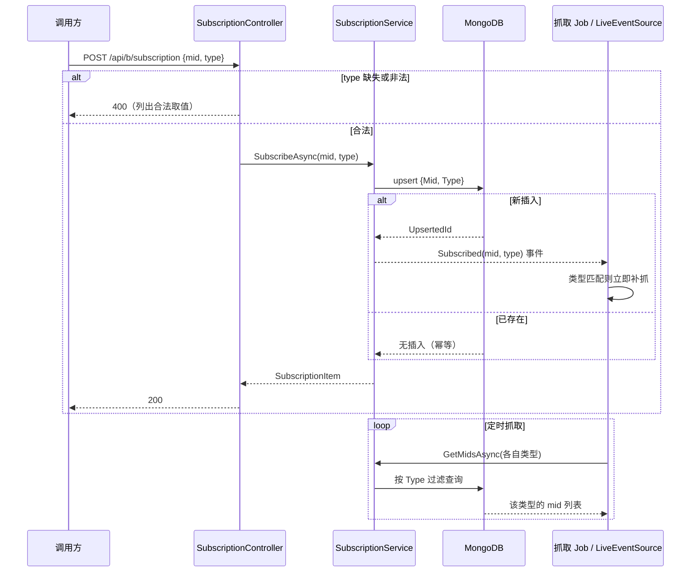

# 订阅抓取类型独立控制 - 技术提案

**功能名称**: 订阅抓取类型独立控制
**关联 PRD**: `docs/product/draft/20260820-subscription-crawl-type-prd.md`
**技术提案版本**: v1.0
**创建日期**: 2026-08-20
**作者**: Deliay
**feat-branch**: `feat/subscription-crawl-type`（需求总分支；实现分支另行切出）

## 1. 概述

### 1.1 背景

当前订阅一个 mid 后，两类抓取同时生效：

- **动态抓取**：`Jobs/SpaceTimelineJob.cs` 定时遍历 `SubscriptionService.GetMidsAsync()` 返回的全部 mid 抓取空间动态，并监听 `ISubscriptionService.Subscribed` 事件对新订阅即时补抓一次；
- **弹幕/直播事件抓取**：`Live/LiveEventSource.cs`（BackgroundService）每 30 秒对全部订阅 mid 做对账，经 `AccountBasicInfoRepository.GetLatestRoomIdByMidAsync` 解析 roomId 后维持弹幕 WebSocket 长连接；`Jobs/LiveStatusJob.cs` 同样监听 `Subscribed` 事件并抓取直播状态/场次。

订阅存储为 MongoDB 集合 `bilibili_subscriptions`（实体 `Persistence/Entities/SubscriptionRecord.cs`：`Id` / `Mid` / `SubscribedAt`），`Mid` 上有唯一索引（`Persistence/MongoDbInitializer.cs:45-51`）。订阅无类型维度，订阅方无法按需控制抓取范围。

### 1.2 目标

- 订阅记录扩展抓取类型（`dynamic` / `danmaku`），同一 mid 可按类型分别订阅；
- `POST /api/b/subscription` 请求体新增**必填** `type` 参数，缺失或非法返回 400；
- 动态抓取仅按 `dynamic` 订阅驱动，弹幕/直播状态抓取仅按 `danmaku` 订阅驱动；
- 存量订阅在启动时幂等迁移为「dynamic + danmaku」双订阅，行为与升级前一致；
- 更新 `contracts/bilibili-crawler.openapi.yaml` 契约。

### 1.3 范围

- **做**：订阅存储模型扩展、订阅 CRUD 的 type 维度、两条抓取链路的类型过滤、存量数据迁移、契约更新、测试覆盖；
- **不做**：
  - 新增除 `dynamic` / `danmaku` 之外的抓取类型（如账号信息类型化，留待后续）；
  - 抓取链路本身的风控、频率等治理（已由 412 修复提案覆盖）；
  - 前端界面变更（前端基于契约重新生成客户端，无页面改造）。

## 2. 技术架构

### 2.1 系统架构图



### 2.2 技术栈

| 层级 | 技术选型 | 说明 |
|------|---------|------|
| 后端 | .NET 10 / C#（现有栈） | Controller / Service / Job 就地扩展 |
| 数据库 | MongoDB（现有） | 集合扩展字段 + 复合唯一索引重建 + 幂等迁移 |
| 契约 | OpenAPI YAML（`contracts/`） | 后端为契约生成源，同步更新 |
| 测试 | xUnit + Testcontainers (Mongo) | 现有测试模式，集成测试覆盖迁移 |

### 2.3 模块划分



| 模块 | 职责 | 关键技术点 |
|------|------|-----------|
| `SubscriptionType` | 定义抓取类型：`Dynamic` / `Danmaku` | 字符串序列化落库（`"dynamic"`/`"danmaku"`），与契约一致 |
| `SubscriptionService` | 按 (mid, type) 幂等订阅；提供按类型查询 mid 列表 | `Subscribed` 事件载荷扩展为 (mid, type) |
| `SpaceTimelineJob` / `LiveStatusJob` / `LiveEventSource` | 仅处理各自类型的订阅 | 查询接口替换为按类型过滤版本 |
| `MongoDbInitializer` | 复合唯一索引 (mid, type) 重建；存量记录迁移为双类型 | 复用 `zvtuber_meta` 迁移标记模式 |

## 3. API 设计

### 3.1 API 契约

更新 `contracts/bilibili-crawler.openapi.yaml`。

#### 接口 1: 创建订阅（变更）

- **请求**
  - Method: POST
  - Path: /api/b/subscription
  - Body:
    ```json
    {
      "mid": 123456,
      "type": "dynamic"
    }
    ```
  - `SubscribeRequest` 变更：`required: [mid, type]`；`type` 为 string，`enum: [danmaku, dynamic]`。

- **响应**
  - Status: 200 — 订阅成功（幂等），返回 `SubscriptionItem`（增加 `type` 字段）
  - Status: 400 — `mid` 非法、`type` 缺失或取值不在枚举内；错误描述中列出合法取值

#### 接口 2: 查询订阅列表（变更）

- Method: GET，Path: /api/b/subscription
- `SubscriptionItem` 增加 `type` 字段（`enum: [danmaku, dynamic]`）；同一 mid 的两种类型为两条独立条目。

#### 接口 3: 取消订阅（变更）

- Method: DELETE，Path: /api/b/subscription/{mid}
- 新增**必填** query 参数 `type`（`enum: [danmaku, dynamic]`），取消指定 (mid, type) 的订阅；未传 `type` 返回 400；该 (mid, type) 未订阅返回 404。

### 3.2 内部接口

#### `SubscriptionService` 签名调整

```csharp
// 事件载荷扩展为 (mid, type)
event Action<long, SubscriptionType>? Subscribed;

Task<SubscriptionRecord> SubscribeAsync(long mid, SubscriptionType type, CancellationToken ct);
Task<IReadOnlyList<long>> GetMidsAsync(SubscriptionType type, CancellationToken ct); // 按类型过滤
Task<bool> UnsubscribeAsync(long mid, SubscriptionType type, CancellationToken ct);
```

- `SubscribeAsync` 沿用 `UpdateOneAsync` + `IsUpsert` + `SetOnInsert` 模式，过滤条件由 `{ Mid }` 改为 `{ Mid, Type }`，仅真正插入时触发 `Subscribed` 事件；
- Controller 层负责把请求字符串解析为 `SubscriptionType`：缺失/非法直接 400，错误信息列出 `danmaku, dynamic`；`type` 解析大小写不敏感，落库统一小写。

## 4. 数据模型

### 4.1 数据库设计

#### 集合: `bilibili_subscriptions`（扩展现有）

| 字段 | 类型 | 说明 |
|------|------|------|
| `Mid` | Int64 | 主播 mid（现有） |
| `Type` | string | 抓取类型：`dynamic` / `danmaku`（新增） |
| `SubscribedAt` | DateTime (UTC) | 订阅时间（现有，幂等订阅时 SetOnInsert） |

索引变更：删除现有 `Mid` 单字段唯一索引，新建 `(Mid, Type)` 复合唯一索引。同一 mid 的 dynamic 与 danmaku 为两条独立文档。

### 4.2 存量迁移

复用 `MongoDbInitializer` 的「启动时幂等迁移 + `zvtuber_meta` 标记」模式：

- 迁移 key：`subscription_type_split_v1`；
- 流程：找出所有无 `Type` 字段（或 `Type` 为空）的存量文档，对每条文档写入 `Type="dynamic"`，并以同 `Mid`、`Type="danmaku"`、原 `SubscribedAt` upsert 第二条记录；
- 幂等性：upsert 以 (Mid, Type) 为过滤条件，天然幂等；重复执行/中断重跑不产生重复数据；完成后写入 `zvtuber_meta` 标记；
- 顺序：先执行迁移，再重建复合唯一索引（避免迁移插入与唯一索引竞争），均在 `Program.cs` 启动块内完成。

### 4.3 缓存设计

不涉及缓存变更。

## 5. 技术实现方案

### 5.1 核心流程



### 5.2 关键实现点

#### 实现点 1: 类型模型与契约同步

- **描述**: 新增 `SubscriptionType` 枚举（`Dynamic` / `Danmaku`），MongoDB 序列化为小写字符串；契约 `SubscribeRequest` / `SubscriptionItem` / DELETE 参数同步增加 `type`。
- **技术细节**: 序列化值与契约 enum 值（`dynamic`/`danmaku`）保持一致，避免 DB 值与 API 值两套映射；非法字符串在 Controller 边界即拒绝，枚举不携带未知值。
- **风险点**: 契约中 `type` 为必填是破坏性变更——前端需在客户端重新生成后同步传入；本需求范围内确认无其他现存调用方。

#### 实现点 2: 抓取链路类型过滤

- **描述**: `SpaceTimelineJob` 改用 `GetMidsAsync(Dynamic)`（定时遍历与 `Subscribed` 事件补抓均需类型匹配）；`LiveStatusJob` 与 `LiveEventSource` 改用 `GetMidsAsync(Danmaku)`，`Subscribed` 事件仅在 `type == Danmaku` 时响应。
- **技术细节**: `Subscribed` 事件订阅方各自判断类型，事件源不做分发过滤（保持事件语义简单）；`LiveEventSource` 的对账循环按类型过滤后，被取消 danmaku 订阅的房间连接随下一轮对账自然断开。
- **风险点**: 取消订阅事件当前不存在，停止抓取依赖对账/下一轮周期收敛——延迟约一个抓取周期（30s 级），可接受。

#### 实现点 3: 存量迁移与索引重建

- **描述**: 启动时先执行 `subscription_type_split_v1` 迁移（存量记录 → dynamic + danmaku 两条），再删旧唯一索引、建 (Mid, Type) 复合唯一索引，写入 meta 标记。
- **技术细节**: 迁移与 `SubscribeAsync` 并发安全——upsert 同 key 幂等，最坏情况为重复 upsert 同值；索引重建窗口内如有并发写入，依赖 (Mid, Type) upsert 语义保证不重复。
- **风险点**: 迁移期间新旧代码混部（旧代码不带 Type 写入）会再次产生无 Type 记录——部署上要求先停旧实例再启新实例，或接受重启时迁移重跑兜底（meta 标记只防重复全量执行，无 Type 记录由迁移的「无 Type 即处理」条件兜底；实现时迁移判断以数据状态为准而非仅以标记为准）。

## 6. 技术决策

### 6.1 决策列表

| 决策 | 选项 A | 选项 B | 最终选择 | 原因 |
|------|--------|--------|---------|------|
| 类型建模 | 每 (mid, type) 一条订阅文档 | 单文档内 types 数组 | A | 复合唯一索引天然幂等；取消单类型语义清晰；与现有 upsert 模式一致 |
| type 缺省行为 | 必填，缺失 400 | 缺省视为全类型 | A | PRD 明确要求显式指定，杜绝隐式全量抓取 |
| 类型存储格式 | 小写字符串 | 枚举整型 | A | DB 可读性好，与契约 enum 值一致 |
| 取消订阅接口 | DELETE 加必填 type 参数 | 新增按类型的独立端点 | A | 复用现有端点，改动最小 |
| 迁移方式 | 启动时幂等迁移 + meta 标记 | 离线脚本 | A | 复用 `MongoDbInitializer` 既有模式，无额外运维步骤 |

### 6.2 依赖与约束

| 类型 | 内容 | 说明 |
|------|------|------|
| 依赖 | 现有 `SubscriptionService` / `SpaceTimelineJob` / `LiveStatusJob` / `LiveEventSource` | 就地扩展，不重构 |
| 依赖 | `MongoDbInitializer` 迁移框架 | 新增第四个迁移 |
| 约束 | 契约变更需同步（后端为生成源） | `contracts/bilibili-crawler.openapi.yaml` 更新后前端重新生成客户端 |
| 约束 | 迁移必须幂等、可重跑 | 服务重启安全 |
| 约束 | 部署避免新旧实例并行写入 | 见 5.2 实现点 3 |

## 7. 项目结构

```
servers/api/
├── Controllers/
│   └── BilibiliSubscriptionController.cs   # 调整：type 参数解析与 400 校验；DELETE 增加 type
├── Services/
│   └── SubscriptionService.cs              # 调整：(mid, type) 维度 CRUD + 按类型查询 + 事件载荷扩展
├── Persistence/
│   ├── Entities/
│   │   ├── SubscriptionRecord.cs           # 扩展：Type 字段
│   │   └── SubscriptionType.cs             # 新增：类型枚举（或置于 Services）
│   └── MongoDbInitializer.cs               # 扩展：复合唯一索引 + subscription_type_split_v1 迁移
├── Jobs/
│   ├── SpaceTimelineJob.cs                 # 调整：仅 dynamic
│   └── LiveStatusJob.cs                    # 调整：仅 danmaku
├── Live/
│   └── LiveEventSource.cs                  # 调整：对账仅 danmaku
└── Program.cs                              # 启动块：迁移 + 索引调用

contracts/
└── bilibili-crawler.openapi.yaml           # SubscribeRequest/SubscriptionItem/DELETE 增加 type

tests/Z.Vtuber.Tests/
├── SubscriptionServiceTests.cs             # 扩展：类型幂等/过滤/取消用例
├── SubscriptionTypeSplitMigrationTests.cs  # 新增：存量迁移幂等性（Testcontainers）
└── BilibiliSubscriptionControllerTests.cs  # 新增/扩展：type 缺失/非法 400、合法 200
```

## 8. 测试策略

### 8.1 测试覆盖要求

- 订阅类型相关新增/变更逻辑覆盖主要分支，核心逻辑覆盖率 ≥ 80%；
- API 测试覆盖端点：`POST /api/b/subscription`（type 缺失/非法/合法）、`GET /api/b/subscription`（含 type）、`DELETE /api/b/subscription/{mid}`（type 缺失 400 / 未订阅 404 / 成功 204）；
- 既有测试（`dotnet test tests/Z.Vtuber.Tests`）不得回归，调用 `SubscribeAsync`/`GetMidsAsync` 的既有用例同步适配新签名。

### 8.2 测试类型

| 类型 | 工具 | 覆盖范围 |
|------|------|---------|
| 单元测试 | xUnit | type 解析与校验、事件类型过滤逻辑 |
| 集成测试 | xUnit + Testcontainers (Mongo) | (mid, type) upsert 幂等、按类型查询、复合唯一索引、存量迁移幂等与重跑 |
| API 测试 | 现有 API 测试模式 | 上述端点的 200/400/404/204 用例 |
| 手工验证 | 本地 Aspire 编排 | 分别订阅两种类型，观察仅对应抓取生效；存量数据升级后双类型抓取正常 |

## 9. 部署方案

### 9.1 环境规划

| 环境 | 用途 | 部署方式 |
|------|------|---------|
| 本地 | 开发验证 | Aspire 编排（现状） |
| 生产 | 正式运行 | 现有 Docker 镜像流水线；迁移随服务启动自动执行 |

### 9.2 配置管理

无新增配置项。部署注意：先停旧实例再启动新实例，避免新旧代码并行写入产生无 `Type` 记录（兜底：迁移按数据状态判断，可安全重跑）。

## 10. 验收标准

- [ ] 技术方案评审通过
- [ ] Contract 评审通过（type 必填、枚举、DELETE 参数）
- [ ] 代码实现完成，两类抓取按订阅类型严格过滤
- [ ] 单元测试覆盖达标，既有测试无回归
- [ ] API 测试通过（含 type 缺失/非法 400）
- [ ] 存量迁移幂等性经集成测试验证，升级后存量主播双类型抓取无缺口

## 11. 相关文档

- 关联 PRD: `docs/product/draft/20260820-subscription-crawl-type-prd.md`
- 关联 Contract: `contracts/bilibili-crawler.openapi.yaml`
- 开发规范: `docs/engineering/common-rules.md`、`docs/engineering/backend-rules.md`
