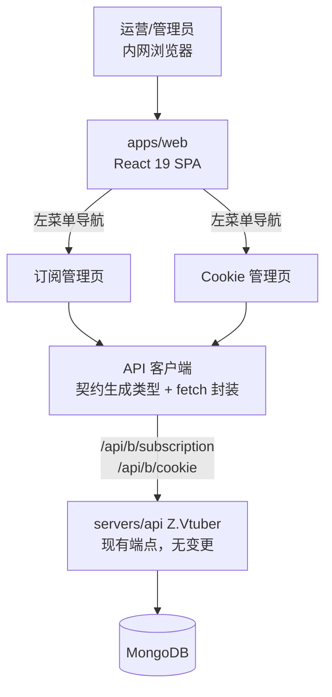
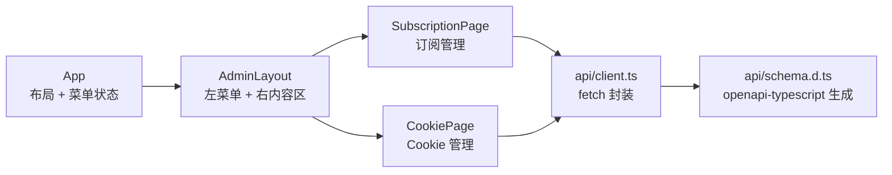
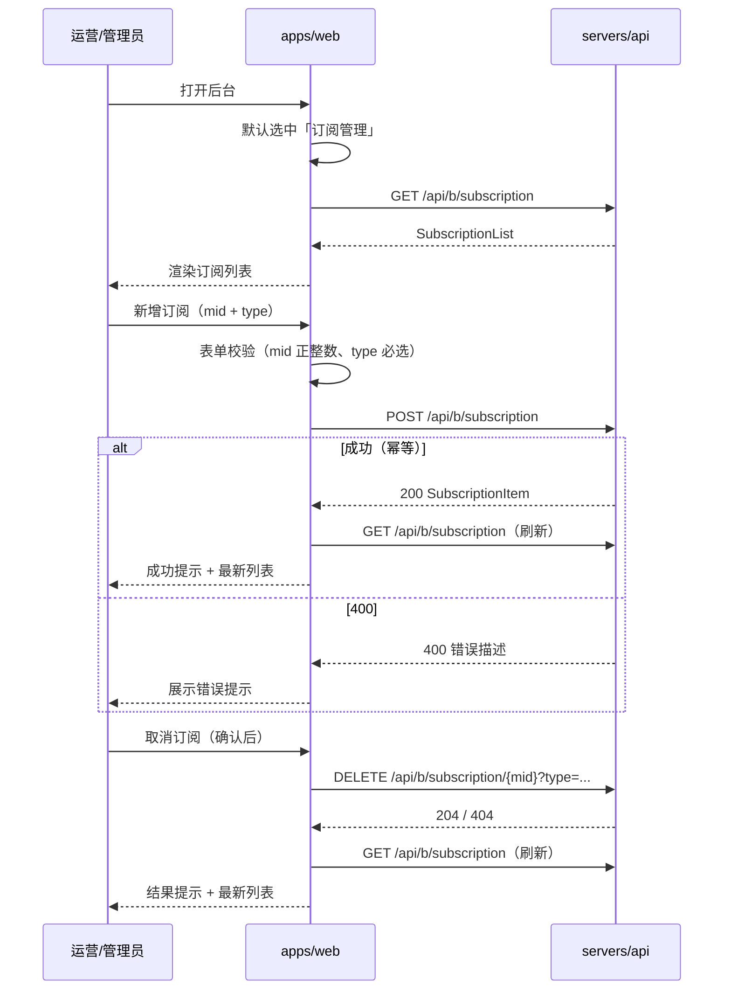

# 管理后台初版（订阅管理 + Cookie 管理）- 技术提案

**功能名称**: 管理后台初版（订阅管理 + Cookie 管理）
**关联 PRD**: `docs/product/draft/20260822-admin-console-prd.md`
**技术提案版本**: v1.0
**创建日期**: 2026-08-22
**作者**: Deliay
**feat-branch**: `feat/admin-console`（需求总分支；实现分支另行切出）

## 1. 概述

### 1.1 背景

PRD 要求为平台提供内网使用的 Web 管理后台：左菜单右内容布局、免鉴权，首期包含「订阅管理」与「Cookie 管理」两个页面。当前 `apps/web` 仅有 Vite 脚手架默认落地页（`App.tsx` 中一次 `/health` 探测），无路由、无 UI 组件库、无测试框架、无契约客户端。

后端订阅与 Cookie 能力已完备并有契约定义（`contracts/bilibili-crawler.openapi.yaml`）：订阅的列表/创建/取消与 Cookie 的列表/录入均可直接消费，本提案不涉及任何后端变更。

### 1.2 目标

- 将 `apps/web` 改造为「左菜单 + 右内容」的后台骨架，菜单含「订阅管理」「Cookie 管理」两个入口，默认进入订阅管理页；
- 订阅管理页：订阅列表（mid、type、subscribedAt）、新增订阅（mid + 必选 type）、取消订阅（mid + type，二次确认）；
- Cookie 管理页：Cookie 列表（id、status、lastCheckedAt、lastUsedAt，不含明文）、录入 Cookie（幂等）；
- 基于 OpenAPI 契约生成类型化客户端（契约式开发）；
- 引入 Vitest + React Testing Library，按 TDD 覆盖页面逻辑。

### 1.3 范围

- **做**：后台布局与导航、订阅管理页面、Cookie 管理页面、契约类型生成与 API 客户端、前端单元/组件测试；
- **不做**：
  - 任何后端 API 变更（现有契约完全满足需求）；
  - 鉴权/登录（内网部署，PRD 明确本期不做）；
  - 直播事件、空间动态等其他数据的可视化页面（后续需求）；
  - Cookie 删除/订阅编辑等现有契约不支持的操作。

## 2. 技术架构

### 2.1 系统架构图



### 2.2 技术栈

| 层级 | 技术选型 | 说明 |
|------|---------|------|
| 前端 | React 19 + TypeScript + Vite（现有栈） | 就地扩展，不更换框架 |
| 路由 | 无路由库，菜单状态切换 | 仅两个页面，用 React 状态管理当前页（见 6.1 决策） |
| 契约客户端 | openapi-typescript（新增 devDependency）+ 手写 fetch 封装 | 由 `contracts/bilibili-crawler.openapi.yaml` 生成类型，符合 frontend-rules 契约式开发要求 |
| UI 样式 | 手写 CSS（现有 App.css/index.css 模式） | 不引入组件库（见 6.1 决策） |
| 测试 | Vitest + React Testing Library（新增 devDependency） | frontend-rules 指定测试框架 |
| 后端 | .NET 10（现有，无变更） | 仅消费现有端点 |

### 2.3 模块划分



| 模块 | 职责 | 关键技术点 |
|------|------|-----------|
| `App` / `AdminLayout` | 左菜单右内容布局、菜单项高亮、内容区切换 | React 内置状态保存当前菜单项；默认选中「订阅管理」 |
| `SubscriptionPage` | 订阅列表 + 新增表单 + 取消操作 | 列表/表单/确认交互均为受控组件；操作后重新拉取列表 |
| `CookiePage` | Cookie 列表 + 录入表单 | 同上；不展示明文（契约本身不返回明文） |
| `api/client.ts` | 对契约端点的类型化封装 | `listSubscriptions` / `subscribe` / `unsubscribe` / `listActiveCookies` / `addCookie`；统一错误处理 |
| `api/schema.d.ts` | 契约类型 | `npm run codegen` 由 openapi-typescript 从契约文件生成，不入库手改 |

## 3. API 设计

### 3.1 API 契约

本提案**不新增、不变更任何 API**，仅消费 `contracts/bilibili-crawler.openapi.yaml` 现有端点：

#### 订阅管理页消费

| 操作 | Method | Path | 说明 |
|------|--------|------|------|
| 订阅列表 | GET | `/api/b/subscription` | 返回 `SubscriptionList`（items: mid / type / subscribedAt） |
| 新增订阅 | POST | `/api/b/subscription` | Body `SubscribeRequest`：`{ mid, type }`，type 必填，枚举 `danmaku` / `dynamic`；400 时展示错误提示 |
| 取消订阅 | DELETE | `/api/b/subscription/{mid}?type={type}` | type 必填 query 参数；204 成功 / 404 未订阅提示 |

#### Cookie 管理页消费

| 操作 | Method | Path | 说明 |
|------|--------|------|------|
| Cookie 列表 | GET | `/api/b/cookie` | 返回 `CookieList`（items: id / status[active,offline] / lastCheckedAt / lastUsedAt），不含明文 |
| 录入 Cookie | POST | `/api/b/cookie` | Body `CookieAddRequest`：`{ cookie }`；400（空 Cookie）时展示错误提示 |

### 3.2 内部接口

`api/client.ts` 对页面暴露的类型化接口（签名示意）：

```typescript
// 基于 openapi-typescript 生成的 paths/components 类型
listSubscriptions(): Promise<SubscriptionItem[]>
subscribe(mid: number, type: 'danmaku' | 'dynamic'): Promise<SubscriptionItem>
unsubscribe(mid: number, type: 'danmaku' | 'dynamic'): Promise<void>
listCookies(): Promise<CookieItem[]>
addCookie(cookie: string): Promise<CookieItem>
```

- base URL 沿用现有约定：`import.meta.env.VITE_API_URL ?? '/api'`；
- 非 2xx 响应统一抛出含服务端错误描述的 `Error`，页面层捕获后展示提示；
- `unsubscribe` 对 404 单独区分（提示「该订阅已不存在」）并刷新列表。

## 4. 数据模型

### 4.1 数据库设计

无数据库变更（后端无变更）。前端页面状态即为契约 DTO：

| 页面状态 | 来源契约 Schema | 关键字段 |
|---------|----------------|---------|
| 订阅列表项 | `SubscriptionItem` | `mid` (int64)、`type` (`danmaku`/`dynamic`)、`subscribedAt` (date-time) |
| Cookie 列表项 | `CookieItem` | `id`、`status` (`active`/`offline`)、`lastCheckedAt`、`lastUsedAt`（可空） |

### 4.2 缓存设计

不引入缓存。列表数据在页面挂载与每次变更操作成功后重新拉取（订阅/Cookie 数量在百级内，无性能问题）。

## 5. 技术实现方案

### 5.1 核心流程



Cookie 管理页流程同理（GET /api/b/cookie 列表 + POST /api/b/cookie 录入，空内容前端即拦截）。

### 5.2 关键实现点

#### 实现点 1: 后台布局与菜单导航

- **描述**: `App.tsx` 重构为 `AdminLayout`：左侧固定宽度菜单（「订阅管理」「Cookie 管理」），右侧内容区按当前选中项渲染对应页面组件；选中项高亮；默认选中订阅管理。
- **技术细节**: 当前页用 `useState` 管理（`'subscriptions' | 'cookies'`），不引入路由库；菜单配置抽为数组（`{ key, label, component }`），后续新增页面只需追加配置项。
- **风险点**: 无 URL 可分享/刷新保持——内网工具两个页面可接受；后续页面增多时再引入 react-router（菜单配置结构已为此预留）。

#### 实现点 2: 契约类型化客户端

- **描述**: 新增 `openapi-typescript` devDependency 与 `npm run codegen` 脚本，从 `contracts/bilibili-crawler.openapi.yaml` 生成 `src/api/schema.d.ts`；`src/api/client.ts` 基于生成类型手写轻量 fetch 封装（5 个端点函数）。
- **技术细节**: 生成文件标注「自动生成勿手改」；契约变更后重新执行 codegen 即可获得类型错误提示，符合契约式开发流程；fetch 封装统一注入 base URL、JSON 头与错误处理。
- **风险点**: openapi-typescript 只生成类型不发请求，运行时校验仍依赖服务端；前端表单做基础校验（mid 正整数、type 必选、cookie 非空）兜底。

#### 实现点 3: 订阅管理页

- **描述**: 列表表格（mid / 类型中文标签 / subscribedAt 本地化时间 / 取消按钮）+ 新增表单（mid 数字输入、type 单选「弹幕/动态」、提交）+ 操作反馈（成功/错误消息条）。
- **技术细节**: 取消采用行内二次确认（点击「取消」→ 按钮变为「确认取消 / 返回」），避免引入弹窗组件；类型展示做 `danmaku→弹幕`、`dynamic→动态` 映射；提交中禁用按钮防重复提交。
- **风险点**: 取消后另一类型不受影响由后端保证（契约已是 mid+type 维度），前端只需刷新列表。

#### 实现点 4: Cookie 管理页

- **描述**: 列表表格（id 截断展示 / status 中文标签与颜色标识 / lastCheckedAt、lastUsedAt 本地化时间，空值显示「-」）+ 录入表单（textarea 粘贴 Cookie、提交）。
- **技术细节**: Cookie 输入使用 textarea 且录入成功后清空；契约不返回明文，页面无泄漏面；空/纯空白内容前端直接拦截并提示。
- **风险点**: status 枚举以契约（active/offline）为准展示「可用/离线」；若后端未来返回冷却等新状态，未识别值原样展示并提示（防御性兜底）。

#### 实现点 5: 测试设施引入

- **描述**: 新增 `vitest`、`@testing-library/react`、`@testing-library/jest-dom`、`jsdom` devDependency，`package.json` 增加 `test` 脚本与 Vite 配置中的 test 块。
- **技术细节**: API 客户端在组件测试中以 vi.mock 替换，测试聚焦表单校验、列表渲染、交互反馈；`api/client.ts` 的错误处理逻辑用 mocked fetch 单测。
- **风险点**: 首次引入测试框架需保证 `npm run build`（tsc -b）与 `npm run lint`（oxlint）同时通过。

## 6. 技术决策

### 6.1 决策列表

| 决策 | 选项 A | 选项 B | 最终选择 | 原因 |
|------|--------|--------|---------|------|
| 页面导航 | 引入 react-router | React 状态切换菜单 | B | 仅两个页面，引入路由属过度设计；菜单配置数组为未来迁移预留结构 |
| UI 组件 | 引入组件库（Ant Design 等） | 手写 CSS | B | 两个简单页面，避免重型依赖；内网工具无复杂交互 |
| 契约客户端 | openapi-typescript 生成类型 + 手写 fetch | openapi-generator 生成完整客户端 | A | 生成完整客户端依赖重、代码量大；本项目仅 5 个端点，类型 + 轻封装足够，且符合 frontend-rules「生成 API 客户端」的契约式要求 |
| 列表刷新策略 | 操作后重新 GET 全量列表 | 本地状态增删 | A | 与服务端保持强一致（幂等语义下本地推断易错），百级数据量无性能问题 |
| 取消确认交互 | 行内二次确认按钮 | 弹窗组件 | A | 不引入弹窗基础设施，交互同样明确 |

### 6.2 依赖与约束

| 类型 | 内容 | 说明 |
|------|------|------|
| 依赖 | `contracts/bilibili-crawler.openapi.yaml` 现有订阅/Cookie 端点 | 契约无需变更；若契约演进需重新 codegen |
| 依赖 | 后端服务可达（`VITE_API_URL` 或 `/api` 代理） | Aspire 编排下沿用现有服务发现 |
| 约束 | 前端遵循 `docs/engineering/frontend-rules.md`（PascalCase 组件、kebab-case 目录、React 内置状态优先） | 本需求状态简单，不引入 Zustand |
| 约束 | 免鉴权仅限内网部署 | 部署侧保证，前端不做任何鉴权假设 |
| 约束 | TDD：核心逻辑覆盖率 ≥ 80% | common-rules 要求 |

## 7. 项目结构

```
apps/web/
├── src/
│   ├── App.tsx                         # 调整：AdminLayout（左菜单 + 右内容）
│   ├── App.css                         # 调整：布局与菜单样式
│   ├── api/
│   │   ├── schema.d.ts                 # 新增：openapi-typescript 生成（勿手改）
│   │   └── client.ts                   # 新增：5 个端点的类型化 fetch 封装
│   ├── components/
│   │   └── admin-layout/               # 新增：菜单 + 内容区布局组件（如从 App 拆出）
│   ├── pages/
│   │   ├── subscription/
│   │   │   ├── SubscriptionPage.tsx    # 新增：订阅列表 + 新增 + 取消
│   │   │   └── SubscriptionPage.test.tsx
│   │   └── cookie/
│   │       ├── CookiePage.tsx          # 新增：Cookie 列表 + 录入
│   │       └── CookiePage.test.tsx
│   └── main.tsx                        # 不变
├── package.json                        # 调整：新增 codegen/test 脚本与 devDependencies
└── vite.config.ts                      # 调整：补充 vitest test 配置

contracts/
└── bilibili-crawler.openapi.yaml       # 不变（codegen 输入）
```

后端 `servers/api` 与 `tests/Z.Vtuber.Tests` 无变更。

## 8. 测试策略

### 8.1 测试覆盖要求

- 页面组件与客户端封装核心逻辑覆盖率 ≥ 80%；
- 无后端端点变更，无需新增 API 测试；后端既有测试（`dotnet test tests/Z.Vtuber.Tests`）不受影响；
- `npm run build`、`npm run lint`、`npm run test` 全绿。

### 8.2 测试类型

| 类型 | 工具 | 覆盖范围 |
|------|------|---------|
| 组件测试 | Vitest + React Testing Library | 订阅页：列表渲染/空态、新增表单校验（mid 非法、type 未选）、提交成功/400 反馈、取消二次确认与 404 提示；Cookie 页：列表渲染/空态、录入空值拦截、成功/400 反馈 |
| 单元测试 | Vitest | `api/client.ts` 的 base URL、错误处理、DELETE query 拼接 |
| 手工验证 | 本地 Aspire 编排 | 打开后台完成订阅新增/取消与 Cookie 录入，与 `curl` 查询结果交叉核对一致性 |

## 9. 部署方案

### 9.1 环境规划

| 环境 | 用途 | 部署方式 |
|------|------|---------|
| 本地 | 开发验证 | Aspire 编排（现状），`npm run dev` |
| 内网生产 | 正式使用 | 现有构建产物（`npm run build` → `dist/`）随现有流水线部署；务必仅内网可达 |

### 9.2 配置管理

- 无新增配置项；后端地址沿用 `VITE_API_URL`（缺省 `/api`）；
- 新增 npm 脚本：`codegen`（openapi-typescript 生成类型）、`test`（vitest run）。

## 10. 验收标准

- [ ] 技术方案评审通过
- [ ] Contract 评审通过（本需求消费现有契约，无契约变更）
- [ ] 代码实现完成：左菜单右内容布局、订阅管理、Cookie 管理
- [ ] 组件/单元测试覆盖达标，`npm run test` / `lint` / `build` 通过
- [ ] 手工验证通过：页面操作与后端实际状态一致（订阅/取消/录入即时生效）
- [ ] 后端既有测试无回归（无后端改动）

## 11. 相关文档

- 关联 PRD: `docs/product/draft/20260822-admin-console-prd.md`
- 关联 Contract: `contracts/bilibili-crawler.openapi.yaml`
- 开发规范: `docs/engineering/common-rules.md`、`docs/engineering/frontend-rules.md`
