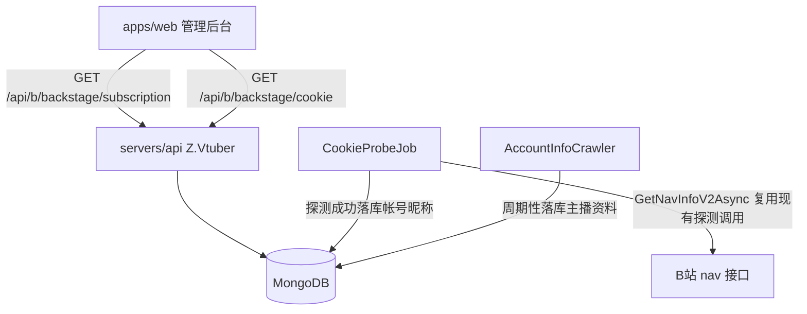
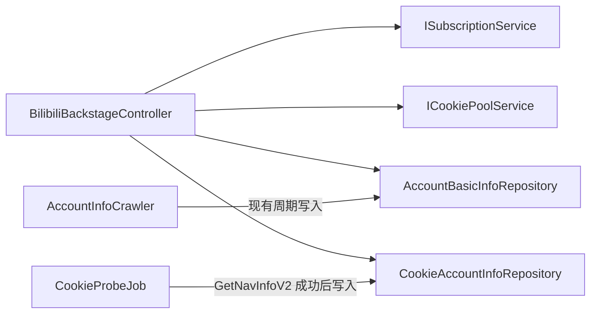
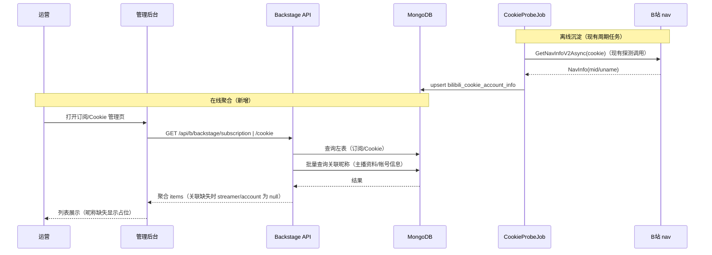

# 管理后台数据聚合（订阅主播昵称 + Cookie 帐号昵称） - 技术提案

**功能名称**: 管理后台数据聚合（订阅主播昵称 + Cookie 帐号昵称）
**关联 PRD**: `docs/product/draft/20260828-backstage-data-aggregation-prd.md`
**技术提案版本**: v1.1
**创建日期**: 2026-08-28
**作者**: Deliay
**feat-branch**: `feat/backstage-data-aggregation`

> v1.1 返工说明：按评审意见收敛——Cookie 帐号信息明确使用 `GetNavInfoV2` 方法获取并落库；两个列表均只展示昵称（name），不再展示头像、帐号 ID、直播间号等字段。

## 1. 概述

### 1.1 背景

管理后台初版已上线「订阅管理」（`SubscriptionPage`）与「Cookie 管理」（`CookiePage`）页面，但列表只展示标识类字段：订阅列表只有 `mid`/`type`/`subscribedAt`，Cookie 列表只有脱敏 `id`/`status`/时间戳。平台其实已经沉淀了可用于聚合的数据：

- **主播资料**：`AccountInfoCrawler` 周期性将 B 站 channel 数据落库到 `bilibili_account_basic_info`（`AccountBasicInfoRecord`）；
- **Cookie 帐号信息**：`CookieProbeJob` 每个探测周期都会对每条可用 Cookie 调用 `IBiliApiClient.GetNavInfoV2Async`（nav 接口）校验有效性，但 nav 返回的帐号信息（mid/uname 等）用后即弃，没有落库。

本提案将两类数据聚合进后台列表：订阅列表关联库中主播昵称，Cookie 列表关联凭证对应帐号的昵称，各自通过一个新的 backstage 聚合接口提供给前端。

### 1.2 目标

- 新增 `GET /api/b/backstage/subscription`：订阅列表与库中主播昵称聚合，一次返回；
- 新增 `GET /api/b/backstage/cookie`：Cookie 列表与帐号昵称聚合，一次返回；
- Cookie 帐号昵称通过 `GetNavInfoV2Async` 获取，并在 `CookieProbeJob` 探测成功时落库（复用已有探测调用，不新增对 B 站的请求）；
- 两个列表展示字段从简：各自只新增一个「昵称」列；
- 前端两个页面切换到聚合接口展示，现有管理操作（订阅增删、Cookie 录入）行为不变。

### 1.3 范围

**做**：

- 后端：两个 backstage 聚合只读接口；新增 Cookie 帐号信息集合与仓储；`CookieProbeJob` 探测成功时通过 nav 结果落库帐号昵称；`AccountBasicInfoRepository` 增加按 mid 批量查询；
- 契约：`contracts/bilibili-crawler.openapi.yaml` 新增两个 path 与相关 schema；
- 前端：`SubscriptionPage`/`CookiePage` 切换为聚合接口并各新增一个昵称列。

**不做**：

- 头像、帐号 ID、直播间号等其他字段的展示（本期只展示昵称）；
- nav 信息的实时拉取（页面加载不触发对 B 站的实时请求）；
- 昵称的编辑能力；
- 后台鉴权机制（沿用内网免鉴权约定）。

## 2. 技术架构

### 2.1 系统架构图



### 2.2 技术栈

| 层级 | 技术选型 | 说明 |
|------|---------|------|
| 前端 | TypeScript + React 19 + Vite | 现有管理后台，OpenAPI codegen 生成类型 |
| 后端 | C# (.NET 10) + ASP.NET Core | 新增 backstage Controller |
| 数据库 | MongoDB | 新增 1 个集合，复用 2 个现有集合 |
| 抓取 | Mikibot.Crawler | 帐号昵称来自现有 `GetNavInfoV2Async` 调用 |

### 2.3 模块划分



| 模块 | 职责 | 关键技术点 |
|------|------|-----------|
| `BilibiliBackstageController` | 对外提供两个聚合只读接口 | 内存 join，统一前缀 `/api/b/backstage` |
| `CookieAccountInfoRepository` | Cookie 帐号昵称的读写 | 按 CookieId upsert，索引初始化 |
| `CookieProbeJob`（改造） | 探测（GetNavInfoV2）成功时落库帐号昵称 | 不新增外部请求，失败路径不变 |
| `AccountBasicInfoRepository`（扩展） | 按 mid 批量查询最新主播资料 | `$in` 查询 + 按 mid 取 `FetchedAt` 最新 |

## 3. API 设计

### 3.1 API 契约

契约更新至 `contracts/bilibili-crawler.openapi.yaml`，新增两个 path（只读 GET），schema 见下。聚合响应中昵称统一命名为 `name`，取不到时为 `null`。

#### 接口 1: 订阅聚合列表

- **请求**
  - Method: GET
  - Path: `/api/b/backstage/subscription`
  - Body: 无

- **响应**
  - Status: 200
  - Body:
    ```json
    {
      "items": [
        {
          "mid": 12345,
          "type": "danmaku",
          "subscribedAt": "2026-08-20T10:00:00Z",
          "streamer": {
            "name": "某主播"
          }
        }
      ]
    }
    ```

  - `streamer` 可空：库中无该主播资料时为 `null`；`name` 从落库的 channel JSON 中提取，缺失时为 `null`（channel JSON 原始字段以实际抓取数据为准，提取不到一律按缺失处理）。

#### 接口 2: Cookie 聚合列表

- **请求**
  - Method: GET
  - Path: `/api/b/backstage/cookie`
  - Body: 无

- **响应**
  - Status: 200
  - Body:
    ```json
    {
      "items": [
        {
          "id": "66a1b2c3d4e5f60718293a4b",
          "status": "active",
          "lastCheckedAt": "2026-08-28T07:30:00Z",
          "lastUsedAt": "2026-08-28T07:31:00Z",
          "account": {
            "name": "某帐号"
          }
        }
      ]
    }
    ```

  - `account` 可空：该 Cookie 尚未成功探测过时为 `null`；nav 返回无昵称时 `name` 为 `null`；
  - Cookie 原始内容不出现在响应中（沿用现有脱敏 `id`）。

### 3.2 内部接口

- `AccountBasicInfoRepository.GetLatestByMidsAsync(IReadOnlyCollection<long> mids, CancellationToken)`：批量查询，按 mid 分组取 `FetchedAt` 最新一条，返回 `Dictionary<long, AccountBasicInfoRecord>`；
- `CookieAccountInfoRepository.UpsertAsync(CookieAccountInfoRecord, CancellationToken)` / `GetByCookieIdsAsync(IReadOnlyCollection<ObjectId>, CancellationToken)`；
- `ICookiePoolService.GetActiveAsync`：现有接口，聚合接口直接复用（与现有 `/api/b/cookie` 列表口径一致）。

## 4. 数据模型

### 4.1 数据库设计

#### 新增集合: `bilibili_cookie_account_info`（`CookieAccountInfoRecord`）

| 字段 | 类型 | 说明 |
|------|------|------|
| Id | ObjectId | 主键 |
| CookieId | ObjectId | 关联 `bilibili_cookie` 的 `CookieRecord.Id`，唯一索引 |
| Mid | long | `GetNavInfoV2` 返回的帐号 mid |
| Uname | string | `GetNavInfoV2` 返回的帐号昵称，可空 |
| FetchedAt | DateTime(UTC) | 最近一次成功探测时间 |

- `MongoDbInitializer` 新增 `CookieAccountInfo` 集合名与 `CookieId` 唯一索引初始化；
- 存量 Cookie 无该集合数据，聚合时 `account = null`，首次探测后自动补齐，无需迁移；
- 集合只保存聚合展示所需的最小字段（mid + 昵称），不保存 nav 返回的其他信息。

#### 复用集合

| 集合 | 用途 |
|------|------|
| `bilibili_subscription`（`SubscriptionRecord`） | 订阅聚合的左表 |
| `bilibili_account_basic_info`（`AccountBasicInfoRecord`） | 主播昵称来源，按 mid 关联 |
| `bilibili_cookie`（`CookieRecord`） | Cookie 聚合的左表 |

### 4.2 缓存设计

不引入缓存。后台为低频内网访问，聚合为两次集合查询 + 内存 join。

## 5. 技术实现方案

### 5.1 核心流程



### 5.2 关键实现点

#### 实现点 1: nav 帐号昵称落库（CookieProbeJob 改造）

- **描述**: `CookieProbeJob.RunOnceAsync` 中 `GetNavInfoV2Async` 探测成功后（`nav.Mid > 0` 分支），将 `nav.Mid`/`nav.Uname` upsert 到 `bilibili_cookie_account_info`（按 `CookieId`）。
- **技术细节**: 复用每次探测已发起的 `GetNavInfoV2Async` 调用，不增加任何额外外部请求；落库失败仅记日志，不影响探测状态机（cooldown/offline 判定逻辑完全不变）。
- **风险点**: `NavInfo` 模型字段以 `Mikibot.Crawler` 实际定义为准，`Uname` 缺失时按可空处理。

#### 实现点 2: 订阅昵称聚合

- **描述**: 取全部订阅 → 收集 mids → `AccountBasicInfoRepository.GetLatestByMidsAsync` 批量取资料 → 内存 join，从 channel JSON 提取昵称。
- **技术细节**: 同一 mid 的 danmaku/dynamic 两条订阅共享同一个昵称；资料 `Data` 为 channel JSON 字符串，解析后提取昵称字段（沿用 `BilibiliUserController.ParseRaw` 的解析方式），提取失败按缺失处理（`name = null`）。
- **风险点**: 无资料主播 `streamer = null`，前端展示占位。

#### 实现点 3: 前端页面切换

- **描述**: `SubscriptionPage`/`CookiePage` 改用聚合接口，各新增一个昵称列；`npm run codegen` 重新生成 `schema.d.ts` 与客户端方法。
- **技术细节**: 昵称可空，为空显示「暂无资料」；其余交互（新增订阅、取消订阅二次确认、录入 Cookie）不变。
- **风险点**: 无。

## 6. 技术决策

### 6.1 决策列表

| 决策 | 选项 A | 选项 B | 最终选择 | 原因 |
|------|--------|--------|---------|------|
| Cookie 帐号昵称获取方式 | 其他接口/推算 | `GetNavInfoV2Async`（nav 接口） | B | 评审明确要求使用 GetNavInfoV2 方法；现有探测链路已具备 |
| 昵称时效策略 | 聚合接口实时调用 nav | 探测任务落库、接口读库 | B | 实时调用慢且有风控风险；探测任务本就在调 nav，落库零额外成本；允许合理延迟（PRD 已约定） |
| 展示字段 | 昵称 + 头像 + ID 等多字段 | 只展示昵称 | B | 评审明确只展示 Name 即可，契约与 UI 同步从简 |
| 聚合接口位置 | 扩展现有 Controller | 新建 BackstageController | B | 聚合是后台专用视角，独立 Controller 不污染现有对外 API 语义 |
| 存量数据处理 | 数据迁移回填 | 不迁移，探测周期自然补齐 | B | 探测周期分钟级，存量 Cookie 很快自动有数据 |

### 6.2 依赖与约束

| 类型 | 内容 | 说明 |
|------|------|------|
| 依赖 | `CookieProbeJob` 周期探测在运行 | 帐号昵称沉淀依赖 GetNavInfoV2 探测成功 |
| 依赖 | `AccountInfoCrawler` 周期抓取在运行 | 主播昵称依赖帐号信息抓取 |
| 约束 | Cookie 原文不出接口 | 沿用脱敏 id |
| 约束 | TDD：先测试后实现 | 单元测试 + Testcontainers 集成测试 |

## 7. 项目结构

```
servers/api/
├── Controllers/
│   └── BilibiliBackstageController.cs        # 新增：两个聚合只读接口
├── Persistence/
│   ├── Entities/
│   │   └── CookieAccountInfoRecord.cs        # 新增实体（CookieId/Mid/Uname/FetchedAt）
│   ├── CookieAccountInfoRepository.cs        # 新增仓储
│   ├── AccountBasicInfoRepository.cs         # 扩展：GetLatestByMidsAsync
│   └── MongoDbInitializer.cs                 # 扩展：集合名 + CookieId 唯一索引
├── Jobs/
│   └── CookieProbeJob.cs                     # 改造：GetNavInfoV2 成功落库帐号昵称
apps/web/src/
├── api/client.ts                             # 新增聚合接口客户端方法
├── pages/subscription/SubscriptionPage.tsx   # 切换聚合接口 + 主播昵称列
└── pages/cookie/CookiePage.tsx               # 切换聚合接口 + 帐号昵称列
contracts/bilibili-crawler.openapi.yaml       # 新增 2 path + schema
tests/Z.Vtuber.Tests/                         # 聚合/落库/仓储测试
```

## 8. 测试策略

### 8.1 测试覆盖要求

- 单元测试覆盖率: >= 80%（核心逻辑）
- API 测试覆盖的端点: `GET /api/b/backstage/subscription`、`GET /api/b/backstage/cookie`

### 8.2 测试类型

| 类型 | 工具 | 覆盖范围 |
|------|------|---------|
| 单元测试 | xUnit | `CookieProbeJob` 落库（成功/失败路径）、聚合 join 逻辑、昵称为空降级 |
| 集成测试 | Testcontainers (MongoDB) | `CookieAccountInfoRepository` upsert/批量查询、`GetLatestByMidsAsync` 取最新、两个聚合端点端到端 |
| 前端测试 | Vitest + RTL | 两页面昵称列渲染、占位展示、现有交互回归 |

## 9. 部署方案

### 9.1 环境规划

| 环境 | 用途 | 部署方式 |
|------|------|---------|
| 本地/Aspire | 开发联调 | `z-aspire-orchestrator` 编排 API + MongoDB + Web |
| 内网 | 实际使用 | 沿用现有部署，无新增配置项 |

### 9.2 配置管理

无新增配置项；索引初始化随 `MongoDbInitializer` 启动执行。

## 10. 验收标准

- [ ] 技术方案评审通过
- [ ] Contract 评审通过（2 个新 path + schema）
- [ ] 代码实现完成（后端 + 契约 + 前端）
- [ ] 单元测试覆盖达标
- [ ] API 测试通过（两个聚合端点，含关联缺失场景）
- [ ] E2E 测试通过（两页面昵称列展示）
- [ ] 现有订阅增删、Cookie 录入功能回归通过

## 11. 相关文档

- 关联 PRD：`docs/product/draft/20260828-backstage-data-aggregation-prd.md`
- 关联 Contract：`contracts/bilibili-crawler.openapi.yaml`
- 开发规范：`docs/engineering/common-rules.md`、`docs/engineering/backend-rules.md`、`docs/engineering/frontend-rules.md`
