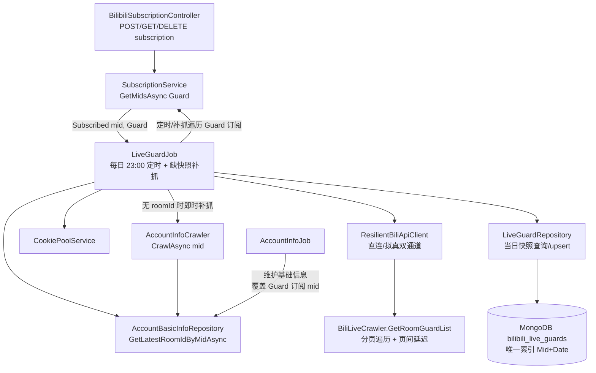
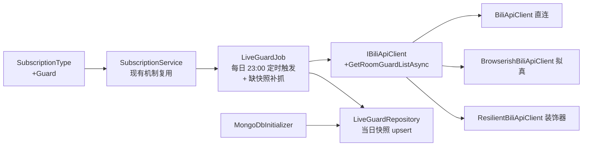
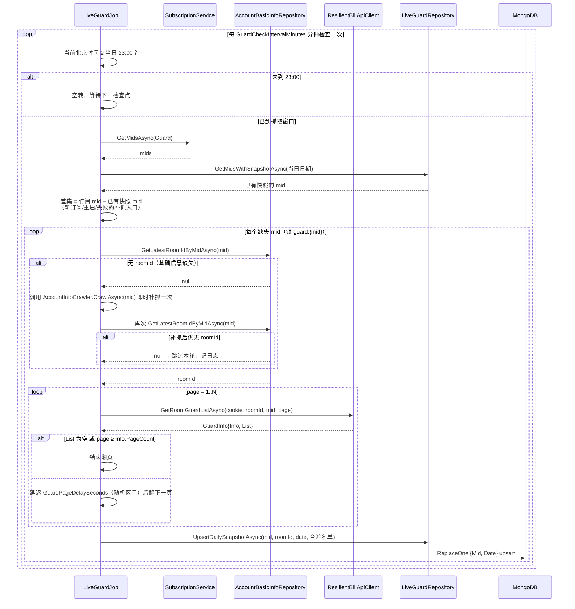

# 舰长数据抓取 - 技术提案

**功能名称**: 舰长数据抓取
**关联 PRD**: `docs/product/draft/20260831-live-guard-crawl-prd.md`
**技术提案版本**: v1.0
**创建日期**: 2026-08-31
**作者**: Deliay
**feat-branch**: `feat/live-guard-crawl`（需求总分支；实现分支另行切出）

## 1. 概述

### 1.1 背景

订阅体系已完成类型化改造（`docs/engineering/proposals/20260820-proposal-subscription-crawl-type.md`）：订阅按 (mid, type) 维度管理，当前类型为 `Dynamic` / `Danmaku`，各类抓取链路按类型过滤驱动。本需求在该体系上新增第三种类型「舰长」（`Guard`），并新建一条舰长名单抓取链路：

- 上游指定抓取方法：`Mikibot.Crawler.Http.Bilibili.BiliLiveCrawler.GetRoomGuardList(long roomId, long bId, int page = 1, CancellationToken token = default)`（Mikibot.Crawler 1.0.9 已带此重载），返回 `GuardInfo { Info(PageInfo: Count/Current/PageCount), List<GuardUserInfo>, Top3 }`；
- roomId 从基础信息集合 `bilibili_account_basic_info` 解析（`AccountBasicInfoRepository.GetLatestRoomIdByMidAsync`，现有）；
- 落库新集合 `bilibili_live_guards`，每主播每天一行：mid + roomId + guard_list。

### 1.2 目标

- `SubscriptionType` 新增 `Guard`（落库/契约值 `guard`），订阅 CRUD 与类型过滤天然复用现有 (mid, type) 机制；
- `IBiliApiClient` 新增舰长名单分页查询方法，直连/拟真双通道实现并纳入 `ResilientBiliApiClient` 风控治理；
- 新增 `LiveGuardJob` 定时任务：**每日 23:00（北京时间，可配置）触发**当日抓取；23:00 及之后周期性检查各 `Guard` 订阅的当日快照，**缺失即补抓**（覆盖新订阅、服务重启、此前失败的场景）：遍历缺失 mid → 解析 roomId（缺失时即时补抓基础信息）→ 分页全量抓取（页间延迟）→ 覆盖写当日快照；
- 新集合 `bilibili_live_guards`，(Mid, Date) 唯一索引保证「每主播每天一行」；
- 更新 `contracts/bilibili-crawler.openapi.yaml`，前端订阅管理页识别新类型。

### 1.3 范围

- **做**：订阅类型扩展、舰长抓取客户端方法（双通道 + 弹性装饰）、`LiveGuardJob`、新集合与索引、契约更新、前端类型选项、测试覆盖；
- **不做**：
  - 舰长数据的查询/分析 API 与后台展示（快照先行沉淀，消费接口留待后续需求）；
  - 舰长名单变化的实时推送（弹幕 `GUARD_BUY` 事件已在事件流中，本需求不做关联）；
  - 历史回填（上线前无舰长数据，无需迁移）。

## 2. 技术架构

### 2.1 系统架构图



### 2.2 技术栈

| 层级 | 技术选型 | 说明 |
|------|---------|------|
| 后端 | .NET 10 / C#（现有栈） | Job / Client / Repository 就地新增 |
| 抓取库 | Mikibot.Crawler 1.0.9（现有依赖） | `BiliLiveCrawler.GetRoomGuardList(roomId, bId, page, token)` 重载已存在，无需升级 |
| 数据库 | MongoDB（现有） | 新增集合 `bilibili_live_guards` + (Mid, Date) 唯一索引 |
| 契约 | OpenAPI YAML（`contracts/`） | 后端为契约生成源，同步更新 |
| 前端 | React（`apps/web`，现有） | 订阅管理页类型选项/展示增加「舰长」 |
| 测试 | xUnit + Testcontainers (Mongo) | 现有测试模式 |

### 2.3 模块划分



| 模块 | 职责 | 关键技术点 |
|------|------|-----------|
| `SubscriptionType` | 新增 `Guard` 枚举值 | 字符串序列化落库 `"guard"`，与契约 enum 一致 |
| `IBiliApiClient` 及三实现 | 舰长名单单页查询 | 直连复用 Mikibot `BiliLiveCrawler`；拟真通道 wbi 签名直调 HTTP；装饰器通道键 `guard:{roomId}` |
| `LiveGuardJob` | 每日 23:00 定时触发；23:00 后检查当日快照缺失并补抓；分页全量抓取、页间延迟、失败隔离、roomId 缺失即时补抓基础信息 | 复用 `PeriodicJobBase`（短间隔检查）/ `CrawlLockProvider`（锁键 `guard:{mid}`）/ Cookie 池 / `IAccountInfoCrawler` |
| `LiveGuardRepository` + `LiveGuardRecord` | 每日快照读写、当日已抓 mid 查询 | (Mid, Date) upsert 覆盖写 |
| `MongoDbInitializer` | 新集合索引 | (Mid, Date) 唯一索引 |
| `AccountInfoJob` | 基础信息覆盖 Guard 订阅 mid | mid 集合并入 Guard 类型，保证 roomId 可解析 |

## 3. API 设计

### 3.1 API 契约

更新 `contracts/bilibili-crawler.openapi.yaml`，本次为**纯增量**变更：各 schema 的类型枚举追加 `guard`。

#### 接口 1: 创建订阅（枚举扩展）

- **请求**
  - Method: POST，Path: /api/b/subscription
  - Body:
    ```json
    {
      "mid": 123456,
      "type": "guard"
    }
    ```
  - `SubscribeRequest.type` 枚举由 `[danmaku, dynamic]` 扩展为 `[danmaku, dynamic, guard]`，其余不变（`type` 仍为必填）。

- **响应**
  - Status: 200 — 订阅成功（幂等），`SubscriptionItem.type` 枚举同步扩展
  - Status: 400 — `type` 缺失或非法，错误描述列出合法取值 `danmaku, dynamic, guard`

#### 接口 2: 查询订阅列表（枚举扩展）

- Method: GET，Path: /api/b/subscription；`SubscriptionItem.type` 枚举扩展为 `[danmaku, dynamic, guard]`。

#### 接口 3: 取消订阅（枚举扩展）

- Method: DELETE，Path: /api/b/subscription/{mid}；query 参数 `type` 枚举扩展为 `[danmaku, dynamic, guard]`；未订阅返回 404 的语义不变。

#### 接口 4: 后台订阅管理（枚举扩展）

- Path: /api/b/backstage/subscription；`BackstageSubscriptionItem.type` 枚举同步扩展。

> 本需求不新增端点；舰长快照的消费接口不在本期范围。

### 3.2 内部接口

#### `IBiliApiClient` 新增方法

```csharp
// 单页查询舰长名单；分页遍历由 LiveGuardJob 负责
Task<GuardInfo> GetRoomGuardListAsync(string cookie, long roomId, long bId, int page = 1, CancellationToken ct = default);
```

- `BiliApiClient`（直连）：经 `IBilibiliAccountProvider` 解析 `BiliLiveCrawler`，直接调用 `GetRoomGuardList(roomId, bId, page, ct)`；
- `BrowserishBiliApiClient`（拟真）：与 `GetSpaceDynamicsAsync` 同模式——`EnsureWarmupAsync` + 随机延迟 + wbi 签名后直调 `GET https://api.live.bilibili.com/xlive/app-room/v2/guardList/topList?room_id={roomId}&ruid={bId}&page={page}`（以 Mikibot 内部实现为准对齐参数），解析为 `GuardInfo`；
- `ResilientBiliApiClient`（装饰器）：按现有 `ExecuteWithResilienceAsync` 模式包装，target 键 `guard:{roomId}`，复用退避/降级/cookie 冷却治理。

#### `LiveGuardRepository`

```csharp
Task UpsertDailySnapshotAsync(LiveGuardRecord record, CancellationToken ct = default); // 过滤条件 { Mid, Date }，ReplaceOne + IsUpsert
Task<IReadOnlyList<long>> GetMidsWithSnapshotAsync(string date, CancellationToken ct = default); // 当日已有快照的 mid，供补抓差集计算
```

#### `LiveGuardJob` 依赖说明

除 `ISubscriptionService` / `IBiliApiClient` / Cookie 池 / `CrawlLockProvider` 外，注入现有 `IAccountInfoCrawler`：当 `AccountBasicInfoRepository.GetLatestRoomIdByMidAsync` 无记录时调用一次 `CrawlAsync(mid)` 即时补抓基础信息，再重新解析 roomId（详见 5.2 实现点 5）。

调度语义（详见 5.2 实现点 1）：以 `PeriodicJobBase` 短间隔（`GuardCheckIntervalMinutes`，默认 10 分钟）运行检查循环——未到当日 23:00（北京时间）则空转；23:00 及之后计算「Guard 订阅 mid − 当日已有快照 mid」差集并逐个抓取。该设计使新订阅、服务重启、定时触发共用同一条「缺失即补抓」路径。

#### `AccountInfoJob` 调整

`RunOnceAsync` 的 mid 集合由「Dynamic ∪ Danmaku」改为「Dynamic ∪ Danmaku ∪ Guard」（去重），保证舰长订阅主播的基础信息（roomId）持续维护。

## 4. 数据模型

### 4.1 数据库设计

#### 集合: `bilibili_live_guards`（新增，`MongoCollectionNames.LiveGuards`）

实体 `LiveGuardRecord`：

| 字段 | 类型 | 说明 |
|------|------|------|
| `Id` | ObjectId | 主键 |
| `Mid` | Int64 | 主播 mid（= 抓取入参 bId） |
| `RoomId` | Int64 | 直播间 roomId（基础信息解析结果） |
| `Date` | string | 快照日期，`yyyy-MM-dd`（**北京时间 UTC+8**，与每日 23:00 定时口径一致），与 Mid 构成每日一行粒度 |
| `Guards` | `List<LiveGuardEntry>` | 当日全量舰长名单（guard_list，全分页合并） |
| `GuardCount` | int | 名单人数（冗余便于检索/校验） |
| `FetchedAt` | DateTime (UTC) | 最近一次抓取完成时间 |

内嵌 `LiveGuardEntry`（取自 `GuardUserInfo`）：

| 字段 | 类型 | 说明 |
|------|------|------|
| `Uid` | Int64 | 舰长 uid |
| `UserName` | string | 舰长昵称 |
| `GuardLevel` | int | 大航海等级（1 总督 / 2 提督 / 3 舰长，对应 `GuardUserInfo.GuardType`） |
| `MedalName` | string | 粉丝勋章名（可空） |
| `MedalLevel` | int | 粉丝勋章等级 |

索引：`(Mid asc, Date asc)` **唯一索引**（`Mid_1_Date_1`），保证每主播每天一行；同日重复抓取以 `ReplaceOneModel { IsUpsert = true }` 覆盖。

### 4.2 缓存设计

不涉及缓存变更。

## 5. 技术实现方案

### 5.1 核心流程



### 5.2 关键实现点

#### 实现点 1: 每日定时触发与缺快照补抓

- **描述**: 抓取为**时间触发**：每日 23:00（北京时间，可配置）进入抓取窗口；窗口内周期性计算「`Guard` 订阅 mid − 当日已有快照 mid」差集并抓取。该机制天然覆盖三类补抓场景——**新订阅**（订阅事件到达后，若已在窗口内则随下一次检查即时补抓）、**服务重启**（重启后检查循环恢复，当日未抓的 mid 自动补抓）、**窗口内抓取失败**（失败的 mid 当日仍无快照，下一检查点重试）。
- **技术细节**: 复用 `PeriodicJobBase`，`Interval` 取 `GuardCheckIntervalMinutes`（默认 10 分钟）；`RunOnceAsync` 先到「是否已进入当日抓取窗口」判断，未进入直接返回（空转低成本）；窗口内每次运行只处理差集 mid，已落快照的 mid 不重复抓取；`Subscribed(Guard)` 事件处理为「触发一次同样的差集检查」而非直接抓单个 mid，逻辑收敛为单一路径。**凌晨窗口例外**：事件到达时若北京时间处于 00:00–`GuardCatchUpBeforeHour`（默认 3）点之间，不走差集路径，改为直接抓取该 mid 并以**前一日** `Date` 落快照（前一日快照已存在则跳过），用于把凌晨新增的订阅补进前一日的数据序列；当日 23:00 的定时抓取按当日差集照常运行，与该前一日快照互不干扰。
- **风险点**: 23:00 为抓取高峰（全量订阅集中翻页）——mid 逐个串行 + 页间延迟，整体时长随订阅数线性增长；若未来订阅规模大到窗口内抓不完，再考虑分片/提前开窗，本期规模可接受。

#### 实现点 2: 分页遍历与防反爬延迟

- **描述**: 从 `page = 1` 开始遍历，终止条件为「本页 `List` 为空」或「`page >= Info.PageCount`」（满足 PageInfo 数据），两者取先；每次翻页前 `Task.Delay` 随机延迟（配置区间，默认 2–5 秒，复用 `BrowserMinDelaySeconds`/`BrowserMaxDelaySeconds` 风格新增独立配置）。
- **技术细节**: 翻页循环加页数上限兜底（如 `GuardMaxPages`，默认 50）防止上游 PageInfo 异常导致死循环；单页失败/异常整轮放弃该主播，不落半成品快照（名单不全的快照比缺失更有害）；`CrawlBackoffActiveException` 直接跳过本轮。
- **风险点**: 大航海人数多的主播（数千人，每页约 29 人）翻页耗时长——以 3 秒/页估算 100 页约 5 分钟，周期任务可接受；页数上限与延迟配置可在运行期调参。

#### 实现点 3: 每日快照的幂等覆盖写

- **描述**: `Date` 取**北京时间（UTC+8）**当日 `yyyy-MM-dd`，upsert 过滤条件 `{ Mid, Date }`，整体替换 `Guards`/`GuardCount`/`RoomId`/`FetchedAt`；唯一索引兜底并发重复。
- **技术细节**: 与 `MongoDbInitializer` 的 `EnsureIndexesAsync` 模式一致新增 `EnsureLiveGuardIndexesAsync`；同日多次调度（定时、重启补抓、事件补抓重叠）自然收敛为一行；`Date` 与调度窗口共用同一北京时间口径，23:00 触发抓取的快照归属当日，语义直观。
- **风险点**: 23:00–24:00 窗口内失败的 mid 重试可能跨零点——跨零点后 `Date` 变为次日，当次成功抓取落为次日快照，前一日快照保持缺失，语义可接受（当日未抓即当日无数据）。

#### 实现点 4: 双通道客户端与风控治理接入

- **描述**: `IBiliApiClient` 新增单页查询方法，直连走 Mikibot `BiliLiveCrawler`，拟真通道按现有 wbi 签名模式直调 HTTP，装饰器以 `guard:{roomId}` 为退避键接入既有治理（退避、直连→拟真降级、cookie 冷却）。
- **技术细节**: 页间延迟由 Job 层负责，客户端方法保持单页语义（与 `GetSpaceDynamicsAsync` 的单页/单 offset 语义一致）；拟真通道的延迟（`DelayAsync`）与 Job 翻页延迟叠加，总量仍由配置控制。
- **风险点**: 拟真通道需对齐 Mikibot 内部实际请求路径与签名参数，实现时以 Mikibot 1.0.9 IL/源码核对为准；若拟真实现复杂度过高，允许首版拟真通道降级为「委托直连通道实现」（与 `GetAccountInfoDataAsync` 现状一致），在决策表中记录。

#### 实现点 5: roomId 解析依赖与缺失兜底

- **描述**: 舰长抓取依赖 `bilibili_account_basic_info` 的 roomId，但 `AccountBasicInfoRepository` 中**可能不存在**指定 mid 的记录（新订阅主播的基础信息尚未被抓取、或基础信息抓取失败）。因此 `LiveGuardJob` 在 `GetLatestRoomIdByMidAsync` 返回空时，必须**调用一次 `IAccountInfoCrawler.CrawlAsync(mid)` 即时补抓基础信息**，随后重新解析 roomId；补抓后仍无 roomId 才跳过本轮。
- **技术细节**: `IAccountInfoCrawler.CrawlAsync` 为现有服务（内部带 `account:{mid}` 锁、失败仅记日志不抛出），直接注入复用；补抓每轮每个 mid 至多触发一次，避免重复请求；`AccountInfoJob` 同时并入 `Guard` 订阅 mid，让基础信息进入常规周期维护，即时补抓只是冷启动/失败后的兜底。
- **风险点**: 补抓本身也可能失败（目标主播无直播间、接口异常）——此时本轮跳过并记日志，下一周期重试，不阻塞其他主播。

## 6. 技术决策

### 6.1 决策列表

| 决策 | 选项 A | 选项 B | 最终选择 | 原因 |
|------|--------|--------|---------|------|
| 舰长类型建模 | 复用 (mid, type) 订阅，新增 `Guard` 枚举 | 独立订阅表 | A | 类型化订阅机制已就绪，契约/管理页/事件天然复用 |
| 快照粒度 | (Mid, Date) 每日一行覆盖写 | 每次抓取一行追加 | A | PRD 明确每日一行；唯一索引 + upsert 天然幂等 |
| 调度方式 | 每日 23:00（北京时间）定时触发 + 窗口内缺快照补抓 | 固定间隔周期抓取 | A | 打回意见明确：时间触发、23:00 及之后抓取；差集补抓统一覆盖新订阅/重启/失败 |
| Date 口径 | 北京时间 `yyyy-MM-dd` 字符串 | UTC / DateTime | A | 与 23:00 定时窗口同口径，快照归属日语义直观 |
| 名单存储 | 结构化内嵌数组（uid/昵称/等级/勋章） | 原始 JSON 整块 | A | guard_list 需要可检索、可分析；字段集稳定 |
| 翻页延迟位置 | Job 层统一延迟 | 客户端内延迟 | A | 单页语义与既有客户端方法一致；延迟策略集中可调 |
| 拟真通道实现 | wbi 签名直调 HTTP | 复用直连实现 | A（允许降级 B） | 与 `GetSpaceDynamicsAsync` 模式一致；若实现核对发现偏差过大，首版降级为 B 并记录 |
| 快照失败策略 | 整轮失败不落库 | 落部分名单 | A | 半成品名单会污染趋势分析 |
| roomId 缺失兜底 | 即时调用 `AccountInfoCrawler.CrawlAsync` 补抓一次后重解析 | 直接跳过等下一周期 | A | 基础信息表可能无指定 mid，直接跳过会让新订阅主播长期无快照；补抓为现有服务，代价低 |

### 6.2 依赖与约束

| 类型 | 内容 | 说明 |
|------|------|------|
| 依赖 | Mikibot.Crawler 1.0.9 | `GetRoomGuardList(roomId, bId, page, token)` 重载已存在，无需升级包 |
| 依赖 | `SubscriptionService` / `AccountBasicInfoRepository` / Cookie 池 / `CrawlLockProvider` / 风控治理 | 就地复用，不重构 |
| 依赖 | `AccountInfoJob` / `IAccountInfoCrawler` 基础信息维护与即时补抓 | mid 集合扩展 Guard 类型；roomId 缺失时补抓兜底 |
| 约束 | 契约变更需同步 | `contracts/bilibili-crawler.openapi.yaml` 枚举扩展后前端重新生成客户端 |
| 约束 | 页间延迟 + 页数上限 | 防反爬与死循环兜底，配置可调 |
| 约束 | 抓取窗口每日 23:00（北京时间）开启 | 23:00 前不产生抓取；窗口内缺快照即补抓；唯一例外为凌晨（00:00–`GuardCatchUpBeforeHour`）新增订阅的前一日补抓 |
| 约束 | 每日一行 | (Mid, Date) 唯一索引 + 覆盖写 |

## 7. 项目结构

```
servers/api/
├── Persistence/
│   ├── Entities/
│   │   ├── SubscriptionType.cs             # 扩展：Guard 枚举值
│   │   └── LiveGuardRecord.cs              # 新增：快照实体 + LiveGuardEntry 内嵌
│   ├── LiveGuardRepository.cs              # 新增：当日快照 upsert + GetMidsWithSnapshotAsync
│   └── MongoDbInitializer.cs               # 扩展：LiveGuards 集合名 + (Mid, Date) 唯一索引
├── Crawlers/
│   ├── BiliApiClient.cs                    # 扩展：GetRoomGuardListAsync（直连）
│   ├── BrowserishBiliApiClient.cs          # 扩展：GetRoomGuardListAsync（拟真，或降级委托）
│   └── ResilientBiliApiClient.cs           # 扩展：guard:{roomId} 通道治理
├── Jobs/
│   ├── LiveGuardJob.cs                     # 新增：每日 23:00 定时触发 + 缺快照差集补抓 + roomId 缺失时调用 IAccountInfoCrawler 即时补抓
│   └── AccountInfoJob.cs                   # 调整：mid 集合并入 Guard 类型
├── Configuration/
│   └── BilibiliCrawlerOptions.cs           # 扩展：GuardDailyCrawlHour / GuardCheckIntervalMinutes / GuardPageDelayMinSeconds / GuardPageDelayMaxSeconds / GuardMaxPages
└── Program.cs                              # 注册 LiveGuardJob / LiveGuardRepository

contracts/
└── bilibili-crawler.openapi.yaml           # 各 type 枚举追加 guard

apps/web/src/pages/subscription/
└── SubscriptionPage.tsx                    # 类型选项/展示增加「舰长」（及对应测试）

tests/Z.Vtuber.Tests/
├── LiveGuardJobTests.cs                    # 新增：翻页终止/延迟/失败不落库/空名单快照
├── LiveGuardRepositoryTests.cs             # 新增：(Mid, Date) upsert 幂等（Testcontainers）
└── SubscriptionServiceTests.cs 等          # 适配：Guard 类型用例
```

## 8. 测试策略

### 8.1 测试覆盖要求

- 舰长抓取核心逻辑（调度窗口判断、差集补抓、翻页终止条件、失败策略、快照组装）覆盖率 ≥ 80%；
- API 测试覆盖：`POST /api/b/subscription`（`type=guard` 200 / 非法类型 400）、`GET /api/b/subscription`（含 guard 条目）、`DELETE /api/b/subscription/{mid}?type=guard`（204/404）；
- 既有测试（`dotnet test tests/Z.Vtuber.Tests`）不得回归。

### 8.2 测试类型

| 类型 | 工具 | 覆盖范围 |
|------|------|---------|
| 单元测试 | xUnit | 调度窗口（23:00 前不抓 / 23:00 后触发）、差集补抓（新订阅 / 重启后当日缺快照 / 失败后重试 / 已有快照不重复抓）、翻页终止（List 空 / 到达 PageCount / 页数上限）、单页失败整轮放弃、空名单落快照、日期口径（北京时间）、roomId 缺失时即时补抓基础信息（补抓成功继续抓取 / 补抓后仍无 roomId 则跳过） |
| 集成测试 | xUnit + Testcontainers (Mongo) | (Mid, Date) 唯一索引、同日覆盖写幂等、GetMidsWithSnapshotAsync 差集查询、重启重复调度收敛一行 |
| API 测试 | 现有 API 测试模式 | 上述订阅端点的 guard 类型用例 |
| 手工验证 | 本地 Aspire 编排 | 订阅真实主播 guard 类型，23:00 窗口观察定时抓取与分页延迟日志；模拟重启后当日补抓；取消订阅后抓取停止 |

## 9. 部署方案

### 9.1 环境规划

| 环境 | 用途 | 部署方式 |
|------|------|---------|
| 本地 | 开发验证 | Aspire 编排（现状） |
| 生产 | 正式运行 | 现有 Docker 镜像流水线；索引随服务启动自动创建 |

### 9.2 配置管理

`BilibiliCrawler` 配置节新增（均有默认值，不改配置可运行）：

| 配置项 | 默认值 | 说明 |
|------|------|------|
| `GuardDailyCrawlHour` | 23 | 每日抓取窗口开启时刻（北京时间，整点）；23:00 及之后才允许抓取 |
| `GuardCatchUpBeforeHour` | 3 | 凌晨补抓窗口截止时刻（北京时间，整点）：00:00 至该时刻前新增 Guard 订阅立即抓取并记为前一日快照 |
| `GuardCheckIntervalMinutes` | 10 | 检查循环间隔：窗口内周期性计算缺快照差集并补抓；窗口外空转 |
| `GuardPageDelayMinSeconds` | 2 | 翻页延迟下限 |
| `GuardPageDelayMaxSeconds` | 5 | 翻页延迟上限 |
| `GuardMaxPages` | 50 | 单主播翻页上限兜底 |

无存量数据迁移；上线为纯增量（新枚举值、新集合、新 Job）。

## 10. 验收标准

- [ ] 技术方案评审通过
- [ ] Contract 评审通过（各 type 枚举含 guard）
- [ ] 代码实现完成：Guard 订阅驱动舰长抓取，每日 23:00（北京时间）定时触发、窗口内缺快照自动补抓，分页全量 + 页间延迟，快照每日一行
- [ ] 单元测试覆盖达标，既有测试无回归
- [ ] API 测试通过（guard 类型创建/查询/取消）
- [ ] 手工验证：真实主播快照完整、重启后当日缺快照自动补抓、同日重复抓取收敛一行、取消订阅后停止

## 11. 相关文档

- 关联 PRD: `docs/product/draft/20260831-live-guard-crawl-prd.md`
- 关联 Contract: `contracts/bilibili-crawler.openapi.yaml`
- 前置提案: `docs/engineering/proposals/20260820-proposal-subscription-crawl-type.md`
- 开发规范: `docs/engineering/common-rules.md`、`docs/engineering/backend-rules.md`
