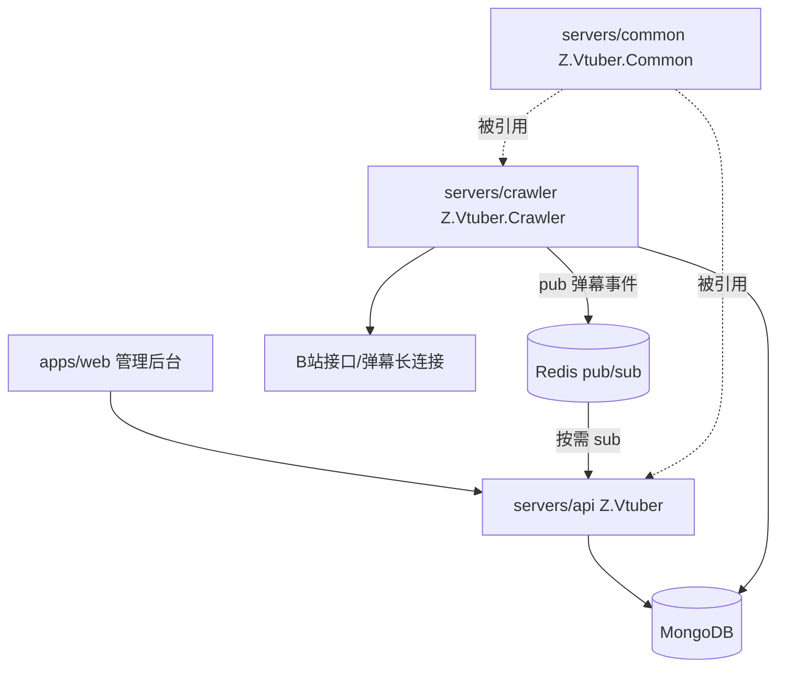
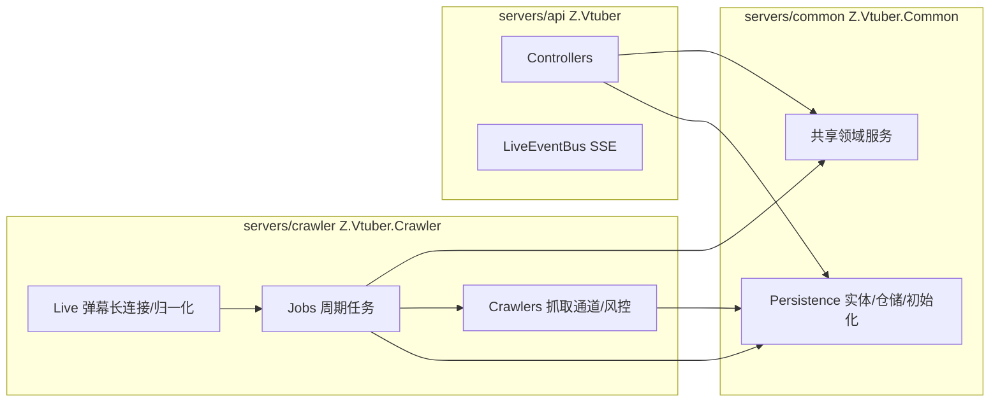
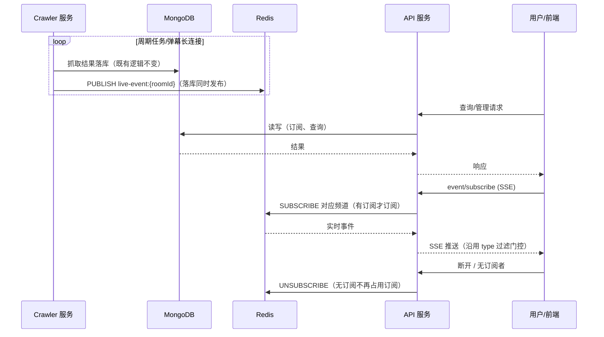

# 抓取与 API 服务拆分 - 技术提案

**功能名称**: 抓取与 API 服务拆分
**关联 PRD**: `docs/product/draft/20260901-api-crawler-split-prd.md`
**技术提案版本**: v1.3
**创建日期**: 2026-09-01
**作者**: Deliay
**feat-branch**: `feat/api-crawler-split`

> v1.1 返工说明：按评审意见，服务间事件通道由「MongoDB 仓储轮询」改为「消息中间件 pub/sub」——crawler 发布事件，api 在有 SSE 订阅请求时按需订阅、无订阅或断开后退订；消息中间件通过 Aspire 编排。
>
> v1.2 返工说明：按评审意见，crawler 增加健康检查接口 `/health`，供 Aspire 与部署环境探活，见 5.2 实现点 3 与 6.1 决策。
>
> v1.3 返工说明：按评审结论，消息中间件选型确认为 **Redis（pub/sub）**，全文落定，见 6.1 / 6.2。

## 1. 概述

### 1.1 背景

当前抓取与 API 同处于 `servers/api`（`Z.Vtuber.csproj`）一个工程中、同一进程内运行：周期性抓取任务（`Jobs/`）、B 站直连/拟真抓取通道（`Crawlers/`）、弹幕长连接（`Live/LiveEventSource`）与对外 API（`Controllers/`）共享宿主。按 PRD 要求将其拆分为两个独立部署的服务，公共类型抽取为共享项目。

### 1.2 目标

- 新增 `servers/common`（命名空间 `Z.Vtuber.Common`）：承载两个服务共享的公共类型；
- 新增 `servers/crawler`（命名空间 `Z.Vtuber.Crawler`）：承载全部抓取逻辑，独立 Worker 进程运行；
- `servers/api` 收敛为纯 API 服务：只保留对外接口与读侧能力；
- 在 `servers/` 下提供解决方案文件并正确配置项目相对路径；
- 为 crawler 增加与 api 同体系的镜像构建流水线，镜像名 `z-vtuber-crawler`；
- 对外行为零变化：契约不变、数据不迁移、现有测试保持绿色。

### 1.3 范围

**做**：

- 解决方案与工程结构调整：`servers/Z.Vtuber.slnx`、`servers/common`、`servers/crawler`、`servers/api` 瘦身；
- 代码搬迁与命名空间调整（`Z.Vtuber.Common` / `Z.Vtuber.Crawler`），不改动业务逻辑；
- crawler 独立宿主（Worker SDK）、健康检查接口 `/health`、`servers/crawler/Dockerfile`、`.github/workflows/build-crawler-image.yml`；
- 引入 Redis（Aspire 编排）：crawler 发布弹幕事件，api 按需订阅（有 SSE 订阅请求才订阅、无订阅/断开后退订）；
- Aspire 编排增加 crawler 项目与 Redis 资源；
- API 侧弹幕事件 SSE 推送通道的跨进程改造（Redis pub/sub）。

**不做**：

- 任何业务功能新增与对外契约变更（`contracts/bilibili-crawler.openapi.yaml` 不动）；
- 数据库结构与历史数据迁移；
- 前端改造；
- 抓取服务对外暴露 HTTP 接口。

## 2. 技术架构

### 2.1 系统架构图



### 2.2 技术栈

| 层级 | 技术选型 | 说明 |
|------|---------|------|
| API 服务 | C# (.NET 10) + ASP.NET Core | 现有工程瘦身，命名空间保持 `Z.Vtuber` |
| 抓取服务 | C# (.NET 10) Worker | `Microsoft.NET.Sdk.Worker`，后台任务宿主 + `/health` 健康检查接口 |
| 公共项目 | C# (.NET 10) 类库 | `Z.Vtuber.Common`，实体/仓储/共享服务 |
| 数据库 | MongoDB | 两个服务各自直连，共享既有集合 |
| 消息中间件 | Redis（pub/sub） | 弹幕事件 pub/sub，Aspire 编排（`Aspire.StackExchange.Redis`），选型见 6.2 |
| 抓取库 | Mikibot.Crawler 1.0.9 | 仅 crawler 引用，api 移除该依赖 |
| 编排 | Aspire | AppHost 增加 crawler 项目引用 |

### 2.3 模块划分



**归属判定规则**：只被一方使用的代码归该方；被双方使用的代码入 common。按此规则盘点现有文件（`servers/api` 下 57 个源文件）：

| 归属 | 内容 |
|------|------|
| common | `Persistence/` 全量（10 实体 + 仓储 + `MongoDbInitializer` + `BsonConvert`）；共享领域服务 `CookiePoolService`、`SubscriptionService`、`LiveSessionTracker`、`LiveStatusStateMachine`、`PubTsExtractor`、`SpaceTimelinePaging`；共享模型 `LiveEvent`；`Configuration/BilibiliCrawlerOptions`（API 读取Cookie池状态等仍依赖其定义时保留于 common，否则归 crawler——以实现时实际引用为准） |
| crawler | `Crawlers/` 全量（`IBiliApiClient`/直连/拟真/弹性装饰器/风控/退避注册表/`BilibiliAccountProvider`）、`Jobs/` 全量（4 个周期任务 + `PeriodicJobBase` + `CrawlLockProvider`）、`Live/LiveEventSource`、`DanmakuClientFactory`、`DanmakuEventNormalizer`、`GiftPriceExtractor`、`LiveEventTextExtractor`、`Services/AccountInfoCrawler`、`CookieNavProbeService` |
| api | `Controllers/` 全量、`Live/LiveEventBus`（SSE 订阅门控）、`Program.cs`、appsettings |

注：`CookiePoolService`（三态凭证池）被 crawler（选号抓取）与 api（Cookie 状态展示）共同使用；`SubscriptionService` 被 api（订阅管理）与 crawler（抓取任务读取订阅）共同使用，故均入 common。

## 3. API 设计

### 3.1 API 契约

本期不变更契约。`contracts/bilibili-crawler.openapi.yaml` 保持原样，全部既有端点由瘦身后的 `servers/api` 原样提供（统一前缀 `/api/b`，含 backstage 聚合与健康检查）。

### 3.2 内部接口

两个服务之间不引入任何同步调用。持久数据仍仅通过共享 MongoDB 集合交换：

| 方向 | 集合 | 说明 |
|------|------|------|
| crawler 写 / api 读 | `bilibili_live_event`、`bilibili_live_session`、`bilibili_live_status`、`bilibili_space_timeline`、`bilibili_account_basic_info`、`bilibili_cookie_account_info` | 抓取产出 |
| api 写 / crawler 读 | `bilibili_subscription` | 订阅管理写入，抓取任务消费 |
| 双向 | `bilibili_cookie` | api 录入/状态展示，crawler 池化消费与状态回写 |

弹幕事件的实时推送通道改为 Redis pub/sub：crawler 侧 `LiveEventSource` 归一化出事件后，在落库的同时向 Redis 频道发布；api 侧仅当存在 SSE 订阅请求时订阅对应频道，无订阅或全部断开后退订。事件以 MongoDB 落库为准，Redis 通道只承担实时分发（丢失可接受，不影响数据完整性）。详细方案见 5.2 实现点 2，选型结论见 6.2。

## 4. 数据模型

### 4.1 数据库设计

不新增、不变更任何集合与索引。既有 10 个集合与 `MongoDbInitializer` 的索引初始化逻辑原样搬入 common；crawler 与 api 启动时均可执行幂等的索引初始化（现有实现已为幂等）。

### 4.2 缓存设计

不引入缓存。原进程内状态（`CrawlBackoffRegistry` 退避表、`CrawlLockProvider` 锁）随抓取任务全部归入 crawler 进程，无需跨进程共享。

## 5. 技术实现方案

### 5.1 核心流程



### 5.2 关键实现点

#### 实现点 1: 工程拆分与解决方案

- **描述**: 新建 `servers/common/Z.Vtuber.Common.csproj`（类库，net10.0）与 `servers/crawler/Z.Vtuber.Crawler.csproj`（Worker SDK，net10.0）；按 2.3 归属表搬运文件并调整命名空间；`servers/api` 移除已搬出代码及对 `Mikibot.Crawler` 的引用，新增对 common 的项目引用；crawler 引用 common 与 `Mikibot.Crawler`、`Aspire.MongoDB.Driver` 等。
- **slnx 说明**: 需求要求「slnx 挪到 servers/ 目录下并修改项目路径」。经核查，当前仓库（含 main 分支）不存在任何 `.sln`/`.slnx` 文件，故无文件可挪——本提案按需求意图在 `servers/` 下**新建** `servers/Z.Vtuber.slnx`，纳入 api/common/crawler 三个项目及 `../tests/Z.Vtuber.Tests`、`../infra/apphost`（相对路径相应配置为 `../` 上溯）。
- **技术细节**: 纯搬运，不改动任何类型成员与逻辑；命名空间 `Z.Vtuber.Persistence` 等统一调整为 `Z.Vtuber.Common.*`，抓取侧类型调整为 `Z.Vtuber.Crawler.*`，api 侧保持 `Z.Vtuber.*`。
- **风险点**: 反射/约定绑定处（如 OpenAPI、DI 注册）需在迁移后全量回归。

#### 实现点 2: 弹幕事件通道改造为 Redis pub/sub

- **描述**: 原链路 `LiveEventSource`（进程内）→ `LiveEventBus` → SSE。拆分后事件源位于 crawler：`LiveEventSource` 归一化出 `LiveEvent` 后，在落库 `bilibili_live_event` 的同时向 Redis 频道 `PUBLISH`；api 侧 `LiveEventBus` 保留 SSE 订阅门控语义，数据源改为 Redis 订阅——**按需订阅**：存在 SSE 订阅者时才 `SUBSCRIBE` 相应频道，最后一个订阅者断开后 `UNSUBSCRIBE`，不空挂订阅。
- **技术细节**:
  - 频道按房间划分：`live-event:{roomId}`，载荷为归一化后的 `LiveEvent` JSON；api 侧沿用现有 `type` 过滤门控；
  - 订阅生命周期由 `LiveEventBus` 的订阅计数驱动：首个订阅者加入时订阅频道，计数归零时退订；
  - 事件可靠性以 MongoDB 落库为准：Redis pub/sub 为 fire-and-forget，api 未订阅期间的事件不补推（与现状「只有在线订阅者收推送」语义一致），历史事件仍走 `event/range`/`event/search` 查库；
  - 连接由 Aspire 注入：两服务引用 `Aspire.StackExchange.Redis`，连接串 `ConnectionStrings:messaging`（见实现点 4）。
- **风险点**: api 重启窗口内的实时推送会丢（落库不受影响），属可接受语义；Redis 单点为基础设施容器，内网小规模场景可接受。

#### 实现点 3: crawler 独立宿主、健康检查与流水线

- **描述**: `servers/crawler/Program.cs` 以 `Host.CreateApplicationBuilder` 承载 4 个周期任务与弹幕长连接（原 `Program.cs` 中对应 DI 注册平移）；同时暴露健康检查接口 `GET /health`：csproj 增加 `FrameworkReference Microsoft.AspNetCore.App`，宿主内挂最小 Kestrel（端口可配置，默认 8080），`AddHealthChecks` + `MapHealthChecks("/health")`，健康项包含进程存活与 MongoDB 连通性；新增 `servers/crawler/Dockerfile`（多阶段构建，restore 需同时拷贝 common 与 crawler 的 csproj，EXPOSE 8080）；新增 `.github/workflows/build-crawler-image.yml`，参照 `build-api-image.yml`：`release`/`release/**` 推送或手动触发，路径过滤 `servers/crawler/**`、`servers/common/**`，镜像 tag 为 `${DOCKER_ENDPOINT}/zero-tools/z-vtuber-crawler:{sha}` 与 `:latest`。
- **技术细节**: 同步在 `build-api-image.yml` 的路径过滤中补充 `servers/common/**`（common 变更应同时触发两个镜像重建）；api 的 Dockerfile 同步补充 common 项目拷贝；Aspire 侧 crawler 资源以 `.WithHttpHealthCheck("/health")` 接入探活（见实现点 4）。
- **风险点**: 镜像上下文为仓库根，需注意 Dockerfile 中 common 的 COPY 路径，漏拷会导致 restore 失败；健康端点仅做探活，不承载业务 API，不对外暴露其他路由。

#### 实现点 4: Aspire 编排与配置

- **描述**: `infra/apphost/AppHost.cs` 增加 `builder.AddProject<Projects.Z_Vtuber_Crawler>("crawler").WithReference(mongo)` 并 `.WithHttpHealthCheck("/health")`（健康检查接口探活）；同时增加 Redis 资源 `builder.AddRedis("messaging")`，crawler 与 api 均 `.WithReference(messaging)`，连接串由 Aspire 注入 `ConnectionStrings:messaging`（两服务引用 `Aspire.StackExchange.Redis`）；crawler 的 appsettings 携带 `BilibiliCrawler` 节；api 的 appsettings 移除 `BilibiliCrawler` 节（若该 Options 归 crawler）。
- **风险点**: 非 Aspire 的裸部署场景需在部署文档中说明 crawler/api 所需的 Redis 环境变量；镜像流水线不变（Redis 为基础设施容器，不进业务镜像）。

## 6. 技术决策

### 6.1 决策列表

| 决策 | 选项 A | 选项 B | 最终选择 | 原因 |
|------|--------|--------|---------|------|
| 消息中间件选型 | Redis（pub/sub） | RabbitMQ / Kafka | A（Redis） | 评审确认使用 Redis；对比见 6.2 |
| 公共代码复用 | 双方各复制一份 | 共享类库项目 common | B | 需求明确要求公共类型单份维护，避免口径漂移 |
| crawler 宿主形态 | ASP.NET Core（Web SDK） | Worker SDK + FrameworkReference 挂最小 Kestrel | B | 抓取服务除 `/health` 探活外无 HTTP 端点，Worker 语义最简；健康检查按评审要求保留 |
| crawler 健康检查 | 不提供（纯后台进程） | 提供 `GET /health`（进程存活 + MongoDB 连通性） | B | 评审明确要求抓取服务有健康检查接口，供 Aspire 与部署环境探活 |
| 服务间通信 | 新增 RPC/HTTP 调用 | 共享数据库 + 异步 pub/sub | B | PRD 约束：不引入同步调用依赖；实时事件走异步消息，持久数据走库 |
| 测试项目 | 按三项目拆分测试工程 | 保持 `tests/Z.Vtuber.Tests` 单工程引用三项目 | B | 最小改动，现有测试全部平移即回归；后续可按需再拆 |
| slnx | 无文件可挪，跳过 | 在 servers/ 下新建 slnx | B | 仓库现状无 sln/slnx，按需求意图新建并正确配置相对路径 |

### 6.2 消息中间件选型（评审已确认：Redis）

场景特征：单生产者（crawler）单消费者（api）；消息为弹幕事件实时分发，**事件已落库 MongoDB，通道本身不要求投递保证与持久化**；api 侧按需订阅/退订；部署为内网小规模，Aspire 编排。

| 维度 | Redis（pub/sub） | RabbitMQ | Kafka |
|------|------------------|----------|-------|
| 匹配度 | pub/sub 语义天然贴合「有订阅才投递、无订阅即丢弃」 | 队列语义，需声明 exchange/queue 模拟 fan-out，无消费者时消息堆积需配 TTL | 日志语义，面向高吞吐流式场景，本场景严重过重 |
| 投递保证 | fire-and-forget，无持久化（本场景可接受，落库兜底） | 可持久化、可 ACK（本场景用不上） | 持久化、可回放（本场景用不上） |
| Aspire 集成 | `AddRedis` 一等支持，`Aspire.StackExchange.Redis` 客户端 | `AddRabbitMQ` 一等支持，`Aspire.RabbitMQ.Client` | 有集成但组件重（broker+zk/kraft），本地编排启动慢 |
| 运维成本 | 极低，单容器 | 中，需管理 exchange/queue | 高，内网小规模不值得 |
| 额外收益 | 可顺带承担后续缓存需求 | 路由能力强（用不上） | 流处理生态（用不上） |

**最终选择：Redis（pub/sub），评审已确认。** 语义最贴合「按需订阅、无订阅即弃、落库兜底」的本场景，Aspire 集成与运维成本最低；后续如需离线补投再评估迁移 RabbitMQ（Kafka 对本场景无收益，不采用）。

### 6.3 依赖与约束

| 类型 | 内容 | 说明 |
|------|------|------|
| 依赖 | MongoDB 连接串 | 两服务共用 `ConnectionStrings:mongo`，Aspire 注入 |
| 依赖 | Redis 连接 | 两服务共用 `ConnectionStrings:messaging`，Aspire 注入（`Aspire.StackExchange.Redis`） |
| 依赖 | `Mikibot.Crawler` 1.0.9 | 仅 crawler 引用 |
| 约束 | 契约不变 | `contracts/bilibili-crawler.openapi.yaml` 零改动 |
| 约束 | TDD | 拆分后现有测试全绿，新增 pub/sub 与按需订阅逻辑补测试 |
| 约束 | 纯搬运 | 不借机重构业务逻辑 |

## 7. 项目结构

```
servers/
├── Z.Vtuber.slnx                          # 新建：api/common/crawler + tests + apphost
├── api/
│   ├── Controllers/                       # 保留：6 个控制器
│   ├── Live/LiveEventBus.cs               # 保留：SSE 门控（改为消息订阅驱动，按需订阅/退订）
│   ├── Program.cs                         # 瘦身：移除抓取侧注册，接入消息订阅
│   ├── Dockerfile                         # 改造：补充 common 拷贝
│   └── Z.Vtuber.csproj                    # 移除 Mikibot.Crawler，引用 common + 消息客户端
├── common/
│   ├── Persistence/                       # 搬入：实体/仓储/MongoDbInitializer/BsonConvert
│   ├── Services/                          # 搬入：CookiePool/Subscription/SessionTracker 等共享服务
│   ├── Live/LiveEvent.cs                  # 搬入：共享事件模型
│   └── Z.Vtuber.Common.csproj             # 新建类库
└── crawler/
    ├── Crawlers/                          # 搬入：抓取通道/风控/退避
    ├── Jobs/                              # 搬入：4 周期任务 + 基类 + 锁
    ├── Live/                              # 搬入：LiveEventSource/弹幕客户端/归一化（新增事件发布）
    ├── Services/                          # 搬入：AccountInfoCrawler/CookieNavProbeService
    ├── Configuration/BilibiliCrawlerOptions.cs
    ├── Program.cs                         # 新建：Worker 宿主 + /health 健康检查
    ├── Dockerfile                         # 新建（EXPOSE 8080）
    └── Z.Vtuber.Crawler.csproj            # 新建 Worker 项目（引用 common + 消息客户端）
.github/workflows/build-crawler-image.yml  # 新建：zero-tools/z-vtuber-crawler
infra/apphost/AppHost.cs                   # 增加 crawler 项目与 Redis 资源
tests/Z.Vtuber.Tests/                      # 引用调整为三项目，用例平移
```

## 8. 测试策略

### 8.1 测试覆盖要求

- 单元测试覆盖率: >= 80%（核心逻辑，拆分不降低既有覆盖）
- API 测试覆盖的端点: 全部既有端点回归（契约不变）

### 8.2 测试类型

| 类型 | 工具 | 覆盖范围 |
|------|------|---------|
| 单元测试 | xUnit | 现有用例随代码平移后全绿；新增 pub/sub 发布、按需订阅/退订（订阅计数归零退订）、crawler `/health` 健康项用例 |
| 集成测试 | Testcontainers (MongoDB + Redis) | 仓储与聚合端点回归；crawler pub → api sub 端到端；crawler 写 / api 读的跨服务读写一致性 |
| 构建验证 | dotnet build / docker build | slnx 全量构建；两个 Dockerfile 可构建 |

## 9. 部署方案

### 9.1 环境规划

| 环境 | 用途 | 部署方式 |
|------|------|---------|
| 本地/Aspire | 开发联调 | AppHost 编排 mongo + Redis + crawler + api + web |
| 内网 | 实际使用 | 两个独立容器：`zero-tools/z-vtuber-api` 与 `zero-tools/z-vtuber-crawler`，共用 MongoDB 与 Redis（基础设施容器） |

### 9.2 配置管理

- 两服务共用 `ConnectionStrings:mongo` 与 `ConnectionStrings:messaging`（Redis，Aspire 注入）；
- `BilibiliCrawler` 节仅 crawler 需要（api appsettings 中移除）；
- 镜像流水线复用既有 `DOCKER_ENDPOINT`/`DOCKER_USER`/`DOCKER_PASSWORD` secrets。

## 10. 验收标准

- [ ] 技术方案评审通过（消息中间件选型已确认为 Redis）
- [ ] slnx 全量构建通过，三项目引用关系正确
- [ ] crawler 可独立启动并执行全部抓取任务与弹幕长连接，事件落库同时向 Redis 发布；`GET /health` 健康检查可访问（含 MongoDB 连通性）
- [ ] api 可独立启动，全部既有端点回归通过（契约零变更）；SSE 在有订阅时收到实时推送，无订阅/断开后退订
- [ ] 任一服务停止时另一服务行为正常
- [ ] 单元/集成测试全绿
- [ ] `z-vtuber-crawler` 镜像由新流水线构建推送成功
- [ ] Aspire 一键编排（mongo + Redis + 两服务 + web）联调通过

## 11. 相关文档

- 关联 PRD：`docs/product/draft/20260901-api-crawler-split-prd.md`
- 关联 Contract：`contracts/bilibili-crawler.openapi.yaml`（本期不变更）
- 开发规范：`docs/engineering/common-rules.md`、`docs/engineering/backend-rules.md`
- 参考流水线：`.github/workflows/build-api-image.yml`
