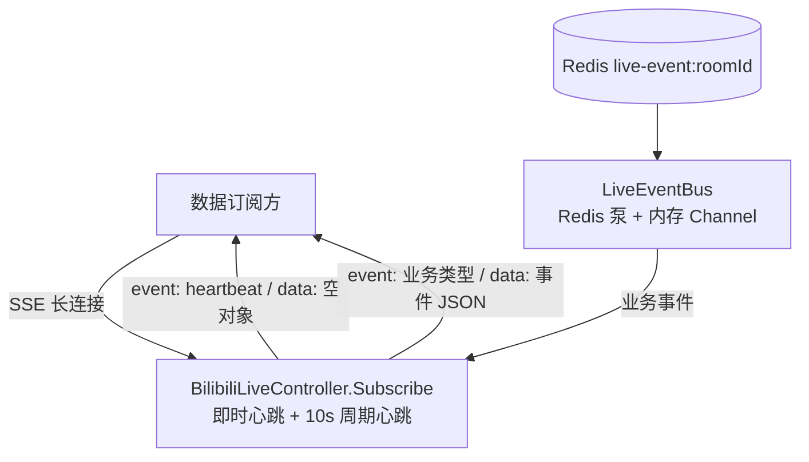
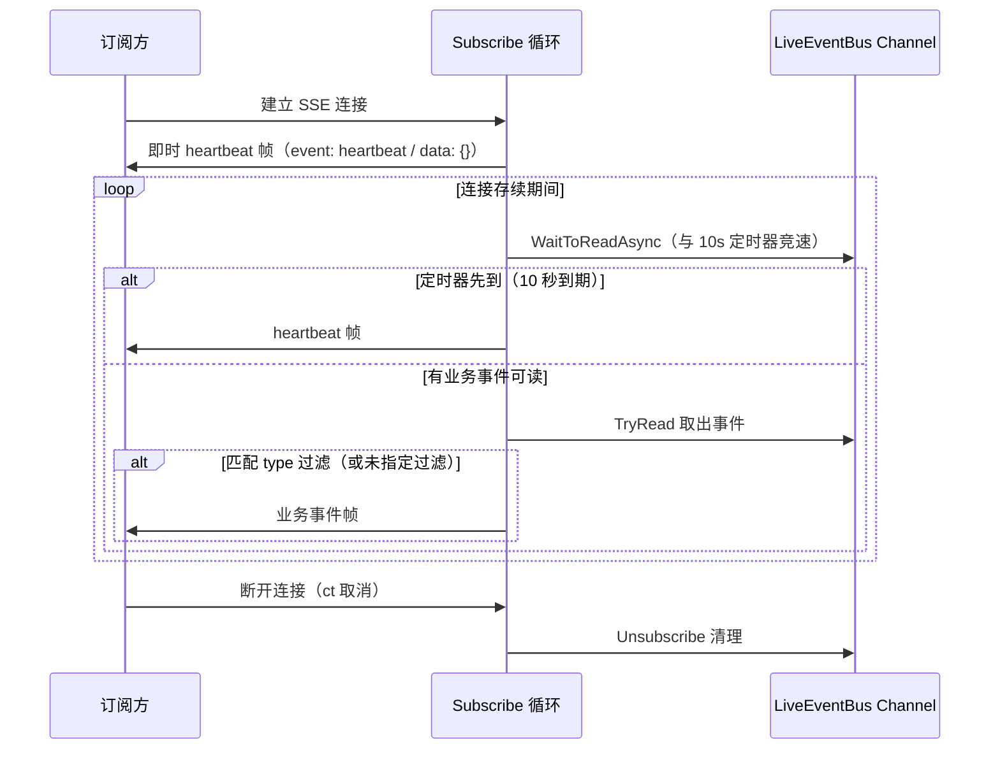

# 直播间实时事件订阅心跳 - 技术提案

**功能名称**: 直播间实时事件订阅心跳
**关联 PRD**: `docs/product/draft/20260903-live-event-subscribe-heartbeat-prd.md`
**技术提案版本**: v1.0
**创建日期**: 2026-09-03
**作者**: Deliay
**feat-branch**: `feat/live-event-subscribe-heartbeat`（需求总分支；实现分支另行切出）

## 1. 概述

### 1.1 背景

`GET /api/b/live/{roomId}/event/subscribe`（`BilibiliLiveController.Subscribe`，`servers/api/Controllers/BilibiliLiveController.cs:148`）以 SSE（`text/event-stream`）推送直播间实时事件：事件经 `LiveEventBus`（`servers/api/Live/LiveEventBus.cs`）从 Redis 频道泵入内存 Channel，控制器 `await foreach` 读取并逐帧写入响应。当直播间无业务事件时连接长时间完全静默，调用方无法区分「无事件」与「断连」，且中间网络设备可能回收空闲长连接。

本需求在该端点增加心跳帧：连接建立后立即发送一次，之后每 10 秒一次，事件类型 `heartbeat`，不携带额外数据。

### 1.2 目标

- `Subscribe` 推送循环重构为「读事件 / 心跳定时器」竞速模式：每轮等待 `ChannelReader` 可读或 10 秒定时器触发，先到者先处理；
- 连接建立后、进入循环前立即写入一帧 `heartbeat`；
- 心跳帧格式与业务事件一致：`event: heartbeat` + `data: {}`（空对象，不携带业务数据）；
- 心跳为**连接级输出**：在控制器内生成，不经 `LiveEventBus` / Redis 发布、不落库、不受 `type` 过滤影响；
- 更新 `contracts/bilibili-crawler.openapi.yaml` 中该端点的描述，前端重新生成契约类型。

### 1.3 范围

- **做**：`Subscribe` 推送循环重构（即时心跳 + 10 秒周期心跳）、契约描述更新、测试覆盖；
- **不做**：
  - 心跳间隔的配置化（PRD 固定 10 秒，实现为常量）；
  - 心跳入事件总线 / Redis / Mongo（心跳是每连接独立产生的存活信号，不是直播间事件）；
  - 前端 UI 变更（前端暂无 SSE 消费方，仅重新生成契约类型）。

## 2. 技术架构

### 2.1 系统架构图



心跳在控制器内本地生成（上图 `CTRL` 内部），不经过 `LiveEventBus` / Redis / Mongo 任何一跳。

### 2.2 技术栈

| 层级 | 技术选型 | 说明 |
|------|---------|------|
| 后端 | .NET 10 / C#（现有栈） | 控制器内就地改造，无新增依赖 |
| 契约 | OpenAPI YAML（`contracts/`） | 端点描述更新，schema 无结构性变更 |
| 测试 | xUnit（现有 `BilibiliLiveControllerTests` 模式） | 假 `ILiveEventBus` + 取消令牌驱动读取 |

### 2.3 模块划分

| 模块 | 职责 | 关键技术点 |
|------|------|-----------|
| `BilibiliLiveController.Subscribe` | 即时心跳、周期心跳与业务事件的单循环交错写出 | `ChannelReader.WaitToReadAsync` 与 `Task.Delay` 竞速；所有写帧仍在同一请求循环内串行执行，无并发写 |
| `contracts/bilibili-crawler.openapi.yaml` | 端点描述补充心跳行为 | 纯描述性变更，无破坏性 |

## 3. API 设计

### 3.1 API 契约

更新 `contracts/bilibili-crawler.openapi.yaml` 中 `/api/b/live/{roomId}/event/subscribe` 端点的 `description`，补充心跳行为（**纯描述性增量，无破坏性变更**）：

```yaml
/api/b/live/{roomId}/event/subscribe:
  get:
    summary: 订阅直播间实时事件（SSE）
    description: >-
      订阅直播间实时事件，可传入一个或多个 type 仅推送匹配类型的事件，不传 type 推送全部类型。
      连接建立后立即发送一条 heartbeat 事件，之后每 10 秒发送一条（event: heartbeat，data 为空对象 {}）；
      heartbeat 为连接存活信号，不受 type 过滤影响，且不持久化、不出现在历史事件查询结果中。
    responses:
      "200":
        description: text/event-stream，仅推送连接建立之后的事件；另含连接级 heartbeat 帧
```

#### 心跳帧线格式（与业务事件帧同构）

```
event: heartbeat
data: {}

```

- `data` 固定为空对象 `{}`，不携带 roomId、时间戳等任何字段（PRD 明确不需要额外数据）；
- 心跳帧不使用 `LiveEvent` 模型序列化，由控制器直接写出固定内容。

### 3.2 内部接口

无新增内部接口。`ILiveEventBus`（`Subscribe` / `Unsubscribe` / `TryPublish`）签名不变；心跳不进入事件总线。

## 4. 数据模型

无数据库、缓存变更。心跳不落库，`bilibili_live_event` 集合与文本索引不受影响。

## 5. 技术实现方案

### 5.1 核心流程



### 5.2 关键实现点

#### 实现点 1: 推送循环重构（定时器竞速）

- **描述**: 现有循环为 `await foreach (var liveEvent in subscription.Reader.ReadAllAsync(ct))`，无法在无事件时插入心跳。重构为手动循环：每轮用 `Task.WhenAny(reader.WaitToReadAsync(ct).AsTask(), Task.Delay(HeartbeatInterval, ct))` 竞速；定时器先到则写心跳帧并进入下一轮；可读先到则 `TryRead` 取出事件、按既有 type 过滤逻辑决定是否写帧。循环开始前先写一帧即时心跳。
- **技术细节**: 心跳间隔为常量 `private static readonly TimeSpan HeartbeatInterval = TimeSpan.FromSeconds(10)`；每轮重建 `Task.Delay`，因此心跳实际节奏为「自上一轮起 10 秒」，事件密集时心跳会顺延——实现简单且满足「约 10 秒间隔」的语义（详见 6.1 决策）；所有 SSE 写帧仍在同一个请求处理循环内串行发生，不存在与心跳并发写响应体的竞态；`ct` 取消时 `WaitToReadAsync` / `Task.Delay` 均抛出 `OperationCanceledException`，由 ASP.NET 正常结束请求，`finally` 中 `eventBus.Unsubscribe` 清理逻辑不变。
- **风险点**: `WaitToReadAsync` 返回 `false`（Channel 完成，即最后一个订阅者退订导致泵关闭）时应 `break` 退出循环，而非继续空转。

#### 实现点 2: 心跳帧写出

- **描述**: 心跳帧固定写出 `event: heartbeat\n` + `data: {}\n\n` 并 `FlushAsync`，与业务事件帧共用同一写出路径风格。
- **技术细节**: 不构造 `LiveEvent`、不经过 `ToEventDto` 序列化；心跳不受 `types`（type 过滤）判断影响，写帧逻辑独立于过滤分支；客户端断开时 `WriteAsync`/`FlushAsync` 抛异常或 `ct` 触发取消，连接自然终止，无异常风暴。
- **风险点**: 无。

## 6. 技术决策

### 6.1 决策列表

| 决策 | 选项 A | 选项 B | 最终选择 | 原因 |
|------|--------|--------|---------|------|
| 心跳产生位置 | 控制器内按连接本地生成 | 经 LiveEventBus/Redis 发布 | A | 心跳是连接存活信号而非直播间事件；走总线会广播给所有订阅者并污染 Redis 频道，且需要防落库的特殊处理 |
| 心跳节奏 | 每轮循环 10 秒定时（事件密集时顺延） | 独立固定 10 秒 tick | A | 单循环实现最简单，无并发写问题；事件密集时连接本就活跃，心跳顺延不影响存活判定，满足 PRD「约 10 秒」 |
| 心跳是否受 type 过滤 | 不受过滤，始终发送 | 仅当过滤包含 heartbeat 时发送 | A | PRD 明确心跳为连接级信号；若受过滤，仅订阅单类事件的调用方会在无该类事件时失去存活信号 |
| 心跳 data 内容 | 空对象 `{}` | 携带 roomId/时间戳 | A | PRD 明确不需要额外数据；空对象保持帧格式与业务事件同构，便于客户端统一解析 |
| 心跳间隔配置化 | 常量 10 秒 | 配置项 | A | PRD 固定 10 秒，无调参需求，避免无谓配置面 |
| 心跳持久化 | 不落库、不进历史查询 | 作为普通事件落库 | A | 每连接 10 秒一条会产生海量无意义记录；PRD 明确历史查询结果不含心跳 |

### 6.2 依赖与约束

| 类型 | 内容 | 说明 |
|------|------|------|
| 依赖 | `ILiveEventBus` / `LiveEventBus` 现有实现 | 接口与行为不变，仅控制器消费方式重构 |
| 约束 | SSE 写帧串行 | 所有写帧（心跳 + 业务事件）必须在同一请求循环内串行执行，禁止引入并发写响应体 |
| 约束 | 契约同步 | `contracts/bilibili-crawler.openapi.yaml` 描述更新后前端重新生成 `apps/web/src/api/schema.d.ts` |

## 7. 项目结构

```
servers/api/
└── Controllers/
    └── BilibiliLiveController.cs   # 修改：Subscribe 循环重构（即时心跳 + 10s 定时器竞速 + heartbeat 帧写出）

contracts/
└── bilibili-crawler.openapi.yaml   # 修改：subscribe 端点 description 补充心跳行为

apps/web/src/api/
└── schema.d.ts                     # 重新生成（描述性变更）

tests/Z.Vtuber.Tests/
└── BilibiliLiveControllerTests.cs  # 扩展：心跳用例
```

## 8. 测试策略

### 8.1 测试覆盖要求

- `Subscribe` 心跳与过滤逻辑为本端点核心路径，随控制器测试整体覆盖率 ≥ 80%；
- 既有测试（`dotnet test tests/Z.Vtuber.Tests`）不得回归，特别是 `Subscribe_WithTypeFilter_OnlyPushesMatchingEvents` / `Subscribe_WithoutType_PushesAllEvents`。

### 8.2 测试类型

| 类型 | 工具 | 覆盖范围 |
|------|------|---------|
| 单元测试 | xUnit（复用 `RunSubscribeAsync` 辅助方法模式） | 连接建立后首帧为 heartbeat；无事件时按 10 秒节奏收到 heartbeat（测试可通过注入/缩短间隔或放宽等待窗口验证，实现时以可测试方式处理间隔常量）；指定 type 过滤时 heartbeat 仍到达、被过滤业务事件仍不推送；业务事件与心跳可交错到达且业务事件内容/顺序不变；连接取消后不再产生心跳 |
| 手工验证 | 本地 Aspire 编排 + curl | `curl -N` 订阅真实直播间，观察即时心跳与 10 秒周期心跳；带 `type` 参数订阅验证心跳不受过滤影响 |

## 9. 部署方案

### 9.1 环境规划

| 环境 | 用途 | 部署方式 |
|------|------|---------|
| 本地 | 开发验证 | Aspire 编排（现状） |
| 生产 | 正式运行 | 现有 Docker 镜像流水线 |

### 9.2 配置管理

无新增配置项（心跳间隔为常量 10 秒）；无数据迁移；上线为纯增量行为变更。

## 10. 验收标准

- [ ] 技术方案评审通过
- [ ] Contract 评审通过（subscribe 端点描述含心跳行为）
- [ ] 代码实现完成：连接建立即时心跳 + 每 10 秒周期心跳，`event: heartbeat`、`data: {}`，不受 type 过滤影响
- [ ] 单元测试覆盖达标，既有测试无回归
- [ ] 手工验证：无事件直播间心跳按节奏到达；带过滤订阅心跳正常；断开后心跳停止

## 11. 相关文档

- 关联 PRD: `docs/product/draft/20260903-live-event-subscribe-heartbeat-prd.md`
- 关联 Contract: `contracts/bilibili-crawler.openapi.yaml`
- 前置提案: `docs/engineering/proposals/20260815-proposal-live-event-filter.md`（事件类型过滤）
- 开发规范: `docs/engineering/common-rules.md`、`docs/engineering/backend-rules.md`
