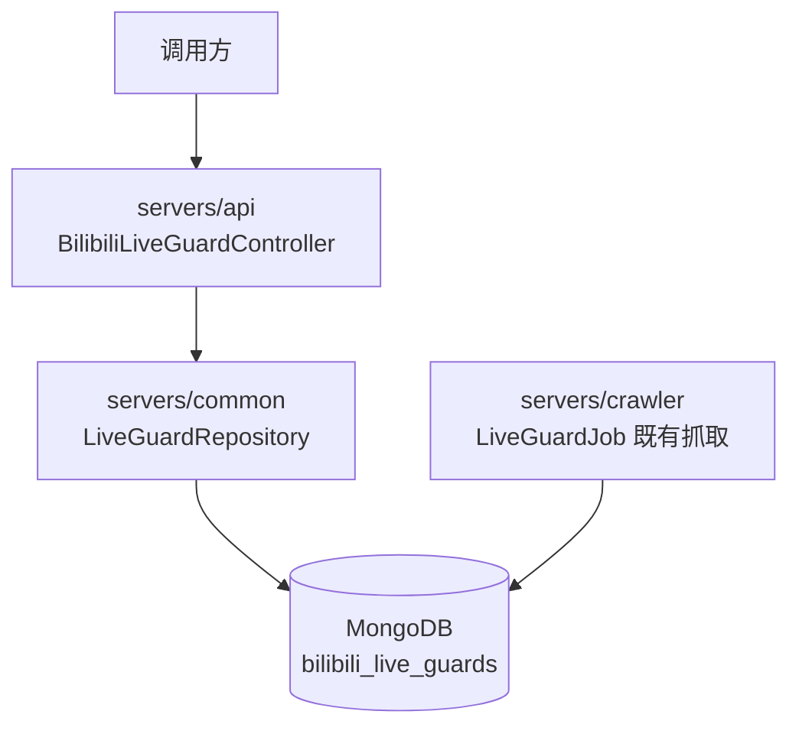
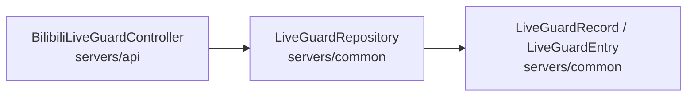
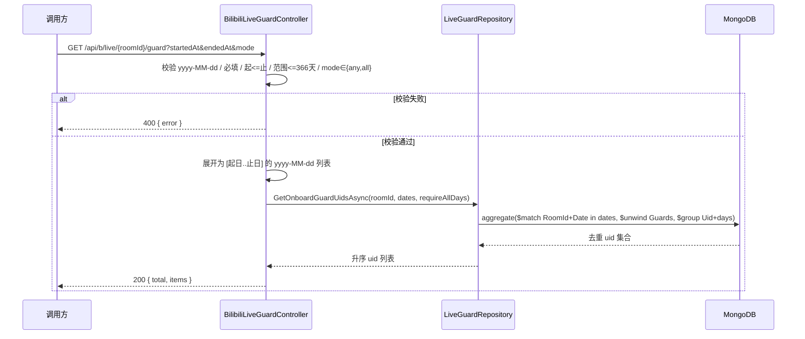

# 在舰查询 - 技术提案

**功能名称**: 在舰查询
**关联 PRD**: [[20260903-live-guard-onboard-query-prd]]
**技术提案版本**: v1.2
**创建日期**: 2026-09-03
**作者**: Deliay
**feat-branch**: `feat/live-guard-onboard-query`

## 1. 概述

### 1.1 背景

「舰长数据抓取」（PR #56，提案见 [[20260831-proposal-live-guard-crawl]]）已按订阅将各主播直播间的舰长名单以「每 mid 每天一条快照」的粒度沉淀至 MongoDB 集合 `bilibili_live_guards`，但读侧没有任何出口。本提案依据 [[20260903-live-guard-onboard-query-prd]] 新增在舰查询 API：给定直播间 `roomId` 与 `startedAt`/`endedAt`（均为 `yyyy-MM-dd`）及统计口径 `mode`（`any`/`all`），返回该直播间在该日期范围内满足口径的在舰用户 uid，按 uid 去重。

### 1.2 目标

- 新增只读查询端点 `GET /api/b/live/{roomId}/guard`，路径参数 `roomId` 指定直播间，查询参数 `startedAt`、`endedAt`（`yyyy-MM-dd`，必填），语义为「起日 00:00 至止日 23:59:59」（首尾两天按全天计入）；
- 查询参数 `mode`（可选，默认 `any`）：`any` 表示范围内任意一天在舰即计入，`all` 表示范围内每一天都在舰才计入；
- 结果按 uid 去重，仅覆盖指定 `roomId` 的快照；
- 参数非法（格式错误、缺失、起日晚于止日、范围超限、mode 取值非法）返回 400 与明确错误信息；
- 遵循契约式开发：先更新 `contracts/bilibili-crawler.openapi.yaml`，再实现。

### 1.3 范围

- **做**：契约新增端点定义；`LiveGuardRepository` 新增按 roomId 的去重查询方法（支持 any/all）；api 新增 Controller 与端点；`MongoDbInitializer` 新增 `RoomId_1_Date_1` 查询索引；仓储与 Controller 集成测试。
- **不做**：crawler 抓取链路任何改动；分页（去重后的 uid 名单一次返回）；跨直播间汇总查询（调用方可逐直播间查询后自行合并）；前端界面。

## 2. 技术架构

### 2.1 系统架构图



### 2.2 技术栈

| 层级 | 技术选型 | 说明 |
|------|---------|------|
| 后端 | ASP.NET Core（MVC Controller） | 沿用既有 `[ApiController]` + `/api/b` 前缀风格 |
| 数据库 | MongoDB（`bilibili_live_guards` 集合） | 复用既有快照数据，无新集合；新增一个 `RoomId_1_Date_1` 查询索引 |
| 契约 | OpenAPI 3.1 YAML（`contracts/`） | 后端为契约生成源，手工同步 |
| 测试 | xUnit + Testcontainers（MongoDB 7.0） | 沿用 `mongo` Collection 集成测试范式 |

### 2.3 模块划分



| 模块 | 职责 | 关键技术点 |
|------|------|-----------|
| `BilibiliLiveGuardController`（新增，servers/api/Controllers/） | 参数解析校验、日期范围展开、返回去重 uid 名单 | `DateOnly.TryParseExact` 严格解析 `yyyy-MM-dd` |
| `LiveGuardRepository`（扩展，servers/common/Persistence/） | 按日期集合聚合查询去重 uid | 聚合管道 `$match` → `$unwind` → `$group` |
| `contracts/bilibili-crawler.openapi.yaml` | 端点与 schema 契约 | 新增 `format: date` 参数与响应 schema |

## 3. API 设计

### 3.1 API 契约

#### 接口 1: 在舰 uid 查询

- **请求**
  - Method: GET
  - Path: `/api/b/live/{roomId}/guard`
  - Path 参数：
    - `roomId`（int64，必填）：直播间 id，复用契约既有 `components/parameters/RoomId`
  - Query:
    - `startedAt`（string, `yyyy-MM-dd`, **必填**）：起始日期，当天 00:00 起计入（北京时间口径，与快照落库口径一致）
    - `endedAt`（string, `yyyy-MM-dd`, **必填**）：结束日期，计入至当天 23:59:59
    - `mode`（string, 可选，默认 `any`）：统计口径。`any` = 范围内任意一天在舰即计入；`all` = 范围内每一天都在舰才计入
- **响应**
  - Status: 200
    ```json
    {
      "total": 2,
      "items": [10001, 10002]
    }
    ```
    - `items`：满足口径的去重在舰 uid 列表（int64，升序）；`total` 恒等于 `items` 长度，便于调用方直接读取数量。
  - Status: 400 —— 参数缺失、格式非法、起日晚于止日、范围超过上限（366 天）、`mode` 非 `any`/`all`：
    ```json
    { "error": "mode must be one of: any, all." }
    ```

### 3.2 契约变更要点

- 新增 path `/api/b/live/{roomId}/guard`，operationId `listOnboardGuardUids`，summary 中文；路径参数复用既有 `components/parameters/RoomId`；
- 现有 `components/parameters/StartedAt`/`EndedAt` 为 `format: date-time` 且可选、UTC 语义，**不可复用**；新增 `StartedDate`/`EndedDate` 参数（`format: date`，`required: true`，描述北京时间口径与全天含边界语义）；
- 新增查询参数 `OnboardMode`（`type: string`，`enum: [any, all]`，`required: false`，默认 `any`）；
- 新增 schema `LiveGuardOnboardList`：`{ total: integer(int32), items: array<integer(int64)> }`。

### 3.3 内部接口

`LiveGuardRepository` 新增：

```csharp
public async Task<IReadOnlyList<long>> GetOnboardGuardUidsAsync(
    long roomId, IReadOnlyList<string> dates, bool requireAllDays, CancellationToken ct = default)
```

- `roomId` 为直播间 id，`dates` 为 Controller 展开后的 `yyyy-MM-dd` 字符串列表（与 `LiveGuardRecord.Date` 同格式），`requireAllDays` 对应 `mode=all`；
- 聚合管道：`$match: { RoomId: roomId, Date: { $in: dates } }` → `$unwind: "$Guards"` → `$group: { _id: "$Guards.Uid", days: { $addToSet: "$Date" } }`；
- `requireAllDays = false`（any）：取全部 `_id` 升序返回；`requireAllDays = true`（all）：仅保留 `days.Count == dates.Count` 的 `_id`，升序返回（`$addToSet` 天然对同 uid 多天命中去重计数）；
- `dates` 为空时直接返回空列表，不发起查询。

## 4. 数据模型

### 4.1 数据库设计

无新增集合。复用既有集合：

#### 集合: `bilibili_live_guards`（`LiveGuardRecord`，每 mid 每天一条快照）

| 字段 | 类型 | 说明 |
|------|------|------|
| Mid | long | 主播 mid |
| RoomId | long | 直播间 id（本功能的过滤字段之一） |
| Date | string | 北京时间 `yyyy-MM-dd` 日快照键（本功能的过滤字段之一） |
| Guards | LiveGuardEntry[] | 当日舰长名单，`Uid` 为去重目标字段 |
| GuardCount | int | 当日舰长数 |
| FetchedAt | DateTime | 抓取时间（UTC） |

索引：既有唯一复合索引 `Mid_1_Date_1`（写入幂等用）保留；本功能按 `RoomId = roomId AND Date $in [...]` 过滤，既有索引前缀为 Mid 无法命中，故在 `MongoDbInitializer` 新增非唯一复合索引 `RoomId_1_Date_1`，随服务启动的既有索引初始化流程创建。

### 4.2 缓存设计

无缓存。查询直接走 MongoDB 聚合，保持实现最简单。

## 5. 技术实现方案

### 5.1 核心流程



### 5.2 关键实现点

#### 实现点 1: 日期语义与「全天含边界」

- **描述**: `startedAt` 的当天开始、`endedAt` 的当天结束，在数据层等价于「快照 `Date` ∈ [startedAt, endedAt] 闭区间」——因为快照本身以北京时间日字符串为键，天然按天离散。
- **技术细节**: Controller 用 `DateOnly.TryParseExact("yyyy-MM-dd")` 严格解析；用 `DateOnly.AddDays` 从起日迭代到止日生成字符串列表；日期口径与 `LiveGuardJob` 落库口径同为北京时间（UTC+8），无需任何时区换算。
- **风险点**: 若调用方误传 `date-time` 字符串会被拒绝——契约与错误信息中明确 `yyyy-MM-dd` 要求。

#### 实现点 2: any/all 口径的去重聚合

- **描述**: 同一 uid 可能在指定直播间的多天快照中重复出现；`any` 口径要求去重，`all` 口径要求「命中天数 == 范围天数」。
- **技术细节**: 聚合管道 `$unwind` 后按 `$group` 到 uid，并用 `$addToSet: "$Date"` 收集该 uid 命中的日期集合——`any` 直接取 `_id`；`all` 过滤 `days.Count == dates.Count`。整个计算在 MongoDB 聚合内完成，避免把全量名单拉到内存；结果按 uid 升序（去重后规模有限，客户端排序即可）。
- **风险点**: 范围内某天无该直播间快照时，`all` 口径下任何 uid 的 `days.Count` 都小于 `dates.Count`，结果自然为空——与 PRD 约定一致（无数据即无法证实在舰）；范围内快照全部缺失时返回空 `items`。

#### 实现点 3: 范围上限保护

- **描述**: 防止病态入参（如起止相差上万年）生成超大 `$in` 列表拖垮查询。
- **技术细节**: Controller 限制 `(endedAt - startedAt).Days <= 366`，超出返回 400；常规月度/季度查询不受影响。

## 6. 技术决策

### 6.1 决策列表

| 决策 | 选项 A | 选项 B | 最终选择 | 原因 |
|------|--------|--------|---------|------|
| 端点归属 | 新建 `BilibiliLiveGuardController` | 塞入既有 `BilibiliLiveController` | 选项 A | 舰长是独立数据域，后续还会长出自己的查询端点 |
| 路由形态 | `/api/b/live/{roomId}/guard`（roomId 路径参数） | `/api/b/live/guard/{mid}/onboard`（mid 路径参数） | 选项 A | 评审结论：跟随契约既有 `/api/b/live/{roomId}/...` 前缀惯例，直播间是舰长名单的直接归属资源 |
| roomId 查询索引 | 新增 `RoomId_1_Date_1` | 复用 `Mid_1_Date_1`（先 roomId→mid 再查） | 选项 A | 避免二次查询与隐式耦合，索引创建成本极低 |
| 去重位置 | MongoDB 聚合 `$group` | 拉到内存 distinct | 选项 A | 避免传输全量名单，聚合语义清晰 |
| 日期过滤方式 | `RoomId = roomId AND Date $in [展开日期]` | 范围比较 `Gte/Lte` | 选项 A | `Date` 是字符串日键，`$in` 语义精确且无字典序边界歧义 |
| mode 默认值 | 缺省按 `any` | `mode` 必填 | 选项 A | 与初版需求（任意一天在舰即统计）语义一致，向后兼容最简单的调用方式 |
| all 口径缺失快照语义 | 无快照天视为不满足（结果可能为空） | 无快照天不计入范围 | 选项 A | 「每天都在舰」必须逐天证实，放宽会得出误导性的「全勤」结论 |
| 响应是否分页 | 一次返回全量 + total | 套 `{total,page,pageSize,items}` | 选项 A | PRD 无分页诉求，单直播间去重名单规模有限（舰长数量级） |
| 复用契约参数 | 复用 `StartedAt/EndedAt` | 新增 `StartedDate/EndedDate` | 选项 B | 既有参数为 `date-time`/UTC/可选，语义不同不可复用 |
| 范围上限 | 不设限 | 限 366 天 | 选项 B | 防病态 `$in`，对正常查询无影响 |

### 6.2 依赖与约束

| 类型 | 内容 | 说明 |
|------|------|------|
| 依赖 | `LiveGuardRecord`/`LiveGuardRepository`（servers/common） | 既有产物，仅扩展只读方法 |
| 依赖 | `LiveGuardRepository` 已在 api `Program.cs` 注册 | 新 Controller 直接构造注入，无新增 DI 注册 |
| 约束 | api 进程不承载抓取任务（servers/api/AGENTS.md） | 本功能为纯读侧，天然符合 |
| 约束 | 契约式开发 | 先改契约再实现，前后端以契约为准 |

## 7. 项目结构

```
contracts/
└── bilibili-crawler.openapi.yaml          # 新增 /api/b/live/{roomId}/guard、参数与 schema
servers/
├── api/
│   └── Controllers/
│       └── BilibiliLiveGuardController.cs # 新增：在舰查询端点
└── common/
    └── Persistence/
        ├── LiveGuardRepository.cs         # 扩展：GetOnboardGuardUidsAsync
        └── MongoDbInitializer.cs          # 扩展：RoomId_1_Date_1 索引
tests/
└── Z.Vtuber.Tests/
    ├── LiveGuardRepositoryTests.cs        # 扩展：any/all/去重/范围/空结果用例
    └── BilibiliLiveGuardControllerTests.cs# 新增：校验与 200 用例
```

## 8. 测试策略

### 8.1 测试覆盖要求

- 覆盖端点：`GET /api/b/live/{roomId}/guard`（200 与全部 400 分支，含 mode 缺省/非法值）；
- 仓储方法覆盖：any/all 口径、跨天去重、roomId 过滤（其他直播间快照不混入）、范围过滤、无数据空结果（含 all 口径下部分天缺快照）。

### 8.2 测试类型

| 类型 | 工具 | 覆盖范围 |
|------|------|---------|
| 仓储集成测试 | xUnit + Testcontainers（`[Collection("mongo")]`） | `GetOnboardGuardUidsAsync` 的过滤、去重与 any/all 语义，沿用 `LiveGuardRepositoryTests` 范式 |
| Controller 集成测试 | xUnit，直接实例化 Controller + 真实仓储 | 参数校验 400 分支、200 响应结构（`total`/`items` 升序去重），沿用 `BilibiliBackstageControllerTests` 范式 |
| DI 接线 | `StartupDiTests` | 无新增注册，既有用例回归即可 |

## 9. 部署方案

### 9.1 环境规划

| 环境 | 用途 | 部署方式 |
|------|------|---------|
| 本地 | 开发与集成测试 | z-aspire 编排（api + crawler + MongoDB） |
| 线上 | 随 api 服务常规发布 | 既有发布流程，无新增配置 |

### 9.2 配置管理

无新增配置项。

## 10. 验收标准

- [ ] 技术方案评审通过
- [ ] Contract 评审通过（`/api/b/live/{roomId}/guard` 定义完整，含 `mode` 枚举）
- [ ] 代码实现完成（Controller + 仓储方法 + 索引）
- [ ] 仓储/Controller 集成测试全部通过
- [ ] 单日、多日、any/all 口径、roomId 过滤、边界日期、空结果、五类 400 用例验证通过
- [ ] 既有测试无回归

## 11. 相关文档

- [[20260903-live-guard-onboard-query-prd]]
- [[20260831-proposal-live-guard-crawl]]
- `contracts/bilibili-crawler.openapi.yaml`
- `docs/engineering/backend-rules.md`
