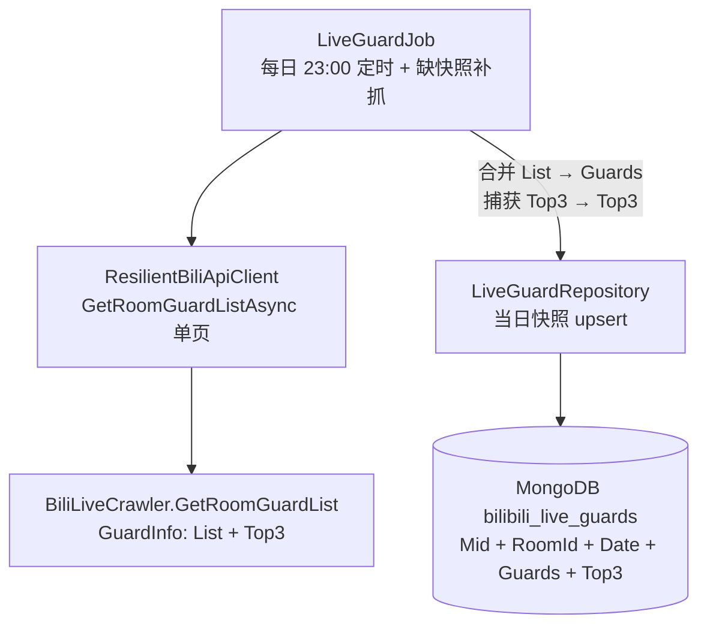
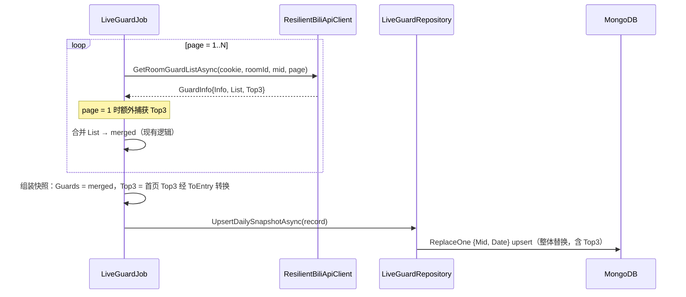

# 舰长 Top3 落库 - 技术提案

**功能名称**: 舰长 Top3 落库
**关联 PRD**: `docs/product/draft/20260903-live-guard-top3-prd.md`
**技术提案版本**: v1.0
**创建日期**: 2026-09-03
**作者**: Deliay
**feat-branch**: `feat/live-guard-top3`（需求总分支；实现分支另行切出）

## 1. 概述

### 1.1 背景

「舰长数据抓取」已上线（`docs/engineering/proposals/20260831-proposal-live-guard-crawl.md`）：`LiveGuardJob` 每日 23:00（北京时间）分页抓取舰长名单，经 `LiveGuardRepository` 以 `(Mid, Date)` upsert 落库每日快照 `bilibili_live_guards`（mid + roomId + guard_list）。

上游抓取库 Mikibot.Crawler 1.0.9 的 `BiliLiveCrawler.GetRoomGuardList(roomId, bId, page, token)` 返回 `GuardInfo { Info, List, Top3 }`，其中 **`Top3` 为 `List<GuardUserInfo>`，与名单条目同构**（uid / 昵称 / 大航海等级 / 粉丝勋章），对应 B 站 guardList 接口响应中的 `top3`（大航海贡献前三，可能含已下船用户）。当前 `LiveGuardJob.FetchAllPagesAsync` 只合并 `info.List`，`info.Top3` 被直接丢弃。本需求将 top3 补入每日快照。

### 1.2 目标

- `LiveGuardRecord` 新增 `Top3` 字段（`List<LiveGuardEntry>`，数组顺序即排名 1–3），与 `Guards` 同一条快照记录落库；
- `LiveGuardJob` 在抓取过程中捕获首页响应的 `GuardInfo.Top3`，经既有 `ToEntry` 转换写入快照；
- 不新增抓取请求、不改调度/风控/补抓逻辑、无契约变更、无索引变更；
- 历史快照不回填，读取兼容（缺省空列表）。

### 1.3 范围

- **做**：快照实体加字段、Job 捕获 top3、测试覆盖；
- **不做**：
  - top3 的对外查询 API 与后台展示（舰长快照消费接口整体留待后续需求）；
  - 历史快照 top3 回填（历史值不可通过现接口还原）；
  - top3 与 guard_list 的交叉去重/合并（两者语义独立，各自保留）。

## 2. 技术架构

### 2.1 系统架构图

本需求为既有链路内的数据补全，架构不变：



### 2.2 技术栈

| 层级 | 技术选型 | 说明 |
|------|---------|------|
| 后端 | .NET 10 / C#（现有栈） | 实体与 Job 就地扩展 |
| 抓取库 | Mikibot.Crawler 1.0.9（现有依赖） | `GuardInfo.Top3: List<GuardUserInfo>` 已解析，无需升级 |
| 数据库 | MongoDB（现有） | 实体加字段，无新集合/新索引 |
| 测试 | xUnit + Testcontainers (Mongo) | 现有测试模式 |

### 2.3 模块划分

| 模块 | 职责 | 关键技术点 |
|------|------|-----------|
| `LiveGuardRecord`（common） | 快照实体新增 `Top3` 字段 | 复用 `LiveGuardEntry` 内嵌类型，缺省 `[]` |
| `LiveGuardJob`（crawler） | 抓取时捕获 top3 并写入快照 | 首页响应取 `GuardInfo.Top3`，经既有 `ToEntry` 转换 |
| `LiveGuardRepository`（common） | 无改动 | 既有 `ReplaceOne + IsUpsert` 整体替换天然覆盖新字段 |

## 3. API 设计

### 3.1 API 契约

无变更。舰长快照暂无对外查询接口，top3 不暴露在任何现有端点中；`contracts/bilibili-crawler.openapi.yaml` 不变。

### 3.2 内部接口

无签名变更。`IBiliApiClient.GetRoomGuardListAsync` 返回的 `GuardInfo` 已携带 `Top3`，仅需 Job 层消费。

`LiveGuardJob.FetchAllPagesAsync` 内部行为调整（实现细节，非接口）：除返回合并名单外，同时带出首页 top3——可以 `record` 元组返回值或 out 参数形式收敛，保持方法内聚（详见 5.2 实现点 1）。

## 4. 数据模型

### 4.1 数据库设计

#### 集合: `bilibili_live_guards`（既有，实体扩展）

实体 `LiveGuardRecord` 新增一个字段：

| 字段 | 类型 | 说明 |
|------|------|------|
| `Top3` | `List<LiveGuardEntry>` | 当次抓取接口返回的大航海贡献前三，**数组顺序即排名**（index 0 = 第 1 名）；接口返回为空时为 `[]`；与 `Guards` 独立存储，不计入 `GuardCount` |

`LiveGuardEntry` 复用现有内嵌类型（Uid / UserName / GuardLevel / MedalName / MedalLevel），与 guard_list 条目字段一致。

**兼容性**：MongoDB 无模式约束，新增字段对存量文档无副作用；存量快照反序列化时 `Top3` 为默认空列表，无需迁移与回填。

索引：不变，仍仅 `(Mid, Date)` 唯一索引。

### 4.2 缓存设计

不涉及缓存变更。

## 5. 技术实现方案

### 5.1 核心流程



### 5.2 关键实现点

#### 实现点 1: top3 捕获位置与首页语义

- **描述**: B 站 guardList 接口的 top3 榜单数据随响应返回，首页（page=1）响应即为权威来源。`FetchAllPagesAsync` 在 `page == 1` 的响应中捕获 `info.Top3`，后续页忽略（避免翻页过程中榜单抖动造成口径不一）。
- **技术细节**: `FetchAllPagesAsync` 返回值由 `List<LiveGuardEntry>?` 调整为携带 top3 的轻量结果（如 `(List<LiveGuardEntry> Guards, List<LiveGuardEntry> Top3)?`），`null` 语义不变（整轮失败不落库）；top3 转换复用现有 `ToEntry(GuardUserInfo)`，逐条映射；top3 为空（`null` 或空列表）时落 `[]`，不视为失败。
- **风险点**: 上游接口异常时 top3 可能缺失但名单正常——按「top3 缺失落空列表」处理，名单数据不因此丢弃，语义可接受。

#### 实现点 2: top3 与名单的独立存储

- **描述**: top3 可能包含已下船的高贡献用户（不在 guard_list 中），也可能与在舰名单重叠。两者语义不同（「贡献前三」vs「在舰名单」），**独立字段存储，不去重、不合并、不计入 GuardCount**。
- **技术细节**: `GuardCount` 维持 `Guards.Count`；`LiveGuardEntry` 不加 Rank 字段——top3 有序数组天然携带排名信息，guard_list 条目的 rank 无业务诉求，避免无谓的模型膨胀。
- **风险点**: 无。

#### 实现点 3: 覆盖写与历史兼容

- **描述**: 仓储层零改动——`UpsertDailySnapshotAsync` 为 `ReplaceOne { IsUpsert = true }` 整体替换，`Top3` 随文档自然覆盖；同日重复抓取后 top3 与名单同口径（同一次成功抓取）。
- **技术细节**: 历史快照无 `Top3` 字段，MongoDB 反序列化为 null——实体初始值 `= []` 兜底（与 `Guards` 现有写法一致），读取侧无需任何判空改造。
- **风险点**: 无。

## 6. 技术决策

### 6.1 决策列表

| 决策 | 选项 A | 选项 B | 最终选择 | 原因 |
|------|--------|--------|---------|------|
| top3 存储位置 | 快照同行新增 `Top3` 字段 | 独立集合 | A | 与名单同一次抓取、同一日期口径；粒度「每主播每天一行」不变；查询/覆盖写最简单 |
| top3 条目类型 | 复用 `LiveGuardEntry` | 新增专用类型 | A | `GuardInfo.Top3` 与名单同为 `GuardUserInfo`，字段完全一致，无差异化需求 |
| 排名表达 | 数组顺序即排名 | 条目加 Rank 字段 | A | top3 定长有序，冗余字段无收益 |
| 与名单关系 | 独立存储，不去重 | 并入 Guards / 去重 | A | 语义不同（贡献榜 vs 在舰），合并会丢失 top3 中已下船用户 |
| 捕获来源 | 仅首页响应 | 每页取最后值 | A | 首页为权威来源；每页覆盖会引入翻页期抖动，且徒增复杂度 |
| 历史快照 | 不回填，缺省空 | 调用现接口回填 | A | top3 为实时榜单，历史值不可还原，强行回填会写入错误数据 |

### 6.2 依赖与约束

| 类型 | 内容 | 说明 |
|------|------|------|
| 依赖 | Mikibot.Crawler 1.0.9 | `GuardInfo.Top3: List<GuardUserInfo>` 已存在，无需升级包 |
| 依赖 | 既有舰长抓取链路 | `LiveGuardJob` / `LiveGuardRepository` 就地扩展，不重构 |
| 约束 | 不新增抓取请求 | top3 仅来自既有名单接口响应 |
| 约束 | 快照粒度不变 | (Mid, Date) 唯一索引 + 整体替换，每日一行 |
| 约束 | 历史不回填 | 存量快照 Top3 缺省空列表 |

## 7. 项目结构

```
servers/common/
└── Persistence/
    └── Entities/
        └── LiveGuardRecord.cs               # 扩展：新增 Top3 字段（List<LiveGuardEntry>，缺省 []）

servers/crawler/
└── Jobs/
    └── LiveGuardJob.cs                      # 扩展：首页捕获 Top3，组装快照时写入；FetchAllPagesAsync 返回值携带 top3

tests/Z.Vtuber.Tests/
├── LiveGuardJobTests.cs                     # 扩展：top3 捕获（首页捕获/空 top3/失败不落库/不计入 GuardCount）
└── LiveGuardRepositoryTests.cs              # 扩展：含 top3 的 upsert 幂等覆盖（Testcontainers）
```

## 8. 测试策略

### 8.1 测试覆盖要求

- 本次变更的核心逻辑（top3 捕获、组装、覆盖写）覆盖率 ≥ 80%；
- 既有测试（`dotnet test tests/Z.Vtuber.Tests`）不得回归。

### 8.2 测试类型

| 类型 | 工具 | 覆盖范围 |
|------|------|---------|
| 单元测试 | xUnit | 首页 top3 捕获并写入快照；top3 顺序保持（排名语义）；top3 为空时落空列表且快照正常落库；top3 不计入 GuardCount、不并入 Guards；top3 含未在舰用户时照常保存；抓取失败时 top3 与名单均不落库 |
| 集成测试 | xUnit + Testcontainers (Mongo) | 含 top3 的快照 upsert；同日重复抓取 top3 随文档整体覆盖；读取无 top3 字段的存量文档反序列化为空列表 |
| 手工验证 | 本地 Aspire 编排 | 订阅真实主播，抓取后在 MongoDB 中确认快照含 top3 且与接口返回一致 |

## 9. 部署方案

### 9.1 环境规划

| 环境 | 用途 | 部署方式 |
|------|------|---------|
| 本地 | 开发验证 | Aspire 编排（现状） |
| 生产 | 正式运行 | 现有 Docker 镜像流水线，纯代码变更，无配置/索引/迁移动作 |

### 9.2 配置管理

无新增配置项；无存量数据迁移。

## 10. 验收标准

- [ ] 技术方案评审通过
- [ ] 代码实现完成：舰长每日快照含 top3，与名单同行落库、同日覆盖
- [ ] 单元测试覆盖达标，既有测试无回归
- [ ] 手工验证：真实主播快照含 top3 且与接口返回一致；历史快照读取无异常

## 11. 相关文档

- 关联 PRD: `docs/product/draft/20260903-live-guard-top3-prd.md`
- 前置提案: `docs/engineering/proposals/20260831-proposal-live-guard-crawl.md`（舰长数据抓取）
- 开发规范: `docs/engineering/common-rules.md`、`docs/engineering/backend-rules.md`
