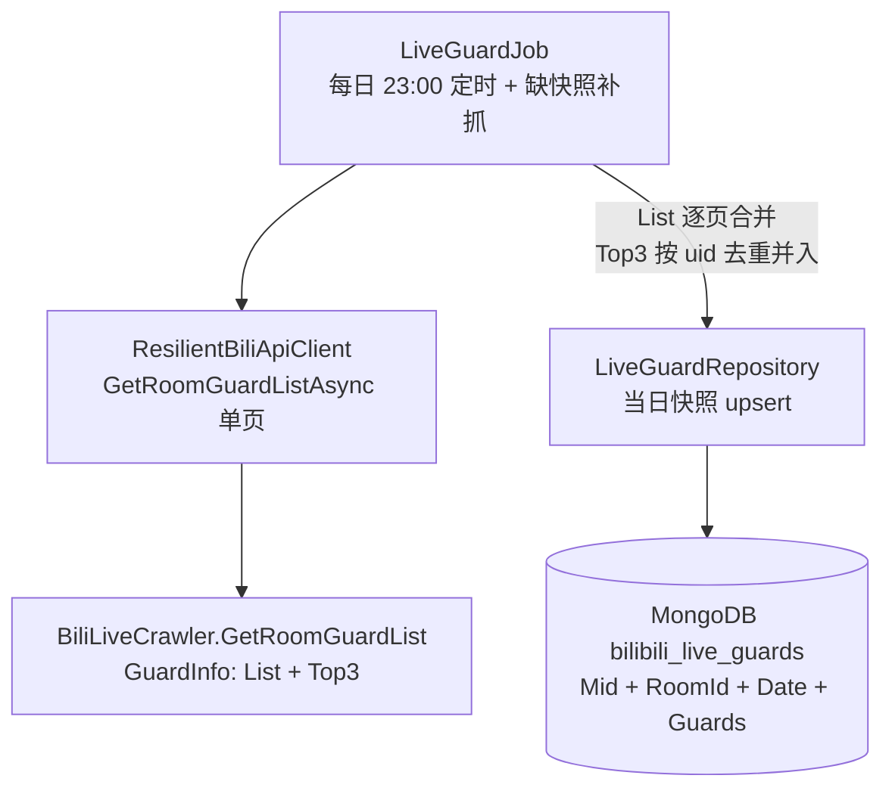
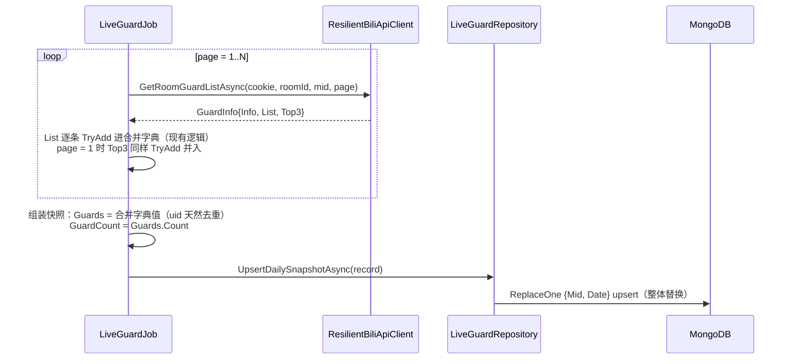

# 舰长 Top3 落库 - 技术提案

**功能名称**: 舰长 Top3 落库
**关联 PRD**: `docs/product/draft/20260903-live-guard-top3-prd.md`
**技术提案版本**: v1.1
**创建日期**: 2026-09-03
**作者**: Deliay
**feat-branch**: `feat/live-guard-top3`（需求总分支；实现分支另行切出）

## 1. 概述

### 1.1 背景

「舰长数据抓取」已上线（`docs/engineering/proposals/20260831-proposal-live-guard-crawl.md`）：`LiveGuardJob` 每日 23:00（北京时间）分页抓取舰长名单，经 `LiveGuardRepository` 以 `(Mid, Date)` upsert 落库每日快照 `bilibili_live_guards`（mid + roomId + guard_list）。

上游抓取库 Mikibot.Crawler 1.0.9 的 `BiliLiveCrawler.GetRoomGuardList(roomId, bId, page, token)` 返回 `GuardInfo { Info, List, Top3 }`，其中 **`Top3` 为 `List<GuardUserInfo>`，与名单条目同构**（uid / 昵称 / 大航海等级 / 粉丝勋章），对应 B 站 guardList 接口响应中的 `top3`（大航海贡献前三，可能含已下船用户）。当前 `LiveGuardJob.FetchAllPagesAsync` 只合并 `info.List`，`info.Top3` 被直接丢弃。本需求将 top3 打平并入 guard_list 落库。

### 1.2 目标

- `LiveGuardJob` 在抓取过程中捕获首页响应的 `GuardInfo.Top3`，与分页名单**按 uid 去重后打平并入 `Guards`**，经既有 `ToEntry` 转换随快照落库；
- 快照实体 `LiveGuardRecord`、仓储、契约、索引**零变更**——仅 guard_list 的内容来源扩展；
- 不新增抓取请求、不改调度/风控/补抓逻辑；
- 历史快照不回填。

### 1.3 范围

- **做**：`LiveGuardJob` 合并逻辑补入 top3、测试覆盖；
- **不做**：
  - top3 的单独记录/专用字段（打回意见明确：打平进入列表存储）；
  - top3 排名信息的额外标注（打平后不再区分来源）；
  - top3 的对外查询 API 与后台展示（舰长快照消费接口整体留待后续需求）；
  - 历史快照回填（历史值不可通过现接口还原）。

## 2. 技术架构

### 2.1 系统架构图

本需求为既有链路合并逻辑内的数据补全，架构不变：



### 2.2 技术栈

| 层级 | 技术选型 | 说明 |
|------|---------|------|
| 后端 | .NET 10 / C#（现有栈） | 仅 `LiveGuardJob` 合并逻辑扩展 |
| 抓取库 | Mikibot.Crawler 1.0.9（现有依赖） | `GuardInfo.Top3: List<GuardUserInfo>` 已解析，无需升级 |
| 数据库 | MongoDB（现有） | 实体/集合/索引零变更 |
| 测试 | xUnit + Testcontainers (Mongo) | 现有测试模式 |

### 2.3 模块划分

| 模块 | 职责 | 关键技术点 |
|------|------|-----------|
| `LiveGuardJob`（crawler） | 抓取时捕获 top3 并按 uid 去重并入名单 | 首页响应取 `GuardInfo.Top3`，复用既有合并字典与 `ToEntry` 转换 |
| `LiveGuardRecord` / `LiveGuardRepository`（common） | 无改动 | 既有 `ReplaceOne + IsUpsert` 整体替换语义不变 |

## 3. API 设计

### 3.1 API 契约

无变更。舰长快照暂无对外查询接口；`contracts/bilibili-crawler.openapi.yaml` 不变。

### 3.2 内部接口

无签名变更。`IBiliApiClient.GetRoomGuardListAsync` 返回的 `GuardInfo` 已携带 `Top3`；`LiveGuardJob.FetchAllPagesAsync` 的内部合并逻辑扩展为「分页名单 ∪ top3」，返回值与失败语义（`null` = 整轮失败不落库）不变。

## 4. 数据模型

### 4.1 数据库设计

#### 集合: `bilibili_live_guards`（既有，无结构变更）

实体 `LiveGuardRecord` 不加字段。变化仅在字段语义：

| 字段 | 变化 | 说明 |
|------|------|------|
| `Guards` | 内容来源扩展 | 由「分页名单」扩展为「分页名单 ∪ top3」，按 uid 去重；top3 中已下船的用户也并入 |
| `GuardCount` | 口径随动 | 合并去重后的名单总人数（= `Guards.Count`） |

其余字段（`Mid` / `RoomId` / `Date` / `FetchedAt`）与 `(Mid, Date)` 唯一索引均不变。MongoDB 无模式约束，存量快照无需迁移。

### 4.2 缓存设计

不涉及缓存变更。

## 5. 技术实现方案

### 5.1 核心流程



### 5.2 关键实现点

#### 实现点 1: top3 去重并入合并字典

- **描述**: `FetchAllPagesAsync` 现有合并结构为 `Dictionary<long, LiveGuardEntry>`（键为 uid，`TryAdd` 天然去重）。在 `page == 1` 的响应处理中，除 `info.List` 外，将 `info.Top3` 逐条 `TryAdd` 进同一字典——top3 与分页名单重叠的 uid 自动去重，已下船的 top3 用户自动并入。
- **技术细节**: top3 转换复用现有 `ToEntry(GuardUserInfo)`；`info.Top3` 为 `null` 或空列表时跳过，不视为失败；仅首页捕获（后续页忽略，避免翻页过程中榜单抖动造成口径不一）；合并顺序上先 `List` 后 `Top3` 或反之均可（`TryAdd` 保留先到的条目，两者同构无语义差异）。
- **风险点**: 无。改动收敛在一个循环分支内，失败路径（单页异常整轮返回 `null`）不受影响。

#### 实现点 2: 覆盖写与历史兼容

- **描述**: 仓储层零改动——`UpsertDailySnapshotAsync` 为 `ReplaceOne { IsUpsert = true }` 整体替换，同日重复抓取后 guard_list 始终为最新一次成功抓取的合并结果。
- **技术细节**: 实体结构不变，存量快照读写完全兼容，无需迁移、无需回填。
- **风险点**: 无。

## 6. 技术决策

### 6.1 决策列表

| 决策 | 选项 A | 选项 B | 最终选择 | 原因 |
|------|--------|--------|---------|------|
| top3 存储方式 | 打平并入 guard_list，按 uid 去重 | 快照新增独立 Top3 字段 | A | 打回意见明确：top3 打平进入列表存储，而不是单独记录；实体/仓储/契约零变更，实现最简 |
| 去重口径 | 按 uid 去重（合并字典 TryAdd） | 不去重直接拼接 | A | 同一用户不应在名单中出现两次；复用现有字典结构零成本 |
| 已下船 top3 用户 | 照常并入名单 | 过滤仅在舰用户 | A | 需求方要的就是 top3 数据本身，过滤会再次丢失 |
| 捕获来源 | 仅首页响应 | 每页取最后值 | A | 首页为权威来源；每页覆盖会引入翻页期抖动，且徒增复杂度 |
| 排名信息 | 不标注，打平后不区分来源 | 条目加 Rank/IsTop3 标记 | A | 打回意见要求打平存储；附加标记违背「不单独记录」的口径且膨胀模型 |
| 历史快照 | 不回填 | 调用现接口回填 | A | top3 为实时榜单，历史值不可还原，强行回填会写入错误数据 |

### 6.2 依赖与约束

| 类型 | 内容 | 说明 |
|------|------|------|
| 依赖 | Mikibot.Crawler 1.0.9 | `GuardInfo.Top3: List<GuardUserInfo>` 已存在，无需升级包 |
| 依赖 | 既有舰长抓取链路 | 仅 `LiveGuardJob` 合并逻辑扩展，不重构 |
| 约束 | 不新增抓取请求 | top3 仅来自既有名单接口响应 |
| 约束 | 打平并入、按 uid 去重 | 不单独记录 top3，不附加来源/排名标记 |
| 约束 | 快照粒度不变 | (Mid, Date) 唯一索引 + 整体替换，每日一行 |
| 约束 | 历史不回填 | 存量快照不修改 |

## 7. 项目结构

```
servers/crawler/
└── Jobs/
    └── LiveGuardJob.cs                      # 扩展：page=1 响应中将 info.Top3 逐条 TryAdd 并入合并字典

tests/Z.Vtuber.Tests/
├── LiveGuardJobTests.cs                     # 扩展：top3 并入（去重/已下船并入/空 top3/失败不落库/GuardCount 口径）
└── LiveGuardRepositoryTests.cs              # 扩展：含并入 top3 的名单 upsert 覆盖（Testcontainers）
```

## 8. 测试策略

### 8.1 测试覆盖要求

- 本次变更的核心逻辑（top3 捕获、去重并入、覆盖写）覆盖率 ≥ 80%；
- 既有测试（`dotnet test tests/Z.Vtuber.Tests`）不得回归。

### 8.2 测试类型

| 类型 | 工具 | 覆盖范围 |
|------|------|---------|
| 单元测试 | xUnit | 首页 top3 并入 guard_list；top3 与分页名单重叠 uid 去重不重复；已下船 top3 用户照常并入；top3 为空时仅落分页名单；GuardCount = 合并去重后人数；抓取失败时不落库 |
| 集成测试 | xUnit + Testcontainers (Mongo) | 含并入 top3 的快照 upsert；同日重复抓取整体覆盖 |
| 手工验证 | 本地 Aspire 编排 | 订阅真实主播，抓取后在 MongoDB 中确认 guard_list 含 top3 用户且与接口返回一致 |

## 9. 部署方案

### 9.1 环境规划

| 环境 | 用途 | 部署方式 |
|------|------|---------|
| 本地 | 开发验证 | Aspire 编排（现状） |
| 生产 | 正式运行 | 现有 Docker 镜像流水线，纯代码变更，无配置/索引/迁移动作 |

### 9.2 配置管理

无新增配置项；无存量数据迁移。

## 10. 验收标准

- [ ] 技术方案评审通过
- [ ] 代码实现完成：top3 按 uid 去重打平并入 guard_list，随快照同行落库、同日覆盖
- [ ] 单元测试覆盖达标，既有测试无回归
- [ ] 手工验证：真实主播快照 guard_list 含 top3 用户且与接口返回一致

## 11. 相关文档

- 关联 PRD: `docs/product/draft/20260903-live-guard-top3-prd.md`
- 前置提案: `docs/engineering/proposals/20260831-proposal-live-guard-crawl.md`（舰长数据抓取）
- 开发规范: `docs/engineering/common-rules.md`、`docs/engineering/backend-rules.md`
