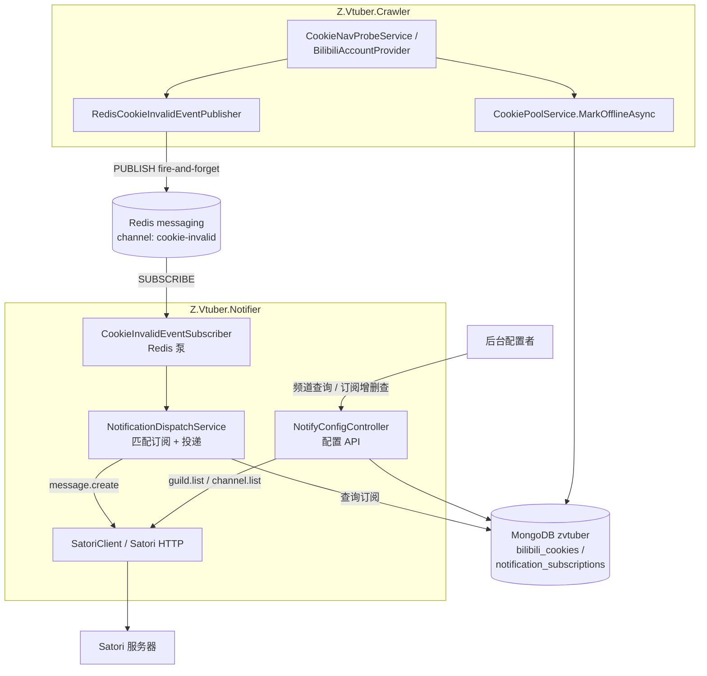
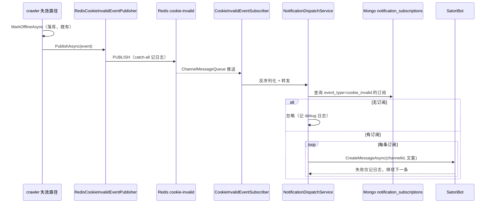

# Cookie 失效通知 - 技术提案

**功能名称**: Cookie 失效通知
**关联 PRD**: `docs/product/draft/20260904-cookie-invalid-notification-prd.md`
**技术提案版本**: v1.0
**创建日期**: 2026-09-04
**作者**: Deliay
**feat-branch**: `feat/cookie-invalid-notification`（需求总分支；实现分支另行切出）

## 1. 概述

### 1.1 背景

crawler 的 cookie 探活（`CookieNavProbeService.ProbeAsync`，`servers/crawler/Services/CookieNavProbeService.cs:62-67`）与账号构造（`BilibiliAccountProvider`，`servers/crawler/Crawlers/BilibiliAccountProvider.cs:47-52`）在 cookie 失效时经 `ICookiePoolService.MarkOfflineAsync` 将 cookie 置为 offline 并落库——失效事件止步于数据库。本需求新增独立通知服务 **Z.Vtuber.Notifier**：crawler 在失效路径上向 Redis 发布一条 fire-and-forget 事件，notifier 订阅事件并按已配置的订阅经 Satori 客户端（[Satori.NET](https://github.com/bsdayo/Satori.NET)）把通知投递到目标频道；通知目标通过 notifier 提供的配置 API 管理。

### 1.2 目标

- 新增 `servers/notifier`（Z.Vtuber.Notifier）：Worker SDK + minimal Kestrel（`/health`，与 crawler 同形态），纳入 slnx、Aspire 编排、Dockerfile 与镜像构建 workflow；
- Satori endpoint 经环境变量 `Z_VTUBER_SATORI_ENDPOINT` 注入，`ValidateOnStart` 缺失即启动失败；
- crawler 失效路径新增 Redis 发布（频道 `cookie-invalid`，fire-and-forget，发布失败仅记日志）；
- notifier 订阅 `cookie-invalid`，查询 Mongo 中的订阅配置，命中则经 Satori 客户端发送通知消息；
- notifier 提供配置 API：可用频道查询、订阅增删查；订阅持久化于 Mongo 新集合 `notification_subscriptions`；
- 新增 `contracts/notifier.openapi.yaml` 描述配置 API。

### 1.3 范围

- **做**：notifier 服务全量（Satori 接入、Redis 订阅、配置 API、Mongo 持久化）；crawler 失效事件发布；common 新增事件模型/频道常量/订阅实体与仓储；Aspire/slnx/Dockerfile/GitHub Action 接入；契约文件；测试覆盖；
- **不做**：
  - 前端管理界面（PRD 明确本期仅交付 API）；
  - 通知类型的通用框架化（仅落地 `cookie_invalid` 一种，模型预留 `EventType` 字段）；
  - 配置 API 鉴权（与既有后台接口一致，内网匿名，后续统一接入）；
  - 失效事件去重/聚合（失效为低频事件，重复投递可接受）。

## 2. 技术架构

### 2.1 系统架构图



### 2.2 技术栈

| 层级 | 技术选型 | 说明 |
|------|---------|------|
| 新服务 | .NET 10 / C#，Worker SDK + `FrameworkReference Microsoft.AspNetCore.App` | 与 crawler 同形态：后台泵 + minimal Kestrel 暴露配置 API 与 `/health`（8080） |
| Satori 客户端 | `Satori.Client`（Satori.NET，NuGet） | `SatoriClient(endpoint, token)` + `Bot(platform, selfId).CreateMessageAsync(...)`；频道列表走原生 HTTP API（见 6.1） |
| 消息通道 | Redis pub/sub（既有 `messaging`，`Aspire.StackExchange.Redis`） | 发布/订阅模式分别复用 `RedisLiveEventPublisher` / `LiveEventBus` 既有模式 |
| 持久化 | MongoDB（既有 `mongo`，`Aspire.MongoDB.Driver`） | 新集合 `notification_subscriptions`，仓储与初始化走 `servers/common/Persistence` 既有模式 |
| 契约 | OpenAPI YAML | 新增 `contracts/notifier.openapi.yaml` |

### 2.3 模块划分

| 模块 | 职责 | 关键技术点 |
|------|------|-----------|
| `servers/common/Live/CookieEventChannels.cs`（新） | Redis 频道名常量 | 仿 `LiveEventChannels`，字面量 `cookie-invalid`，`PatternMode.Literal` |
| `servers/common/Live/CookieInvalidEvent.cs`（新） | 事件 payload 模型 | `CookieId` / `Mid` / `Uname` / `OccurredAt` / `Reason`，System.Text.Json 序列化 |
| `servers/common/Persistence`（扩） | 订阅实体 + 仓储 + 集合初始化 | `NotificationSubscriptionRecord`、`NotificationSubscriptionRepository`、`MongoCollectionNames.NotificationSubscriptions` |
| `servers/crawler/Services/RedisCookieInvalidEventPublisher.cs`（新） | 失效事件发布 | 仿 `RedisLiveEventPublisher`：catch-all 记日志、永不阻断 |
| `servers/crawler`（改） | 失效路径挂接发布 | `CookieNavProbeService` offline 分支与 `BilibiliAccountProvider` 失效分支调用发布器 |
| `servers/notifier`（新） | Satori 接入、Redis 订阅泵、投递、配置 API | 见第 5 节 |

## 3. API 设计

### 3.1 API 契约

新增 `contracts/notifier.openapi.yaml`，notifier 服务端口 8080，统一前缀 `/api/notify`：

| 方法 | 路径 | 描述 |
|------|------|------|
| GET | `/api/notify/channels` | 查询 Satori 机器人当前可见的频道列表 |
| GET | `/api/notify/subscriptions` | 查询全部通知订阅 |
| POST | `/api/notify/subscriptions` | 创建通知订阅 |
| DELETE | `/api/notify/subscriptions/{id}` | 删除通知订阅 |

#### GET /api/notify/channels

聚合 Satori 的 `guild.list` + 各 guild 的 `channel.list`（Satori.NET 未实现这两个方法，见 6.1，由 notifier 内置 `HttpClient` 直连 Satori HTTP API，携带 `Authorization: Bearer {token}` 与 `X-Platform` / `X-Self-ID` 头）：

```json
[
  {
    "platform": "onebot",
    "guildId": "123456",
    "guildName": "运维群",
    "channelId": "123456",
    "channelName": "运维群"
  }
]
```

Satori 不可达或未配置登录信息时返回 `503` + 明确错误消息（不静默返回空列表）。

#### POST /api/notify/subscriptions

```json
{
  "eventType": "cookie_invalid",
  "platform": "onebot",
  "guildId": "123456",
  "guildName": "运维群",
  "channelId": "123456",
  "channelName": "运维群"
}
```

- `eventType` 当前仅接受 `cookie_invalid`，其他值返回 400；
- 同一 `(eventType, platform, channelId)` 重复创建按幂等处理：返回已存在的订阅（200），不产生重复记录；
- 成功返回 `201` 与订阅记录（含 `id`、`createdAt`）。

#### GET /api/notify/subscriptions

返回全部订阅记录数组（含 `id`、`eventType`、频道定位信息、`createdAt`）。

#### DELETE /api/notify/subscriptions/{id}

存在则删除并返回 `204`；不存在返回 `404`。

### 3.2 内部接口

#### Redis 事件契约（crawler → notifier）

- 频道：`cookie-invalid`（`CookieEventChannels.Invalid`），`PatternMode.Literal`；
- payload（JSON，snake_case 与既有 Redis 事件序列化保持一致）：

```json
{
  "cookie_id": "66d8f...",
  "mid": 12345678,
  "uname": "某某账号",
  "occurred_at": "2026-09-04T12:00:00Z",
  "reason": "nav_probe_failed"
}
```

- `mid` / `uname` 经 `CookieAccountInfoRepository` 按 CookieId 反查，查不到时为 `null`，消息文案降级为仅展示 CookieId 尾段；
- **payload 与通知消息均不得包含 cookie 原始字符串**。

#### 通知消息文案（Satori 频道）

```
【Z.Vtuber】Cookie 失效通知
账号：{Uname}（MID {Mid}）
时间：{OccurredAt 本地时间}
请及时检查并更换 Cookie。
```

以 `TextElement` 经 `SatoriBot.CreateMessageAsync(channelId, elements)` 发送。

## 4. 数据模型

Mongo `zvtuber` 库新增集合 `notification_subscriptions`（注册进 `MongoCollectionNames` 与 `MongoDbInitializer.EnsureIndexesAsync`）：

| 字段 | 类型 | 说明 |
|------|------|------|
| `_id` | ObjectId | 主键 |
| `event_type` | string | 通知类型，当前仅 `"cookie_invalid"` |
| `platform` | string | Satori 平台 |
| `guild_id` / `guild_name` | string / string? | 群组定位与展示名 |
| `channel_id` / `channel_name` | string / string? | 频道定位与展示名 |
| `created_at` | DateTime(UTC) | 创建时间 |

索引：`(event_type, platform, channel_id)` 唯一索引（支撑幂等创建）。既有集合（含 `bilibili_cookies`）无任何变更。

## 5. 技术实现方案

### 5.1 核心流程



### 5.2 关键实现点

#### 实现点 1: notifier 服务骨架与 Satori 配置（fail-fast）

- **描述**: `servers/notifier/Z.Vtuber.Notifier.csproj`：`Microsoft.NET.Sdk.Worker` + `FrameworkReference Microsoft.AspNetCore.App`，形态对齐 crawler。`Program.cs`：`AddRedisClient("messaging")`、`AddMongoDBClient("mongo")`、注册选项/后台服务/控制器，minimal Kestrel 监听 8080 暴露 `/health` 与配置 API。
- **技术细节**: 配置项 `SatoriOptions { Endpoint, Token, Platform, SelfId }`；默认配置链已读环境变量，注册时显式映射并校验：

```csharp
builder.Services.AddOptions<SatoriOptions>()
    .Configure<IConfiguration>((o, cfg) =>
    {
        o.Endpoint = cfg["Z_VTUBER_SATORI_ENDPOINT"];
        o.Token = cfg["Z_VTUBER_SATORI_TOKEN"];
        o.Platform = cfg["Z_VTUBER_SATORI_PLATFORM"];
        o.SelfId = cfg["Z_VTUBER_SATORI_SELF_ID"];
    })
    .Validate(o => !string.IsNullOrWhiteSpace(o.Endpoint),
        "缺少必需环境变量 Z_VTUBER_SATORI_ENDPOINT")
    .ValidateOnStart();
```

- `Endpoint` 为唯一强制项（需求约束）；`Platform`/`SelfId` 缺失时服务仍可启动（`/health` 正常），但频道查询返回 503、投递记警告日志并跳过（见 6.1 决策）。
- **风险点**: `ValidateOnStart` 在 Aspire 下表现为副本反复重启且日志清晰，符合 PRD「启动失败」语义。

#### 实现点 2: Satori 客户端封装

- **描述**: 单例 `SatoriClient`（`new SatoriClient(endpoint, token)`）由 `IHostedService` 管理 `StartAsync()`/`StopAsync()` 生命周期；发送侧 `client.Bot(platform, selfId).CreateMessageAsync(channelId, elements)`。
- **技术细节**: 频道列表所需 `guild.list` / `channel.list` 在 Satori.NET 中为注释掉的未实现方法（`SatoriBot.ChannelApis.cs`），因此 notifier 内置一个 `SatoriApiClient`：`HttpClient`（BaseAddress=endpoint，`Authorization: Bearer {token}`）POST `/v1/guild.list`、`/v1/channel.list`，请求头带 `X-Platform`/`X-Self-ID`，响应按 snake_case 反序列化；`message.create` 走库的 `CreateMessageAsync` 而非自实现，避免重复序列化逻辑。
- **风险点**: Satori 协议分页（`next` 游标）：`guild.list`/`channel.list` 返回 `DataPagination`，实现需循环翻页直至 `next` 为空。

#### 实现点 3: crawler 失效事件发布

- **描述**: 新增 `ICookieInvalidEventPublisher` 与 `RedisCookieInvalidEventPublisher`（仿 `servers/crawler/Live/RedisLiveEventPublisher.cs`：构造 literal `RedisChannel` → `GetSubscriber().PublishAsync` → catch-all 记 warning）。在 `CookieNavProbeService.ProbeAsync` 的 offline 分支（`servers/crawler/Services/CookieNavProbeService.cs:62-67`）与 `BilibiliAccountProvider` 的失效分支（`servers/crawler/Crawlers/BilibiliAccountProvider.cs:47-52`）于 `MarkOfflineAsync` 之后调用。
- **技术细节**: `Mid`/`Uname` 由 `CookieAccountInfoRepository` 按 CookieId 反查（查不到为 null）；发布为 await 但内部 catch-all，语义与 crawler AGENTS.md 一致——**发布失败只记日志，绝不阻断数据库更新与长连接**；`MarkCooldownAsync`（风控冷却，可恢复）**不发布**失效事件。
- **风险点**: 两处调用点需保持「先落库、后发布」顺序；后续新增 `MarkOfflineAsync` 调用点时需同步挂接（在 AGENTS.md / 代码注释中标注）。

#### 实现点 4: notifier Redis 订阅泵与投递

- **描述**: `CookieInvalidEventSubscriber`（`BackgroundService`）仿 `servers/api/Live/LiveEventBus.cs` 的泵模式：`SubscribeAsync` 得 `ChannelMessageQueue`，`await foreach` 读消息，反序列化为 `CookieInvalidEvent` 转发给 `NotificationDispatchService`；断线按固定延迟（2s，对齐 LiveEventBus）重订阅。
- **技术细节**: 泵为常驻订阅（不同于 LiveEventBus 的按需订阅），服务启动即订阅、停止即退订（queue 级 `UnsubscribeAsync`）；`NotificationDispatchService` 按 `event_type` 查 Mongo 订阅并逐条投递，单条投递失败仅记日志不影响其余订阅；Satori 发送异常（网络/频道失效）不向上抛出。
- **风险点**: 反序列化失败的脏消息记 warning 后丢弃，不阻塞泵。

#### 实现点 5: 工程接入（slnx / Aspire / Docker / CI）

- **slnx**：`servers/Z.Vtuber.slnx` 的 `/servers/` 文件夹新增 `notifier/Z.Vtuber.Notifier.csproj`；
- **Aspire**：`infra/apphost/Z.Vtuber.AppHost.csproj` 新增 ProjectReference；`AppHost.cs` 新增：

```csharp
var notifier = builder.AddProject<Projects.Z_Vtuber_Notifier>("notifier")
    .WithReference(mongo).WaitFor(mongo)
    .WithReference(messaging).WaitFor(messaging)
    .WithEnvironment("Z_VTUBER_SATORI_ENDPOINT", builder.AddParameter("satori-endpoint", secret: true))
    .WithHttpHealthCheck("/health");
```

（`Token`/`Platform`/`SelfId` 同法以 Parameter 按需注入；本仓库 AppHost 首次引入 `AddParameter`，参数值经 `aspire run` 环境或 user-secrets 提供。）
- **Dockerfile**：`servers/notifier/Dockerfile`，与 api/crawler 相同的两阶段模板（restore common+notifier → publish → aspnet:10.0 运行时，`EXPOSE 8080`，入口 `Z.Vtuber.Notifier.dll`）；
- **CI**：`.github/workflows/build-notifier-image.yml`，复用既有模板（buildx + 私有 registry 登录 + `zero-tools/z-vtuber-notifier:{sha},:latest`），路径过滤 `servers/notifier/**` 与 `servers/common/**`。

## 6. 技术决策

### 6.1 决策列表

| 决策 | 选项 A | 选项 B | 最终选择 | 原因 |
|------|--------|--------|---------|------|
| 事件挂接点 | 两个 `MarkOfflineAsync` 调用点分别发布 | 在 `CookiePoolService.MarkOfflineAsync` 内发布 | A | common 不引用 Redis 包（AGENTS.md 约束 common 不依赖基础设施）；发布器属 crawler 基础设施，挂接调用点最直观 |
| 失效事件语义 | 仅 offline 发布，cooldown 不发布 | 风控冷却也发布 | A | PRD 范围为「cookie 失效」；冷却可自动恢复，通知会造成打扰 |
| 频道列表实现 | notifier 直连 Satori HTTP API | 扩展/ fork Satori.NET 实现 `channel.list` | A | 库方法为注释状态，直连 HTTP 成本最低且不引入 fork 维护负担；发送仍用库 |
| Bot 登录信息来源 | 环境变量 `Z_VTUBER_SATORI_PLATFORM`/`SELF_ID` | 从 WebSocket ready 信号自动发现 | A | Satori.NET 的 `EventService` 为 internal，公共 API 无法订阅 ready/login 事件；自动发现不可行，显式配置最简单可靠（缺失时降级而非启动失败，因需求仅强制 endpoint） |
| 订阅存储 | Mongo 新集合 | Redis 哈希 | A | 订阅为低频读写的配置数据，Mongo 持久化语义与既有后台数据一致，且 notifier 已需 mongo 连接反查空间小 |
| 订阅模式 | notifier 常驻订阅 `cookie-invalid` | 按需订阅（有订阅配置才 SUBSCRIBE） | A | 配置变化需联动订阅管理，常驻订阅一个频道成本可忽略，实现最简单 |
| 失效事件可靠性 | fire-and-forget pub/sub | 引入持久化事件队列 | A | 对齐仓库既有语义（Mongo 为事实源，pub/sub 仅通知）；失效状态本身落库，通知丢失可通过后台数据兜底，低频场景可接受 |
| 重复创建订阅 | 唯一索引幂等返回已有 | 直接报错 409 | A | 配置操作幂等对后台更友好；唯一索引兜底并发 |

### 6.2 依赖与约束

| 类型 | 内容 | 说明 |
|------|------|------|
| 依赖 | Satori.NET（NuGet `Satori.Client`） | 新增包引用，仅 notifier 引用 |
| 依赖 | 既有 `CookieAccountInfoRepository` / `MongoDbInitializer` | common 内扩展，不改动既有行为 |
| 约束 | common 归属约定 | 事件模型/频道常量/订阅实体放 common；Redis/Satori 依赖只在 crawler/notifier |
| 约束 | fire-and-forget | 发布失败不阻断落库与采集；投递失败不影响其他订阅 |
| 约束 | 敏感信息 | 事件 payload、通知文案、日志均不得出现 cookie 原始字符串（沿用 `CookieTag` 短哈希惯例） |
| 约束 | Aspire 注入 | `ConnectionStrings__mongo` / `ConnectionStrings__messaging` 经 `WithReference` 自动注入；Satori 参数经 `AddParameter` + `WithEnvironment` |

## 7. 项目结构

```
servers/
├── Z.Vtuber.slnx                                # 修改：/servers/ 新增 notifier 项目
├── common/
│   ├── Live/
│   │   ├── CookieEventChannels.cs               # 新增：cookie-invalid 频道常量
│   │   └── CookieInvalidEvent.cs                # 新增：事件 payload 模型
│   └── Persistence/
│       ├── Entities/NotificationSubscriptionRecord.cs   # 新增
│       ├── NotificationSubscriptionRepository.cs        # 新增
│       └── MongoDbInitializer.cs                # 修改：集合名 + 唯一索引
├── crawler/
│   ├── Services/RedisCookieInvalidEventPublisher.cs     # 新增（接口 + 实现）
│   ├── Services/CookieNavProbeService.cs        # 修改：offline 分支发布事件
│   ├── Crawlers/BilibiliAccountProvider.cs      # 修改：失效分支发布事件
│   └── Program.cs                               # 修改：注册发布器
└── notifier/                                    # 新增服务
    ├── Z.Vtuber.Notifier.csproj
    ├── Program.cs                               # 选项 fail-fast、Redis/Mongo 客户端、后台服务、/health
    ├── Dockerfile
    ├── Satori/
    │   ├── SatoriOptions.cs                     # Endpoint/Token/Platform/SelfId
    │   ├── SatoriApiClient.cs                   # guild.list / channel.list 直连 HTTP
    │   └── SatoriClientHostedService.cs         # SatoriClient 生命周期
    ├── Events/
    │   └── CookieInvalidEventSubscriber.cs      # Redis 订阅泵
    ├── Dispatch/
    │   └── NotificationDispatchService.cs       # 匹配订阅 + Satori 投递
    └── Controllers/
        └── NotifyConfigController.cs            # /api/notify/channels、/api/notify/subscriptions

contracts/
└── notifier.openapi.yaml                        # 新增：配置 API 契约

infra/apphost/
├── Z.Vtuber.AppHost.csproj                      # 修改：ProjectReference
└── AppHost.cs                                   # 修改：notifier 编排 + satori 参数

.github/workflows/
└── build-notifier-image.yml                     # 新增：镜像构建 workflow

tests/Z.Vtuber.Tests/
├── RedisCookieInvalidEventPublisherTests.cs     # 新增
├── CookieInvalidEventSubscriberTests.cs         # 新增
├── NotificationDispatchServiceTests.cs          # 新增
├── NotificationSubscriptionRepositoryTests.cs   # 新增
└── NotifyConfigControllerTests.cs               # 新增
```

## 8. 测试策略

### 8.1 测试覆盖要求

- notifier 的订阅泵、投递匹配、配置 API 与 crawler 的发布器为本次核心路径，随对应测试类覆盖率 ≥ 80%；
- 既有测试（`dotnet test tests/Z.Vtuber.Tests`）不得回归，特别是 `CookieNavProbeServiceTests`、`CookiePoolServiceTests`。

### 8.2 测试类型

| 类型 | 工具 | 覆盖范围 |
|------|------|---------|
| 单元测试 | xUnit + 手写 fake（`Fakes.cs` 模式） | 发布器：调用后 Redis 收到结构与字段正确的 payload、异常时静默不抛；订阅泵：收到事件→反序列化→转发，脏消息丢弃不阻塞；投递：有/无订阅、多订阅、单条失败不影响其余、Satori 未登录降级；配置 API：增删查、幂等创建、非法 eventType 400 |
| 集成测试 | Testcontainers MongoDB + Redis（复用 `MongoDbFixture`/`RedisFixture`） | 发布→订阅→投递链路（Satori 以 stub `HttpMessageHandler` 假服务器验证 `message.create` 请求体与频道 ID）；订阅仓储唯一索引与幂等；`ValidateOnStart` 缺 endpoint 时宿主构建失败 |
| 手工验证 | 本地 Aspire + 真实 Satori | 配置订阅后将测试 cookie 置失效，观察频道消息；缺 `Z_VTUBER_SATORI_ENDPOINT` 启动失败；断网重连后投递恢复 |

## 9. 部署方案

### 9.1 环境规划

| 环境 | 用途 | 部署方式 |
|------|------|---------|
| 本地 | 开发验证 | Aspire 编排（notifier 与 mongo/redis/api/crawler 一键启动） |
| 生产 | 正式运行 | `build-notifier-image.yml` 构建 `zero-tools/z-vtuber-notifier` 镜像，随既有镜像流水线部署 |

### 9.2 配置管理

| 配置项 | 注入方式 | 必需 |
|--------|---------|------|
| `Z_VTUBER_SATORI_ENDPOINT` | 环境变量 / Aspire Parameter | 是（缺失启动失败） |
| `Z_VTUBER_SATORI_TOKEN` | 环境变量 / Aspire Parameter | 视 Satori 服务器鉴权配置 |
| `Z_VTUBER_SATORI_PLATFORM` / `Z_VTUBER_SATORI_SELF_ID` | 环境变量 / Aspire Parameter | 投递与频道查询需要；缺失时对应能力降级 |
| `ConnectionStrings__mongo` / `ConnectionStrings__messaging` | Aspire `WithReference` 自动注入 | 是 |

无数据迁移；Mongo 新集合与索引随服务启动由 `MongoDbInitializer` 建立。

## 10. 验收标准

- [ ] 技术方案评审通过
- [ ] Contract 评审通过（`contracts/notifier.openapi.yaml`）
- [ ] notifier 服务完成：Satori 接入（endpoint 缺失 fail-fast）、Redis 订阅、投递、配置 API 全链路可用
- [ ] crawler 失效路径发布事件，且发布失败不影响既有落库与采集
- [ ] slnx / Aspire / Dockerfile / GitHub Action 接入完成，镜像可构建推送
- [ ] 单元与集成测试覆盖达标，既有测试无回归
- [ ] 手工验证：配置订阅后失效 cookie 秒级收到频道通知；无订阅时静默；缺 endpoint 启动失败

## 11. 相关文档

- 关联 PRD: `docs/product/draft/20260904-cookie-invalid-notification-prd.md`
- 关联 Contract: `contracts/notifier.openapi.yaml`
- 参考实现: `servers/crawler/Live/RedisLiveEventPublisher.cs`（发布模式）、`servers/api/Live/LiveEventBus.cs`（订阅泵模式）
- Satori.NET: https://github.com/bsdayo/Satori.NET （Example: `examples/Satori.Client.Example/Program.cs`）
- 开发规范: `docs/engineering/common-rules.md`、`docs/engineering/backend-rules.md`、`servers/common/AGENTS.md`、`servers/crawler/AGENTS.md`
