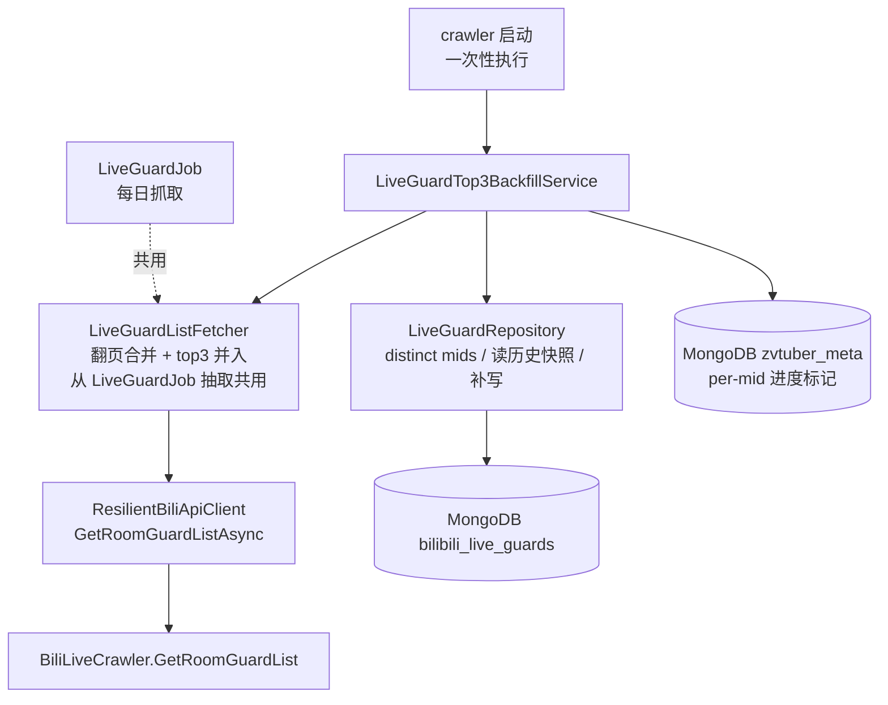
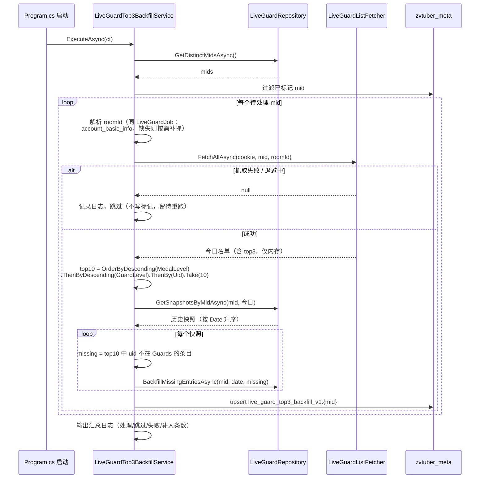

# 舰长 Top3 历史补录 - 技术提案

**功能名称**: 舰长 Top3 历史补录
**关联 PRD**: `docs/product/draft/20260904-live-guard-top3-backfill-prd.md`
**技术提案版本**: v1.0
**创建日期**: 2026-09-04
**作者**: Deliay
**feat-branch**: `feat/live-guard-top3-backfill`（需求总分支；实现分支另行切出）

## 1. 概述

### 1.1 背景

「舰长 Top3 落库」（`docs/engineering/proposals/20260903-proposal-live-guard-top3.md`）已上线，增量快照的 guard_list 含 top3；但此前落库的历史快照缺失这部分头部用户。需求方分析后确认：大航海头部用户与「粉丝牌等级最高的一批用户」高度重合，而粉丝牌等级长期积累、当前接口仍可见，因此可以通过「重抓今日名单 → 粉丝牌等级倒序取 top10 → 逐天比对历史快照 → 缺则补齐」近似补回历史数据。

### 1.2 目标

- crawler 启动时执行一次性补录：历史快照按 mid 去重，逐 mid 重抓今日舰长名单（含 top3，仅内存、不落库），按粉丝牌等级倒序取 top10 作为补录源，逐天与该 mid 的历史快照比对，缺失条目直接补入；
- 复用 `LiveGuardJob` 的抓取纪律（cookie 池、翻页、页间延迟、风控退避），不提高请求频率；
- 以 mid 为粒度用 meta 集合记录进度，可中断、可重跑、幂等；
- 只增不改：历史快照既有条目不删除、不修改；当日快照不处理。

### 1.3 范围

- **做**：
  - 抽取 `LiveGuardJob.FetchAllPagesAsync` 的翻页合并逻辑为可复用抓取组件（含 top3 并入），供 Job 与补录共用；
  - 补录服务（top10 选取、逐天差异计算、快照更新、进度标记）；
  - `LiveGuardRepository` 补录所需的查询/更新方法；
  - 单元测试与集成测试。
- **不做**：
  - 新增对外 API / 后台界面（补录进度与结果仅以日志体现）；
  - 当日快照的补录处理（当日快照由 `LiveGuardJob` 生成，本身含真实 top3）；
  - 补入条目的来源标注（与既有条目同构打平，不区分）；
  - 任何常驻周期任务（一次性启动任务，跑完即结束）。

## 2. 技术架构

### 2.1 系统架构图

补录复用既有抓取与落库链路，无架构变更：



### 2.2 技术栈

| 层级 | 技术选型 | 说明 |
|------|---------|------|
| 后端 | .NET 10 / C#（现有栈） | 补录服务在 crawler，仓储扩展在 common |
| 抓取库 | Mikibot.Crawler 1.0.9（现有依赖） | `GuardInfo.Top3` 已解析，无需升级 |
| 数据库 | MongoDB（现有） | 实体/索引零变更；进度标记复用 `zvtuber_meta` 集合 |
| 测试 | xUnit + Testcontainers (Mongo) | 现有测试模式 |

### 2.3 模块划分

| 模块 | 职责 | 关键技术点 |
|------|------|-----------|
| `LiveGuardListFetcher`（crawler/Services） | 翻页抓取并合并名单（含首页 top3），供 `LiveGuardJob` 与补录共用 | 从 `LiveGuardJob.FetchAllPagesAsync` 原样抽取（含延迟、退避、失败返回 `null` 语义），Job 改为调用它，行为零变化 |
| `LiveGuardTop3BackfillService`（crawler/Services） | 补录编排：distinct mids → 逐 mid 重抓 → top10 → 逐天补齐 → 进度标记 | top10 选取与差异计算为纯函数，便于单测 |
| `LiveGuardRepository`（common） | 补录查询/更新方法 | `GetDistinctMidsAsync`、`GetSnapshotsByMidAsync`、`BackfillMissingEntriesAsync` |
| `MongoDbInitializer`（common） | 无改动 | 进度标记直接读写 `zvtuber_meta`（`MetaRecord`），不新增迁移方法 |

## 3. API 设计

### 3.1 API 契约

无变更。本需求不新增对外接口，`contracts/bilibili-crawler.openapi.yaml` 不变。

### 3.2 内部接口

`LiveGuardRepository` 新增：

```csharp
// 历史快照中全部去重 mid
Task<IReadOnlyList<long>> GetDistinctMidsAsync(CancellationToken ct = default);

// 某 mid 在 beforeDate（不含）之前的全部快照，按 Date 升序
Task<IReadOnlyList<LiveGuardRecord>> GetSnapshotsByMidAsync(
    long mid, string beforeDateExclusive, CancellationToken ct = default);

// 将缺失条目补入指定快照：Guards 追加 missing（调用方保证按 uid 不重复），GuardCount 同步更新；
// 以 (Mid, Date) 定位，条件更新 Guards 字段，不触碰其他字段
Task BackfillMissingEntriesAsync(
    long mid, string date, IReadOnlyList<LiveGuardEntry> missing, CancellationToken ct = default);
```

`LiveGuardListFetcher`（从 `LiveGuardJob` 抽取，签名对齐现状）：

```csharp
// 返回合并去重后的名单；任一页失败返回 null（整轮放弃），与 LiveGuardJob 现有语义一致
Task<List<LiveGuardEntry>?> FetchAllAsync(
    string cookie, long mid, long roomId, CancellationToken ct);
```

## 4. 数据模型

### 4.1 数据库设计

#### 集合: `bilibili_live_guards`（既有，无结构变更）

实体 `LiveGuardRecord` 不加字段。补录仅对历史快照做「追加式」更新：

| 字段 | 变化 | 说明 |
|------|------|------|
| `Guards` | 追加缺失条目 | 仅追加补录源中该日缺失的 uid 对应条目，既有条目不修改、不重排 |
| `GuardCount` | 随动更新 | = 追加后的 `Guards.Count` |

`(Mid, Date)` 唯一索引不变，无需迁移。

#### 集合: `zvtuber_meta`（既有，复用）

进度标记复用 `MetaRecord`（key 为主键）：

| key | 含义 |
|-----|------|
| `live_guard_top3_backfill_v1:{mid}` | 该 mid 补录完成（成功处理过即写入；抓取失败的 mid 不写，留待重跑） |

不设整体完成标记：每次启动取 distinct mids 减去已标记 mids 即为待处理集合，待处理为空则记录日志跳过——与 `MigrateSubscriptionTypeSplitAsync` 的「标记 + 残余检查」模式一致，天然支持失败重跑与新增 mid 的补做。

### 4.2 缓存设计

不涉及缓存变更。

## 5. 技术实现方案

### 5.1 核心流程



### 5.2 关键实现点

#### 实现点 1: 抽取共用抓取组件 `LiveGuardListFetcher`

- **描述**: `LiveGuardJob.FetchAllPagesAsync` 的翻页循环（cookie 传入、`GuardMaxPages` 上限、首页 top3 并入、页间随机延迟、`CrawlBackoffActiveException`/异常返回 `null`）原样抽取为 `LiveGuardListFetcher.FetchAllAsync`，`LiveGuardJob` 与补录服务共用。
- **技术细节**: 依赖 `IBiliApiClient`、`BilibiliCrawlerOptions`、`ILogger`；`DelayBetweenPagesAsync` 一并迁入（保留 `internal virtual` 以便测试覆写）；`LiveGuardJob` 删除私有实现改为注入调用，既有单测语义不变（测试改用 fetcher 的 fake/覆写点）。
- **风险点**: 重构须保证 Job 行为零变化——纯代码搬移，不改任何分支逻辑；既有 `LiveGuardJobTests` 全量回归。

#### 实现点 2: top10 选取与差异计算（纯函数）

- **描述**: 两个纯函数静态方法（如 `LiveGuardTop3BackfillPlanner`）：
  - `SelectTop10(entries)`：`OrderByDescending(MedalLevel).ThenByDescending(GuardLevel).ThenBy(Uid).Take(10)`——粉丝牌等级为主序，大航海等级次之，uid 兜底保证排序稳定，重跑结果不抖动；
  - `ComputeMissing(snapshotGuards, top10)`：top10 中 uid 不在当日名单的条目，按 top10 顺序返回。
- **技术细节**: 补入条目直接使用今日抓取的条目对象（昵称/大航海等级/粉丝牌为今日值）——PRD 已明确此为需求方接受的近似口径。
- **风险点**: 无 I/O，单测直接覆盖全部分支（并列排序、不足 10 人、全部已存在、部分缺失）。

#### 实现点 3: 快照补写与并发安全

- **描述**: `BackfillMissingEntriesAsync` 以 `(Mid, Date)` 条件更新：`$set Guards = 既有 + missing`、`$set GuardCount`；`missing` 为空时不发起写。
- **技术细节**: 补录只处理 `Date < 今日（北京）` 的快照，而 `LiveGuardJob` 只写当日快照，两者写入集合不相交，无写冲突；单文档更新天然原子，无需事务。读改写以「读出快照 → 内存计算 → 条件写回」实现，重跑时 `missing` 必为空（幂等）。
- **风险点**: 若补录与手动数据修复并发写同一历史文档，后写覆盖先写——生产无此操作路径，接受。

#### 实现点 4: 启动执行与进度标记

- **描述**: `Program.cs` 在既有「启动执行幂等索引初始化与回填」之后调用补录服务一次（非 HostedService，不随 worker 周期运行）。每个 mid 处理成功（含「无缺失可补」）后 upsert `live_guard_top3_backfill_v1:{mid}` 标记；抓取失败/退避的 mid 不写标记，下次启动自动重试。
- **技术细节**: roomId 解析复用 `LiveGuardJob` 的路径：先 `AccountBasicInfoRepository.GetLatestRoomIdByMidAsync`，缺失则 `IAccountInfoCrawler.CrawlAsync` 后重查，仍缺失则记日志跳过（不写标记）。cookie 复用 `ICookiePoolService.NextAsync`，无可用 cookie 时整轮记日志退出（与 Job 一致）。
- **风险点**: mid 数量大时启动耗时拉长——补录在启动序列中异步执行不阻塞 `/health` 与其他 HostedService（与既有回填一致，fire-and-forget 任务 + 异常捕获记日志）；每个 mid 一次抓取，量级与单日正常抓取相当。

## 6. 技术决策

### 6.1 决策列表

| 决策 | 选项 A | 选项 B | 最终选择 | 原因 |
|------|--------|--------|---------|------|
| 补录载体 | crawler 启动一次性任务（meta 标记幂等） | 独立 console 工具项目 | A | 项目既有先例（`MongoDbInitializer` 启动回填 + meta 标记）；复用 DI 容器内的抓取通道/仓储/配置，零新增部署单元 |
| 抓取逻辑复用 | 抽取 `LiveGuardListFetcher` 共用 | 补录服务复制一份翻页逻辑 | A | 避免两份翻页/延迟/退避逻辑漂移；Job 行为经既有测试锁定 |
| 补录源排序 | MedalLevel desc → GuardLevel desc → Uid asc | 仅 MedalLevel desc | A | 并列等级时排序稳定，重跑/比对结果可复现 |
| 历史写入口径 | 只追加缺失条目 + 同步 GuardCount | 整行 Guards 替换为合并结果 | A | 只增不改，既有条目零风险；重跑幂等（missing 为空即无写） |
| 当日快照 | 不处理（Date < 今日） | 一并处理 | A | 当日快照由正常抓取链路生成且含真实 top3；同时规避与 `LiveGuardJob` 的写冲突 |
| 进度粒度 | per-mid meta 标记 | 单一整体标记 | A | 单 mid 失败不阻断他人，重跑只补未完成者；与订阅拆分迁移的「标记 + 残余检查」模式一致 |
| 失败 mid | 跳过记日志、不写标记、下轮重试 | 中断整个补录 | A | 风控退避是常态，整体失败不可接受；重跑自然收敛 |

### 6.2 依赖与约束

| 类型 | 内容 | 说明 |
|------|------|------|
| 依赖 | Mikibot.Crawler 1.0.9 | `GuardInfo.Top3: List<GuardUserInfo>` 已存在 |
| 依赖 | 既有舰长抓取链路 | cookie 池、退避、roomId 解析、抓取纪律全部复用 |
| 依赖 | `zvtuber_meta` 集合 | 进度标记复用 `MetaRecord`，无结构变更 |
| 约束 | 重抓结果不落库 | 今日名单仅内存使用，当日快照仅由 `LiveGuardJob` 产生 |
| 约束 | 只增不改 | 历史快照既有条目不删除、不修改、不重排 |
| 约束 | 抓取频率不变 | 页间延迟/退避与正常抓取一致，每 mid 仅一轮抓取 |
| 约束 | 近似口径 | 补入条目用户信息取自今日抓取结果，PRD 已声明 |

## 7. 项目结构

```
servers/crawler/
├── Jobs/
│   └── LiveGuardJob.cs                       # 改：翻页合并逻辑迁移至 fetcher，改为注入调用（行为不变）
└── Services/
    ├── LiveGuardListFetcher.cs               # 新：翻页抓取 + top3 并入 + 延迟/退避（自 LiveGuardJob 抽取）
    ├── LiveGuardTop3BackfillPlanner.cs       # 新：SelectTop10 / ComputeMissing 纯函数
    └── LiveGuardTop3BackfillService.cs       # 新：补录编排 + per-mid 进度标记 + 汇总日志

servers/common/Persistence/
└── LiveGuardRepository.cs                    # 改：新增 GetDistinctMidsAsync / GetSnapshotsByMidAsync / BackfillMissingEntriesAsync

tests/Z.Vtuber.Tests/
├── LiveGuardJobTests.cs                      # 改：适配 fetcher 抽取（语义不变，全量回归）
├── LiveGuardTop3BackfillPlannerTests.cs      # 新：top10 排序/并列/不足 10 人、差异计算全分支
├── LiveGuardTop3BackfillServiceTests.cs      # 新：fake IBiliApiClient 的端到端编排（失败跳过/标记/幂等重跑）
└── LiveGuardRepositoryTests.cs               # 扩展：新增方法的 Testcontainers 集成测试
```

## 8. 测试策略

### 8.1 测试覆盖要求

- 本次变更核心逻辑（top10 选取、差异计算、补写、进度标记）覆盖率 ≥ 80%；
- 既有测试（`dotnet test tests/Z.Vtuber.Tests`）不得回归，重点是 `LiveGuardJobTests`（fetcher 抽取后行为锁定）。

### 8.2 测试类型

| 类型 | 工具 | 覆盖范围 |
|------|------|---------|
| 单元测试 | xUnit | `SelectTop10`：主序/次序/uid 兜底、不足 10 人取全部；`ComputeMissing`：全部缺失/部分缺失/全部已存在；`LiveGuardTop3BackfillService`：重抓不落库、抓取失败跳过不写标记、成功写标记、重跑已标记跳过、roomId 缺失跳过 |
| 集成测试 | xUnit + Testcontainers (Mongo) | `GetDistinctMidsAsync` 去重；`GetSnapshotsByMidAsync` 排除当日、按日期升序；`BackfillMissingEntriesAsync` 追加 + GuardCount 同步 + 既有条目不变；补录端到端幂等（跑两遍结果一致） |
| 手工验证 | 本地 Aspire 编排 | 造数（不含 top3 的历史快照）→ 启动 crawler → 日志确认逐 mid 处理与补入条数 → MongoDB 抽查历史快照已补齐且当日快照未被触碰 → 重启确认幂等跳过 |

## 9. 部署方案

### 9.1 环境规划

| 环境 | 用途 | 部署方式 |
|------|------|---------|
| 本地 | 开发验证 | Aspire 编排（现状） |
| 生产 | 一次性补录 | 现有 Docker 镜像流水线，纯代码变更；随下一次发版启动时自动执行，跑完即结束 |

### 9.2 配置管理

无新增配置项（复用 `BilibiliCrawler` 节的抓取参数）；无索引变更；无存量数据迁移（补录本身即数据修复）。

## 10. 验收标准

- [ ] 技术方案评审通过
- [ ] 代码实现完成：`LiveGuardListFetcher` 抽取且 `LiveGuardJob` 行为零变化；补录服务按 mid 重抓（不落库）、top10 选取、逐天补齐、per-mid 进度标记
- [ ] 单元测试覆盖达标，既有测试无回归
- [ ] 集成测试通过：补写正确、重跑幂等、当日快照不处理
- [ ] 手工验证：本地造数补录结果正确，重启幂等跳过，日志汇总完整

## 11. 相关文档

- 关联 PRD: `docs/product/draft/20260904-live-guard-top3-backfill-prd.md`
- 前置提案: `docs/engineering/proposals/20260903-proposal-live-guard-top3.md`（舰长 Top3 落库）
- 前置提案: `docs/engineering/proposals/20260831-proposal-live-guard-crawl.md`（舰长数据抓取）
- 开发规范: `docs/engineering/common-rules.md`、`docs/engineering/backend-rules.md`
