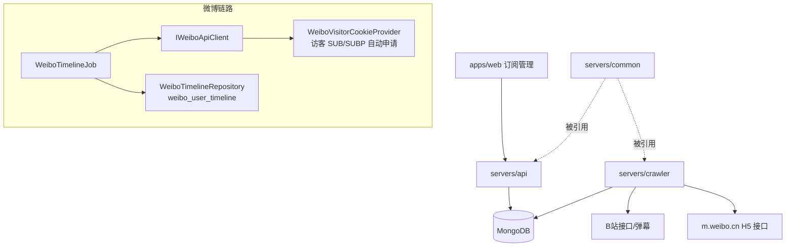
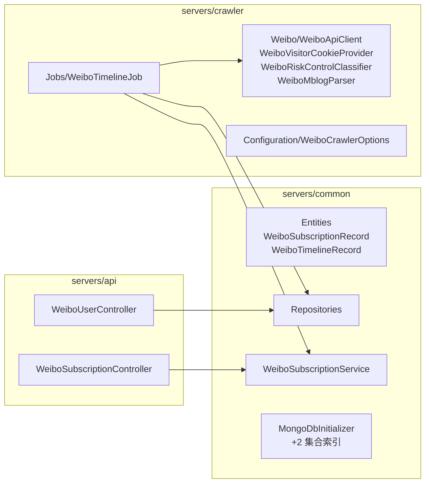
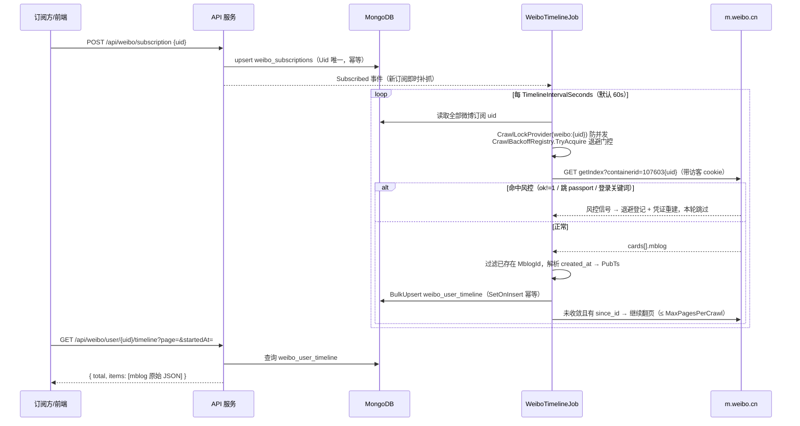

# 微博动态抓取 - 技术提案

**功能名称**: 微博动态抓取
**关联 PRD**: `docs/product/draft/20260909-weibo-crawler-prd.md`
**技术提案版本**: v1.0
**创建日期**: 2026-09-09
**作者**: Deliay
**feat-branch**: `feat/weibo-crawler`

## 1. 概述

### 1.1 背景

平台现有 B 站抓取链路（`servers/crawler`）以「订阅驱动 + 周期任务 + 风控退避 + MongoDB 落库」的模式运行：订阅存于 `bilibili_subscriptions`（`(Mid, Type)` 唯一），`SpaceTimelineJob` 按周期对 `dynamic` 订阅逐个抓取空间动态并写入 `bilibili_user_space_timeline`，API 侧经 `/api/b/user/{mid}/space` 对外查询。按 PRD 要求新增微博动态抓取：订阅管理增加「微博」类型，原生 C# 实现抓取，行为与现有动态抓取一致，并提供对外查询 API。

参考实现：

- **DDBOT `lsp/weibo`**（Go）：`m.weibo.cn/api/container/getIndex?containerid=107603{uid}` 拉动态列表；访客 cookie 三步握手（`passport.weibo.com/visitor/genvisitor` → `visitor?a=incarnate` → `login.sina.com.cn/visitor/visitor?a=crossdomain`），每小时刷新；mbid 去重 + `created_at` 水位线双重增量判定；随机 UA。
- **mcp-server-weibo**（Python）：同一 `getIndex` 端点；访客 cookie 一步方案 `POST visitor.passport.weibo.cn/visitor/genvisitor2` 直接返回 `sub/subp`；`Referer: https://m.weibo.cn/` + 移动端 UA；401/403/跳 passport/响应含登录关键词时作废 cookie 重建重试。

### 1.2 目标

- 微博订阅、抓取、落库、查询全链路原生 C# 实现，复用现有「周期任务 + 订阅驱动 + 退避 + 落库」模式；
- 微博与 B 站数据、订阅、API 相互隔离：独立的集合、服务与 `/api/weibo` 路由前缀；
- 前端订阅管理页支持创建/查看/取消微博订阅；
- 新增 `contracts/weibo-crawler.openapi.yaml` 作为微博 API 契约，前端 codegen 同步。

### 1.3 范围

**做**：

- common：`WeiboSubscriptionRecord` / `WeiboTimelineRecord` 实体与仓储、`WeiboSubscriptionService`、`MongoDbInitializer` 新集合索引初始化；
- crawler：`WeiboCrawlerOptions`、`IWeiboApiClient`（m.weibo.cn H5 接口）、`WeiboVisitorCookieProvider`（访客凭证自动申请/刷新/重建）、`WeiboRiskControlClassifier`、`WeiboTimelineJob`（周期抓取 + 新订阅即时补抓 + 退避）；
- api：`WeiboSubscriptionController`、`WeiboUserController`（动态分页/时间范围查询）；
- 契约与前端：`contracts/weibo-crawler.openapi.yaml`、订阅管理页「微博」类型、API client 与 codegen；
- 测试：单测 + Testcontainers 集成测试。

**不做**：

- 微博热搜、评论、粉丝/关注、搜索等接口（参考项目支持，本期不需要）；
- 微博扫码登录态（访客凭证足够覆盖公开动态抓取）；
- 既有 B 站链路任何行为变更；既有数据迁移。

## 2. 技术架构

### 2.1 系统架构图



### 2.2 技术栈

| 层级 | 技术选型 | 说明 |
|------|---------|------|
| 抓取 | C# `HttpClient`（HttpClientFactory） | 原生实现，不引入第三方微博 SDK |
| 微博接口 | m.weibo.cn `/api/container/getIndex` | 移动端 H5 公开接口，`containerid=107603{uid}` 拉动态 |
| 凭证 | 访客 SUB/SUBP cookie | `genvisitor2` 一步申请为主，DDBOT 三步握手为 fallback，定时刷新 + 失败重建 |
| 存储 | MongoDB | 新集合 `weibo_subscriptions` / `weibo_user_timeline`，沿用 `zvtuber` 库 |
| 退避 | 复用 `CrawlBackoffRegistry` | 以 `weibo:{uid}` 为 target key |
| 编排 | Aspire | crawler 现有宿主内新增 Job，无新服务、无新中间件 |

### 2.3 模块划分



## 3. API 设计

### 3.1 API 契约

新增 `contracts/weibo-crawler.openapi.yaml`（与 `bilibili-crawler.openapi.yaml` 同级、结构对齐），统一前缀 `/api/weibo`：

| 方法 | 路径 | 说明 |
|------|------|------|
| GET | `/api/weibo/subscription` | 微博订阅列表：`{ items: [{ uid, subscribedAt }] }` |
| POST | `/api/weibo/subscription` | 创建微博订阅，body `{ uid: long }`；uid 缺失/非正数 → 400；重复订阅幂等 |
| DELETE | `/api/weibo/subscription/{uid}` | 取消订阅 → 204 / 404 |
| GET | `/api/weibo/user/{uid}/timeline` | 微博动态分页查询：`page`（≥1）、`pageSize`（1-100）、`startedAt`/`endedAt`（可选，按发布时间过滤，起晚于止 → 400），返回 `{ total, page, pageSize, items }`，items 为微博原始 mblog JSON |

微博订阅不引入 crawl type 维度（本期只有动态一种数据），因此 `POST` 只需 `uid`。

### 3.2 前端契约生成

`apps/web` 的 `codegen` 当前从 `contracts/bilibili-crawler.openapi.yaml` 生成 `src/api/schema.d.ts`（openapi-typescript）。本期增加对 `contracts/weibo-crawler.openapi.yaml` 的生成，产出 `src/api/schema-weibo.d.ts`，`api/client.ts` 增加 `listWeiboSubscriptions` / `subscribeWeibo` / `unsubscribeWeibo` / `getWeiboTimeline` 封装。

## 4. 数据模型

### 4.1 数据库设计

沿用 `zvtuber` 库，新增 2 个集合（`MongoCollectionNames` 补充常量，`MongoDbInitializer.EnsureIndexesAsync` 幂等建索引）：

**`weibo_subscriptions`** — `WeiboSubscriptionRecord`

| 字段 | 类型 | 说明 |
|------|------|------|
| Id | ObjectId | BsonId |
| Uid | long | 微博用户 ID |
| SubscribedAt | DateTime | UTC |

索引：`Uid` 唯一索引（单字段即可，微博订阅无类型维度）。

**`weibo_user_timeline`** — `WeiboTimelineRecord`

| 字段 | 类型 | 说明 |
|------|------|------|
| Id | ObjectId | BsonId |
| Uid | long | 博主微博用户 ID |
| MblogId | string | 微博 id（mblog.id），幂等键 |
| Data | string | mblog 原始 JSON（含 text/raw_text/pics/retweeted_status/互动计数等） |
| PubTs | long? | 发布时间秒级时间戳（由 `created_at` Ruby 格式解析） |
| FetchedAt | DateTime | 抓取时间 UTC |

索引：`MblogId` 唯一；`(Uid, -PubTs)`；`(Uid, -MblogId)`（对齐 `bilibili_user_space_timeline` 索引形态）。仓储 `WeiboTimelineRepository`：`GetExistingMblogIdsAsync` + `BulkUpsertAsync`（按 `MblogId` SetOnInsert upsert，重复抓取幂等）+ `GetPageAsync`（按 PubTs 过滤分页）。

### 4.2 缓存设计

不引入新缓存。访客 cookie 为进程内单例状态（`WeiboVisitorCookieProvider`），属 crawler 进程私有，与现有 B 站 Cookie 池互不混用。

## 5. 技术实现方案

### 5.1 核心流程



### 5.2 关键实现点

#### 实现点 1: 微博 API 客户端（`servers/crawler/Weibo/`）

- **描述**: `IWeiboApiClient.GetUserTimelineAsync(uid, sinceId?)` 请求 `https://m.weibo.cn/api/container/getIndex?containerid=107603{uid}`（翻页带 `since_id`），返回 `WeiboTimelinePage { HasMore, SinceId, Items: WeiboMblogItem[] { MblogId, PubTs, Data(JsonElement) } }`。固定请求头：移动端 `User-Agent`（iPhone Safari UA，可配置）、`Referer: https://m.weibo.cn/`、`Accept: application/json`。
- **技术细节**: 响应外层 `ok != 1` 视为失败信号交风控分类器；`cards[]` 取 `card_type == 9` 的 `mblog`；`created_at` 为 Ruby 格式（`"Wed Oct 10 00:00:00 +0800 2023"`），由 `WeiboMblogParser` 以自定义 format（`ddd MMM dd HH:mm:ss zzz yyyy`，InvariantCulture）解析为 UTC 秒级时间戳，解析失败 `PubTs` 置 null 但仍落库（对齐 B 站 `PubTsExtractor` 的宽容策略）；原始 mblog JSON 整体存入 `Data`，不裁剪字段。
- **风险点**: 微博响应结构无契约保证，字段缺失时按可空处理，严禁反序列化抛错中断整轮抓取。

#### 实现点 2: 访客凭证管理（`WeiboVisitorCookieProvider`）

- **描述**: 进程内单例，持有共享 `CookieContainer`（`HttpClientHandler { UseCookies = true }`，跨域 set-cookie 自动落 jar）。申请主路径为一步方案：`POST https://visitor.passport.weibo.cn/visitor/genvisitor2`（form：`cb=visitor_callback&from=weibo&tid=&return_url=https://m.weibo.cn/`），JSONP 响应正则 `\((.*)\)` 提取后取 `sub/subp`；失败时 fallback 到 DDBOT 三步握手（`passport.weibo.com/visitor/genvisitor` → `visitor?a=incarnate` → `login.sina.com.cn/visitor/visitor?a=crossdomain`）。
- **技术细节**: 启动时申请一次（失败重试 3 次、间隔 1s）；之后按 `CookieRefreshIntervalMinutes`（默认 60min）定时刷新；命中风控/凭证失效信号时作废当前凭证立即重建并原样重试一次（对齐 mcp-server-weibo 的恢复路径）；并发申请用 `SemaphoreSlim` 保护。
- **风险点**: 访客凭证覆盖公开动态足够，但微博可能收紧匿名访问——若长期失效需评估扫码登录态（本期不做，PRD 已约束）。

#### 实现点 3: 风控识别与退避（`WeiboRiskControlClassifier`）

- **描述**: 对齐现有 `RiskControlClassifier` 模式，微博侧风控信号：HTTP 302/redirect 至 `passport.weibo.com`、HTTP 401/403、响应 JSON `ok != 1`、响应 `msg`/`error` 含「登录/cookie/visitor/auth」关键词。命中后：登记 `CrawlBackoffRegistry`（target key `weibo:{uid}`，复用现有指数退避 + 冷却机制），并触发凭证重建。
- **技术细节**: `CrawlBackoffRegistry` 位于 crawler 工程、按字符串 key 泛化设计，直接复用；退避参数沿用 `WeiboCrawlerOptions` 独立配置（默认值对齐 B 站：`BackoffBaseSeconds=30`、`BackoffMaxMinutes=15`、`CooldownMinutes=30`、阈值 5 次）。
- **风险点**: 退避期间暂停该 uid 抓取，恢复后靠收敛式翻页补齐漏抓微博，无数据缺口。

#### 实现点 4: 周期抓取任务（`WeiboTimelineJob : PeriodicJobBase`）

- **描述**: 复用 `PeriodicJobBase`（PeriodicTimer 循环），间隔 `TimelineIntervalSeconds`（默认 60s，微博风控敏感度高于 B 站，默认值比空间动态的 30s 保守）；订阅 `WeiboSubscriptionService.Subscribed` 事件即时补抓；`CrawlLockProvider` key `weibo:{uid}` 防并发。
- **技术细节**: 增量收敛逻辑复用 `SpaceTimelinePaging.ShouldContinuePaging` 的思路（本页全部已存在 / 无 since_id / 达到 `MaxPagesPerCrawl`（默认 5 页）即停），`visitedSinceIds` 防游标循环；首次订阅按同一收敛逻辑抓取，自然拿到最近若干页后收敛，不做全量历史回放。
- **风险点**: `MaxPagesPerCrawl` 限制下单轮可能抓不到更早历史，后续轮次不会回溯（与 B 站动态抓取语义一致，可接受）。

#### 实现点 5: API 与契约

- **描述**: `WeiboSubscriptionController`（`api/weibo/subscription`）与 `WeiboUserController`（`api/weibo/user`）对齐 B 站控制器的参数校验与响应形态（分页 clamp 1-100、`BadTimeRange` 400 模式）；`WeiboSubscriptionService` 入 common，提供 `Subscribed` 事件 + `GetUidsAsync/GetAllAsync/SubscribeAsync/UnsubscribeAsync`（`Uid` upsert 幂等），与 B 站 `SubscriptionService` 同构。
- **技术细节**: 新建 `contracts/weibo-crawler.openapi.yaml` 覆盖上述 4 个端点；`apps/web/package.json` codegen 脚本增加该契约的生成。
- **风险点**: 无 —— 与既有端点完全隔离，B 站契约零改动。

#### 实现点 6: 前端订阅管理（`apps/web`）

- **描述**: `SubscriptionPage.tsx` 新增订阅表单增加「平台」选择（B站 / 微博）：选 B 站时维持现状（mid + 类型下拉），选微博时仅填写微博 uid；订阅列表增加平台标识列，取消按钮按平台调用对应接口。
- **技术细节**: 平台取值映射 `PLATFORM_LABELS`（对齐现有 `TYPE_LABELS` 模式）；微博 uid 前端校验纯数字正整数。
- **风险点**: 存量 B 站订阅展示不受影响（平台列默认 B站）。

#### 实现点 7: 配置与编排

- **描述**: 新增 `WeiboCrawlerOptions`（SectionName `WeiboCrawler`，crawler `Program.cs` 同模式绑定 + `ValidateOnStart`）：`TimelineIntervalSeconds=60`、`HttpTimeoutSeconds=10`、`CookieRefreshIntervalMinutes=60`、`MaxPagesPerCrawl=5`、`UserAgent`、退避参数。`servers/crawler/appsettings.json` 增加 `WeiboCrawler` 节。
- **技术细节**: 无新服务、无新中间件，Aspire 编排与镜像流水线零改动。
- **风险点**: 无。

## 6. 技术决策

### 6.1 决策列表

| 决策 | 选项 A | 选项 B | 最终选择 | 原因 |
|------|--------|--------|---------|------|
| 订阅模型 | 现有 `SubscriptionRecord` 加 `Platform` 字段 + 存量迁移 | 独立 `weibo_subscriptions` 集合与服务 | B | 现有订阅全链路（集合名、枚举、路由、契约）均为 B 站语义，加平台字段需迁移存量并改动全部读写方；独立集合零迁移、隔离清晰，与 PRD「互不干扰」约束一致 |
| 微博接口 | 微博开放平台官方 API | m.weibo.cn H5 `getIndex` | B | 官方 API 需企业/开发者授权且权限收紧；两个参考项目均以 H5 接口 + 访客凭证稳定抓取公开动态 |
| 访客凭证申请 | DDBOT 三步握手 | `genvisitor2` 一步申请 | B 为主、A 为 fallback | 一步方案少两次请求；保留三步握手兜底提高可用性 |
| 抓取凭证体系 | 复用 B 站 Cookie 池（加平台字段） | 微博独立访客凭证单例 | B | B 站 Cookie 池耦合帐号登录态与冷却语义；微博访客凭证无需登录、全局共享一份即可，语义完全不同 |
| 首次订阅历史 | 全量回放历史微博 | 收敛式翻页（限页数），不回放全量 | B | 与现有 B 站动态抓取行为一致（PRD 要求）；全量回放风控风险高 |
| 对外 API 形态 | 归一化为统一动态模型 | 按微博原始 mblog JSON 返回 | B | PRD 明确 payload 按微博格式即可；原始 JSON 落库 + 原样返回，信息无损 |
| 契约文件 | 扩展 `bilibili-crawler.openapi.yaml` | 新建 `weibo-crawler.openapi.yaml` | B | 现有文件为 B 站专用契约，混用污染语义；独立文件互不影响 |

### 6.2 依赖与约束

| 类型 | 内容 | 说明 |
|------|------|------|
| 依赖 | m.weibo.cn 公开接口可用性 | 无官方契约，需以容错解析兜底 |
| 依赖 | MongoDB / Aspire 编排 | 全部复用现有基础设施 |
| 约束 | 原生 C# 实现 | 不引入第三方微博 SDK 或外部抓取进程 |
| 约束 | 隔离 | B 站集合、契约、路由、配置零改动 |
| 约束 | TDD | 新链路单测 + 集成测试，既有测试全绿 |

## 7. 项目结构

```
contracts/
└── weibo-crawler.openapi.yaml           # 新建：微博 API 契约（4 端点）
servers/
├── common/
│   ├── Persistence/
│   │   ├── Entities/
│   │   │   ├── WeiboSubscriptionRecord.cs    # 新建
│   │   │   └── WeiboTimelineRecord.cs        # 新建
│   │   ├── WeiboSubscriptionRepository.cs    # 新建
│   │   ├── WeiboTimelineRepository.cs        # 新建
│   │   └── MongoDbInitializer.cs             # +2 集合与索引初始化
│   └── Services/
│       └── WeiboSubscriptionService.cs       # 新建（含 Subscribed 事件）
├── crawler/
│   ├── Configuration/WeiboCrawlerOptions.cs  # 新建
│   ├── Weibo/
│   │   ├── IWeiboApiClient.cs / WeiboApiClient.cs   # 新建：getIndex 客户端
│   │   ├── WeiboVisitorCookieProvider.cs            # 新建：访客凭证申请/刷新/重建
│   │   ├── WeiboRiskControlClassifier.cs            # 新建：风控信号识别
│   │   └── WeiboMblogParser.cs                      # 新建：created_at 解析等
│   ├── Jobs/WeiboTimelineJob.cs              # 新建：周期抓取 + 即时补抓
│   ├── Program.cs                            # 注册微博链路 + Options
│   └── appsettings.json                      # +WeiboCrawler 节
└── api/
    └── Controllers/
        ├── WeiboSubscriptionController.cs    # 新建：api/weibo/subscription
        └── WeiboUserController.cs            # 新建：api/weibo/user/{uid}/timeline
apps/web/
├── package.json                              # codegen 增加微博契约
└── src/
    ├── api/schema-weibo.d.ts                 # 生成
    ├── api/client.ts                         # +微博接口封装
    └── pages/subscription/SubscriptionPage.tsx  # +平台选择/微博 uid/平台列
tests/Z.Vtuber.Tests/                         # 对应新类型补齐单测与集成测试
```

各目录 `AGENTS.md` 涉及结构描述处同步更新。

## 8. 测试策略

### 8.1 测试覆盖要求

- 单元测试覆盖率: >= 80%（新链路核心逻辑）
- API 测试覆盖的端点: 新增 4 个微博端点全覆盖；既有端点回归

### 8.2 测试类型

| 类型 | 工具 | 覆盖范围 |
|------|------|---------|
| 单元测试 | xUnit + 手写 fake | `WeiboMblogParser`（Ruby 时间解析、字段缺失容错）、`WeiboRiskControlClassifier`（各风控信号）、`WeiboVisitorCookieProvider`（申请/刷新/失败重建/并发）、`WeiboTimelineJob`（增量收敛、退避跳过、即时补抓、MaxPagesPerCrawl 上限）、两个控制器（参数校验、400/404、幂等） |
| 集成测试 | Testcontainers (MongoDB) | 仓储 upsert 幂等、分页/时间范围查询、订阅服务幂等与唯一索引、`MongoDbInitializer` 新索引幂等 |
| 契约校验 | openapi-typescript codegen | 新契约可被前端正常生成类型 |

## 9. 部署方案

### 9.1 环境规划

| 环境 | 用途 | 部署方式 |
|------|------|---------|
| 本地/Aspire | 开发联调 | 现有 AppHost 一键编排，无新增资源 |
| 内网 | 实际使用 | 复用现有 `z-vtuber-api` / `z-vtuber-crawler` 镜像与流水线，无新增镜像 |

### 9.2 配置管理

- crawler appsettings 增加 `WeiboCrawler` 节（间隔、超时、凭证刷新周期、退避参数、UA）；
- 无新增连接串与环境变量；微博访客凭证为运行时自申请，不落配置。

## 10. 验收标准

- [ ] 技术方案评审通过
- [ ] slnx 全量构建通过，既有测试全绿
- [ ] 订阅管理可创建/查看/取消微博订阅，重复订阅幂等，非法 uid 被拒绝
- [ ] 新增微博订阅后即时补抓，之后按周期持续抓取；同一微博不重复入库
- [ ] 风控信号下自动退避 + 凭证重建，恢复后无数据缺口
- [ ] `/api/weibo/user/{uid}/timeline` 分页与时间范围查询行为正确，非法时间范围 400
- [ ] B 站全部既有端点与抓取行为回归通过（零改动验证）
- [ ] `contracts/weibo-crawler.openapi.yaml` 评审通过，前端 codegen 正常

## 11. 相关文档

- 关联 PRD：`docs/product/draft/20260909-weibo-crawler-prd.md`
- 既有契约：`contracts/bilibili-crawler.openapi.yaml`（本期零改动）
- 开发规范：`docs/engineering/common-rules.md`、`docs/engineering/backend-rules.md`、`docs/engineering/frontend-rules.md`
- 参考实现：[DDBOT lsp/weibo](https://github.com/Sora233/DDBOT/tree/5bd8924d2ccd2775832958c7432d185f4bea8812/lsp/weibo)、[mcp-server-weibo](https://github.com/qinyuanpei/mcp-server-weibo/tree/main)
