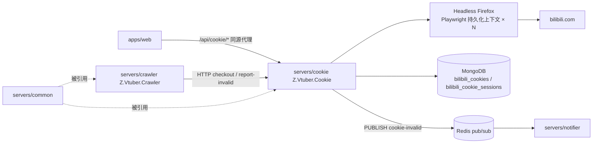
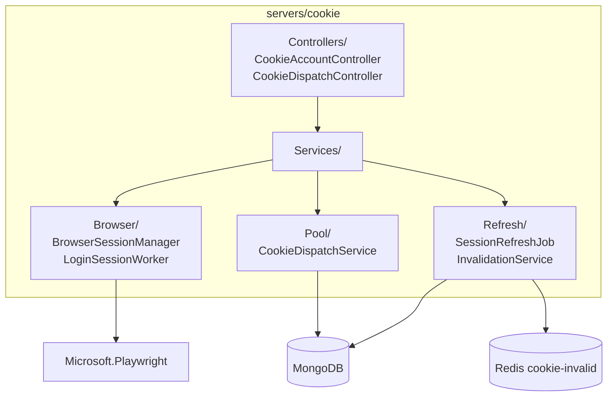
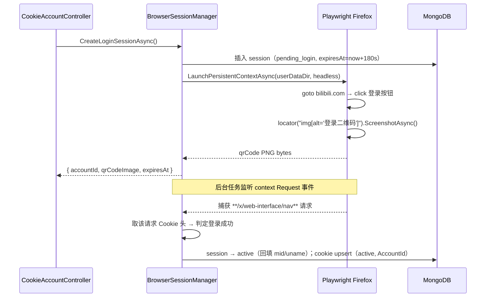
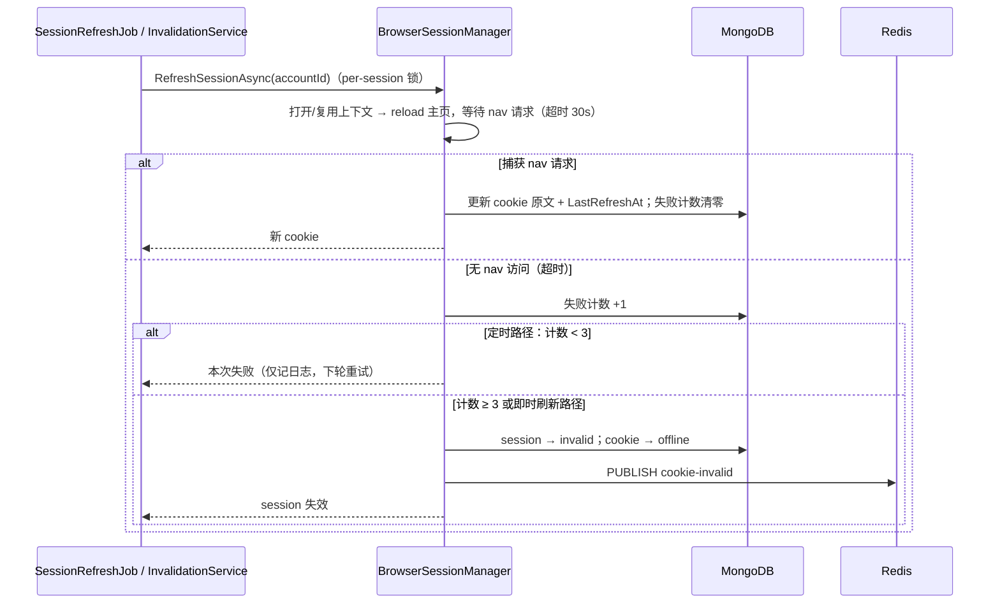

# 无头浏览器 Cookie 服务（z-vtuber-cookie）- 技术提案

- 日期：2026-09-11
- 状态：待评审
- feat-branch：`feat/cookie-service`
- 关联文档：[PRD](../product/draft/20260911-cookie-service-prd.md)

## 1. 概述

### 1.1 背景

当前 cookie 生命周期（详见 `servers/common/Services/CookiePoolService.cs`、`servers/crawler/Services/CookieNavProbeService.cs`）：

- **录入**：人工在浏览器登录 B 站、复制 cookie 字符串，经 `POST /api/b/cookie`（`BilibiliCookieController`）→ `CookiePoolService.AddAsync` 写入 MongoDB `bilibili_cookies` 集合，写入即 `Status=active`；
- **分发**：crawler 各 Job 与 `LiveEventSource` 经 `CookiePoolService.NextAsync`（round-robin，按 `LastUsedAt` 升序原子检出）取 cookie；首次使用前经 `ICookieNavProbeService.ProbeAsync` 探测；
- **失效**：`CookieProbeJob` 周期探测与 `BilibiliAccountProvider` 构建失败时 `MarkOfflineAsync`，并经 Redis `cookie-invalid` 频道发布 `CookieInvalidEvent`，notifier 投递通知；
- **修复**：无。失效后只能人工重新登录、复制、粘贴。

痛点：录入与修复全人工，恢复链路长；cookie 自然过期无法预防。

### 1.2 目标

新增独立服务 **Z.Vtuber.Cookie**（`servers/cookie`，镜像 `zero-tools/z-vtuber-cookie`），基于 **Microsoft.Playwright + headless Firefox**：

1. 「新增帐号 API」：调起独立持久化 headless Firefox session 访问 bilibili.com，点击登录、截取 `alt="登录二维码"` 元素返回；监听 nav 接口 XHR 判定扫码登录成功，持久化 session 与 nav cookie；
2. 定时任务每 10 分钟刷新各 session 主页，以 nav 接口 cookie 保鲜；无 nav 访问则 session 与 cookie 失效并发布既有失效事件；
3. 「获取 cookie / 阻塞式宣告失效」API：crawler 改经 HTTP 取 cookie；宣告失效时立即刷新 session，成功返回新 cookie 供重试，session 失效则明确返回；
4. web「Cookie 管理」页改造为扫码新增帐号 + session 状态视图，经 nginx 同源代理访问 Cookie 服务。

### 1.3 范围

- **内**：新服务骨架（API + 浏览器编排 + 定时刷新 + 持久化）、crawler cookie 获取/宣告路径切换、web Cookie 页改造、契约/OpenAPI、Aspire 编排、Dockerfile、CI 流水线、测试；
- **外**：notifier（事件格式不变，零改动）；数据抓取链路仍走 crawler 既有 HTTP 通道（`BiliApiClient`/`BrowserishBiliApiClient`），浏览器不参与抓取；B 站帐号注册、风控申诉等人工事项。

## 2. 技术架构

### 2.1 系统架构图



### 2.2 技术栈

| 项 | 选型 | 说明 |
|---|---|---|
| 语言/框架 | C# / .NET 10，ASP.NET Core Web API | 与 api 服务一致，需提供真实 HTTP API（非 Worker） |
| 浏览器自动化 | Microsoft.Playwright（Firefox，headless） | 持久化上下文 `LaunchPersistentContextAsync`，每帐号独立 user-data-dir |
| 数据库 | MongoDB（`Aspire.MongoDB.Driver`） | 复用既有实例与 `zvtuber` 库 |
| 消息通道 | Redis pub/sub（`Aspire.StackExchange.Redis`，`ConnectionStrings:messaging`） | 复用 `cookie-invalid` 频道 |
| 契约 | OpenAPI YAML（`contracts/cookie.openapi.yaml`）+ openapi-typescript codegen | 与既有三份契约同模式 |
| 测试 | xUnit + Testcontainers（Mongo/Redis），Playwright 侧以接口 mock | 沿用 `tests/Z.Vtuber.Tests` |
| 部署 | 两阶段 Dockerfile + GitHub Action `build-cookie-image.yml` | 范本：notifier |

### 2.3 模块划分



- `Controllers/`：对外 API，统一前缀 `/api/cookie`；
- `Browser/`：Playwright 生命周期封装——session 创建、二维码截取、nav XHR 监听、持久化上下文恢复、资源回收；
- `Refresh/`：10 分钟定时刷新（每 session 错峰）、失效宣告触发的即时刷新、失效状态机与事件发布；
- `Pool/`：可用 cookie 检出（round-robin）、对外 cookie 读写；
- 共享：实体/仓储按「双方使用入 common」约定，`CookieRecord` 扩展字段落在 common；cookie 服务私有实体（session）留在本服务。

## 3. API 设计

### 3.1 API 契约

契约文件：`contracts/cookie.openapi.yaml`（本服务为契约生成源，web 经 openapi-typescript 生成类型）。

统一前缀 `/api/cookie`，分组如下。

#### POST /api/cookie/accounts

新增帐号：调起 headless Firefox session 并返回登录二维码。

- 响应 `202 Accepted`：

```json
{
  "accountId": "66e1f0a2b1c9d2e3f4a5b6c7",
  "status": "pending_login",
  "qrCodeImage": "data:image/png;base64,iVBORw0KGgo...",
  "expiresAt": "2026-09-11T14:43:00Z"
}
```

- 无请求体；并发上限（如正在登录中的 session ≥ 3）时返回 `429`。

#### GET /api/cookie/accounts/{accountId}

查询帐号 session 状态（web 轮询扫码结果）。

- 响应 `200`：`{ accountId, status, mid?, uname?, qrCodeImage?, expiresAt? }`
- `status` ∈ `pending_login`（仍附 `qrCodeImage`）/ `active` / `expired` / `invalid`；`404` 表示不存在。

#### GET /api/cookie/accounts

列出全部帐号 session（web 列表）：`{ items: [{ accountId, status, mid, uname, cookieStatus, lastRefreshAt, lastLoginAt, createdAt }] }`，**不含 cookie 原文**。

#### DELETE /api/cookie/accounts/{accountId}

删除帐号 session：关闭并清理浏览器上下文与持久化目录，其 cookie 标记 `offline`（发布失效事件，reason `account_removed`）。响应 `204`。

#### GET /api/cookie/available

可用 cookie 列表（供 web 展示）：`{ items: [{ cookieId, accountId, uname, status, lastCheckedAt, lastUsedAt, lastRefreshAt }] }`，**不含 cookie 原文**。

#### POST /api/cookie/checkout

取下一个可用 cookie（crawler 抓取取用，round-robin）：

- 响应 `200`：`{ cookieId, accountId, cookie }`；
- 无可用 cookie：`404 { "error": "no_available_cookie" }`。

#### POST /api/cookie/report-invalid

阻塞式宣告失效并尝试即时刷新。

- 请求：`{ "cookieId": "..." }`；
- 响应 `200`（刷新成功）：`{ cookieId, accountId, cookie, refreshed: true }`——调用方用新 cookie 重试；
- 响应 `410 Gone`（session 失效）：`{ cookieId, accountId, reason: "session_invalid" }`——调用方放弃本轮；
- 响应 `404`（cookieId 不存在）；接口内部超时上限默认 60s，超时返回 `504`。

### 3.2 内部接口

#### Redis 事件契约（cookie → notifier，零改动复用）

频道 `cookie-invalid`，payload 为既有 `CookieInvalidEvent`（`servers/common/Live/CookieInvalidEvent.cs`）：

```json
{ "cookie_id": "...", "mid": 12345, "uname": "xxx", "occurred_at": "...", "reason": "session_invalid|account_removed|refresh_nav_missing" }
```

发布失败仅记日志（fire-and-forget），MongoDB 仍为事实源。payload/日志沿用 `CookieTag` 短哈希惯例，**不含 cookie 原文**。

#### crawler → cookie 调用契约

crawler 新增 `CookieServiceClient`（typed HttpClient），封装 `checkout` / `report-invalid`，超时与 `404/410` 语义见 5.2 实现点 4。

## 4. 数据模型

MongoDB 库 `zvtuber`（既有实例）。

### 4.1 既有集合演进：`bilibili_cookies`

`CookieRecord`（`servers/common/Persistence/Entities/CookieRecord.cs`）新增可空字段：

| 字段 | 类型 | 说明 |
|---|---|---|
| `AccountId` | string? | 关联 `bilibili_cookie_sessions._id`；历史手工录入数据为 null（兼容期仍可用） |
| `LastRefreshAt` | DateTime? | 最近一次 nav cookie 刷新时间 |

索引：`AccountId_1` 普通索引（幂等创建，并入 `MongoDbInitializer.EnsureCookiesIndexesAsync`）。

### 4.2 新增集合：`bilibili_cookie_sessions`

实体 `CookieSessionRecord`（cookie 服务私有）：

| 字段 | 类型 | 说明 |
|---|---|---|
| `_id` | ObjectId | 即 API 中的 accountId |
| `Status` | string | `pending_login` / `active` / `expired` / `invalid` |
| `UserDataDir` | string | Playwright 持久化上下文目录（卷内相对路径） |
| `Mid` / `Uname` | long? / string? | 登录成功后由 nav 响应回填 |
| `CookieId` | string? | 关联 `bilibili_cookies._id`（登录成功后写入） |
| `CreatedAt` / `LastLoginAt` / `LastRefreshAt` / `ExpiresAt` | DateTime | `ExpiresAt` 为二维码过期时间 |
| `ConsecutiveRefreshFailures` | int | 连续刷新失败计数（阈值判定用） |

索引：`Status_1`、`CookieId_1`。

## 5. 技术实现方案

### 5.1 核心流程

**扫码登录流程**：



**定时刷新 / 即时刷新流程**（同一 `RefreshSessionAsync` 入口，按 session 串行化）：



### 5.2 关键实现点

#### 实现点 1: 服务骨架与工程接入（范本 notifier）

- `servers/cookie/Z.Vtuber.Cookie.csproj`：ASP.NET Core Web API（`Microsoft.NET.Sdk.Web`），net10.0，引用 `Z.Vtuber.Common` + `Microsoft.Playwright`；
- `Program.cs`：Controllers/OpenApi/HealthChecks/Mongo/Redis（`ConnectionStrings:mongo`、`ConnectionStrings:messaging`，与既有服务同名注入）+ Options（`CookieServiceOptions`，`ValidateOnStart`）+ 后台服务注册；
- slnx 加入项目；`infra/apphost` 编排：`AddProject<Projects.Z_Vtuber_Cookie>()` + `WithReference(mongo)` + `WithReference(messaging)` + `WithHttpHealthCheck("/health")` + 挂载 session 持久化卷（`/data/browser-sessions`）；
- Dockerfile：两阶段；运行时阶段执行 `playwright install --with-deps firefox`（或基于 `mcr.microsoft.com/playwright/dotnet` 镜像），EXPOSE 8080；
- `.github/workflows/build-cookie-image.yml`：复制 `build-notifier-image.yml`，镜像名 `zero-tools/z-vtuber-cookie`，触发路径含 `servers/cookie/**` 与 `servers/common/**`。

#### 实现点 2: 浏览器编排（BrowserSessionManager）

- `IBrowserSessionManager` 抽象（便于单测 mock），实现持有 `IPlaywright` + `IBrowser`（Firefox，`Headless = true`）单例；每帐号 `LaunchPersistentContextAsync(Path.Combine(dataDir, accountId))`；
- **登录会话**：`page.GotoAsync("https://www.bilibili.com")` → 点击登录入口 → `page.Locator("img[alt=\"登录二维码\"]").ScreenshotAsync()` 返回 PNG；同时挂 `context.Request` 事件匹配 `https://api.bilibili.com/x/web-interface/nav`；
- **登录成功判定**：捕获到该 session 发出的 nav 请求即视为登录态建立（未登录主页不产生带登录 cookie 的 nav 请求）；取请求头 `cookie` 作为对外 cookie；`expiresAt`（默认 180s）内未捕获 → `expired`，关闭上下文并清理；
- **持久化与恢复**：持久化上下文目录即 session 落盘；服务重启时扫描 `active/invalid` session 记录，上下文**惰性重建**（首次刷新/宣告时重建），`pending_login` 记录直接清理；
- **资源管理**：上下文注册到 session 表，`IDisposable` 模式释放；进程退出时统一 `DisposeAsync`；单上下文异常（crash）隔离捕获，只影响对应 session。

#### 实现点 3: 定时刷新（SessionRefreshJob）

- `BackgroundService`，每 60s 扫描一次 `active` session，对距上次刷新 ≥ 10 分钟者触发 `RefreshSessionAsync`（错峰：按 `LastRefreshAt` 自然错开，单轮内 session 间随机延迟数秒）；
- 刷新：复用或重建上下文 → `page.ReloadAsync()` → 等待 nav 请求（30s 超时）；
- 成功：更新 `bilibili_cookies` 中该 session 的 cookie 原文与 `LastRefreshAt`，失败计数清零；
- 失败（无 nav）：计数 +1，**连续 3 次**（≈30 分钟）才判 session 失效（容忍 B 站/网络瞬时抖动）；判失效时 cookie → offline + 发布 `cookie-invalid`（reason `refresh_nav_missing`）。

#### 实现点 4: 阻塞式失效宣告（InvalidationService）

- `POST /api/cookie/report-invalid` → 按 cookieId 反查 session → **per-session `SemaphoreSlim` 锁**（同 `CookieCallGate` 思路，键锁驻留）→ 锁内先查「刚被其他宣告刷新过」（`LastRefreshAt` 晚于宣告入队时间则直接返回现值，并发去重）→ 否则执行一次 `RefreshSessionAsync`（即时路径：单次失败即判失效，不等 3 次）；
- 成功：`200` 返回新 cookie；失败：session/cookie 失效 + 发事件，`410`；
- 接口总超时 60s（配置项），超时返回 `504`，后台刷新流程继续；
- **crawler 侧** `CookieServiceClient`：
  - `CheckoutAsync` 替代 `CookiePoolService.NextAsync` 调用点（`LiveStatusJob`/`SpaceTimelineJob`/`LiveGuardJob`/`LiveEventSource`/`CookieProbeJob` 等）：`404` → 抛既有 `NoAvailableCookieException`，沿用暂停/退避语义；
  - 失效宣告替代 `MarkOfflineAsync` 的调用点语义：调用方捕获风控/失效 → `ReportInvalidAsync` 阻塞等待 → `200` 拿新 cookie 重试原请求一次；`410` 放弃本轮，等待下一轮取其他 cookie；
  - **兼容期**：`AccountId == null` 的历史手工 cookie 无 session 可刷新，宣告时直接走旧逻辑（offline + 事件），引导运维用扫码帐号替代；
  - `CookieProbeJob` 的 nav 探测职责随 cookie 保鲜移交 cookie 服务，crawler 侧探测改为对「取用的 cookie」做轻量校验或整 Job 下线（实现期定夺，提案建议：cookie 服务已 10 分钟保鲜 + 宣告自愈，crawler 的周期探测可下线）。

#### 实现点 5: web「Cookie 管理」页改造

- `apps/web/src/api/client.ts` 新增 cookie 服务客户端函数；类型经 openapi-typescript 由 `contracts/cookie.openapi.yaml` 生成（`schema-cookie.d.ts`，勿手改）；
- `cookie/CookiePage.tsx` 改造：列表数据源切到 `GET /api/cookie/accounts`（+ `/available`）；移除 textarea 粘贴录入，改「新增帐号」按钮 → 弹窗展示 `qrCodeImage`（base64 PNG）→ 每 2s 轮询 `GET /accounts/{id}` 至 `active/expired`；
- 代理：vite dev 增加 `VITE_COOKIE_URL`（默认 localhost:5200）；生产 nginx 增加 `location /api/cookie` 且**必须置于 `location /api` 之前**，`docker-entrypoint.sh` envsubst 增加 `COOKIE_BACKEND`（默认 `cookie:8080`）。

#### 实现点 6: 配置项（CookieServiceOptions，节 `CookieService`，`ValidateOnStart`）

| 配置 | 默认 | 说明 |
|---|---|---|
| `BrowserSessionDataDir` | `/data/browser-sessions` | 持久化卷路径 |
| `QrCodeExpiresSeconds` | 180 | 二维码有效期 |
| `RefreshIntervalMinutes` | 10 | 定时刷新周期 |
| `RefreshNavTimeoutSeconds` | 30 | 单次刷新等待 nav 请求超时 |
| `MaxConsecutiveRefreshFailures` | 3 | 定时路径失效判定阈值 |
| `ReportInvalidTimeoutSeconds` | 60 | 宣告接口超时上限 |
| `MaxPendingLoginSessions` | 3 | 并发登录 session 上限 |

## 6. 技术决策

### 6.1 决策列表

1. **引入 Playwright（重新论证历史决策）**：`20260820-proposal-bilibili-412-fix.md` 曾明确「不引入 Playwright 等重型浏览器栈」——该决策针对的是 **crawler 数据抓取路径**（高频请求，资源敏感），结论对该路径依然成立；本需求浏览器仅用于**登录与低频主页保活刷新**（每帐号 10 分钟一次），二维码登录态获取无纯 HTTP 等价方案，且独立服务隔离了资源影响。两个决策不冲突，本提案在文档中显式记录该边界。
2. **独立新服务而非塞进 crawler**：浏览器编排与抓取生命周期不同（常驻 GUI 资源 vs 周期任务）；独立服务可复制 notifier 的工程范本（编排/Dockerfile/CI），故障域隔离，crawler 重启不影响登录 session。
3. **cookie 池事实源收敛到 cookie 服务，crawler 改走 HTTP**：满足需求「crawler 调用 api 获得 cookie」；`bilibili_cookies` 集合改由 cookie 服务独占写入，common 中 `CookiePoolService` 的写入路径随之下线（crawler 侧读取改为 API）。牺牲一次跨进程调用，换来 session-cookie 状态强一致与宣告自愈。
4. **持久化上下文（user-data-dir）而非 storageState 导出**：`LaunchPersistentContextAsync` 天然落盘（cookie/localStorage/IndexedDB 全量），重启恢复简单；storageState 需手动导出且不含全部状态。
5. **登录成功以 nav XHR 为准**：需求明确且不依赖易变的页面 DOM/文案；未登录主页不产生登录态 nav 请求，误判率低。
6. **宣告失效阻塞 + 锁内去重**：满足「阻塞调用→拿新 cookie 重试」语义；per-session 锁 + `LastRefreshAt` 比对避免风暴式重复刷新（沿用 `CookieCallGate` 键锁模式）。
7. **定时失效判定需连续 3 次失败，即时宣告路径单次即判**：定时路径容忍瞬时抖动；宣告路径调用方已实际观察到失效，单次确认即可。
8. **失效事件零改动复用 `cookie-invalid`**：notifier 与通知订阅配置不动，reason 枚举扩展新取值。

### 6.2 依赖与约束

- `Microsoft.Playwright` NuGet + Firefox 运行时（镜像体积显著增大，需评估 registry/部署带宽）；
- 部署节点需为 session 目录挂载持久卷（`infra` 侧 docker-compose/卷配置，部署节点执行）；
- 浏览器旗标：headless、无 GPU（`--headless` 由 Playwright 管理）；容器内需非 root 或 `--no-sandbox` 等价配置；
- 前端代理顺序约束：`/api/cookie` 先于 `/api`（同 `/api/notify` 既有先例）。

## 7. 项目结构

```
servers/cookie/
├── Z.Vtuber.Cookie.csproj
├── Program.cs                          # 宿主与 DI 注册
├── appsettings.json                    # CookieService 节
├── Dockerfile                          # 两阶段 + playwright install firefox
├── AGENTS.md
├── Controllers/
│   ├── CookieAccountController.cs      # /api/cookie/accounts*
│   ├── CookieDispatchController.cs     # /api/cookie/{available,checkout,report-invalid}
│   └── HealthController.cs
├── Browser/
│   ├── IBrowserSessionManager.cs
│   ├── BrowserSessionManager.cs        # Playwright 生命周期、二维码、nav 监听、持久化恢复
│   └── LoginSessionWorker.cs           # pending_login session 的 nav 监听后台任务
├── Refresh/
│   ├── SessionRefreshJob.cs            # 10 分钟定时刷新（60s 扫描驱动）
│   └── InvalidationService.cs          # 宣告失效 + 即时刷新 + per-session 锁
├── Pool/
│   └── CookieDispatchService.cs        # round-robin 检出（迁移自 CookiePoolService 语义）
├── Persistence/
│   ├── CookieSessionRecord.cs
│   └── CookieSessionRepository.cs
└── Configuration/
    └── CookieServiceOptions.cs

servers/common/（变更）
├── Persistence/Entities/CookieRecord.cs        # + AccountId / LastRefreshAt
└── Persistence/MongoDbInitializer.cs           # + AccountId 索引

servers/crawler/（变更）
├── Services/CookieServiceClient.cs             # 新增 typed HttpClient
├── Jobs/CookieProbeJob.cs                      # 下线或降级（实现期定夺）
└── （cookie 取用/失效调用点切换到 CookieServiceClient）

contracts/
└── cookie.openapi.yaml                         # 新增契约

apps/web/（变更）
├── src/api/schema-cookie.d.ts                  # codegen 生成
├── src/api/client.ts                           # + cookie 客户端
├── src/cookie/CookiePage.tsx                   # 扫码新增帐号改造
├── vite.config.ts                              # + VITE_COOKIE_URL 代理
└── nginx.conf / docker-entrypoint.sh           # + /api/cookie 前缀

tests/Z.Vtuber.Tests/（新增 cookie 服务用例）
infra/apphost/（编排 + 卷）
.github/workflows/build-cookie-image.yml
```

## 8. 测试策略

### 8.1 测试覆盖要求

核心逻辑覆盖率 ≥ 80%（common-rules）；浏览器交互层经 `IBrowserSessionManager` 抽象 mock，不依赖真实 Firefox 跑单测。

### 8.2 测试类型

- **单元测试**：
  - 登录状态机：`pending_login → active/expired` 迁移、超时清理、nav 捕获触发成功；
  - 刷新状态机：成功更新 cookie、失败计数、连续 3 次失效、即时路径单次失效；
  - 宣告去重：并发 `report-invalid` 只触发一次刷新、后到者获得同一结果；`LastRefreshAt` 比对短路；
  - 检出：round-robin 顺序、无可用 cookie 的 `404`；
- **集成测试**（Testcontainers Mongo + Redis）：session/cookie 仓储、失效事件发布格式与频道、API 端到端（mock 浏览器层）；
- **crawler 侧**：`CookieServiceClient` 对 `200/404/410/504` 的分支行为（mock HttpMessageHandler）；
- **手工验证**：真实扫码登录 → 10 分钟刷新 → 宣告失效自愈全链路（部署节点验收）。

## 9. 部署方案

### 9.1 环境规划

- 新容器 `z-vtuber-cookie`（镜像 `zero-tools/z-vtuber-cookie`），内网端口 8080；
- 挂载卷：`browser-sessions` → `/data/browser-sessions`（session 持久化）；
- web nginx 增加 `/api/cookie` 前缀转发（先于 `/api`）。

### 9.2 配置管理

- `ConnectionStrings:mongo` / `ConnectionStrings:messaging`：与既有服务同源注入；
- `CookieService` 节各参数（见实现点 6）按环境覆盖；
- 无新增密钥；cookie 原文不出服务边界（分发 API 除外），日志沿用 `CookieTag` 短哈希。

## 10. 验收标准

- [ ] `POST /api/cookie/accounts` 返回可扫二维码；扫码后秒级判定登录成功，cookie 进入可用池；
- [ ] 服务重启后 active session 自动恢复（惰性重建），无需重新扫码；
- [ ] active session 每 10 分钟刷新并更新持久化 cookie；人为使 session 失效后连续失败触发 cookie 下线 + `cookie-invalid` 事件，notifier 正常通知；
- [ ] crawler 经 `checkout` 取 cookie 正常抓取；宣告失效后 session 有效则拿新 cookie 重试成功，session 失效则收到 `410` 放弃本轮；
- [ ] 并发宣告同一 cookie 只触发一次实际刷新；
- [ ] web「Cookie 管理」页展示 session 列表，扫码新增帐号全流程可用；服务不可用时页面明确报错不白屏；
- [ ] Aspire 一键启动含 cookie 服务的全套环境；GitHub Action 可构建推送 `zero-tools/z-vtuber-cookie` 镜像；
- [ ] 单测 + 集成测试通过，核心逻辑覆盖率 ≥ 80%。

## 11. 相关文档

- PRD：`docs/product/draft/20260911-cookie-service-prd.md`
- 前置提案：`docs/engineering/proposals/20260904-proposal-cookie-invalid-notification.md`（失效事件链路）
- 历史决策参照：`docs/engineering/proposals/20260820-proposal-bilibili-412-fix.md`（不引入浏览器栈的原决策，本提案第 6.1 节决策 1 重新论证边界）
- 新服务工程范本：`docs/engineering/proposals/20260911-proposal-notifier-milky.md`
