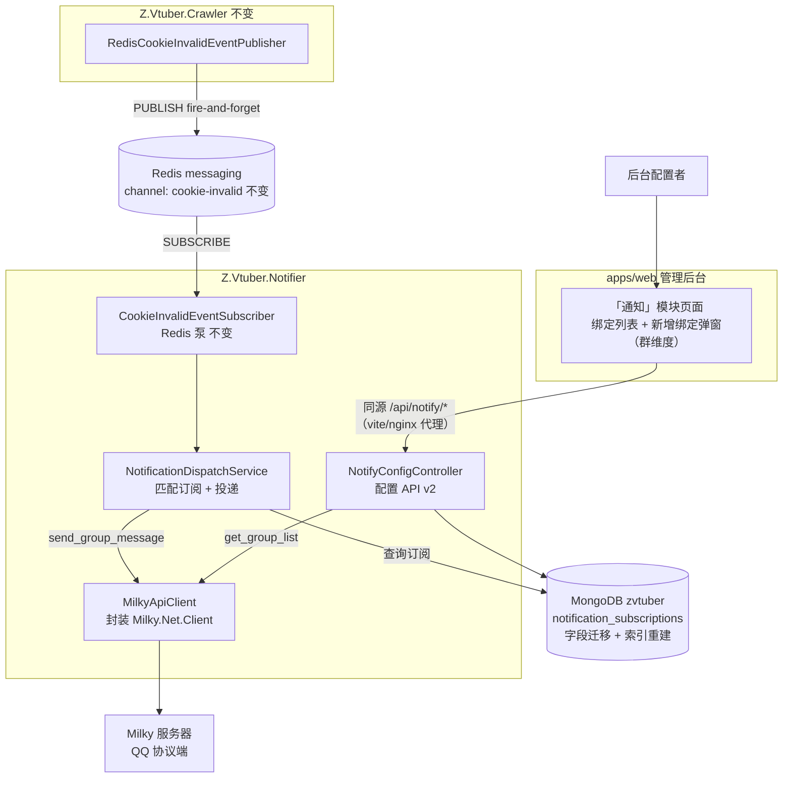
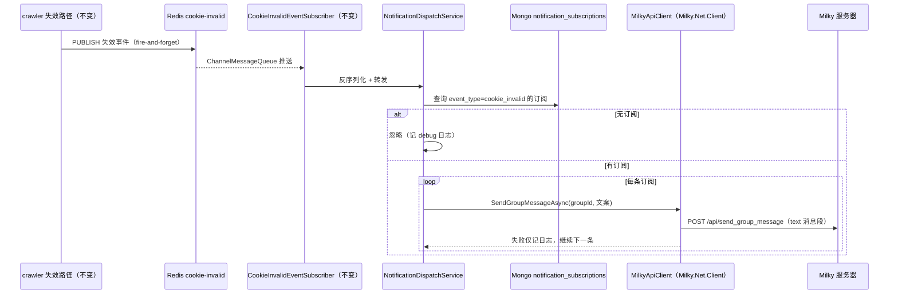

# 通知服务接入 Milky 协议（替换 Satori）- 技术提案

**功能名称**: 通知服务接入 Milky 协议（替换 Satori）
**关联 PRD**: `docs/product/draft/20260911-notifier-milky-prd.md`
**技术提案版本**: v1.0
**创建日期**: 2026-09-11
**作者**: Workflow Agent（代起草）
**feat-branch**: `feat/milky-notification`（需求总分支；实现分支另行切出）

## 1. 概述

### 1.1 背景

notifier 当前以 `HttpClient` 自研实现 Satori 协议 v1（`servers/notifier/Satori/SatoriApiClient.cs`：`login.get` 登录发现、`guild.list`/`channel.list` 频道查询、`message.create` 投递），经 `Authorization: Bearer` + `Satori-Platform`/`Satori-User-ID` 请求头与 Satori 服务器交互。现决定整体切换为 [Milky 协议](https://milky.ntqqrev.org/)，并按要求使用 [Milky.Net](https://github.com/frg2089/Milky.Net) 包接入，删除 Satori 自研实现。

Milky 协议面向 QQ：API 为 `POST /api/{api_name}`（JSON body，`Authorization: Bearer {access_token}`），事件经 SSE/WebSocket `/event` 推送。本服务只发消息、不消费事件（事件来自 Redis），因此仅使用其 HTTP API 面（`get_login_info` / `get_group_list` / `send_group_message`），与当初 Satori「纯 HTTP、无 WS」的接入形态一致。

Milky.Net 为代码生成客户端：`Milky.Net.Client.MilkyClient` 接收一个预配置的 `HttpClient`（`BaseAddress` + `Authorization` 头），API 按分类属性暴露（如 `milky.System.GetImplInfoAsync()`），事件接收（`ReceivingEventUsingSSEAsync`/`ReceivingEventUsingWebSocketAsync`）本期不使用。

### 1.2 目标

- 删除 `servers/notifier/Satori/`，新增 `servers/notifier/Milky/`：基于 `Milky.Net.Client` 包封装 `IMilkyApiClient`/`MilkyApiClient`（登录探活、群列表查询、群消息发送）；
- 环境变量切换：`Z_VTUBER_MILKY_ENDPOINT`（必需，fail-fast）、`Z_VTUBER_MILKY_ACCESS_TOKEN`（可选）；废弃 `Z_VTUBER_SATORI_*`；
- 配置契约升级为 v2：`GET /api/notify/channels` → `GET /api/notify/groups`；订阅字段由 `platform/guild*/channel*` 改为 `groupId/groupName`；
- 数据迁移：清空 `notification_subscriptions` 存量 Satori 数据，唯一索引由 `(event_type, platform, channel_id)` 重建为 `(event_type, group_id)`；
- 投递路径改经 Milky `send_group_message`（text 消息段）；文案不变；
- 前端「通知」模块与 `schema-notify.d.ts` 代码生成同步适配群维度；
- Aspire 编排参数 `satori-endpoint`/`satori-token` → `milky-endpoint`/`milky-access-token`。

### 1.3 范围

- **做**：notifier 的 Milky 接入与 Satori 代码删除；配置 API v2（群查询 + 群维度订阅）；Mongo 实体/索引迁移；前端适配与契约代码生成；Aspire 参数切换；全部相关测试改写；
- **不做**：
  - Milky 事件流消费（SSE/WebSocket）——事件来源仍是 Redis；
  - 私聊通知、@人、富媒体消息段——仅 text 消息段纯文本投递；
  - 存量 Satori 订阅的数据转换（Satori 频道 ID 与 QQ 群号无映射，按清理处理）；
  - 配置 API 鉴权（与既有后台接口一致，内网匿名）。

## 2. 技术架构

### 2.1 系统架构图



### 2.2 技术栈

| 层级 | 技术选型 | 说明 |
|------|---------|------|
| Milky 接入 | `Milky.Net.Client`（NuGet，[frg2089/Milky.Net](https://github.com/frg2089/Milky.Net)） | `MilkyClient(HttpClient)`：HTTP API 走 `POST /api/{api}`；不启用 SSE/WS 事件接收 |
| 服务形态 | 不变 | Worker SDK + minimal Kestrel（8080，`/health` 与配置 API） |
| 消息通道 | Redis pub/sub（既有 `messaging`） | 事件链路零改动 |
| 持久化 | MongoDB（既有 `mongo`） | `notification_subscriptions` 集合字段迁移 + 唯一索引重建 |
| 前端 | React 19 + Vite（既有 `apps/web`） | 「通知」模块群维度适配；契约类型由 openapi-typescript 重新生成 |
| 契约 | OpenAPI YAML | `contracts/notifier.openapi.yaml` 升级为 v2.0.0（不兼容变更） |

### 2.3 模块划分

| 模块 | 职责 | 关键技术点 |
|------|------|-----------|
| `servers/notifier/Satori/`（删） | 整体删除 | `SatoriOptions`/`ISatoriApiClient`/`SatoriApiClient` 及所有引用点 |
| `servers/notifier/Milky/`（新） | Milky 接入 | `MilkyOptions { Endpoint, AccessToken }`、`IMilkyApiClient`、`MilkyApiClient`（封装 `MilkyClient`） |
| `servers/notifier/Dispatch/NotificationDispatchService.cs`（改） | 投递到 QQ 群 | 依赖由 `ISatoriApiClient` 换为 `IMilkyApiClient`，`SendMessageAsync(channelId, …)` → `SendGroupMessageAsync(groupId, …)` |
| `servers/notifier/Controllers/NotifyConfigController.cs`（改） | 配置 API v2 | `/channels` → `/groups`；订阅 DTO 字段群维度化 |
| `servers/common/Persistence`（改） | 订阅实体与索引迁移 | `NotificationSubscriptionRecord` 字段改为 `group_id/group_name`；`MongoDbInitializer` 重建唯一索引并清理存量数据 |
| `contracts/notifier.openapi.yaml`（改） | 契约 v2.0.0 | 见第 3 节 |
| `apps/web`（改） | 「通知」模块群维度 | 重新生成 `schema-notify.d.ts`；`client.ts` 与 `NotificationPage.tsx` 字段适配 |
| `infra/apphost/AppHost.cs`（改） | 编排参数切换 | `milky-endpoint` / `milky-access-token` Parameter + `WithEnvironment` |

## 3. API 设计

### 3.1 API 契约

`contracts/notifier.openapi.yaml` 升级为 **2.0.0**（不兼容变更），统一前缀 `/api/notify` 不变：

| 方法 | 路径 | 变更 | 描述 |
|------|------|------|------|
| GET | `/api/notify/groups` | **改名**（原 `/channels`） | 查询机器人当前加入的 QQ 群列表 |
| GET | `/api/notify/subscriptions` | 字段变更 | 查询全部通知订阅（群维度） |
| POST | `/api/notify/subscriptions` | 字段变更 | 创建通知订阅（群维度） |
| DELETE | `/api/notify/subscriptions/{id}` | 不变 | 删除通知订阅 |

#### GET /api/notify/groups

经 Milky `get_group_list` 聚合返回（替换原 guild.list + channel.list 两段聚合）：

```json
{
  "items": [
    { "groupId": "123456", "groupName": "运维群" }
  ]
}
```

Milky 不可达或机器人未登录时返回 `503` + 明确错误消息（不静默返回空列表）。`groupId` 在协议层为 int64，契约层沿用 string 表达（避免 JS 精度问题，与既有 `channelId` string 惯例一致）。

#### POST /api/notify/subscriptions

```json
{
  "eventType": "cookie_invalid",
  "groupId": "123456",
  "groupName": "运维群"
}
```

- `eventType` 当前仅接受 `cookie_invalid`，其他值返回 400；
- 同一 `(eventType, groupId)` 重复创建按幂等处理：返回已存在订阅（200）；
- 成功返回 `201` 与订阅记录（含 `id`、`createdAt`）。

GET 订阅列表响应的订阅对象字段同步为 `{ id, eventType, groupId, groupName, createdAt }`；DELETE 行为不变（204/404）。

### 3.2 内部接口

#### Redis 事件契约（crawler → notifier）

**完全不变**：频道 `cookie-invalid`、payload 字段与序列化约定沿用既有版本。

#### Milky 调用面（notifier → Milky 服务器）

| Milky API | 用途 | 说明 |
|-----------|------|------|
| `get_login_info` | 登录探活 | 群查询前校验机器人登录态；失败映射为 503 |
| `get_group_list` | 群列表查询 | 返回机器人加入的群（群号 int64 + 群名） |
| `send_group_message` | 通知投递 | 入参 `group_id` + 消息段数组；本期仅一个 text 消息段 |

均经 `Milky.Net.Client.MilkyClient` 调用（其内部 `POST /api/{api}`，携带 `HttpClient` 上预配置的 `Authorization: Bearer {access_token}`）；具体生成方法签名以实现时所用包版本为准（包为代码生成，分类属性形如 `milky.System.*` / `milky.Message.*`）。

#### 通知消息文案（QQ 群）

```
【Z.Vtuber】Cookie 失效通知
账号：{Uname}（MID {Mid}）
时间：{OccurredAt 本地时间}
请及时检查并更换 Cookie。
```

文案不变；Milky 的 text 消息段为纯文本，**不再需要 Satori 的 XML 转义逻辑**（`EscapeXml` 随 Satori 实现一并删除）。

## 4. 数据模型

Mongo `zvtuber` 库 `notification_subscriptions` 集合（**不兼容迁移**）：

| 字段 | 类型 | 变更 | 说明 |
|------|------|------|------|
| `_id` | ObjectId | 不变 | 主键 |
| `event_type` | string | 不变 | 通知类型 |
| `platform` | string | **删除** | Milky 仅面向 QQ，平台维度失去意义 |
| `guild_id` / `guild_name` | string / string? | **删除** | Satori 概念 |
| `channel_id` / `channel_name` | string / string? | **删除** | Satori 概念 |
| `group_id` | string | **新增** | QQ 群号（string 表达） |
| `group_name` | string? | **新增** | 群展示名 |
| `created_at` | DateTime(UTC) | 不变 | 创建时间 |

迁移策略（实现于 `MongoDbInitializer.EnsureIndexesAsync` 的启动初始化路径）：

1. 检测到旧唯一索引 `(event_type, platform, channel_id)` 存在则删除；
2. 清空存量文档（Satori 频道 ID 与 QQ 群号无映射关系，不可转换；运维升级后在后台重新绑定）；
3. 创建新唯一索引 `(event_type, group_id)`（支撑幂等创建）。

其余集合无任何变更。该迁移为一次性、幂等（重复启动安全）。

## 5. 技术实现方案

### 5.1 核心流程



### 5.2 关键实现点

#### 实现点 1: Milky 接入封装（MilkyApiClient）

- **描述**: 新增 `servers/notifier/Milky/`：`MilkyOptions { Endpoint, AccessToken }`；`IMilkyApiClient` 定义 `GetLoginInfoAsync` / `GetGroupListAsync` / `SendGroupMessageAsync(long groupId, string text, CancellationToken)` 三个方法；`MilkyApiClient` 内部构造 `Milky.Net.Client.MilkyClient`，对外屏蔽生成模型的细节（群实体、消息段类型）。
- **技术细节**:
  - `HttpClient` 经 `IHttpClientFactory` 创建，`BaseAddress = options.Endpoint`，`AccessToken` 非空时设置 `Authorization: Bearer {token}`；
  - 注册方式沿用既有 Singleton 工厂模式（`Program.cs` 中 `AddSingleton<IMilkyApiClient>(sp => …)`），保证登录态缓存生命周期一致；
  - 不调用 `ReceivingEventUsingSSEAsync`/`ReceivingEventUsingWebSocketAsync`——事件来自 Redis；
  - `SendGroupMessageAsync` 构造单个 text 消息段；`MilkyClient` 返回失败结果（`MilkyResult` 非成功态）或抛异常时，由调用方按「投递失败记日志、查询返回 503」的既有语义处理；
  - `IMilkyApiClient` 抽象保持 controller/dispatch 的可测性（Fakes 手写 fake），`MilkyApiClient` 自身以 stub `HttpMessageHandler` 验证 `/api/{api}` 请求体。
- **风险点**: `Milky.Net.Client` 的发布版本可能为 preview，且 API 由生成器随 Milky IR 演进——锁版本（`packages.lock.json`）并把「生成方法签名差异」收敛在 `MilkyApiClient` 一个类内；包目标框架与 .NET 10 的兼容性在实现时首先验证，不兼容则在需求总分支内升级/降级处理并同步本提案。

#### 实现点 2: 配置切换与 fail-fast

- **描述**: `Program.cs` 中 `SatoriOptions` 注册替换为 `MilkyOptions`：

```csharp
builder.Services.AddOptions<MilkyOptions>()
    .Configure(o =>
    {
        o.Endpoint = builder.Configuration["Z_VTUBER_MILKY_ENDPOINT"] ?? string.Empty;
        o.AccessToken = builder.Configuration["Z_VTUBER_MILKY_ACCESS_TOKEN"];
    })
    .Validate(o => !string.IsNullOrWhiteSpace(o.Endpoint),
        "缺少必需环境变量 Z_VTUBER_MILKY_ENDPOINT")
    .ValidateOnStart();
```

- `Platform`/`SelfId` 概念随 Satori 一并移除（Milky 登录态由协议端维护，应用端无需携带登录头）；Dockerfile、launchSettings、`servers/notifier/Properties/launchSettings.json` 中的旧环境变量同步清理。
- **风险点**: 部署环境若仍只注入旧变量，服务按预期启动失败并给出明确缺失提示——符合 PRD 的不兼容升级语义。

#### 实现点 3: 配置 API v2 与投递路径

- **描述**: `NotifyConfigController` 的 `GetChannels` 改为 `GetGroups`（路由 `/api/notify/groups`）：调用 `IMilkyApiClient.GetGroupListAsync`，单次调用即得全量群列表（替代原 guild 循环 + channel 翻页的两段聚合，逻辑显著简化）；异常返回 503「Milky 不可达或机器人未登录」。订阅增删查的 DTO 字段由 `platform/guildId/guildName/channelId/channelName` 改为 `groupId/groupName`；幂等键由 `(eventType, platform, channelId)` 改为 `(eventType, groupId)`。
- **技术细节**: `NotificationDispatchService` 依赖换为 `IMilkyApiClient`，循环内 `SendGroupMessageAsync(long.Parse(subscription.GroupId), message, ct)`（`GroupId` 落库时校验可解析为 int64，创建 API 对非法群号返回 400）；单条失败仅记日志不影响其余订阅，文案 `FormatMessage` 不变。

#### 实现点 4: 数据迁移与索引重建

- **描述**: `servers/common/Persistence`：`NotificationSubscriptionRecord` 删除 `Platform`/`GuildId`/`GuildName`/`ChannelId`/`ChannelName`，新增 `GroupId`/`GroupName`；`MongoDbInitializer.EnsureIndexesAsync` 增加一次性迁移步骤（删旧索引 → 清空集合 → 建新唯一索引 `(event_type, group_id)`）。
- **技术细节**: 旧文档含已删除字段时反序列化会因未知元素失败，因此「先清空再使用」必须保证顺序；迁移步骤幂等（索引不存在/集合为空时安全跳过）；仓储 `NotificationSubscriptionRepository` 的查询条件同步改为 `(event_type)` 列表查询与 `(event_type, group_id)` 幂等查询。

#### 实现点 5: 前端「通知」模块与契约代码生成

- **描述**: 契约升级后执行既有 `codegen` 重新生成 `apps/web/src/api/schema-notify.d.ts`（自动生成勿手改）；`client.ts` 的 `listNotifyChannels` 改为 `listNotifyGroups`（路径 `/notify/groups`），创建绑定的请求体字段群维度化；`NotificationPage.tsx` 的绑定列表列（平台/群组/频道 → 目标群）与弹窗下拉（选项 label `{groupName ?? groupId}（{groupId}）`，value 携带 groupId/groupName）适配。
- **技术细节**: vite/nginx 同源代理的 `/api/notify` 前缀分流不变；`VITE_NOTIFY_URL` 注入不变；交互细节（错误态 + 重试、删除二次确认、幂等提示）沿用既有版本。
- **风险点**: 契约字段为破坏式变更，需一次性改齐 `client.ts`、页面组件与测试（`client.test.ts`、`NotificationPage.test.tsx`），避免新旧字段混用。

#### 实现点 6: Aspire 与部署配置

- **描述**: `infra/apphost/AppHost.cs` 中 notifier 编排改为：

```csharp
.WithEnvironment("Z_VTUBER_MILKY_ENDPOINT", builder.AddParameter("milky-endpoint", secret: true))
.WithEnvironment("Z_VTUBER_MILKY_ACCESS_TOKEN", builder.AddParameter("milky-access-token", secret: true))
```

- 移除 `satori-endpoint`/`satori-token` Parameter；镜像构建 workflow（`build-notifier-image.yml`）无需改动（路径过滤与镜像名不变）；裸部署文档/配置中的 `Z_VTUBER_SATORI_*` 引用同步替换。
- **风险点**: 生产部署清单（仓库外）需同步更新环境变量名——在 PR 描述与 PRD 不兼容声明中显式列出。

## 6. 技术决策

### 6.1 决策列表

| 决策 | 选项 A | 选项 B | 最终选择 | 原因 |
|------|--------|--------|---------|------|
| Milky 接入方式 | 使用 Milky.Net.Client 包（需求指定） | 沿用自研协议直连（HttpClient 实现 Milky API） | A | 需求明确指定 Milky.Net；包为代码生成、模型与协议 IR 同步，省去手写模型维护；与 Satori 时期「不引 SDK」的决策前提（SDK 不成熟、仅需四端点）不同，本需求以包为准 |
| 事件接收 | 不消费 Milky 事件流（纯 HTTP API） | 启用 SSE/WS 接收 | A | 事件来源是 Redis，Milky 事件（BotOffline 等）本期无消费方；保持与 Satori 版本一致的纯 HTTP 形态 |
| 通知目标模型 | 契约/实体改为纯群维度（groupId/groupName），删除 platform/guild/channel | 保留 platform 字段固定 "qq"、复用 guild/channel 字段承载群 | A | Milky 仅面向 QQ，保留 Satori 字段会留下永久性的语义错位与无效列；契约同步升 v2 明确不兼容 |
| groupId 类型 | 契约/实体用 string，调用 Milky 时转 int64 | 全链路 long | A | 与既有 `channelId` string 惯例一致，避免 JS 端 int64 精度问题；转换收敛在 notifier 一处 |
| 存量订阅数据 | 启动初始化时清空 + 重建索引 | 保留旧文档、双模型兼容读取 | A | Satori 频道 ID 与 QQ 群号无任何映射，保留即脏数据；双模型兼容成本高于一次性清理（低频配置数据，重绑成本低） |
| 频道查询 API 路由 | 改名 `/api/notify/groups` | 保留 `/channels` 路由换实现 | A | 目标模型已变，路由名随之修正，契约 v2 一次性说清不兼容；前端反正要随字段适配 |
| 登录探活 | 群查询前调 `get_login_info` 校验登录态，失败 503 | 不校验，直接调用失败时 503 | A | 错误消息更明确（「Milky 不可达或机器人未登录」），与 PRD 验收口径一致；一次额外调用成本可忽略 |
| 消息段 | 仅 text 消息段 | 支持 @人/图片等富段 | A | 通知为纯文本告警，无富段需求；后续需要时按 Milky 消息段模型扩展 |
| Satori 代码处置 | 整体删除 `servers/notifier/Satori/` 与全部引用 | 保留并存、配置切换 | A | PRD 要求不再保留 Satori 实现；双协议并存增加维护面且无回退需求（回退即回滚部署版本） |

### 6.2 依赖与约束

| 类型 | 内容 | 说明 |
|------|------|------|
| 依赖 | `Milky.Net.Client`（NuGet，[仓库](https://github.com/frg2089/Milky.Net)） | 仅 notifier 引用；锁版本（packages.lock.json）；具体版本与生成 API 签名以实现时为准 |
| 依赖 | Milky 协议（[协议文档](https://milky.ntqqrev.org/)） | 使用 `get_login_info` / `get_group_list` / `send_group_message` 三个 API |
| 依赖 | 既有 Redis 事件链路与 `NotificationSubscriptionRepository` 模式 | 零改动/同模式修改 |
| 约束 | 不兼容升级 | 环境变量、契约、数据模型同步切换；部署侧需更新环境变量并重新绑定 |
| 约束 | fire-and-forget | 发布失败不阻断落库与采集；投递失败不影响其他订阅 |
| 约束 | 敏感信息 | 事件 payload、通知文案、日志均不得出现 cookie 原始字符串 |
| 约束 | Aspire 注入 | `ConnectionStrings__*` 经 `WithReference` 自动注入；Milky 参数经 `AddParameter` + `WithEnvironment` |
| 约束 | 前端同源 | 浏览器侧只访问 web 同源 `/api/notify/*`；nginx `location /api/notify` 先于 `location /api`（既有配置不变） |

## 7. 项目结构

```
servers/
├── common/
│   └── Persistence/
│       ├── Entities/NotificationSubscriptionRecord.cs   # 修改：字段群维度化（group_id/group_name）
│       ├── NotificationSubscriptionRepository.cs        # 修改：查询条件与幂等键适配
│       └── MongoDbInitializer.cs                        # 修改：旧索引删除 + 存量清空 + 新唯一索引
└── notifier/
    ├── Program.cs                                       # 修改：MilkyOptions 注册、IMilkyApiClient 注册
    ├── Satori/                                          # 删除（整目录）
    ├── Milky/                                           # 新增
    │   ├── MilkyOptions.cs                              # Endpoint / AccessToken
    │   ├── IMilkyApiClient.cs                           # 登录探活 / 群列表 / 群消息发送
    │   └── MilkyApiClient.cs                            # 封装 Milky.Net.Client.MilkyClient
    ├── Dispatch/NotificationDispatchService.cs          # 修改：依赖与投递调用适配
    ├── Controllers/NotifyConfigController.cs            # 修改：/groups + 群维度 DTO
    └── Z.Vtuber.Notifier.csproj                         # 修改：新增 Milky.Net.Client 包引用

contracts/
└── notifier.openapi.yaml                                # 修改：升级 v2.0.0（groups + 群维度 schema）

apps/web/
└── src/
    ├── api/schema-notify.d.ts                           # 重新生成（自动生成勿手改）
    ├── api/client.ts                                    # 修改：listNotifyGroups 等适配
    ├── api/client.test.ts                               # 修改
    └── pages/notification/
        ├── NotificationPage.tsx                         # 修改：列表列与弹窗下拉群维度化
        └── NotificationPage.test.tsx                    # 修改

infra/apphost/
└── AppHost.cs                                           # 修改：milky-endpoint / milky-access-token 参数

tests/Z.Vtuber.Tests/
├── SatoriApiClientTests.cs                              # 删除
├── MilkyApiClientTests.cs                               # 新增（stub HttpMessageHandler 验证 /api/* 请求体）
├── NotifyConfigControllerTests.cs                       # 修改（groups + 群维度字段）
├── NotificationDispatchServiceTests.cs                  # 修改（IMilkyApiClient fake）
├── NotificationSubscriptionRepositoryTests.cs           # 修改（新索引与幂等键）
└── Fakes.cs                                             # 修改：ISatoriApiClient fake → IMilkyApiClient fake
```

## 8. 测试策略

### 8.1 测试覆盖要求

- 改动核心路径（`MilkyApiClient`、配置 API、投递服务、仓储迁移）随对应测试类覆盖率 ≥ 80%；
- 既有测试（`dotnet test tests/Z.Vtuber.Tests`）不得回归；Satori 相关测试全部替换后无残留引用。

### 8.2 测试类型

| 类型 | 工具 | 覆盖范围 |
|------|------|---------|
| 单元测试 | xUnit + 手写 fake（`Fakes.cs` 模式） | `MilkyApiClient`：stub `HttpMessageHandler` 验证 `POST /api/get_group_list`、`/api/send_group_message` 的请求体（snake_case、text 消息段结构、group_id）与 `Authorization` 头、错误结果映射；配置 API：群查询成功/503、订阅增删查、幂等创建、非法 eventType/非法 groupId 400；投递：有/无订阅、多订阅、单条失败不影响其余、文案格式不变 |
| 集成测试 | Testcontainers MongoDB + Redis（复用既有 fixture） | 迁移：旧索引删除 + 集合清空 + 新唯一索引建立（重复执行幂等）；仓储：新幂等键唯一约束；发布→订阅→投递链路（Milky 以 stub `HttpMessageHandler` 假服务器验证 `send_group_message` 请求）；`ValidateOnStart` 缺 endpoint 宿主构建失败 |
| 前端测试 | Vitest + React Testing Library | 「通知」页：绑定列表群维度渲染与空态；新增绑定弹窗群下拉加载/错误重试/提交刷新；删除二次确认；`client.ts` 新函数请求路径与错误处理 |
| 手工验证 | 本地 Aspire + 真实 Milky 协议端 | 配置订阅后将测试 cookie 置失效，观察 QQ 群消息；缺 `Z_VTUBER_MILKY_ENDPOINT` 启动失败；断网重连后投递恢复 |

## 9. 部署方案

### 9.1 环境规划

| 环境 | 用途 | 部署方式 |
|------|------|---------|
| 本地 | 开发验证 | Aspire 编排（`milky-endpoint` / `milky-access-token` Parameter） |
| 生产 | 正式运行 | 既有 `build-notifier-image.yml` 流水线，镜像名不变 |

### 9.2 配置管理

| 配置项 | 注入方式 | 必需 |
|--------|---------|------|
| `Z_VTUBER_MILKY_ENDPOINT` | 环境变量 / Aspire Parameter | 是（缺失启动失败） |
| `Z_VTUBER_MILKY_ACCESS_TOKEN` | 环境变量 / Aspire Parameter | 视 Milky 服务器鉴权配置 |
| `Z_VTUBER_SATORI_*`（全部） | — | **废弃，不再读取** |
| `ConnectionStrings__mongo` / `ConnectionStrings__messaging` | Aspire `WithReference` 自动注入 | 是 |

数据迁移随服务启动由 `MongoDbInitializer` 幂等执行（清空存量订阅 + 重建索引）；部署后需在后台重新绑定通知目标群。

## 10. 验收标准

- [ ] 技术方案评审通过
- [ ] Contract 评审通过（`contracts/notifier.openapi.yaml` v2.0.0）
- [ ] notifier Milky 接入完成：`Milky.Net.Client` 包接入（endpoint 缺失 fail-fast）、群查询、群消息投递全链路可用；Satori 代码与 `Z_VTUBER_SATORI_*` 引用零残留
- [ ] 数据迁移完成：存量订阅清空、唯一索引重建，重复启动幂等安全
- [ ] 前端「通知」模块完成群维度适配，契约类型重新生成，vite/nginx 两套路由均可用
- [ ] Aspire 参数切换完成，镜像流水线无需变更可构建推送
- [ ] 单元、集成与前端测试覆盖达标，既有测试无回归，Satori 测试全部替换
- [ ] 手工验证：绑定 QQ 群后失效 cookie 秒级收到群通知；无订阅时静默；缺 endpoint 启动失败；后台完成一次绑定新增与删除

## 11. 相关文档

- 关联 PRD: `docs/product/draft/20260911-notifier-milky-prd.md`
- 关联 Contract: `contracts/notifier.openapi.yaml`（本需求内升级为 v2.0.0）
- 前序提案（通知服务首版）: `docs/engineering/proposals/20260904-proposal-cookie-invalid-notification.md`
- Milky.Net: https://github.com/frg2089/Milky.Net （客户端使用示例见其 ReadMe）
- Milky 协议: https://milky.ntqqrev.org/ （系统 API / 消息 API / 群聊 API）
- 开发规范: `docs/engineering/common-rules.md`、`docs/engineering/backend-rules.md`、`docs/engineering/frontend-rules.md`、`servers/common/AGENTS.md`、`apps/web/AGENTS.md`
