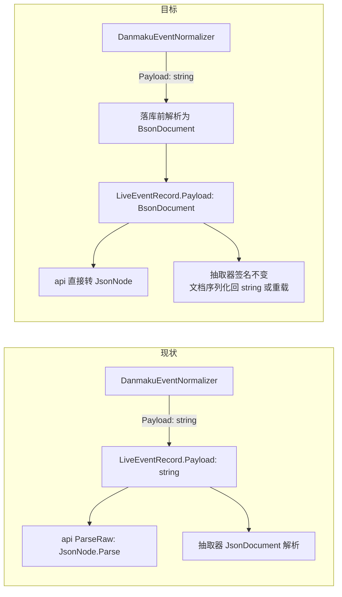
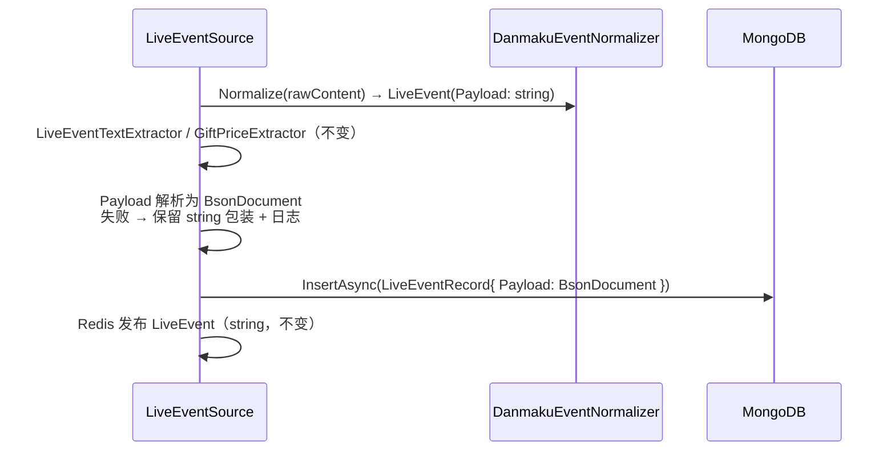

# 直播事件 Payload 结构化存储 - 技术提案

- 日期：2026-09-13
- 状态：待评审
- feat-branch：`feat/live-event-payload-object`
- 关联文档：[PRD](../product/draft/20260913-live-event-payload-object-prd.md)

## 1. 概述

### 1.1 背景

`bilibili_live_event` 集合（`LiveEventRecord`，`servers/common/Persistence/Entities/LiveEventRecord.cs`）的 `Payload` 字段当前为 `string` 类型的 JSON：

- **写入**：crawler `LiveEventSource`（`servers/crawler/Live/LiveEventSource.cs:167-187`）经 `DanmakuEventNormalizer.Normalize` 得到 `LiveEvent`（`servers/common/Live/LiveEvent.cs`，`Payload` 为 string），原样拷贝进 `LiveEventRecord` 落库；
- **读取**：api `BilibiliLiveController.ToEventDto`（`servers/api/Controllers/BilibiliLiveController.cs:257-273`）经 `ParseRaw`（`JsonNode.Parse`）把字符串重新解析为对象返回——契约 `contracts/bilibili-crawler.openapi.yaml` 中 `payload` 本就是 `type: object`；
- **派生**：`GiftPriceExtractor` / `LiveEventTextExtractor`（`servers/common/Live/`）在写入与历史 backfill 中均以 `JsonDocument` 解析该字符串。

即：存储是字符串，但每次使用都要解析。需求要求持久化层直接存对象，并将历史数据迁移为对象。

### 1.2 目标

1. `LiveEventRecord.Payload` 由 `string` 改为 BSON 文档（`BsonDocument`）持久化，写入路径在落库前完成 JSON→BSON 解析；
2. `MongoDbInitializer` 新增幂等迁移 `live_event_payload_object_backfill_v1`，将存量 string Payload 批量回写为对象；
3. 读取路径适配但对外零变化：API 契约、Redis 频道格式、抽取器产出全部不变。

### 1.3 范围

- **内**：`LiveEventRecord` 实体与容错序列化、`LiveEventSource` 写入适配、迁移（含双服务启动注册）、api `ToEventDto` 适配、单测/集成测试；
- **外**：Redis `live-event:{roomId}` 频道消息（`LiveEvent` record 保持 string Payload，纯线上消息无持久化问题）；`Mikibot.Crawler` NuGet 包；web 端与 OpenAPI 契约（无需变更）；文本索引/Price 等派生数据（抽取语义不变，无需重建）；按 Payload 子字段建索引等后续查询能力（后续需求）。

## 2. 技术架构

### 2.1 现状与目标对比



### 2.2 技术栈与归属

| 项 | 选型 | 说明 |
|---|---|---|
| 实体/迁移 | `servers/common`（MongoDB.Bson `BsonDocument`） | 双方使用入 common |
| 写入适配 | `servers/crawler`（`LiveEventSource`） | 仅落库点新增解析 |
| 读取适配 | `servers/api`（`BilibiliLiveController`） | 响应结构不变 |
| 测试 | xUnit + Testcontainers（MongoDB） | 沿用 `tests/Z.Vtuber.Tests` |

### 2.3 关键设计取舍：抽取器与 Redis 保持 string 语义

`LiveEventTextExtractor.Extract(type, payload)`、`GiftPriceExtractor.ExtractGoldSeeds(type, payload)` 以及 Redis 发布的 `LiveEvent` record 均以 `string Payload` 为输入。本次改造**不改变这些签名与语义**：

- crawler 在 `Normalize` 之后仍持有 string Payload，抽取与 Redis 发布沿用现状代码路径；
- 仅在构建 `LiveEventRecord` 落库这一步把 string 解析为 `BsonDocument`；
- 迁移侧（common 内）从旧文档读到 string 后直接解析回写，同样不经抽取器。

这样改动面最小，且抽取/发布逻辑零回归风险。

## 3. API 设计

无对外 API 变更。`contracts/bilibili-crawler.openapi.yaml` 中 `payload: type: object` 与 api 实际响应在改造前后一致；web 生成类型（`schema.d.ts` 中 `payload?: Record<string, never>`）不变。

内部数据面变化：

- `LiveEventRecord.Payload`：`string` → `BsonDocument`（持久化模型，不暴露到线上契约）；
- `LiveEvent`（Redis pub/sub 消息）：**不变**，仍为 string Payload。

## 4. 数据模型

### 4.1 实体变更：`LiveEventRecord`

```csharp
public sealed class LiveEventRecord
{
    [BsonId] public ObjectId Id { get; set; }
    [BsonRepresentation(BsonType.Int64)] public long RoomId { get; set; }
    public string? LiveSessionId { get; set; }
    public string Type { get; set; } = string.Empty;
    [BsonSerializer(typeof(StringTolerantBsonDocumentSerializer))]
    public BsonDocument Payload { get; set; } = new();
    [BsonDateTimeOptions(Kind = DateTimeKind.Utc)] public DateTime OccurredAt { get; set; }
    [BsonRepresentation(BsonType.Int64)] public long Price { get; set; }
}
```

- `StringTolerantBsonDocumentSerializer`（新增于 `servers/common/Persistence/`）：反序列化时若 BSON 值为 String 类型（迁移过渡期/无法解析的脏数据），经 `MongoDB.Bson.Serialization.BsonSerializer`/`BsonDocument.Parse` 容错解析为 `BsonDocument`，解析失败则包装为 `{ "raw": <原字符串> }`；序列化时按文档原样写入。**保证迁移完成前读取旧数据不抛异常**。
- 索引：既有 4 个索引均不含 Payload，**无索引变更**（`MongoDbInitializer.EnsureLiveEventIndexesAsync` 不动）。

### 4.2 迁移：`live_event_payload_object_backfill_v1`

范本：`BackfillGiftPriceAsync`（`servers/common/Persistence/MongoDbInitializer.cs:358-425`）。

- 过滤条件：`Payload` BSON 类型为 String（`Filters.Type(f => f.Payload, BsonType.String)` 等价表达）；
- `_id` 游标分页（`Id > lastId`，SortBy Id，Limit 500，投影 Id/Payload）；
- 每批：string → `BsonDocument.Parse` 成功则 `UpdateOneModel $set Payload=文档`；失败则跳过并计数（记 warning 日志，含记录 Id）；
- `BulkWriteAsync` 逐批提交；扫完（无更多 string 记录）后 `MarkMigrationAppliedAsync("live_event_payload_object_backfill_v1")` upsert 标记；
- 注册到 api（`servers/api/Program.cs`）与 crawler（`servers/crawler/Program.cs`）的启动初始化序列，与既有 backfill 并列；标记位并发安全（现状模式已验证）。

## 5. 技术实现方案

### 5.1 核心流程

**写入路径**（crawler `LiveEventSource`）：



实现要点：解析逻辑收敛为 common 内部辅助（如 `LiveEventPayloadParser.ToBsonDocument(string)`），crawler 落库点与迁移共用同一解析与降级策略，避免两处行为分叉。

**读取路径**（api）：

- `ToEventDto`：`record.Payload`（`BsonDocument`）→ `JsonNode`：经 `JsonNode.Parse(record.Payload.ToJson())`（或 `BsonDocument` → `JsonNode` 的等价转换）替换原 `ParseRaw(string)`；响应 JSON 结构与现状一致（camelCase 等由序列化配置保证，需在测试中锁定）。

**迁移路径**：见 4.2，与既有 backfill 同构。

### 5.2 关键实现点

#### 实现点 1: 容错序列化器（common）

- 新增 `StringTolerantBsonDocumentSerializer : SerializerBase<BsonDocument>`：
  - `Deserialize`：`BsonType.Document` 原样；`BsonType.String` 尝试 `BsonDocument.Parse`，失败返回 `{ "raw": 原值 }` 包装文档；其他类型（Null 等）返回空文档；
  - `Serialize`：按 `BsonDocument` 原样写入；
- 单测覆盖：文档/合法字符串/非法字符串/null 四种输入。

#### 实现点 2: 写入适配（crawler）

- `LiveEventSource` 构建 `LiveEventRecord` 处：`Payload = LiveEventPayloadParser.ToBsonDocument(liveEvent.Payload)`；
- 解析失败（理论上仅异常报文）：记 warning（含 Type/RoomId/OccurredAt），以 `{ "raw": 原字符串 }` 包装落库，不阻断采集循环；
- `gift_v2` 现状 Payload 为 `{"data": {...}, "raw": "<json string>"}`：外层转对象，`raw` 字符串原样保留（PRD 3.5 已明确）。

#### 实现点 3: 迁移（common + 双服务注册）

- `MongoDbInitializer.BackfillLiveEventPayloadObjectAsync`：按 4.2 实现；
- api/crawler `Program.cs` 启动序列中紧随既有 backfill 注册调用；
- 日志：每批进度（处理数/跳过数）与完成统计。

#### 实现点 4: api 读取适配

- `BilibiliLiveController.ToEventDto` 两处：`ParseRaw(record.Payload)` → `BsonDocument`→`JsonNode` 转换；
- `ParseRaw` 若无其他调用点则移除或保留私有（实现期清理）；响应结构用接口测试锁定不变。

#### 实现点 5: 发布与抽取零改动回归

- Redis 发布仍序列化 string-Payload 的 `LiveEvent`——回归测试确认频道消息 JSON 与改造前字节级一致（字段集与命名）；
- 文本索引写入（`bilibili_live_event_text_index`）输入为 string Payload，路径不变，用既有抽取器测试回归。

## 6. 技术决策

### 6.1 决策列表

1. **`BsonDocument` 而非强类型 POCO**：各事件类型 Payload 结构异构（danmaku 的 `info[]` 数组、gift 的 `data.*`、gift_v2 的 `{data,raw}`、super_chat 的 `data.user_info.*`），且由上游 B 站报文决定、会漂移；强类型建模成本高且脆弱。`BsonDocument` 满足「存对象、可查询」的目标，类型化访问留给消费方按需进行。
2. **容错序列化器而非「先迁移后切换」**：api 与 crawler 双服务均跑迁移，部署窗口内必然存在「新代码读旧数据」；成员级容错序列化器消除顺序依赖，迁移完成后也无害（文档路径直通）。
3. **Redis 消息与抽取器保持 string 语义**：Redis 频道是线上消息而非持久化，改格式会波及所有订阅方且收益为零；抽取器签名不变使改动面最小、派生数据无需重建。
4. **迁移复用 `MongoDbInitializer` 幂等 backfill 模式**：与 `BackfillGiftPriceAsync` 等四个既有迁移同构（标记位 + `_id` 游标 + 批量 `$set`），双服务启动注册、并发安全已被验证；不引入手工脚本。
5. **无法解析的脏数据跳过并保留**：历史脏数据强行包装写回会掩盖数据问题；跳过 + 计数日志让运维可审计，且不阻塞迁移完成。

### 6.2 依赖与约束

- 无新增 NuGet 依赖（`MongoDB.Bson` 已随驱动引入）；
- 迁移期间集合写入放大有限（每条记录一次 `$set`），批量 500 + 游标，无长时间锁；
- 契约不变：`contracts/bilibili-crawler.openapi.yaml`、web 端零改动。

## 7. 项目结构

```
servers/common/（变更）
├── Persistence/Entities/LiveEventRecord.cs              # Payload: string → BsonDocument + 容错序列化器
├── Persistence/StringTolerantBsonDocumentSerializer.cs  # 新增
├── Persistence/LiveEventPayloadParser.cs                # 新增：string → BsonDocument 解析与降级（写入/迁移共用）
└── Persistence/MongoDbInitializer.cs                    # + BackfillLiveEventPayloadObjectAsync

servers/crawler/（变更）
├── Live/LiveEventSource.cs                              # 落库前 Payload 解析为 BsonDocument
└── Program.cs                                           # 注册新 backfill

servers/api/（变更）
├── Controllers/BilibiliLiveController.cs                # ToEventDto 适配 BsonDocument
└── Program.cs                                           # 注册新 backfill

tests/Z.Vtuber.Tests/（新增/变更）
├── StringTolerantBsonDocumentSerializerTests.cs
├── LiveEventPayloadBackfillTests.cs                     # Testcontainers：迁移幂等/跳过脏数据/双实例并发
└── （LiveEventRepository / Controller 相关用例适配）
```

## 8. 测试策略

### 8.1 测试覆盖要求

核心逻辑覆盖率 ≥ 80%（common-rules）；TDD：先写失败测试再实现。

### 8.2 测试类型

- **单元测试**：
  - 容错序列化器：文档/合法字符串/非法字符串（`{raw}` 包装）/null 的往返；
  - `LiveEventPayloadParser`：各事件类型真实报文样例转文档、异常报文降级；
- **集成测试（Testcontainers MongoDB）**：
  - 迁移：预置 string Payload 记录 → 执行 backfill → 断言 BSON 类型变为 Document、内容等价、标记位写入；重复执行幂等；含脏数据时跳过并计数；模拟双实例并发执行无错误；
  - 仓储往返：新模型插入/读取（含预置 string 旧数据的容错读取）；
- **接口回归**：事件 range/search 接口对同一数据的响应 JSON 与改造前一致（payload 结构快照）；
- **抽取器回归**：既有 `LiveEventTextExtractor`/`GiftPriceExtractor` 测试原样通过（签名与语义不变）。

## 9. 部署方案

- 随常规版本发布：api 与 crawler 滚动更新，启动时自动执行幂等迁移；无需停机、无需手工脚本；
- 回滚：代码回滚后旧代码读取 object Payload 会反序列化失败——因此回滚前提是未执行迁移的窗口期；迁移一旦完成，需以带容错读取的版本回滚（在发布说明中显式记录该约束）。

## 10. 验收标准

- [ ] 新写入事件 `Payload` 为 BSON object，子字段可直接在 MongoDB 查询；
- [ ] 迁移完成后集合内 string Payload 仅剩脏数据（日志有计数），迁移幂等且双服务并发启动安全；
- [ ] 迁移过渡期读取旧 string 数据不报错，api 响应结构与契约不变；
- [ ] 文本索引与 Price 抽取结果与改造前一致；Redis 频道消息格式不变；
- [ ] 单测 + 集成测试通过，核心逻辑覆盖率 ≥ 80%。

## 11. 相关文档

- PRD：`docs/product/draft/20260913-live-event-payload-object-prd.md`
- 迁移范本：`docs/engineering/proposals/20260815-proposal-bilibili-live-history.md`（`BackfillGiftPriceAsync`）、`docs/engineering/proposals/20260819-proposal-live-event-text-search.md`（`BackfillLiveEventTextIndexAsync`）
