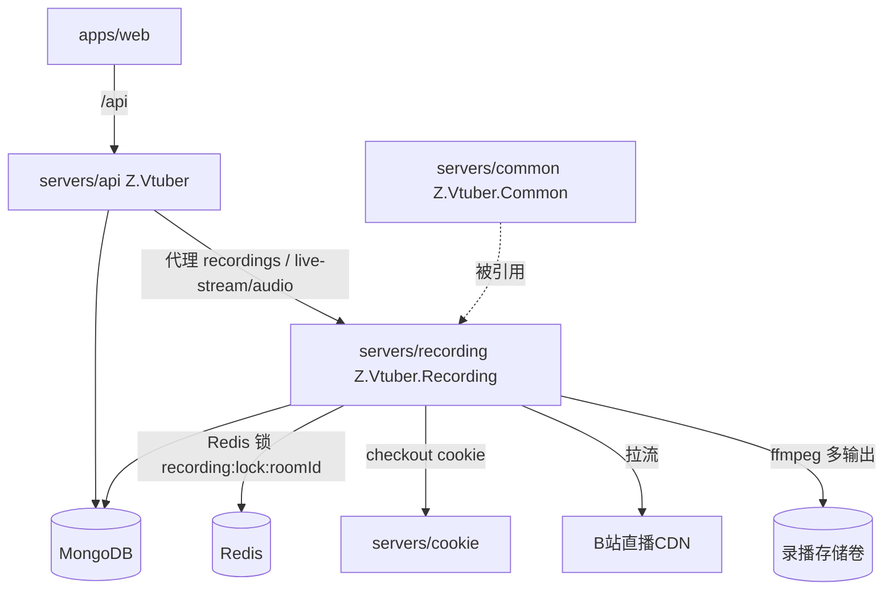
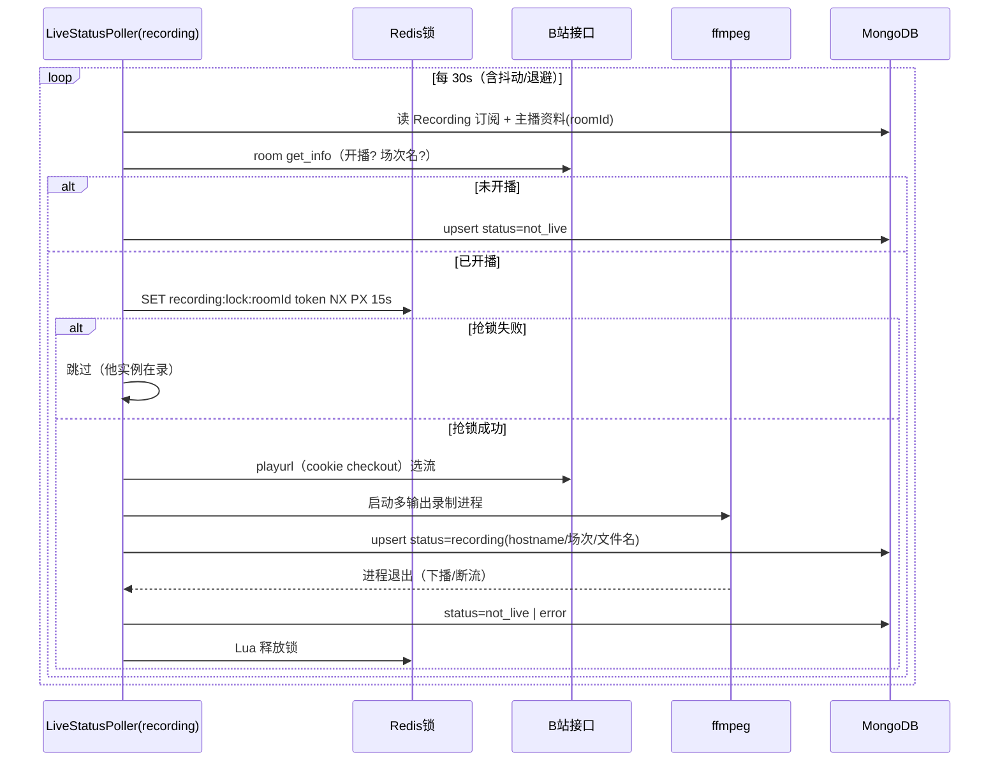

# B站直播录播 - 技术提案

- 日期：2026-09-13
- 状态：待评审
- feat-branch：`feat/live-recording`
- 关联文档：[PRD](../product/draft/20260913-live-recording-prd.md)

## 1. 概述

### 1.1 背景

依据 PRD「B站直播录播」，平台需新增直播流录制能力：订阅驱动、开播自动录制、RAW + AV1 双文件产出、实时音频流、录制状态展示与录播文件管理。录制与存储方式参考 [Zast.AyeRecorder](https://github.com/Deliay/Zast/tree/main/Zast.AyeRecorder)（流选取、ffmpeg 落盘），但按其差异点改造：利用 ffmpeg 自身的多路并行输出能力一次进程产出全部产物，不在进程内手动分流。

### 1.2 目标

1. 新增独立服务 `servers/recording`（Z.Vtuber.Recording，.NET 10），消费「录播」类型订阅，开播触发 ffmpeg 录制，单进程多输出产出 RAW flv、AV1 二压 flv 与实时音频流；
2. 分布式安全：同一直播间同一时刻仅一个实例录制（Redis 锁 + 单副本部署 + 滚动更新接管）；
3. api 新增录播索引/下载/实时音频代理与录制状态聚合接口；web 新增「录制状态」页与录播订阅类型。

### 1.3 范围

- **内**：`SubscriptionType.Recording` 新枚举与订阅链路适配；新服务 `servers/recording` 全部能力（轮询开播检测、流地址解析、ffmpeg 录制、文件名模板、音频 Hub、自身 API）；api 录播相关端点；web 订阅类型扩展与录制状态页；`contracts/recording.openapi.yaml` 新契约与 codegen；AppHost 编排；单测与集成测试。
- **外**：crawler 抓取逻辑零改动；微博链路；notifier；GPU 编码环境本身的安装（部署前置条件，见 §9）；录播文件的自动清理/生命周期管理（后续需求）。

## 2. 技术架构

### 2.1 系统架构图



### 2.2 技术栈

| 层级 | 技术选型 | 说明 |
|------|---------|------|
| 新服务 | C# (.NET 10) Worker + 最小 Kestrel | 与 crawler 同构（Worker 宿主 + `/health`） |
| 录制 | ffmpeg 外部进程（`System.Diagnostics.Process`） | 单进程多输出：RAW copy、AV1(av1_nvenc)、音频 pipe |
| 分布式锁 | StackExchange.Redis（SET NX PX + Lua 释放 + 续期） | per-room 锁 `recording:lock:{roomId}` |
| 数据库 | MongoDB（Aspire.MongoDB.Driver） | 订阅/主播资料/录制状态 |
| 契约 | OpenAPI `contracts/recording.openapi.yaml` | 契约式开发，web codegen |
| 前端 | React 19 + Vite（既有） | 订阅类型扩展 + 录制状态页 |

### 2.3 模块划分

| 模块 | 职责 | 关键技术点 |
|------|------|-----------|
| `servers/recording` `Subscriptions/` | 读取 Recording 类型订阅、mid→roomId 解析 | 复用 common 仓储 |
| `servers/recording` `Live/` | 开播轮询检测、流地址解析（playurl）、流选取 | 直连流带 headers / m3u8 直给 ffmpeg |
| `servers/recording` `Recording/` | ffmpeg 进程编排、文件名模板、锁管理、状态上报 | 多输出参数构造、码率探测、锁续期 |
| `servers/recording` `Audio/` | 实时音频 Hub（广播 + 有界缓冲 + 丢弃） | `Channel` 有界 + DropOldest |
| `servers/recording` `Controllers/` | `/health`、`/api/{roomId}/stream/audio`、`/api/{roomId}/recordings[/{fileName}]`、状态接口 | 未录制 404 |
| `servers/api` | 录播索引/下载/实时音频代理、录制状态聚合 | 反向代理至 recording |
| `apps/web` | 订阅「录播」类型、录制状态页 | codegen 新 schema |

## 3. API 设计

### 3.1 recording 服务 API（本地端口 8083，建 `Properties/launchSettings.json`）

契约：`contracts/recording.openapi.yaml`（新增）。

#### GET /health

- 存活 + MongoDB 连通性（沿用 `MongoDbHealthCheck` 模式）。

#### GET /api/{roomId}/stream/audio

- 实时音频流。录制中：200，`Content-Type: video/x-flv`，chunked 持续输出音频；未在录制：404。

#### GET /api/{roomId}/recordings

- 响应 200：`{ "files": ["[RAW][123][某主播] 2026-09-13-晚间歌回.flv", ...] }`，无录播返回空数组。

#### GET /api/{roomId}/recordings/{fileName}

- 下载录播文件，`application/octet-stream` + `Content-Disposition`；不存在 404。`fileName` 做路径穿越防护（仅允许平文件名，解析后必须落在存储目录内）。

#### GET /api/recording/status

- 当前全部录制状态（供 api 聚合或直接读取）：

```json
{
  "items": [
    {
      "roomId": 123,
      "state": "recording",
      "hostName": "z-vtuber-recording-7d9f",
      "sessionTitle": "晚间歌回",
      "files": ["[RAW][123][某主播] 2026-09-13-晚间歌回.flv", "[AV1][123][某主播] 2026-09-13-晚间歌回.flv"],
      "updatedAt": "2026-09-13T12:00:00Z"
    }
  ]
}
```

`state` ∈ `not_live | recording | error`。

### 3.2 api 服务新增端点（前缀沿用 `/api/b`）

| 端点 | 行为 |
|------|------|
| `GET /api/b/live/{roomId}/recordings` | 代理至 recording 文件列表 |
| `GET /api/b/live/{roomId}/recordings/{fileName}` | 代理下载（流式转发） |
| `GET /api/b/live/{roomId}/live-stream/audio` | 代理实时音频流（流式转发，禁用缓冲） |
| `GET /api/b/live/recording-status` | 录制状态聚合列表（读 Mongo `recording_status` 集合） |

订阅端点扩展：`BilibiliSubscriptionController` 订阅/退订的 `type` 增加 `recording`；创建时与 `danmaku` 一致，先经 basic info 由 mid 解析 roomId 并落库。

上述端点追加至 `contracts/bilibili-crawler.openapi.yaml`。

### 3.3 内部接口

- recording → cookie 服务：`/api/cookie/checkout`、`/api/cookie/report-invalid`（playurl 拉取携带登录 Cookie，契约 `contracts/cookie.openapi.yaml` 既有）；
- api → recording：HTTP 代理（`RecordingService:BaseUrl` 配置项）；
- 状态数据面：recording 写 Mongo `recording_status`，api 读——rollout 期间新实例接管写同一文档，天然规避「代理到哪台实例」的问题；音频流代理由单副本部署保证命中唯一实例。

## 4. 数据模型

### 4.1 集合变更

#### `subscription`（既有）

- `SubscriptionType` 新增 `Recording = 3`（`[BsonRepresentation(BsonType.String)]`），纯增量，无需迁移。

#### `recording_status`（新增）

| 字段 | 类型 | 说明 |
|------|------|------|
| `_id` | ObjectId | |
| `RoomId` | long | 唯一索引 |
| `State` | string | `not_live`/`recording`/`error` |
| `HostName` | string | 执行录制的实例 hostname |
| `SessionTitle` | string? | 当前场次名 |
| `Files` | string[] | 当前场次产出文件名 |
| `Error` | string? | state=error 时的原因 |
| `UpdatedAt` | DateTime(UTC) | 心跳式刷新 |

单写者由录制锁保证；实例每次状态迁移与周期心跳 upsert（`RoomId` 为键）。

### 4.2 存储与锁

- 录播文件：持久卷 `Recording:StorageDir`（容器内 `/data/recordings`），按 `{roomId}/` 子目录组织；
- Redis 锁：`recording:lock:{roomId}`，value 为随机 token，TTL 15s，持有者每 5s 续期；释放用 Lua 比对 token 删除；持锁实例在每轮录制循环前校验锁仍属于自己，丢失则立即终止 ffmpeg。

## 5. 技术实现方案

### 5.1 核心流程



### 5.2 关键实现点

#### 实现点 1: ffmpeg 单进程多输出

```
ffmpeg -hide_banner -loglevel warning \
  [-headers "Cookie: ...\r\nReferer: ...\r\n"] -i "{input}" \
  -map 0 -c copy -f flv "{raw_file}" \
  -map 0:v -map 0:a? -c:v av1_nvenc -rc vbr -spatial-aq 1 -temporal-aq 1 -multipass fullres -b:v {raw_bitrate*0.9} -c:a copy -f flv "{av1_file}" \
  -map 0:a -vn -c:a aac -b:a 128k -f flv pipe:1
```

- `http_stream`（flv 直连）：input 为流地址，`Cookie`/`Referer`/`User-Agent` 经 `-headers` 注入（对应 PRD 2.3.1）；
- `m3u8/hls`：input 直接给 m3u8 地址，ffmpeg 自行处理分片（对应 PRD 2.3.2）；
- 三路输出一个进程完成（对应 PRD 2.4），不手动分流；stdout（pipe:1）为实时音频，由进程内读取泵喂给 Audio Hub；
- `raw_bitrate`：优先取 playurl 返回的码率元数据，缺失时 ffprobe 短时探测，仍不可得回退默认 4000kbps（配置项）。

#### 实现点 2: 流地址解析与选取

- 参考 AyeRecorder `PickStream`：playurl v2 展开 `protocol/format/codec` 组合，排除 hevc，按画质偏好选流；优先 `http_stream+flv`，fallback `http_hls`；记录所选流形式以决定 headers 注入策略。

#### 实现点 3: 文件名模板

`[{uppercase(encode)}][{RoomId}][{主播名称}] {date(yyyy-MM-dd)}-{sanitize(场次名)}.flv`，encode ∈ `RAW|AV1`；sanitize 剔除 `\/:*?"<>|` 与控制字符并裁剪长度；渲染逻辑收敛为纯函数 `RecordingFileName.Render(...)`，可单测。

#### 实现点 4: 实时音频 Hub

- 每房间一个 `AudioStreamHub`：读取泵从 ffmpeg stdout 读 chunk 后立即广播；
- 无订阅者：直接丢弃，零缓冲；
- 每订阅者一条有界 `Channel<byte[]>`（上限如 256KB，`BoundedChannelFullMode.DropOldest` 等价策略：满则丢弃未发送数据并跳过），发送端慢只影响自身，不阻塞广播与其他订阅者，内存有确定上界；
- 流格式为 flv 音频封装（ffmpeg `-f flv -vn`），与 API 响应 Content-Type 一致。

#### 实现点 5: 单实例录制与滚动接管

- 三重保障：① 部署侧单副本 + Recreate 策略（新实例必在旧实例下线后启动）；② Redis per-room 锁兜底异常多副本场景；③ 持锁周期校验（fencing token），失锁立即 kill ffmpeg；
- 旧实例退出：优雅停机时主动 Lua 释放锁，新实例下一轮轮询（≤30s）即接管；崩溃场景锁 TTL 15s 自动过期；
- 接管续录生成新场次文件（按当时日期/场次名渲染），不追加写旧文件，避免双写冲突。

#### 实现点 6: api 代理

- `HttpClient` 流式转发（`HttpCompletionOption.ResponseHeadersRead` + `Stream.CopyToAsync`，响应禁用缓冲）；音频流端点设置 `Cache-Control: no-store`；
- recording 不可达时：列表/下载 502，状态聚合退化为「未知」不阻断页面。

## 6. 技术决策

### 6.1 决策列表

| 决策 | 选项 A | 选项 B | 最终选择 | 原因 |
|------|--------|--------|---------|------|
| 录制宿主 | crawler 内嵌 Job | 独立 recording 服务 | B | 需求明确新服务；录制是长时驻留任务，与周期抓取的发布节奏/资源画像不同 |
| ffmpeg 集成 | FFMpegCore | 裸 Process | B | 多输出 + 自定义 headers + stdout pipe 组合用参数直拼最透明，避免封装库版本差异；参考项目的 FFMpegCore 单输出模式本就不复用 |
| 分流方式 | 进程内读流再写多路 | ffmpeg 多输出 | B | PRD 2.4 明确；进程内零转码拷贝，CPU 最省 |
| 分布式锁 | 复用 common `IDistributedLockProvider` | recording 内自实现 Redis 锁 | B | 现有 Redis 实现在 cookie 服务内，上提 common 会扩大改动面；录制锁语义（续期+fencing+强杀进程）与通用锁不同，自实现更内聚 |
| 状态数据面 | api 反代 recording 状态接口 | Mongo `recording_status` 共享 | B | rollout 期间无「代理到哪台」问题，api 聚合简单；写者由锁保证唯一 |
| 音频封装 | flv 音频 | ogg/opus | A | 与视频产物同封装族，ffmpeg 直出 flv 最稳，PRD 允许 |
| 部署副本 | 多副本 + 锁 | 单副本 Recreate + 锁兜底 | B | 满足「老的下线后新的立即录制」；锁处理崩溃/异常双开 |

### 6.2 依赖与约束

| 类型 | 内容 | 说明 |
|------|------|------|
| 依赖 | 部署镜像含 ffmpeg（含 av1_nvenc 支持的构建）与 NVIDIA 驱动可用 | 二压走 NVENC；无 GPU 环境降级策略见 §9 |
| 依赖 | cookie 服务 `/api/cookie/checkout` | playurl 拉取携带登录态 |
| 依赖 | common 仓储（订阅/主播资料） | 单份实现 |
| 约束 | 录制服务需挂载持久卷 | 文件列表/下载跨 rollout 可见 |
| 约束 | .NET 10、契约式开发、TDD | 项目既有规范 |

## 7. 项目结构

```
servers/recording/（新增 Z.Vtuber.Recording）
├── Program.cs                          # Worker 宿主 + Kestrel /health + DI
├── Properties/launchSettings.json      # 本地 8083
├── Configuration/RecordingOptions.cs   # 存储目录/轮询间隔/锁 TTL/音频缓冲上限/默认码率
├── Subscriptions/RecordingSubscriptionWatcher.cs
├── Live/LiveStatusPoller.cs            # 开播轮询（HostedService）
├── Live/StreamResolver.cs              # playurl 解析与选流（参考 AyeRecorder）
├── Recording/RecordingFileName.cs      # 文件名模板纯函数
├── Recording/RecordingLock.cs          # Redis per-room 锁（续期/Lua 释放/校验）
├── Recording/FfmpegProcessBuilder.cs   # 多输出参数构造
├── Recording/RecordingSession.cs       # 单场次编排：锁→ffmpeg→状态上报
├── Recording/RecordingStatusReporter.cs
├── Audio/AudioStreamHub.cs             # 广播 + 有界缓冲丢弃
├── Controllers/RecordingController.cs  # stream/audio、recordings、status
├── Health/MongoDbHealthCheck.cs        # 与 crawler 同模式
└── Dockerfile

servers/common/（变更）
└── Persistence/Entities/SubscriptionType.cs   # + Recording

servers/api/（变更）
├── Controllers/BilibiliSubscriptionController.cs  # type 支持 recording
├── Controllers/BilibiliLiveRecordingController.cs # 录播索引/下载/音频代理/状态聚合
└── Program.cs                                       # recording HttpClient 注册

apps/web/src/（变更）
├── api/schema-recording.d.ts           # codegen 生成（勿手改）
├── api/schema.d.ts                     # codegen 更新
├── api/client.ts                       # + 录播相关方法
├── pages/subscription/SubscriptionPage.tsx   # + 录播类型
├── pages/recording/RecordingStatusPage.tsx   # 新增
└── App.tsx                             # + 路由

contracts/
├── recording.openapi.yaml              # 新增
└── bilibili-crawler.openapi.yaml       # + 录播端点

infra/apphost/AppHost.cs                # + recording 项目编排（mongo/messaging/cookie/存储卷）

tests/Z.Vtuber.Tests/（新增）
├── RecordingFileNameTests.cs
├── FfmpegProcessBuilderTests.cs
├── AudioStreamHubTests.cs
├── RecordingLockTests.cs               # Testcontainers Redis
└── RecordingApiTests.cs                # Testcontainers：列表/下载/404/状态聚合
```

## 8. 测试策略

### 8.1 测试覆盖要求

- 核心逻辑覆盖率 ≥ 80%（common-rules）；TDD：先写失败测试再实现。

### 8.2 测试类型

- **单元测试**：文件名模板（大小写/sanitize/日期）；ffmpeg 参数构造（http_stream 带 headers / m3u8 / 码率 90% 计算与回退）；Audio Hub（无订阅丢弃、慢消费者跳过、缓冲上界）；锁 token 语义；
- **集成测试（Testcontainers MongoDB + Redis）**：锁互斥/续期/TTL 接管/双实例并发只有一个持锁；状态 upsert；订阅 type=recording 创建（mid→roomId）；录播列表/下载/音频 404；api 代理路径；
- **ffmpeg 进程测试**：以本地生成的测试流（ffmpeg lavfi 源）跑迷你录制，断言 RAW/AV1 两文件产出且非空、音频 pipe 有数据；
- **web**：SubscriptionPage 录播类型、RecordingStatusPage 三态渲染（Vitest + RTL）。

## 9. 部署方案

- AppHost 增加 recording：`WithReference(mongo/messaging)`、`CookieService:BaseUrl` 指向 cookie、挂载录播卷、健康检查 `/health`；
- 生产：单副本 + Recreate 更新策略；镜像基于 aspnet 运行时 + ffmpeg（NVENC 构建），两阶段 Dockerfile 同 crawler 模式；
- 无 GPU 环境：配置 `Recording:Av1:Enabled=false` 时跳过二压输出（仅 RAW + 音频），状态页标注——降级不阻断主流程；
- 配置：`Recording:StorageDir`、`Recording:PollIntervalSeconds`(30)、`Recording:LockTtlSeconds`(15)、`Recording:AudioBufferBytes`(262144)、`Recording:DefaultBitrateKbps`(4000)。

## 10. 验收标准

- [ ] 技术方案评审通过；`contracts/recording.openapi.yaml` 评审通过
- [ ] 创建 recording 类型订阅后开播 1 分钟内自动录制，下播产出 RAW + AV1 两个规范命名文件
- [ ] 滚动更新期间同房间无双写，新实例自动接管
- [ ] 录制状态页三态正确，展示 hostname/场次名/文件名
- [ ] `/api/b/live/{roomId}/recordings[/{fileName}]` 列表与下载可用；未录制访问音频流 404
- [ ] 音频 Hub 内存有上界，慢消费者被丢弃跳过
- [ ] 单测 + 集成测试通过，核心覆盖率 ≥ 80%

## 11. 相关文档

- PRD：`docs/product/draft/20260913-live-recording-prd.md`
- 参考项目：[Zast.AyeRecorder](https://github.com/Deliay/Zast/tree/main/Zast.AyeRecorder)（录制与存储参考）
- 既有契约：`contracts/bilibili-crawler.openapi.yaml`、`contracts/cookie.openapi.yaml`
- 规范：`docs/engineering/common-rules.md`、`docs/engineering/backend-rules.md`、`docs/engineering/frontend-rules.md`
