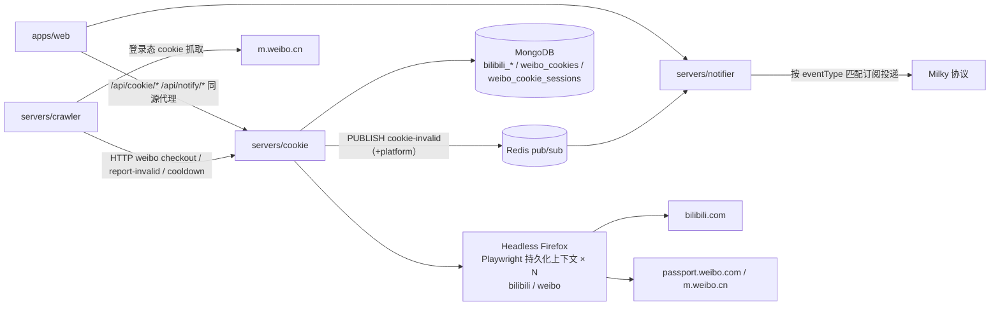
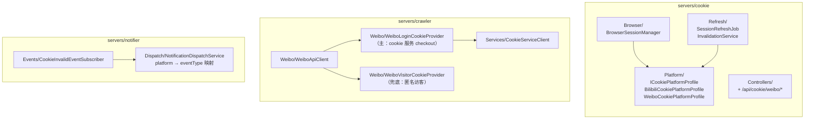
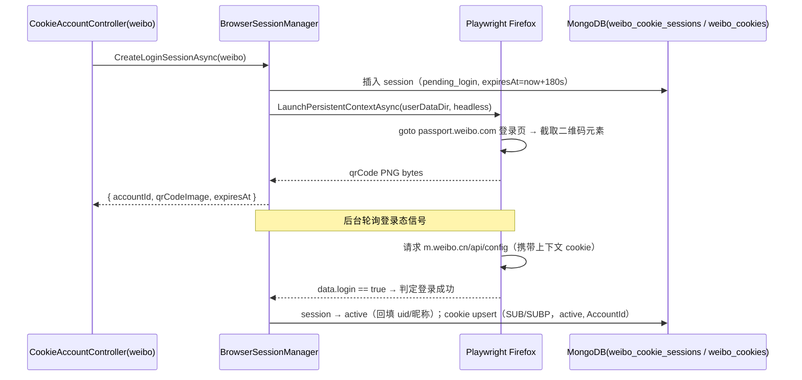

# 微博 Cookie 抓取（weibo-cookie-crawl）- 技术提案

- 日期：2026-09-13
- 状态：待评审
- feat-branch：`feat/weibo-cookie-crawl`
- 关联文档：[PRD](../product/draft/20260913-weibo-cookie-crawl-prd.md)

## 1. 概述

### 1.1 背景

相关现状（详见 `servers/cookie`、`servers/crawler/Weibo`、`servers/notifier`）：

- **Cookie 服务仅支持 Bilibili**：`BrowserSessionManager` 硬编码 B 站登录页与 nav 接口判定；Mongo 集合 `bilibili_cookie_sessions` / `bilibili_cookies`；契约 `contracts/cookie.openapi.yaml` 前缀 `/api/cookie` 无平台维度；失效事件 `CookieInvalidEvent` 无平台字段；
- **微博抓取使用匿名访客凭证**：`WeiboVisitorCookieProvider`（`servers/crawler/Weibo/WeiboVisitorCookieProvider.cs`）经 `visitor.passport.weibo.cn/visitor/genvisitor2` 申请临时 `SUB/SUBP`，风控命中后 `RenewAsync()` 重建；`WeiboApiClient` 以手工塞 `Cookie` 头的方式请求 `m.weibo.cn/api/container/getIndex`；风控识别 `WeiboRiskControlClassifier`（401/403、3xx 跳 passport、`ok != 1`、msg 登录关键词）与 `CrawlBackoffRegistry` 指数退避均已就绪；
- **通知类型单一**：`contracts/notifier.openapi.yaml` 与 `NotifyConfigController` 的 `eventType` 硬编码 `cookie_invalid`，notifier 订阅泵 `CookieInvalidEventSubscriber` 消费 Redis 频道 `cookie-invalid`，投递时按 `event_type` 匹配 `notification_subscriptions`。

痛点：微博匿名凭证额度低、易风控、与真实帐号脱钩；cookie 服务的扫码登录/保鲜/自愈闭环未覆盖微博；失效告警不区分平台。

### 1.2 目标

1. Cookie 服务**多平台化**：抽象平台差异为 Profile 策略，新增微博平台——扫码登录（微博二维码）、登录态检测、定时保鲜、阻塞式失效宣告自愈全套能力与 Bilibili 对齐；
2. crawler 微博链路改用**登录态 cookie**：经 cookie 服务 `checkout` 取用、风控命中走 `report-invalid` 自愈 / `cooldown` 冷却，无可用登录 cookie 时回退匿名访客模式兜底；
3. 失效通知按平台拆分：新增 eventType `bilibili_cookie_invalid` / `weibo_cookie_invalid`，存量订阅迁移；
4. web「Cookie 管理」页「新增帐号」拆分为「新增微博帐号」「新增Bilibili帐号」，列表带平台标识；通知页支持选择两种新类型。

### 1.3 范围

- **内**：cookie 服务平台抽象与微博 Profile、契约扩展、Mongo 新增微博集合、crawler 微博链路接入与兜底降级、notifier 事件类型扩展与订阅迁移、web 两页面改造、测试；
- **外**：Bilibili 链路行为零改动（仅共享代码被抽象，语义不变）；微博 App 二次验证（短信/滑块）等人工事项；代理池、UA 轮换等进阶风控手段（后续迭代）。

## 2. 技术架构

### 2.1 系统架构图



### 2.2 技术栈

全部复用既有栈，无新增依赖：

| 项 | 选型 | 说明 |
|---|---|---|
| cookie 服务 | 既有 Z.Vtuber.Cookie（.NET 10 + Playwright Firefox） | 平台 Profile 抽象 |
| crawler 微博链路 | 既有 `WeiboApiClient` / `WeiboTimelineJob` + `CookieServiceClient` | cookie 来源切换 + 兜底 |
| 通知 | 既有 Z.Vtuber.Notifier（Milky.Net.Client） | eventType 扩展 |
| 契约 | `contracts/cookie.openapi.yaml` / `notifier.openapi.yaml` + openapi-typescript codegen | 与既有模式一致 |
| 存储 | MongoDB `zvtuber` 库新增微博集合；Redis `messaging` 实例 | 复用 |
| 测试 | xUnit + Testcontainers（Mongo/Redis），浏览器层接口 mock | 沿用 `tests/Z.Vtuber.Tests` |

### 2.3 模块划分



- **平台 Profile**：cookie 服务内登录 URL、二维码元素定位、登录态检测信号、cookie 提取域、事件平台名等平台差异的封装；Bilibili 行为迁移进 `BilibiliCookiePlatformProfile`，语义不变；
- **crawler 微博 cookie 提供方**：新增主路径 `WeiboLoginCookieProvider`（经 cookie 服务），既有 `WeiboVisitorCookieProvider` 保留为兜底；
- **notifier**：订阅泵不变（单频道），dispatch 层按事件 `platform` 映射 eventType。

## 3. API 设计

### 3.1 cookie 服务契约扩展（`contracts/cookie.openapi.yaml`）

既有 `/api/cookie/*`（Bilibili）端点**全部保留不动**。新增微博一组平行端点，语义与 Bilibili 对应端点一致：

| 端点 | 说明 |
|---|---|
| `POST /api/cookie/weibo/accounts` | 新增微博帐号，返回 `202 { accountId, status, qrCodeImage, expiresAt }`；并发上限 `429` |
| `GET /api/cookie/weibo/accounts/{accountId}` | 查询微博帐号 session 状态（`pending_login/active/expired/invalid`），`404` 不存在 |
| `GET /api/cookie/weibo/accounts` | 微博帐号列表（不含 cookie 原文） |
| `DELETE /api/cookie/weibo/accounts/{accountId}` | 删除微博帐号 session，cookie 下线并发事件（reason `account_removed`），`204` |
| `GET /api/cookie/weibo/available` | 微博可用 cookie 列表（不含原文） |
| `POST /api/cookie/weibo/checkout` | round-robin 取微博 cookie → `200 { cookieId, accountId, cookie }` / `404` |
| `POST /api/cookie/weibo/report-invalid` | 阻塞式宣告失效：`200` 返回新 cookie（`refreshed: true`）/ `410 { reason }` / `404` / `504` |
| `POST /api/cookie/weibo/cooldown` | 风控冷却（`cookieId` + `durationSeconds`）→ `204` / `404` |

同时 `GET /api/cookie/accounts`（Bilibili 列表）响应项与新增微博列表响应项均携带 `platform` 字段（`bilibili` / `weibo`），供前端列表打平台标签。

> 备选（不采纳）：把既有端点改为 `/api/cookie/{platform}/*` 并迁移 bilibili——破坏既有调用方与前端，收益仅为路径美观，见 6.1 决策 2。

### 3.2 notifier 契约扩展（`contracts/notifier.openapi.yaml`）

- `eventType` enum（两处）由 `[cookie_invalid]` 扩展为 `[bilibili_cookie_invalid, weibo_cookie_invalid]`；
- `cookie_invalid` 从契约移除，存量订阅数据由 notifier 启动迁移兜底（见 5.2 实现点 5）；

### 3.3 内部接口

#### Redis 事件契约（复用单频道，payload 增加 platform）

频道 `cookie-invalid` 不变，`CookieInvalidEvent`（`servers/common/Live/CookieInvalidEvent.cs`）新增字段：

```json
{ "cookie_id": "...", "mid": 12345, "uname": "xxx", "occurred_at": "...", "reason": "...", "platform": "bilibili|weibo" }
```

- `platform` 缺省/未知按 `bilibili` 处理（向后兼容既有消息与消费者）；
- cookie 服务的发布器按平台填充；notifier 订阅泵原样转发给 dispatch，由 dispatch 映射 `platform → eventType`（`bilibili → bilibili_cookie_invalid`，`weibo → weibo_cookie_invalid`）。

#### crawler → cookie 调用契约

`CookieServiceClient` 增加微博方法组（`CheckoutWeiboAsync` / `ReportWeiboInvalidAsync` / `CooldownWeiboAsync`），或泛化为 `platform` 参数；404/410/504 语义与 Bilibili 一致。

## 4. 数据模型

MongoDB 库 `zvtuber`（既有实例）。

### 4.1 新增集合：`weibo_cookie_sessions`

结构与 `CookieSessionRecord`（`servers/common/Persistence/Entities/CookieSessionRecord.cs`）相同：`Status`（`pending_login/active/expired/invalid`）、`UserDataDir`、`Uid?/ScreenName?`（对应 Bilibili 的 `Mid/Uname`，字段名沿用通用命名或复用同一实体，实现期按实体复用方式定夺）、`CookieId`、`QrCodeImage`、`CreatedAt/LastLoginAt/LastRefreshAt/ExpiresAt`、`ConsecutiveRefreshFailures`。索引：`Status_1`、`CookieId_1`。

### 4.2 新增集合：`weibo_cookies`

结构同 `CookieRecord`：`Cookie` 原文、`AccountId?`、`Status`（`active/offline`）、`CooldownUntil`、`LastCheckedAt/LastUsedAt/LastRefreshAt`。索引与 `bilibili_cookies` 对齐。

> 采用并行集合而非在既有集合加 `platform` 字段：bilibili 读写路径零改动、零数据迁移；两个集合结构相同，仓储逻辑经泛型/基类复用。见 6.1 决策 3。

### 4.3 既有集合迁移：`notification_subscriptions`

notifier 启动时将 `event_type == "cookie_invalid"` 的存量订阅一次性更新为 `bilibili_cookie_invalid`（幂等 updateMany，可重复执行）；`(event_type, group_id)` 唯一索引不变。

## 5. 技术实现方案

### 5.1 核心流程

**微博扫码登录流程**（与 Bilibili 同构，差异全在 Profile）：



**微博时间线抓取（登录 cookie + 风控自愈）**：

```mermaid
sequenceDiagram
    participant Job as WeiboTimelineJob
    participant LP as WeiboLoginCookieProvider
    participant CK as Cookie 服务
    participant WB as m.weibo.cn
    participant VP as WeiboVisitorCookieProvider（兜底）

    Job->>LP: 取微博 cookie
    LP->>CK: POST /api/cookie/weibo/checkout
    alt 有可用登录 cookie
        CK-->>LP: { cookieId, cookie }
        LP-->>Job: cookie A（CookieCallGate per-cookie 互斥）
        Job->>WB: getIndex（Cookie: SUB=...; SUBP=...）
        alt 命中风控（WeiboRiskControlClassifier）
            Job->>CK: report-invalid（阻塞，最多一次）
            alt 200 自愈
                CK-->>Job: 新 cookie A' → 重试一次
            else 410 会话失效
                Job->>Job: 放弃本轮 + 退避（cookie-invalid 事件已发）
            end
        end
    else 404 无可用登录 cookie
        LP-->>Job: 回退 VP 匿名访客凭证（记 warning）
        Job->>WB: getIndex（匿名 SUB/SUBP）
    end
```

### 5.2 关键实现点

#### 实现点 1: cookie 服务平台抽象（ICookiePlatformProfile）

- 新增 `servers/cookie/Platform/ICookiePlatformProfile.cs`，封装平台差异：

  ```csharp
  public interface ICookiePlatformProfile
  {
      string Platform { get; }                 // "bilibili" / "weibo"
      string LoginUrl { get; }                 // 登录页 URL
      string QrCodeSelector { get; }           // 二维码元素定位器
      string HomeUrl { get; }                  // 保活刷新着陆页
      string CookieDomainUrl { get; }          // context.CookiesAsync 目标域
      Task<bool> IsLoggedInAsync(IPage page, CancellationToken ct);      // 登录态检测
      Task<AccountIdentity?> ExtractIdentityAsync(IBrowserContext ctx, CancellationToken ct); // uid/昵称回填
  }
  ```

- `BilibiliCookiePlatformProfile`：现有行为原样迁入——登录页 `passport.bilibili.com/login`、二维码 `[class*='login-scan__qrcode']`、登录态以 `/x/web-interface/nav` 响应 `isLogin:true` 为准、提取 `https://www.bilibili.com` 域 cookie；
- `WeiboCookiePlatformProfile`：见实现点 2；
- `BrowserSessionManager` / `SessionRefreshJob` / `InvalidationService` / `LoginSessionWorker` 改为按 Profile 驱动，session 记录带平台或由集合天然区分；分布式锁 key 加平台前缀（`lock:cookie-refresh:weibo:{accountId}`），与 bilibili 锁空间隔离；
- Controllers 拆路由：既有 `CookieAccountController`/`CookieDispatchController` 保持 `/api/cookie/*`，新增 `WeiboCookieAccountController`/`WeiboCookieDispatchController` 挂 `/api/cookie/weibo/*`，共享同一套服务实现（按 Profile + 仓储注入平台实例）。

#### 实现点 2: 微博登录与保鲜检测（WeiboCookiePlatformProfile）

- **登录**：`LoginUrl = https://passport.weibo.com/`（微博网页版扫码登录），二维码元素截图返回（选择器实现期按实际页面校准， fallback 为整页截图中二维码区域）；
- **登录态检测信号**：在浏览器上下文内请求 `https://m.weibo.cn/api/config`，响应 JSON `data.login == true` 即登录态有效（等价于 bilibili 的 nav 信号，不依赖 DOM 文案）；登录轮询期间以数秒间隔检测，直至成功或 `QrCodeExpiresSeconds` 超时；
- **cookie 提取**：`context.CookiesAsync(["https://m.weibo.cn"])` 拼 `name=value; ...` 头字符串（核心为 `SUB`/`SUBP`，其余字段原样保留）；
- **身份回填**：登录成功后由 `api/config` 响应（含 `uid` 等）回填帐号标识；
- **保鲜刷新**：复用上下文 `goto m.weibo.cn`（或直接用 `context.Request` 请求 `api/config`），`login==true` 则更新 cookie 与 `LastRefreshAt`、失败计数清零；`login==false`/超时按既有状态机计数——定时路径连续 3 次判失效，即时宣告路径单次即判，失效即 session invalid + cookie offline + 发布 `cookie-invalid`（`platform=weibo`）。

#### 实现点 3: crawler 微博链路接入（WeiboLoginCookieProvider）

- 新增 `servers/crawler/Weibo/WeiboLoginCookieProvider.cs`：经 `CookieServiceClient` 调 `/api/cookie/weibo/checkout` 取 cookie；按 cookieId 复用 `CookieCallGate`（`lock:cookie-call:{cookieId}`）做 per-cookie 互斥；`404` 不抛异常而是返回「无可用」信号供上层兜底（区别于 Bilibili 的 `NoAvailableCookieException` 语义，因为微博有匿名兜底）；
- `WeiboApiClient` 请求构造改为从「有效 cookie 提供方」取 cookie 头：`WeiboLoginCookieProvider` 主、`WeiboVisitorCookieProvider` 兜底（组合封装为实现期定夺，保证 `IWeiboApiClient` 对外接口不变）；
- **风控处置**（`WeiboTimelineJob` 捕获 `WeiboRiskControlException` 后分支）：
  - 当前使用的是登录 cookie → `ReportWeiboInvalidAsync` 阻塞宣告：`200` 拿新 cookie 重试一次（仅一次）；`410/504/404` → 放弃本轮 + `CrawlBackoffRegistry.ReportRiskControl("weibo:{uid}")` 退避；
  - 当前使用的是匿名凭证 → 维持现状（`RenewAsync()` + 退避）；
  - 频率型风控信号（如明显限频响应）可先 `/cooldown` 冷却该 cookie（实现期按 `WeiboRiskControlClassifier` 细分结果接入，v1 不细分则全部走 report-invalid）；
- **配置**：`WeiboCrawlerOptions` 新增 `UseLoginCookie`（默认 `true`，置 `false` 整体回退匿名模式）、`LoginCookieRetryOnce`（默认 `true`）；抓取间隔/翻页/退避参数不变——接入登录 cookie **不提高请求频率**；
- `WeiboRiskControlClassifier` 关键词库补充微博登录态失效特征（如 `login.sina.com.cn` 跳转、返回 HTML 而非 JSON），保持「仅 JSON msg 字段判词防误伤」的既有约束。

#### 实现点 4: 事件与 notifier 平台化

- common：`CookieInvalidEvent` 增加 `platform` 字段（`[JsonPropertyName("platform")]`，可空，空按 bilibili）；`CookieEventChannels` 频道常量不变；
- cookie 服务：`RedisCookieInvalidEventPublisher` 按 Profile 填充 `platform`；
- notifier：
  - `CookieInvalidEventSubscriber` 不变；
  - `NotificationDispatchService`：`DispatchAsync` 按 `platform` 映射 eventType（`bilibili`（含空）→ `bilibili_cookie_invalid`，`weibo` → `weibo_cookie_invalid`），`FormatMessage` 文案带平台名（「【Z.Vtuber】bilibili 帐号失效通知 …」/「【Z.Vtuber】微博帐号失效通知 …」）；
  - `NotifyConfigController` 的 eventType 校验放开为两个新值；
  - 启动迁移：`event_type == "cookie_invalid"` → `bilibili_cookie_invalid`（幂等 updateMany）；
  - `Program.cs` 无需新增 HostedService（订阅泵复用）。

#### 实现点 5: 前端改造

- `apps/web/src/api/client.ts`：新增微博帐号/cookie 客户端函数（`createWeiboCookieAccount` 等，指向 `/api/cookie/weibo/*`），类型经 openapi-typescript codegen 更新（`schema-cookie.d.ts` / `schema-notify.d.ts`，勿手改）；
- `CookiePage.tsx`：「新增帐号」拆为「新增微博帐号」「新增Bilibili帐号」两按钮，分别调用对应平台创建接口；二维码弹窗、轮询、过期重试逻辑泛化复用；列表加「平台」列/标签（依赖 3.1 的 `platform` 字段）；
- `NotificationPage.tsx`：新增绑定弹窗的通知类型下拉展示「bilibili帐号失效通知」/「微博帐号失效通知」（分别对应 `bilibili_cookie_invalid`/`weibo_cookie_invalid`）；绑定列表展示类型中文名；
- 代理无需改动（`/api/cookie`、`/api/notify` 前缀已在 vite/nginx 配置中）。

#### 实现点 6: 配置项汇总

| 配置 | 默认 | 说明 |
|---|---|---|
| `CookieService` 既有项 | 不变 | 二维码有效期/刷新周期/失败阈值/宣告超时等平台通用参数，微博沿用 |
| `WeiboCrawler:UseLoginCookie` | `true` | 微博抓取是否优先使用登录 cookie |
| `WeiboCrawler:LoginCookieRetryOnce` | `true` | 风控后自愈重试一次开关 |
| notifier 无新增 | — | 迁移逻辑内置，无需配置 |

## 6. 技术决策

### 6.1 决策列表

1. **复用 cookie 服务做多平台化，而非新建 weibo-cookie 服务**：扫码登录/保鲜/自愈/分布式锁机制与平台无关，差异仅在登录页、检测信号与 cookie 域；Profile 抽象即可覆盖。新建服务会带来编排/镜像/运维成本翻倍，无收益。
2. **契约新增 `/api/cookie/weibo/*` 平行端点，bilibili 端点保持原样**：既有调用方（crawler B 站链路、web）零改动；平台演进路径清晰（未来第三平台同法扩展）。牺牲路径对称性换取兼容。
3. **Mongo 并行集合（`weibo_cookies` / `weibo_cookie_sessions`），既有 bilibili 集合不动**：避免对运行中的 bilibili 数据做迁移与集合改名；结构相同，仓储代码经泛型复用。代价是集合级别不统一，接受。
4. **失效事件复用单频道 `cookie-invalid` + `platform` 字段**：notifier 订阅泵零改动，消息向后兼容（缺省按 bilibili）；不新增频道/连。eventType 拆分在 notifier dispatch 层完成。
5. **存量 `cookie_invalid` 订阅迁移为 `bilibili_cookie_invalid` 而非兼容双写**：eventType 语义按平台单一化，避免「旧类型还收不收新事件」的长期歧义；迁移幂等可重入。
6. **微博登录态检测以 `m.weibo.cn/api/config` 的 `data.login` 为准**：与 bilibili nav 信号同一思路——接口字段稳定、不依赖 DOM 文案；浏览器上下文内请求天然携带 cookie。
7. **匿名访客凭证保留为兜底而非下线**：无可用登录 cookie 时抓取不中断（运维接入帐号前系统即可工作）；主/备切换由 `UseLoginCookie` 配置控制，便于灰度与回退。
8. **风控命中登录 cookie 默认走 report-invalid 阻塞自愈，重试仅一次**：与 bilibili 链路语义对齐；`cooldown` 预留给频率型风控细分，v1 不强制启用，避免过度设计。
9. **接入登录 cookie 不提高请求频率**：抓取间隔、翻页上限、退避参数全部沿用，登录态只提升成功率与稳定性，不放大风控面。

### 6.2 依赖与约束

- 微博扫码登录依赖微博网页版二维码入口稳定性；选择器变化时只需调整 `WeiboCookiePlatformProfile`；
- 微博帐号触发二次验证（短信/滑块/风险验证）时无头浏览器无法自动完成，按二维码超时过期处理，属人工事项；
- 分布式锁与事件继续复用 `messaging` Redis 实例，锁 key 增加平台段隔离；
- cookie 原文不出服务边界（checkout 响应除外），日志沿用短哈希惯例。

## 7. 项目结构

```
servers/cookie/（变更）
├── Platform/
│   ├── ICookiePlatformProfile.cs           # 新增：平台差异抽象
│   ├── BilibiliCookiePlatformProfile.cs    # 新增：现有行为迁入
│   └── WeiboCookiePlatformProfile.cs       # 新增：微博登录/检测/提取
├── Controllers/
│   ├── WeiboCookieAccountController.cs     # 新增：/api/cookie/weibo/accounts*
│   └── WeiboCookieDispatchController.cs    # 新增：/api/cookie/weibo/{available,checkout,report-invalid,cooldown}
├── Browser/BrowserSessionManager.cs        # 改：Profile 驱动
├── Refresh/                                # 改：按平台实例化，锁 key 带平台
├── Persistence/                            # 改：+ weibo 集合仓储（泛型复用）
└── Refresh/RedisCookieInvalidEventPublisher.cs  # 改：platform 字段

servers/common/（变更）
└── Live/CookieInvalidEvent.cs              # 改：+ platform

servers/crawler/（变更）
├── Weibo/WeiboLoginCookieProvider.cs       # 新增：cookie 服务 checkout 主凭证
├── Weibo/WeiboVisitorCookieProvider.cs     # 保留：兜底
├── Weibo/WeiboApiClient.cs                 # 改：cookie 来源抽象
├── Weibo/WeiboRiskControlClassifier.cs     # 改：补充登录态失效特征
├── Jobs/WeiboTimelineJob.cs                # 改：风控分支（report-invalid 自愈 / 兜底续期）
├── Services/CookieServiceClient.cs         # 改：+ 微博方法组
└── Configuration/WeiboCrawlerOptions.cs    # 改：+ UseLoginCookie 等

servers/notifier/（变更）
├── Dispatch/NotificationDispatchService.cs # 改：platform → eventType 映射 + 文案
├── Controllers/NotifyConfigController.cs   # 改：eventType 校验放开
└── Persistence/                            # 改：启动迁移 cookie_invalid → bilibili_cookie_invalid

contracts/
├── cookie.openapi.yaml                     # 改：+ /api/cookie/weibo/*，列表项 + platform
└── notifier.openapi.yaml                   # 改：eventType enum

apps/web/（变更）
├── src/api/schema-cookie.d.ts / schema-notify.d.ts   # codegen
├── src/api/client.ts                       # + 微博 cookie 客户端
├── src/pages/cookie/CookiePage.tsx         # 双按钮 + 平台标签
└── src/pages/notification/NotificationPage.tsx       # 类型下拉

tests/Z.Vtuber.Tests/（新增/更新对应用例）
```

## 8. 测试策略

### 8.1 测试覆盖要求

核心逻辑覆盖率 ≥ 80%（common-rules）；浏览器交互层经 Profile/接口 mock，不依赖真实 Firefox 跑单测。

### 8.2 测试类型

- **单元测试**：
  - `WeiboCookiePlatformProfile`：`api/config` `login:true/false` 判定、cookie 提取（SUB/SUBP 拼接）、二维码超时；
  - 平台路由：微博端点走微博集合与微博锁，bilibili 端点行为回归（现有用例保持绿）；
  - `WeiboLoginCookieProvider`：checkout 成功/404 兜底返回、per-cookie 互斥；
  - `WeiboTimelineJob` 风控分支：登录 cookie 命中 → report-invalid 200 重试一次 / 410 放弃 + 退避；匿名凭证命中 → Renew 维持现状；`UseLoginCookie=false` 纯匿名；
  - notifier：platform（含空值）→ eventType 映射、文案、eventType 校验、存量订阅迁移幂等性；
- **集成测试**（Testcontainers Mongo + Redis）：微博 session/cookie 仓储、失效事件 payload（platform 字段）端到端、迁移后订阅匹配投递；
- **前端**：`client.ts` 新函数与页面交互按既有测试模式补齐；
- **手工验证**：真实微博扫码登录 → 定时保鲜 → 宣告失效自愈 → 微博失效通知投递全链路（部署节点验收）；bilibili 全链路回归。

## 9. 部署方案

### 9.1 环境规划

- 无新服务、无新容器；cookie / crawler / notifier / web 镜像随正常发布更新；
- cookie 服务的浏览器会话卷（`/data/browser-sessions`）按帐号子目录隔离，微博会话目录同卷共存。

### 9.2 配置管理

- 新增配置项均有默认值，存量部署零配置变更即可运行（微博默认启用登录 cookie 主路径，无帐号时自动走匿名兜底）；
- 无新增密钥；连接串注入方式不变。

## 10. 验收标准

- [ ] `POST /api/cookie/weibo/accounts` 返回可扫微博二维码；扫码后秒级判定登录成功，cookie 进入微博可用池；
- [ ] 微博 session 按周期保鲜；人为失效后连续失败触发 cookie 下线 + `cookie-invalid`（`platform=weibo`）事件；
- [ ] 微博时间线抓取默认携带登录 cookie；风控命中可自愈重试一次或明确放弃并退避；无登录 cookie 时匿名兜底且日志可观测；
- [ ] bilibili 抓取与 cookie 服务既有端点行为零回归；
- [ ] 订阅「微博帐号失效通知」的群在微博帐号失效时收到含平台与帐号的通知；bilibili 失效仅投递 bilibili 类型订阅；存量绑定迁移后行为不变；
- [ ] 「Cookie 管理」页双按钮分别走通扫码流程，列表带平台标识；通知页类型下拉可选两种新类型；
- [ ] 单测 + 集成测试通过，核心逻辑覆盖率 ≥ 80%。

## 11. 相关文档

- PRD：`docs/product/draft/20260913-weibo-cookie-crawl-prd.md`
- 前置提案：`docs/engineering/proposals/20260911-proposal-cookie-service.md`（Cookie 服务，本提案做多平台扩展）
- 前置提案：`docs/engineering/proposals/20260909-proposal-weibo-crawler.md`（微博时间线抓取现状）
- 前置提案：`docs/engineering/proposals/20260904-proposal-cookie-invalid-notification.md`（失效事件链路）
