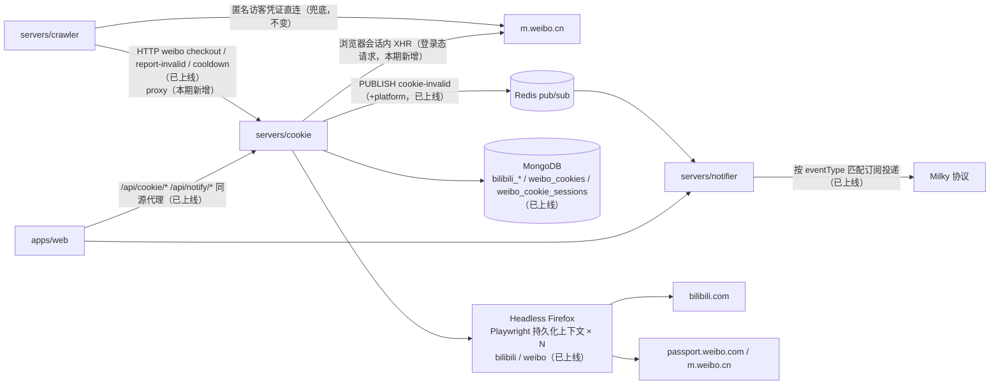
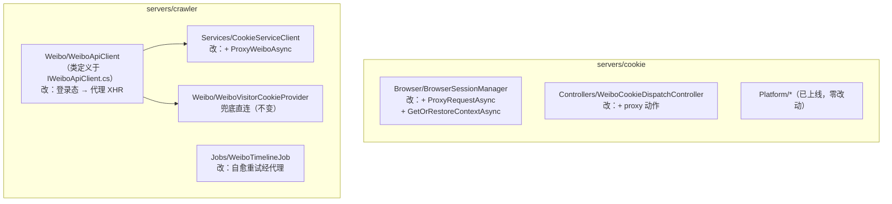
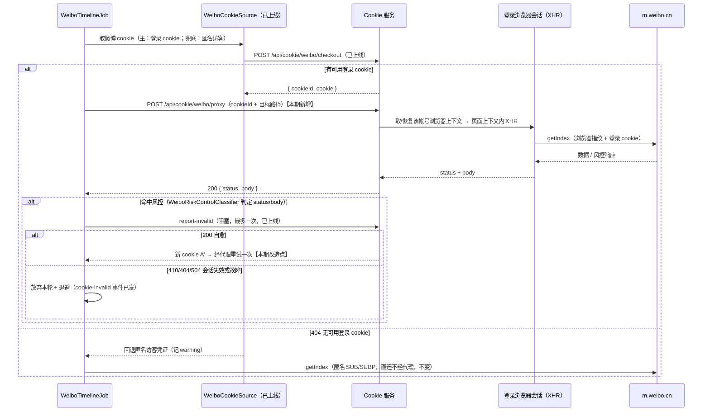

# 微博 Cookie 抓取（weibo-cookie-crawl）- 技术提案

- 日期：2026-09-13（v1.1 修订：2026-09-13；v1.2 修订：2026-09-14，实现前评审查缺补漏）
- 状态：待评审
- feat-branch：`feat/weibo-cookie-crawl`
- 关联文档：[PRD](../product/draft/20260913-weibo-cookie-crawl-prd.md)

> v1.2 变更（2026-09-14，实现前评审）：按 main 代码现状全面修订。v1.0 实现（cookie 服务多平台化、微博登录 cookie 取用/自愈、失效事件按平台拆分、前端双按钮）已全量合并上线，本提案范围收敛为**唯一剩余增量：cookie 服务代理 XHR 端点 + crawler 登录态请求改走代理 + 浏览器上下文重启恢复**。同时勘正 v1.1 中与现状不符的描述（现状综述、文件位置、锁 key、配置项、风控分类器能力、数据模型字段、部署卷），补充遗漏的受影响面（上下文恢复缺口、既有测试资产、apphost 浏览器目录无持久卷）。
>
> v1.1 变更（2026-09-13，下游联调打回）：微博登录态数据请求改为经 cookie 服务**代理 XHR 端点**在登录浏览器会话（页面上下文）内发起；crawler 不再直接携带 cookie 头请求 m.weibo.cn（匿名兜底路径除外）。

## 1. 概述

### 1.1 背景

现状（v1.0 已上线，详见代码）：

- **Cookie 服务已完成多平台化**：`Platform/ICookiePlatformProfile` + `BilibiliCookiePlatformProfile` / `WeiboCookiePlatformProfile`，经 `CookiePlatformContext` / `CookiePlatformRegistry` 聚合，weibo 侧以 keyed 注入（`AddKeyedSingleton("weibo", ...)`）；Mongo 并存 `bilibili_cookie_sessions` / `bilibili_cookies` 与 `weibo_cookie_sessions` / `weibo_cookies`；`/api/cookie/weibo/*` 平行端点组（accounts / available / checkout / report-invalid / cooldown）已上线（`WeiboCookieAccountController` / `WeiboCookieDispatchController`）；
- **crawler 微博链路已接入登录 cookie**：`WeiboLoginCookieProvider`（主：checkout + per-cookie 互斥，404 返回「无可用」信号不抛异常）、`WeiboVisitorCookieProvider`（兜底：匿名访客）、`WeiboCookieSource`（主/兜底组合）；`WeiboTimelineJob` 风控自愈分支（登录 cookie 命中 → report-invalid 200 重试一次 / 410/404/504 放弃 + 退避；匿名 → Renew + 退避）已就绪；配置 `WeiboCrawler:UseLoginCookie` / `LoginCookieRetryOnce`（默认均 true）已存在；
- **失效事件已按平台拆分**：`CookieInvalidEvent` 带 `platform` 字段，notifier dispatch 层映射 `bilibili_cookie_invalid` / `weibo_cookie_invalid`，存量订阅启动迁移（marker `cookie_invalid_platform_split_v1`）已上线；web「Cookie 管理」双按钮、平台列与通知类型下拉已上线。

**遗留痛点**：微博**登录态请求目前仍由 crawler 手工塞 `Cookie` 头直连** `m.weibo.cn/api/container/getIndex`（`servers/crawler/Weibo/IWeiboApiClient.cs`）。下游联调证实该方式过不了微博风控（缺浏览器指纹/同源上下文）——登录 cookie 取得到、用不出效果，是本期的核心问题。

**连带缺口**：cookie 服务的浏览器上下文缓存（`BrowserSessionManager._contexts`）仅在扫码创建会话时填充，进程重启后为空，保鲜/宣告刷新直接失败并把健康 session 误判 invalid——代理链路上线后该缺口将直接影响数据面，必须一并修复。

### 1.2 目标

1. cookie 服务新增**代理 XHR 端点**：在 cookieId 所属帐号的登录浏览器会话（页面上下文）内向微博发起请求并原样回传响应；白名单约束目标，不得成为开放代理；
2. crawler 微博**登录态数据请求全部改经代理端点**，不再直连微博登录态接口（匿名访客兜底路径维持直连不变）；
3. 补齐浏览器上下文**按需恢复**能力（代理、保鲜、宣告刷新共用），消除进程重启后会话不可用的既有缺口；
4. cookie 服务浏览器会话目录在编排中持久化，重启不丢登录会话。

### 1.3 范围

- **内**：`contracts/cookie.openapi.yaml` 新增 proxy 端点（并补 `AccountItem.cookieId` 字段声明，对齐既有实现）；cookie 服务 `BrowserSessionManager.ProxyRequestAsync` + 上下文按需恢复 + proxy 端点；crawler `CookieServiceClient.ProxyWeiboAsync`、`WeiboApiClient` 登录态分流、`WeiboTimelineJob` 自愈重试改走代理；apphost 浏览器会话目录挂卷；测试；
- **外**：已上线的 v1.0 能力零改动（bilibili 全链路、微博扫码/保鲜/事件/前端页面）；匿名访客兜底直连不变；代理池、UA 轮换等进阶风控手段后续迭代。

## 2. 技术架构

### 2.1 系统架构图



### 2.2 技术栈

全部复用既有栈，无新增依赖（Playwright 1.62 已在 cookie 服务引用）：

| 项 | 选型 | 说明 |
|---|---|---|
| cookie 服务 | 既有 Z.Vtuber.Cookie（.NET 10 + Playwright Firefox） | + 代理 XHR 端点 |
| crawler 微博链路 | 既有 `WeiboApiClient` / `WeiboTimelineJob` / `CookieServiceClient` | 登录态请求改走代理 |
| 契约 | `contracts/cookie.openapi.yaml` + openapi-typescript codegen | 与既有模式一致 |
| 存储 | 既有 MongoDB / Redis | 本期无模型变更 |
| 测试 | xUnit + Testcontainers（Mongo/Redis），浏览器层接口 mock | 沿用 `tests/Z.Vtuber.Tests` |

### 2.3 模块划分



注：`WeiboApiClient` 类定义在 `servers/crawler/Weibo/IWeiboApiClient.cs`（无独立 `WeiboApiClient.cs` 文件）；cookie 服务微博侧组件经 `CookiePlatformContext` / keyed 注入获取（AGENTS 约定：weibo 为 `AddKeyedSingleton("weibo", ...)`，bilibili 保持非 keyed 注册与行为不变）。

## 3. API 设计

### 3.1 cookie 服务契约扩展（`contracts/cookie.openapi.yaml`）

既有端点（`/api/cookie/*` bilibili 组与 `/api/cookie/weibo/*` 平行组，`AccountItem.platform` 字段）已全部上线，本期不改动。本期**唯一新增端点**：

| 端点 | 说明 |
|---|---|
| `POST /api/cookie/weibo/proxy` | 代理 XHR：在 cookieId 所属帐号的登录浏览器会话内向微博发起请求 → `200 { status, body }`（回传微博原始状态码与响应体）/ `400` 目标非白名单 / `404` cookieId 不存在或非 active / `410` 关联会话已失效 / `502` 浏览器侧请求失败 / `504` 超时 |

**代理 XHR 端点请求/响应约定**：

```json
// POST /api/cookie/weibo/proxy
// request
{ "cookieId": "<池记录 ObjectId>", "path": "/api/container/getIndex?containerid=..." }
// response 200
{ "status": 200, "body": "<微博原始响应文本>" }
```

- `path` 为目标 API 路径（含 query），**白名单约束**：仅允许 `m.weibo.cn` 的 `/api/*` 路径，其余一律 `400` 拒绝，端点不得成为开放代理；v1 仅支持 `GET`；
- 请求在 cookieId 所属帐号的登录浏览器会话内发起（页面上下文 XHR），自动携带该会话 cookie 与浏览器指纹；crawler 侧不再自行构造 cookie 头请求微博登录态接口；
- 微博业务响应（含风控响应如 403/412/跳转）一律以 `200 { status, body }` 原样回传，由 crawler 侧既有风控分类器统一判定；仅代理自身失败（白名单/寻址/会话失效/网络/超时）使用非 200 状态码。

**顺带修复既有契约漂移**：`CookieAccountController` 实际在 `AccountItem` 中返回了 `cookieId`，openapi 未声明。本期在契约 `AccountItem` 补上 `cookieId` 字段（仅补声明，无行为变更）。

### 3.2 notifier 契约（`contracts/notifier.openapi.yaml`）

eventType 拆分（`bilibili_cookie_invalid` / `weibo_cookie_invalid`）已上线，本期无改动。

### 3.3 内部接口

**Redis 事件契约**：`cookie-invalid` 频道与 `platform` 字段已上线，本期无改动。

**crawler → cookie 调用契约**：`CookieServiceClient` 已有 `CheckoutWeiboAsync` / `ReportWeiboInvalidAsync` / `CooldownWeiboAsync`；本期新增 `ProxyWeiboAsync(cookieId, path)` 返回 `{ status, body }`，代理侧 `410/502/504` 以专用异常/结果类型透出供风控分支区分处置（`404` 与 checkout 的「无可用」语义对齐）。

## 4. 数据模型

本期**无数据模型变更**。既有集合（v1.0 已上线，MongoDB 库 `zvtuber`）：

- `weibo_cookie_sessions`：复用 `CookieSessionRecord`（`Status` / `UserDataDir` / `Mid?` / `Uname?` / `CookieId?` / **`Cookie?`（session 记录冗余存 cookie 原文——勘正 v1.1 §4.1 漏记）** / `QrCodeImage?` / `CreatedAt` / `LastLoginAt` / `LastRefreshAt` / `ExpiresAt` / `ConsecutiveRefreshFailures`）；
- `weibo_cookies`：复用 `CookieRecord`（`Cookie` / `AccountId?` / `Status` / `CooldownUntil` / `LastCheckedAt` / `LastUsedAt` / `LastRefreshAt`）；
- `notification_subscriptions` 存量迁移已随 notifier 启动完成（幂等，marker `cookie_invalid_platform_split_v1`）。

## 5. 技术实现方案

### 5.1 核心流程

**微博时间线抓取（登录 cookie 经代理 XHR + 风控自愈）**——本期目标态：



微博扫码登录、定时保鲜、失效宣告、事件投递链路均已上线，流程不变（见 v1.0 提案与代码）。

### 5.2 关键实现点

#### 实现点 1: cookie 服务代理 XHR 端点（POST /api/cookie/weibo/proxy）

- **挂载**：在 `WeiboCookieDispatchController` 加动作或新增 `WeiboCookieProxyController`，实现期定夺；路由 `/api/cookie/weibo/proxy`；v1 仅支持 `GET`；
- **白名单校验**：`path` 必须以 `/api/` 开头且不得含 scheme/host/回溯符，目标 host 固定为 `https://m.weibo.cn`——非白名单直接 `400`，端点不得成为开放代理；
- **寻址**：`cookieId` → `weibo_cookies` 池记录（不存在/非 active → `404`）→ `AccountId` → 微博 session（`Status != active` → `410`，供 crawler 按会话失效处置）；微博侧 manager/仓储经 `CookiePlatformContext` 或 keyed 注入获取；
- **浏览器会话内发起 XHR**：`BrowserSessionManager` 扩展 `ProxyRequestAsync(accountId, path, ct)`——取该帐号的 Playwright 持久化上下文（缺失时按需恢复，见实现点 2），在页面上下文内执行 `fetch`（`page.EvaluateAsync`，同源相对 URL），回传 `{ status, body }`（body 取原始文本）；备选 `context.APIRequest`（共享 cookie jar，指纹弱于页内 XHR），取舍见决策 11；请求设明确超时上限（复用 `CookieServiceOptions` 既有超时档或新增项，实现期定夺），浏览器侧网络失败 → `502`、超时 → `504`；
- **串行约束**：同一帐号上下文的浏览器侧操作（保鲜/代理/宣告刷新/上下文恢复）经同一 per-session 串行机制执行，避免并发导航与 XHR 相互干扰；crawler 侧 `CookieCallGate` 已按 cookieId 互斥（锁 key 实际为 `cookie-call:{cookieId}`——勘正 v1.1 的 `lock:cookie-call:` 前缀误记）；
- **透传语义**：微博业务响应（含 403/412/跳登录等风控响应）一律 `200 { status, body }` 原样回传，风控判定留在 crawler 侧既有分类器；代理自身失败才用 4xx/5xx；
- **安全**：端点不接收/不返回 cookie 原文（仅 cookieId 寻址）；日志沿用短哈希惯例，不记录 body 中的敏感字段；仅服务内网调用方（crawler）。

#### 实现点 2: 浏览器上下文按需恢复（既有缺口修复）

- **现状缺口**：`_contexts`（`ConcurrentDictionary<accountId, IBrowserContext>`）仅在 `CreateLoginSessionAsync` 时填充，全仓库无第二条恢复路径；进程重启后 `_contexts` 为空，`RefreshSessionAsync` / 失效宣告直接抛「No browser context」，连续失败把健康 session 误判 invalid；
- **方案**：`BrowserSessionManager` 新增 `GetOrRestoreContextAsync(accountId, ct)`：缓存 miss 时，若 session 为 `active` 且 `UserDataDir` 存在，重新 `LaunchPersistentContextAsync` 恢复上下文（Playwright 持久化上下文的 `UserDataDir` 内含登录态 storage）；恢复失败按既有单次失败语义计数，不直接判失效；
- 保鲜、宣告刷新、代理统一改走该入口；与实现点 1 的 per-session 串行机制共用同一把锁，防止并发恢复/并发操作；
- 该修复同时惠及 bilibili 链路（同一 `BrowserSessionManager` 代码路径）——属缺陷修复，bilibili 对外行为语义不变。

#### 实现点 3: crawler 登录态改走代理 XHR

- `CookieServiceClient` 新增 `ProxyWeiboAsync(cookieId, path)`：`200` → `{ status, body }`；`410/502/504` 以专用异常/结果类型透出；
- `WeiboApiClient`（类在 `servers/crawler/Weibo/IWeiboApiClient.cs`）按凭证来源分流：**登录 cookie 路径 → `ProxyWeiboAsync(cookieId, path)` 经 cookie 服务代理取数**，不再自行构造 `Cookie` 头与 UA/`sec-ch-*`/`mweibo-pwa` 等手工头直连（页内 XHR 天然携带浏览器指纹与同源上下文）；**匿名访客路径维持既有直连构造不变**（含现有 UA/头与 `&.rnd=` 参数等既有细节，本期不触碰）；`IWeiboApiClient` 对外接口不变；
- `WeiboTimelineJob` 风控分支（整体已就绪，本期仅改重试路径）：登录 cookie 命中风控 → `ReportWeiboInvalidAsync` 阻塞宣告，`200` 拿新 cookie **经代理**重试一次（仅一次）；`410/404/504` → 放弃本轮 + `CrawlBackoffRegistry` 退避（维持现状）；代理返回 `410` → 按会话失效分支处置；`502/504` → 记退避、**不宣告 cookie 失效**；
- `WeiboRiskControlClassifier` **无需补充**——401/403、3xx 跳 `passport.weibo.com` 与 `login.sina.com.cn`、`ok != 1`、msg 关键词、「预期 JSON 却返回非 JSON」等特征均已具备（勘正 v1.1 实现点 4 的过时描述）；
- **配置**：`WeiboCrawler:UseLoginCookie` / `LoginCookieRetryOnce` 已存在（默认均 `true`），本期**无新增配置项**（勘正 v1.1 实现点 7）；接入登录 cookie 不提高请求频率（抓取间隔/退避参数不变）。注：PR#91 后 job 不再推进 `since_id`、有新增落库即停止翻页，登录 cookie 切换不改变该行为。

#### 实现点 4: apphost 浏览器会话目录持久化

- 现状：`infra/apphost` 将 `CookieService:BrowserSessionDataDir` 指向临时目录（`Path.GetTempPath()/z-vtuber-browser-sessions`，无数据卷），重启即丢全部浏览器会话——v1.0 下表现为重启后需重新扫码；代理链路上线后该问题直接影响数据面（勘正 v1.1 §9.1「`/data/browser-sessions` 卷」的描述：该值仅为 `CookieServiceOptions` 默认值，编排中并未生效）；
- 方案：编排中为 cookie 服务浏览器会话目录挂数据卷（Aspire 卷或具名绑定），生产部署同理。

### 5.3 已完成事项（v1.0，已上线，本期零改动）

- cookie 服务平台抽象（`Platform/ICookiePlatformProfile` + 双 Profile + `CookiePlatformContext`/`CookiePlatformRegistry`）、微博集合与索引、`/api/cookie/weibo/*` 端点组（accounts/available/checkout/report-invalid/cooldown）；
- crawler `WeiboLoginCookieProvider` / `WeiboCookieSource`、`CookieServiceClient` 微博方法组（checkout/report-invalid/cooldown）、`WeiboTimelineJob` 风控分支骨架、`WeiboCrawler:UseLoginCookie`/`LoginCookieRetryOnce` 配置；
- `CookieInvalidEvent.platform`、notifier eventType 拆分与存量订阅迁移；
- web 双按钮、平台列、通知类型下拉、微博 cookie 客户端函数。

## 6. 技术决策

### 6.1 决策列表

**已落地决策（v1.0，已随实现上线，简述备查）**：

1. 复用 cookie 服务做多平台化（Profile 抽象）而非新建 weibo-cookie 服务；
2. 契约新增 `/api/cookie/weibo/*` 平行端点，bilibili 端点保持原样；
3. Mongo 并行集合（`weibo_cookies` / `weibo_cookie_sessions`），bilibili 集合零迁移；
4. 失效事件复用单频道 `cookie-invalid` + `platform` 字段，eventType 拆分在 notifier dispatch 层完成；
5. 存量 `cookie_invalid` 订阅迁移为 `bilibili_cookie_invalid`（幂等 updateMany）；
6. 微博登录态检测以 `m.weibo.cn/api/config` 的 `data.login` 为准；
7. 匿名访客凭证保留为兜底（`UseLoginCookie` 可整体回退）；
8. 风控命中登录 cookie 走 report-invalid 阻塞自愈，重试仅一次；
9. 接入登录 cookie 不提高对微博接口的请求频率。

**本期决策**：

10. **微博登录态数据请求经 cookie 服务代理 XHR（浏览器会话内发起），crawler 不直连**（v1.1 确立，本期执行）：下游联调证实仅携带 cookie 头的服务端 HTTP 请求过不了微博风控（缺浏览器指纹/同源上下文）；在登录浏览器会话页面内发 XHR 天然携带指纹、cookie 与同源上下文，且复用已常驻的保鲜上下文，零新增基础设施。代价是数据链路依赖浏览器会话可用性——以 `410/502/504` 明确区分「会话失效/浏览器故障/超时」供 crawler 区别处置，匿名直连兜底保留；代理端点以白名单（`m.weibo.cn/api/*`）约束目标，防止成为开放代理。
11. **代理请求在页面上下文内 `fetch`（`page.EvaluateAsync`），而非 `context.APIRequest`**：页内 XHR 携带完整浏览器指纹与同源上下文，正是过风控的关键；`APIRequest` 共享 cookie jar 但指纹弱，仅作实现期降级备选。代价是页内执行与导航类操作互斥——以 per-session 串行约束消化。
12. **浏览器上下文按需惰性恢复，而非仅在启动时批量恢复**：进程重启/上下文崩溃后首次使用时恢复，保鲜/宣告/代理三路径共用同一入口与同一把 per-session 锁；恢复以 session `active` + `UserDataDir` 存在为前提，恢复失败按既有单次失败计数，不直接判失效。
13. **浏览器会话目录挂持久卷**：代理数据面依赖持久化会话，临时目录方案在代理链路上不可接受；编排层修复，应用代码零改动。

### 6.2 依赖与约束

- 浏览器会话按帐号相互隔离，禁止多帐号共用；微博与 Bilibili 的 cookie 池、会话状态、互斥锁按平台隔离（锁 key 带平台段）；
- 代理 XHR 与保鲜/宣告共享同一浏览器上下文，同一帐号的浏览器侧操作必须串行化；
- 宣告失效接口阻塞语义不变；代理 XHR 端点有明确超时上限，不长期悬挂；
- 代理 XHR 端点仅服务内网调用方（crawler），目标白名单约束，不暴露公网；
- cookie 原文不出服务边界（checkout 响应除外），日志沿用短哈希惯例；
- 接入登录 cookie 不得提高对微博接口的请求频率；
- 微博帐号触发二次验证（短信/滑块）等人工事项维持 v1.0 处理（超时过期）。

## 7. 项目结构

本期增量（其余为已上线代码，不改动）：

```
contracts/
└── cookie.openapi.yaml                       # 改：+ POST /api/cookie/weibo/proxy；AccountItem 补 cookieId 声明

servers/cookie/（增量）
├── Controllers/WeiboCookieDispatchController.cs    # 改：+ proxy 动作（或新增 WeiboCookieProxyController）
└── Browser/BrowserSessionManager.cs                # 改：+ ProxyRequestAsync、+ GetOrRestoreContextAsync

servers/crawler/（增量）
├── Services/CookieServiceClient.cs                 # 改：+ ProxyWeiboAsync
├── Weibo/IWeiboApiClient.cs                        # 改：登录态路径改经代理（WeiboApiClient 类所在文件）
└── Jobs/WeiboTimelineJob.cs                        # 改：自愈重试经代理

infra/apphost/
└── AppHost.cs                                      # 改：cookie 服务浏览器会话目录挂数据卷

apps/web/
└── src/api/schema-cookie.d.ts                      # codegen 再生成（勿手改）

tests/Z.Vtuber.Tests/                               # 新增代理/恢复用例；既有用例保持绿
```

## 8. 测试策略

### 8.1 测试覆盖要求

核心逻辑覆盖率 ≥ 80%（common-rules）；浏览器交互层经接口 mock，不依赖真实 Firefox 跑单测。

### 8.2 测试类型

- **保持绿的既有资产**：`WeiboCookieDispatchTests`、`WeiboCookieAccountControllerTests`、`WeiboCookieReportInvalidTests`、`WeiboLoginCookieProviderTests`、`WeiboCookieSource` 用例、`WeiboApiClientTests`、`WeiboTimelineJobTests`、`CookieInvalidEventTypeSplitMigrationTests` 等；
- **新增单元测试**：
  - proxy 端点：白名单放行/拒绝（含 scheme/host/回溯符变体）、cookieId 寻址 404、会话失效 410、`{ status, body }` 透传（mock 浏览器层）、per-session 串行约束、超时 → 504 / 网络失败 → 502 映射；
  - `GetOrRestoreContextAsync`：缓存命中不重建、miss + active + UserDataDir 存在则恢复、非 active 不恢复、恢复失败按单次失败计数；
  - `CookieServiceClient.ProxyWeiboAsync`：200 透传、410/502/504 分类透出；
  - `WeiboApiClient`：登录 cookie 路径走 `ProxyWeiboAsync`（断言不直连微博）、匿名路径直连不变；
  - `WeiboTimelineJob`：自愈成功后经代理重试一次、代理 410 → 会话失效分支、502/504 → 退避不宣告；
- **集成测试**（Testcontainers Mongo + Redis）：proxy 端点寻址与状态映射端到端（浏览器层 mock）；
- **前端**：契约再生成后类型对齐，无页面行为变更（既有页面测试保持绿）；
- **手工验证**：真实微博帐号扫码登录 → 代理请求时间线 → 风控自愈全链路；重启 cookie 服务后代理/保鲜自动恢复上下文（验证挂卷与惰性恢复）；bilibili 全链路回归。

## 9. 部署方案

### 9.1 环境规划

- 无新服务、无新容器；cookie / crawler 镜像随正常发布更新；
- cookie 服务浏览器会话目录按本期实现点 4 挂数据卷（编排层变更）；帐号规模预期为个位数，资源占用与现状同量级。

### 9.2 配置管理

- 本期无新增配置项；存量部署零配置变更即可运行（无可用微博帐号时自动走匿名兜底）。

## 10. 验收标准

- [ ] `POST /api/cookie/weibo/proxy` 白名单生效（非 `m.weibo.cn/api/*` 目标 400）；业务响应 `{ status, body }` 原样透传；cookieId 寻址 404、会话失效 410、浏览器故障 502、超时 504 语义正确；
- [ ] 存在可用微博登录 cookie 时，时间线抓取的登录态请求全部经代理端点完成（crawler 不再直连微博登录态接口）；风控命中经 report-invalid 自愈后经代理重试一次，仍失败则放弃本轮并退避，不产生请求风暴；
- [ ] 无可用登录 cookie 时回退匿名访客直连，抓取不中断且有可观测的告警日志；
- [ ] cookie 服务进程重启后，active 会话的浏览器上下文按需恢复，代理与保鲜链路自动可用；
- [ ] 同一帐号的代理/保鲜/宣告/恢复串行执行，无并发上下文操作；
- [ ] cookie 服务浏览器会话目录在编排中持久化，重启不丢会话；
- [ ] bilibili 链路、微博扫码/保鲜/事件/前端既有行为零回归，既有测试全绿；
- [ ] 单测 + 集成测试通过，核心逻辑覆盖率 ≥ 80%。

## 11. 相关文档

- PRD：`docs/product/draft/20260913-weibo-cookie-crawl-prd.md`
- 前置提案：`docs/engineering/proposals/20260911-proposal-cookie-service.md`（Cookie 服务）
- 前置提案：`docs/engineering/proposals/20260909-proposal-weibo-crawler.md`（微博时间线抓取现状）
- 前置提案：`docs/engineering/proposals/20260904-proposal-cookie-invalid-notification.md`（失效事件链路）
