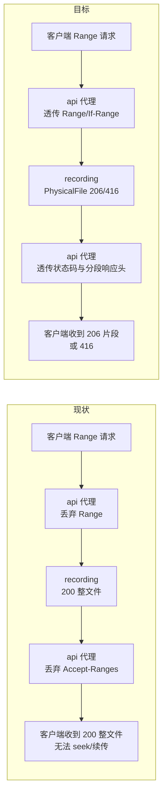
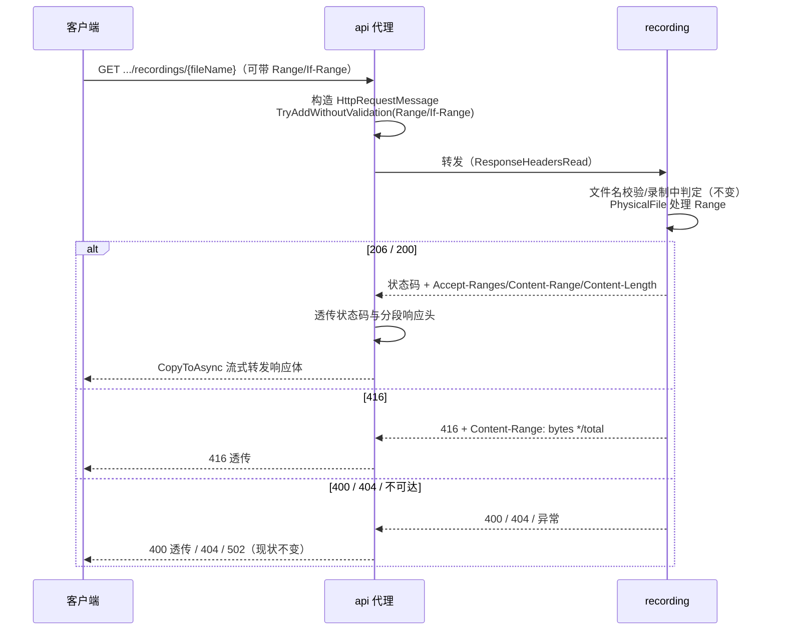

# 录播文件下载支持 Range - 技术提案

- 日期：2026-09-14
- 状态：待评审
- feat-branch：`feat/recording-download-range`
- 关联文档：[PRD](../product/draft/20260914-recording-download-range-prd.md)

## 1. 概述

### 1.1 背景

录播下载链路现状（自外向内）：

- **api 代理** `BilibiliLiveRecordingController.DownloadRecording`（`servers/api/Controllers/BilibiliLiveRecordingController.cs:126-182`）：以 `HttpCompletionOption.ResponseHeadersRead` 流式代理 recording 下载；**不转发请求的 `Range` 头**；响应仅透传 `Content-Type` 与 `Content-Disposition`，丢弃 `Accept-Ranges`/`Content-Range`/`Content-Length`；非成功状态仅特判 404 与 400，其余归并 502；
- **recording 服务** `RecordingController.DownloadRecording`（`servers/recording/Controllers/RecordingController.cs:70-99`）：平文件名校验 → 路径穿越防护 → 录制中 400 判定 → `PhysicalFile(..., enableRangeProcessing: true)`。**录播服务本身已原生支持 Range**（ASP.NET Core 处理 206/416/`Accept-Ranges`），即 Range 能力在代理层被截断。

结论：本需求本质是**打通 api 代理层的 Range 透传**，recording 侧仅需补齐契约与回归测试。

### 1.2 目标

1. api 代理转发 `Range`/`If-Range` 请求头至 recording；
2. api 代理原样透传 200/206 状态码与 `Accept-Ranges`/`Content-Range`/`Content-Length` 响应头；
3. api 代理新增 416 透传分支（不得归并为 502）；
4. 两份契约同步声明 Range 语义；补充测试。

### 1.3 范围

- **内**：`contracts/recording.openapi.yaml`、`contracts/bilibili-crawler.openapi.yaml`；api `BilibiliLiveRecordingController.DownloadRecording` 代理改造；recording 下载端点回归测试；api 代理 Range 透传测试；
- **外**：录制流程与状态上报；列表接口；音频流接口；web 端（无变更）；多重区间（multipart/byteranges，框架不支持时按标准回退 200 整文件）。

## 2. 技术架构

### 2.1 现状与目标对比



### 2.2 技术栈与归属

| 项 | 归属 | 说明 |
|---|---|---|
| Range 解析与分段响应 | `servers/recording` | 复用 ASP.NET Core `PhysicalFile(enableRangeProcessing: true)`，已实现 |
| Range 透传 | `servers/api` | `DownloadRecording` 改造（本需求唯一代码改动点） |
| 契约 | `contracts/` | 两份 OpenAPI 先行 |
| 测试 | `tests/Z.Vtuber.Tests` | 沿用 xUnit 既有录播测试设施 |

### 2.3 关键设计：代理层透传语义

api 代理从「仅透传响应体」升级为「透传请求 Range 头 + 透传状态码与分段响应头」：

```
请求侧：客户端 Range / If-Range → 原样附加到上游 HttpRequestMessage
响应侧：
  上游 200 → 200，透传 Accept-Ranges / Content-Length（如有）
  上游 206 → 206，透传 Content-Range / Accept-Ranges / Content-Length
  上游 416 → 416，透传 Content-Range（bytes */total）
  上游 400 → 400 透传响应体（现状不变）
  上游 404 → 404（现状不变）
  其他非成功 → 502（现状不变）
```

- 不带 Range 的旧客户端：上游恒返回 200，代理行为与现状一致，仅多出 `Accept-Ranges` 头（能力宣告，无害）；
- `Content-Length` 透传后仍按 `CopyToAsync` 流式写响应体，不整文件缓冲；
- 多重区间：ASP.NET Core Range 处理仅支持单区间，多区间请求按标准回退 200 整文件——代理无需特判，透传即可。

## 3. API 设计

### 3.1 契约变更（先行）

**`contracts/recording.openapi.yaml`** — `GET /api/{roomId}/recordings/{fileName}`：

- 新增可选请求头参数：

```yaml
- name: Range
  in: header
  required: false
  description: 字节区间请求（如 bytes=0-1023）；仅支持单区间，多区间回退 200 整文件
  schema:
    type: string
- name: If-Range
  in: header
  required: false
  description: 条件 Range（实体标记或日期），校验失败回退 200 整文件
  schema:
    type: string
```

- `200` 响应补充头部 `Accept-Ranges: bytes` 与描述「不带 Range 时返回完整文件」；
- 新增响应：

```yaml
"206":
  description: 部分内容（Range 请求成功）
  headers:
    Content-Range:
      schema:
        type: string
      description: bytes <start>-<end>/<total>
    Accept-Ranges:
      schema:
        type: string
  content:
    application/octet-stream:
      schema:
        type: string
        format: binary
"416":
  description: 区间无法满足（Range 越界）
  headers:
    Content-Range:
      schema:
        type: string
      description: bytes */<total>
```

**`contracts/bilibili-crawler.openapi.yaml`** — `/api/b/live/{roomId}/recordings/{fileName}` 同步上述变更（Range/If-Range 参数、200 补 Accept-Ranges、新增 206/416）。

### 3.2 端点行为矩阵

| 场景 | recording | api（代理后） |
|---|---|---|
| 无 Range | 200 整文件 + Accept-Ranges | 200 透传 + Accept-Ranges（现状行为 + 头部增强） |
| 单区间合法 | 206 + Content-Range | **206 透传（本次打通）** |
| 区间越界 | 416 + Content-Range: bytes */total | **416 透传（本次新增分支）** |
| 多区间 | 200 整文件（框架回退） | 200 透传 |
| 录制中文件 | 400 `{error}` | 400 透传（现状） |
| 文件不存在 | 404 | 404（现状） |
| 非法文件名 | 400 `{error}` | 400 透传（现状） |
| recording 不可达 | — | 502（现状） |

## 4. 数据模型

无持久化模型变更，无新增 DTO。

## 5. 技术实现方案

### 5.1 核心流程



### 5.2 关键实现点

#### 实现点 1: api 代理请求头转发

- `DownloadRecording` 由 `client.GetAsync(url, ...)` 改为显式构造 `HttpRequestMessage(HttpMethod.Get, url)`：
  - 从 `Request.Headers` 读取 `Range`、`If-Range`，经 `requestMessage.Headers.TryAddWithoutValidation` 附加（跳过严格格式校验，格式非法时由上游按标准忽略该头）；
  - 以 `SendAsync(request, HttpCompletionOption.ResponseHeadersRead, ct)` 发送，保留 `Uri.EscapeDataString(fileName)` 与现有 404/400/502 分支；
  - 沿用 `using` 释放与现有超时/异常映射（`HttpRequestException`/非取消 `TaskCanceledException` → 502）。

#### 实现点 2: api 代理响应透传

- 成功分支（200/206，均满足 `IsSuccessStatusCode`）：
  - `Response.StatusCode = (int)response.StatusCode`（200 或 206 原样）；
  - 透传响应头：`AcceptRanges`（`response.Headers`）、`ContentRange`、`ContentLength`（`response.Content.Headers`）、既有 `ContentType`/`ContentDisposition`；
  - 响应体仍 `CopyToAsync` 流式转发（内存占用不变）；
- 新增 416 分支：置于 400 分支旁——`Response.StatusCode = 416`，透传 `Content-Range` 头后返回空体；
- 其余非成功状态归并 502（不变）。

#### 实现点 3: recording 侧回归保障

- 代码零改动（`enableRangeProcessing: true` 已在位）；补接口测试锁定行为，防止后续重构回退该参数。

### 5.3 不在本期的事项

- ETag/If-None-Match 条件请求与缓存协商：`PhysicalFile` 自带 Last-Modified/ETag，但本期仅承诺 Range/If-Range 透传，缓存策略另立需求；
- 多区间 multipart 响应：框架不支持，按标准回退整文件；
- web 端改造：下载 URL 不变，浏览器/播放器自动受益。

## 6. 技术决策

### 6.1 决策列表

1. **代理透传而非 api 自行实现 Range**：Range 解析/文件随机读权威在 recording（持有存储与 `PhysicalFile` 能力），api 只做协议透传，职责单一、无重复实现；
2. **recording 复用 `PhysicalFile` 框架能力，不手写分段**：框架已正确处理单区间解析、416、`Accept-Ranges`、`If-Range` 与多区间回退，手写只会引入边界缺陷；
3. **`TryAddWithoutValidation` 转发 Range/If-Range**：强类型头解析会拒绝部分合法但非常规的取值并抛错；按原样透传、由上游框架判定语义更符合代理角色；
4. **416 单独透传而非归并 502**：416 是客户端可处理的业务语义（区间越界），归并为 502 会误导客户端重试与告警口径；
5. **透传 `Content-Length`**：分段响应长度远小于整文件，透传使客户端进度显示与校验正确；`CopyToAsync` 转发字节数与上游一致，头值不失真。

### 6.2 依赖与约束

| 类型 | 内容 | 说明 |
|------|------|------|
| 依赖 | ASP.NET Core `PhysicalFile(enableRangeProcessing)` | 已在 recording 使用 |
| 约束 | 契约先行 | 先提交契约变更，再改实现 |
| 约束 | 无新增 NuGet/npm 依赖 | — |
| 约束 | 不改录制流程与 web | — |

## 7. 项目结构

```
contracts/（变更）
├── recording.openapi.yaml                 # 下载端点 Range/If-Range 参数 + 206/416 + Accept-Ranges
└── bilibili-crawler.openapi.yaml          # 代理端点同步

servers/api/（变更）
└── Controllers/BilibiliLiveRecordingController.cs  # DownloadRecording 透传 Range/状态码/分段响应头 + 416 分支

servers/recording/（无代码变更）
└── Controllers/RecordingController.cs     # enableRangeProcessing: true 已在位

tests/Z.Vtuber.Tests/（变更）
├── RecordingApiTests.cs                   # recording 直连：206/416/无 Range 回归
└── BilibiliLiveRecordingControllerTests.cs # 代理：Range 转发、206/416 透传、旧行为不回归
```

## 8. 测试策略

### 8.1 测试覆盖要求

核心逻辑覆盖率 ≥ 80%（common-rules）；TDD：先写失败测试再实现。

### 8.2 测试类型

- **api 代理测试**（`BilibiliLiveRecordingControllerTests`，既有 fake HttpClient 设施）：
  - 带 `Range` 请求 → 上游请求收到相同 Range 头；
  - 上游 206 → 代理 206，`Content-Range`/`Accept-Ranges`/`Content-Length` 透传，响应体为片段；
  - 上游 416 → 代理 416 且 `Content-Range` 透传（不归并 502）；
  - 上游 200 → 200，`Accept-Ranges` 透传；
  - 回归：上游 400/404、不可达 502 行为不变；
- **recording 接口测试**（`RecordingApiTests`，既有设施）：
  - 预置录播文件，`Range: bytes=0-99` → 206，响应体恰为前 100 字节，`Content-Range` 与文件大小一致；
  - 起始位置越界 → 416；无 Range → 200 完整文件；
  - 回归：录制中 400、不存在 404、非法文件名 400；
- **契约**：codegen 产物与契约一致性由构建保证（既有流程）。

## 9. 部署方案

- 随常规版本发布：api 与 recording 同版本滚动更新。兼容性天然成立——新 api 对旧 recording 转发 Range 头会被旧上游忽略（`PhysicalFile` 参数早已在位，实际无旧版窗口），旧客户端不带 Range 行为不变；
- 无数据迁移、无配置变更；回滚按整体版本回退即可。

## 10. 验收标准

- [ ] 带 `Range` 请求经 api 代理返回 206，`Content-Range`/`Accept-Ranges`/`Content-Length` 正确，响应体为对应字节片段；
- [ ] 区间越界经 api 代理返回 416 且携带 `Content-Range: bytes */<total>`；
- [ ] 不带 Range 请求行为不变（200 完整文件），响应携带 `Accept-Ranges: bytes`；
- [ ] 录制中 400、不存在 404、非法文件名 400、不可达 502 行为不回归；
- [ ] 两份 OpenAPI 契约同步更新；单测/接口测试通过，核心逻辑覆盖率 ≥ 80%。

## 11. 相关文档

- PRD：`docs/product/draft/20260914-recording-download-range-prd.md`
- 录播功能技术提案：`docs/engineering/proposals/20260913-proposal-live-recording.md`
- 录播列表元信息提案：`docs/engineering/proposals/20260914-proposal-recording-file-list-metadata.md`
